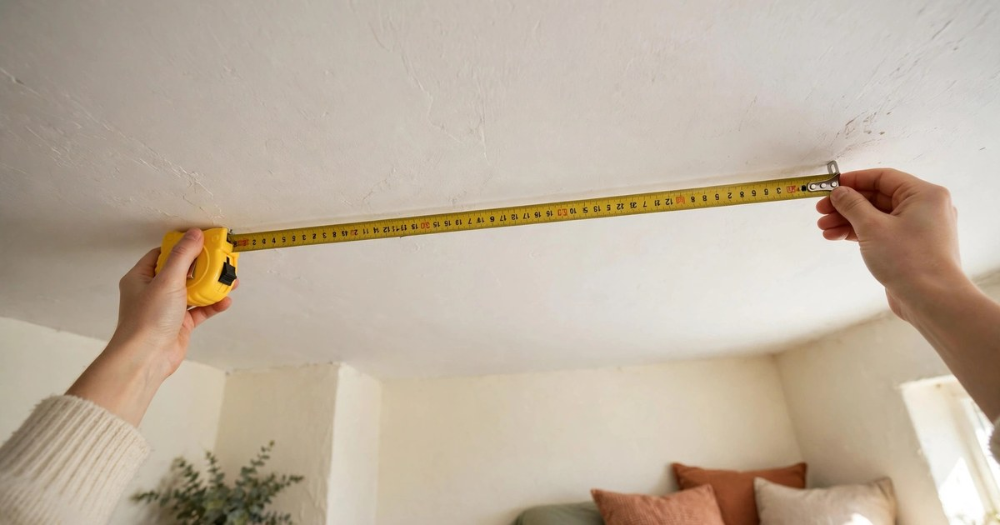
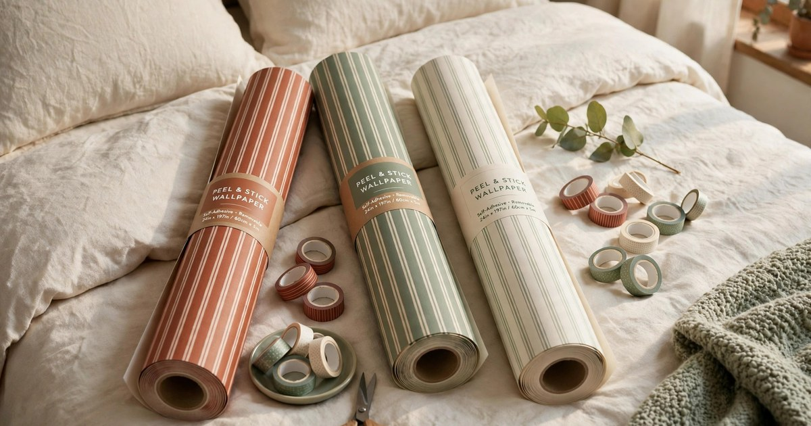
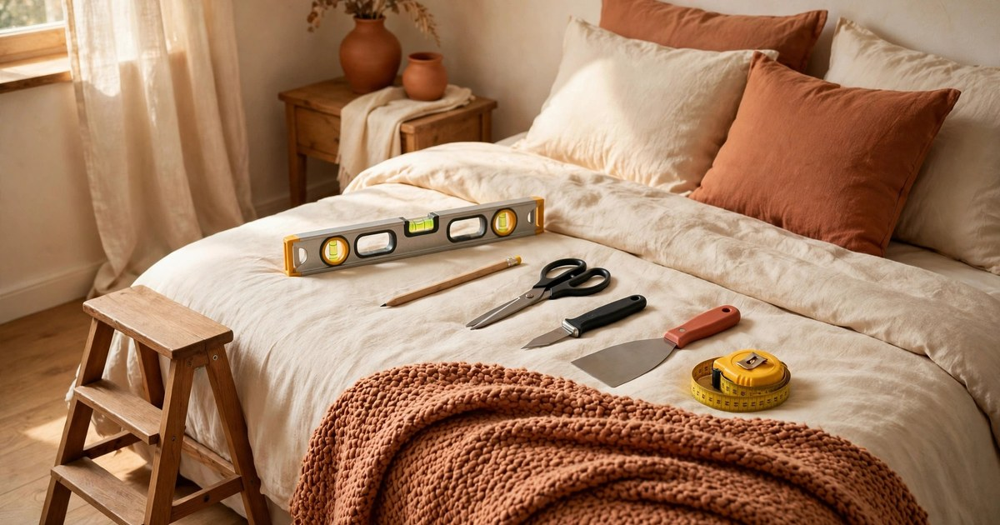
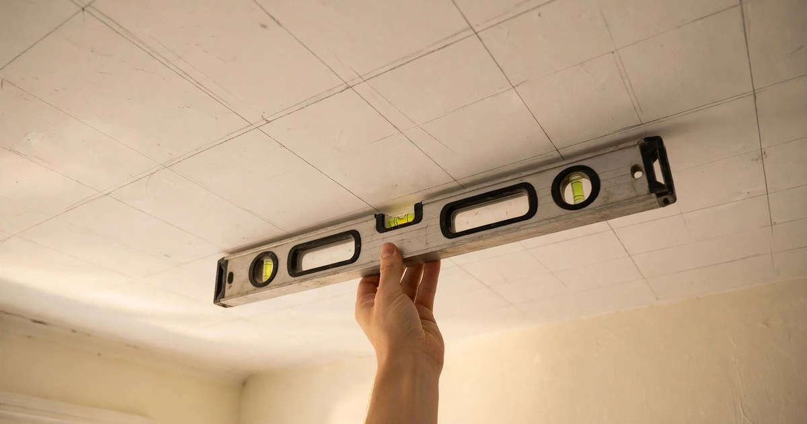
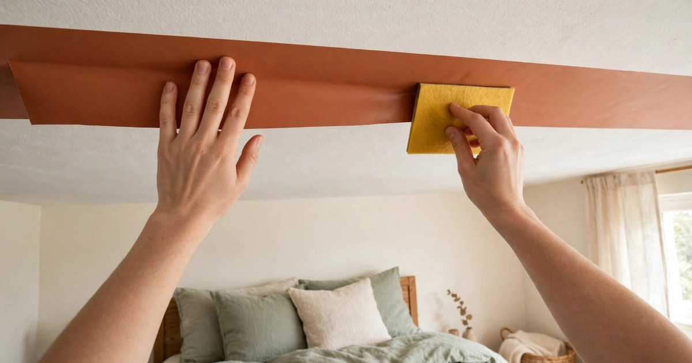
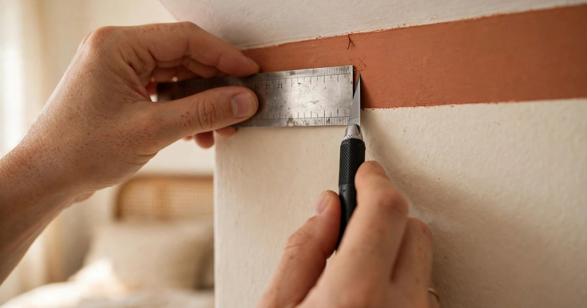

A striped ceiling is the single most dramatic thing you can do to a small rental bedroom — and, if you do it right, the most reversible. Pinterest Predicts 2026 flagged the striped ceiling as a breakout FunHaus trend, with searches for bold striped ceilings up 40% year on year, and it is easy to see why. Stripes pull the eye upward, make a low ceiling feel taller, and turn a plain white box into a room with a point of view. In a rental, where you cannot pick up a paintbrush without risking your deposit, peel-and-stick stripes deliver that same high-impact look for a fraction of the cost of paint — and they come off cleanly when your lease ends.

This guide walks you through the whole job, from measuring and choosing materials to sticking the final stripe and removing everything on move-out day. The total cost for a typical small bedroom comes in under £40, the job takes one relaxed afternoon, and you need no specialist skills — just a steady hand, a tape measure and a little patience. Every step is renter-friendly and damage-free, so your landlord will never know the stripes were there.

### Step 1. Measure your ceiling and plan the stripe layout

Before you buy anything, measure the ceiling properly. In a small bedroom this is a quick job: measure the length and the width in two places each, because rental ceilings are rarely perfectly square, and note the longer dimension. Stripes look best when they run along the longest wall of the room, which draws the eye down the length of the bed and makes the room feel longer. Divide your ceiling width by the stripe width you want — 15 to 20 centimetres is a comfortable scale for a small room — and you will know exactly how many stripes you need and whether you will end with a full or partial stripe at each edge.

Sketch the layout on a piece of paper before you commit. The classic approach is to start with a full stripe at the centre of the ceiling and work outward to the walls, so the two partial stripes at the edges match each other and the pattern looks deliberate rather than accidental. If your ceiling has a light fitting, plan for it too: either centre a stripe on the fitting or leave a neat gap around the rose, and mark that spot on your sketch. A ten-minute planning session now saves you from peeling up a wonky stripe later, and it tells you exactly how much material to buy — measure twice, order once.

### Step 2. Choose the right removable material for your ceiling

Not every peel-and-stick product suits a ceiling. Your best option is removable peel-and-stick wallpaper sold in narrow rolls or pre-cut stripe lengths — it is made to come off cleanly and it holds its own weight overhead. Washi tape is a cheaper, lighter alternative that works beautifully for narrow stripes or a subtle tone-on-tone effect, though it suits smooth ceilings better than textured ones. Avoid anything labelled permanent, any product that needs paste, and vinyl decals meant for walls, which can sag or leave residue when stuck overhead for months.

Order a little more than your measurements suggest — one extra roll or a spare length of tape covers mistakes and the inevitable off-cut around the light fitting. If you are unsure about adhesion, test a small piece in a corner of the ceiling and leave it for 24 hours before committing to the full job. That single test tells you whether your ceiling paint will hold the stripes and whether removal will be clean. For more on choosing renter-safe wall coverings, our guide to [temporary wallpaper for renters](/temporary-wallpaper-renters/) covers adhesion, removal and which surfaces to avoid in detail.

### Step 3. Gather your tools and prep the ceiling surface

You do not need a professional toolkit. Gather a sturdy step ladder or small platform, a long spirit level or a laser level if you have one, a tape measure, a sharp craft knife and a metal ruler, a pencil, a smoothing tool or an old credit card, and a clean dry cloth. A second pair of hands helps enormously when you are handling long lengths overhead, so rope in a friend or flatmate for the sticking stage if you can. Total tool cost is close to nothing if you already own the basics, and everything here is useful for future renter projects too.

Preparation is the unglamorous step that decides whether your stripes stay up for a year or peel off in a week. Wipe the ceiling with a dry cloth to remove dust and cobwebs, paying attention to the corners where dust gathers. If the ceiling is greasy — common above a bed in a room where candles are burned — wipe it with a barely damp cloth and a drop of mild washing-up liquid, then let it dry completely before you start. Never stick stripes to a damp or freshly painted ceiling. Finally, mark your centre line and stripe edges lightly in pencil, using the spirit level to keep the lines true. Those faint pencil guides are your roadmap for the whole job.

### Step 4. Mark your guide lines and cut the first stripe

With your layout sketched and your tools ready, transfer the plan onto the ceiling. Start at the centre line you marked in Step 3 and work outward, marking each stripe edge with a light pencil line. Use the spirit level along the full length of each line — a stripe that drifts by even a centimetre at one end will be glaringly obvious once the whole ceiling is done. If you have a laser level, set it up on the floor pointing upward and use the projected line as your guide; it is faster and steadier than a spirit level for long runs.

Cut your first stripe a few centimetres longer than the ceiling length so you have trimming allowance at both ends, and unroll it flat before you start peeling. For peel-and-stick wallpaper, peel back just the first 15 centimetres of backing paper and fold it under, so you can position the leading edge precisely before committing. For washi tape, unroll the full length and let it hang straight for a moment so any curl relaxes. Cutting and positioning this first stripe slowly is the whole secret of the job: get this one right and every stripe after it simply follows the same line.

### Step 5. Apply the stripes one by one, smoothing as you go

Stand on the ladder at one end of the ceiling, line the leading edge of your first stripe up with the pencil guide and the wall edge, and press it into place with the flat of your hand. Work in short sections — about 30 centimetres at a time — peeling the backing away gradually as you move along the stripe, and smoothing each section firmly with the smoothing tool or a credit card wrapped in a soft cloth. Press from the centre of the stripe outward to push out air bubbles before they get trapped. If a bubble does appear, lift the stripe gently back to the bubble and re-smooth rather than pricking it.

Keep going stripe by stripe, checking each new one against your pencil lines and against its neighbour. Small gaps between stripes are far more noticeable overhead than on a wall, so butt the edges up snugly without overlapping — an overlap creates a ridge that catches the light and shows up in every photograph. Take a break every two or three stripes to step down, stand at the bedroom door and look at the ceiling from a normal viewing angle. That distance check is how you catch a drifting line before it becomes a problem. For a small bedroom this stage takes about an hour, and it is the most satisfying part of the whole project.

### Step 6. Trim the edges and finish around the light fitting

Once all the stripes are up, trim the overhang at each end. Hold the metal ruler flat against the wall-ceiling joint, run the craft knife along it in one smooth stroke, and peel away the excess. A sharp blade matters here — a blunt knife tears the material and leaves a ragged edge, so change the blade if it starts dragging. Work slowly and keep your fingers well clear of the cutting line; the ceiling joint hides small imperfections well, but a clean cut still looks far better.

The light fitting needs the same careful treatment. If your stripes run underneath a ceiling rose, mark the outline of the rose on the stripe, cut an X across the marked area with the craft knife and fold the flaps back behind the rose. If you have a pendant light, cut a neat circle or a small slit so the flex passes through, and press the stripe flat around it. Never cover a light fitting entirely, and never let strips dangle near a bare bulb. When the trimming is done, run the smoothing tool over every stripe one final time, pressing the edges firmly so nothing lifts at the corners. Step back and enjoy it — the room should already feel completely different.

### Step 7. Style the room and plan your damage-free removal

A striped ceiling changes the whole balance of the room, so let it lead your styling. Keep the walls calm — plain cream or soft sage bedding, a terracotta throw and one or two warm-toned cushions pick up the stripe colours without competing with them. If your stripes are bold, keep the rest of the room quiet; if they are tone-on-tone, you can afford a stronger accent elsewhere. A low bed frame and simple bedding work best, because they leave the ceiling as the star. If you want more seasonal styling ideas for the same room, our roundup of [small apartment Christmas bedroom decor ideas](/small-apartment-christmas-bedroom-decor-ideas/) shows how to layer festive touches over a bold ceiling without overwhelming it.

Removal is the part renters worry about most, and it is the easiest step of all. When your lease ends, warm each stripe gently with a hairdryer on its lowest setting for 20 to 30 seconds, then peel slowly from one corner at a low angle. The heat softens the adhesive so the stripe lifts cleanly without taking paint with it. If any residue remains, roll it off with your thumb or wipe it with a damp cloth and a drop of washing-up liquid — never scrape with a blade. Do a final check with your landlord's inventory photos in hand, touch up nothing, and your deposit stays safe. That is the beauty of this project: a full FunHaus transformation for under £40, enjoyed for a year or more, and gone without a trace on moving day.

## Frequently Asked Questions

### Will peel-and-stick stripes damage my rental ceiling?

No, provided you choose a genuinely removable product and test a small piece first. Peel-and-stick wallpaper and washi tape are designed to lift cleanly from painted plaster, and warming the adhesive with a hairdryer before removal makes it even safer. Avoid permanent vinyl and anything that needs paste. If your ceiling paint is already flaking or peeling, fix that with your landlord first — no adhesive product is safe on a failing surface.

### How much do removable ceiling stripes cost for a small bedroom?

For a typical small bedroom of around 9 to 12 square metres, expect to spend £25 to £40 on materials: two to three rolls of peel-and-stick wallpaper or several rolls of wide washi tape, plus a craft knife and smoothing tool if you do not already own them. That is roughly a tenth of the cost of hiring a decorator to paint stripes, and the whole job is reversible.

### How long do peel-and-stick ceiling stripes last?

On a clean, dry ceiling they last the length of a tenancy — easily 12 months or more — without peeling or yellowing. Heat and humidity are the enemies, so keep the room ventilated and avoid placing stripes directly above a radiator or a steamy ensuite door. If an edge does lift, press it back down firmly; a tiny dab of removable mounting putty behind the edge will hold it until move-out day.

### Can I use striped ceiling decor if my ceiling is textured?

Light texture such as a fine orange-peel finish usually works with peel-and-stick wallpaper, though you should press the stripes down firmly and expect slightly weaker adhesion. Heavy popcorn or artex ceilings are a different story — stripes will not sit flat and the adhesive may fail. In that case, washi tape in narrow widths is the better bet, or you can create the same FunHaus effect with a striped fabric canopy hung from command hooks instead.
