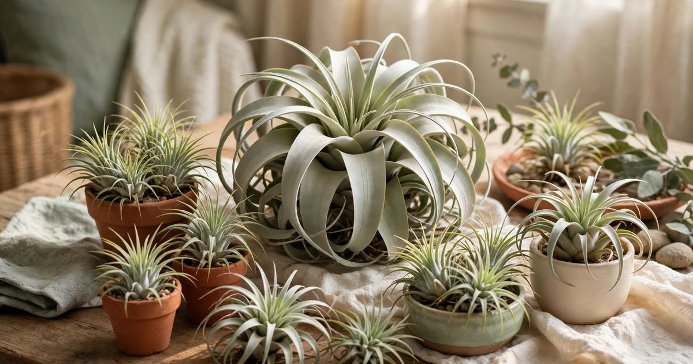
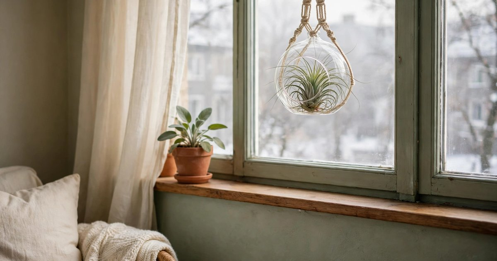
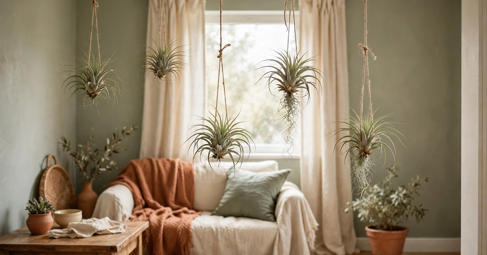
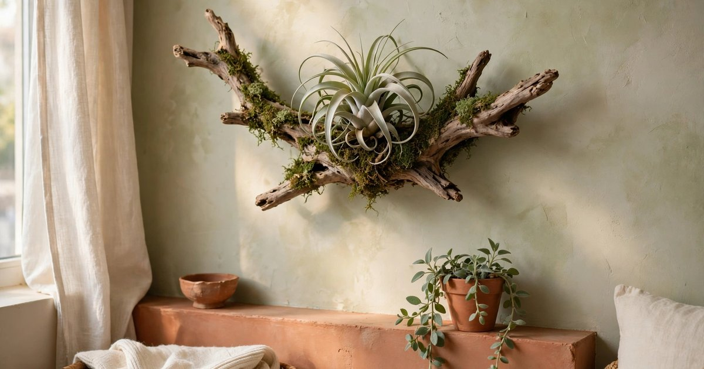
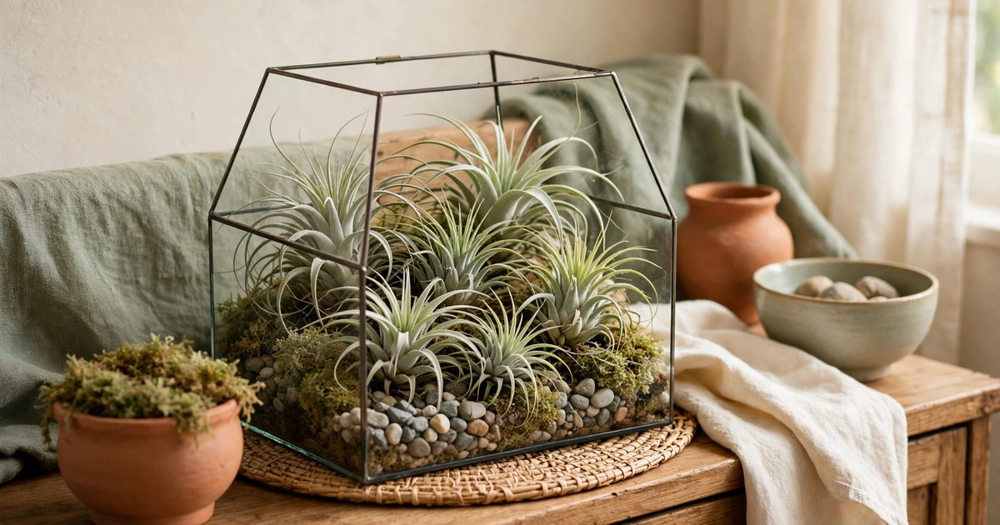
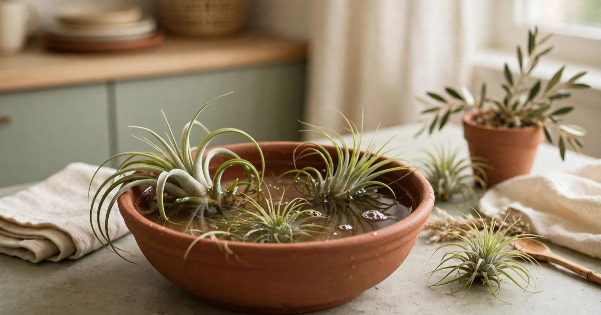
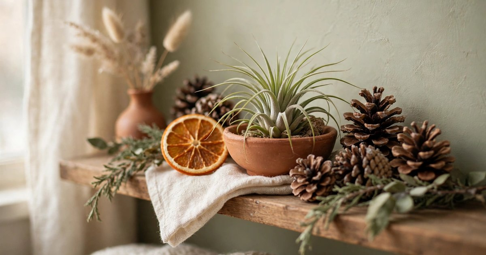
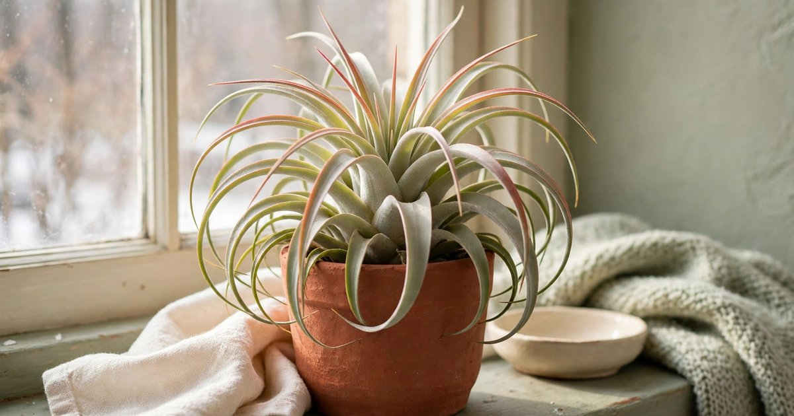

Air plants — tillandsia — are the perfect winter plant for a small apartment. They need no soil, no pot, and almost no space: they live on air, a little water, and a surface to sit on. In winter, when the light is low and the heating is on, most houseplants sulk. Air plants, given the right spot and a weekly soak, keep their sculptural shapes and their silvery-green colour all season, and they can live in places no other plant can: hung from a curtain rod, tucked into a shell on a shelf, mounted on a piece of driftwood on the wall.

This guide walks through styling air plants in a small apartment step by step — choosing the right varieties, finding the right spots, displaying them beautifully, and keeping them alive through dry heated winter air. No drilling, no damage, and nothing that costs more than a few pounds.

### Step 1. Choose winter-hardy varieties

Start with varieties that tolerate dry indoor air. Tillandsia ionantha is small, tough, and blushes red in bright light; Tillandsia xerographica is the big sculptural rosette that looks like a silver flower; Tillandsia caput-medusae has wild curling leaves that suit a dramatic display. Avoid the soft, bright-green varieties in winter — they need more humidity than a heated flat can offer.

Buy from a reputable seller and check the base of each plant before you pay: it should be firm and dry, not soft or brown. A healthy air plant feels substantial for its size and its leaves spring back when you gently bend them. Two or three plants are enough to start — air plants look better grouped than alone, and a small collection is easier to water than a large one.

### Step 2. Find the brightest spot you have

Air plants need bright, indirect light, and in winter that means the brightest window you have. A south- or west-facing windowsill is ideal; an east-facing window works too. Keep them within a metre of the glass — light falls off fast indoors, and a plant three metres from the window is effectively in the dark in December.

Avoid direct midday sun through south-facing glass, which can scorch the leaves, but do not hide them in a dark corner either. A sheer curtain between the plant and the window is the perfect filter: it softens the light and stops the glass from getting cold enough to chill the plant on frosty nights. If your windows are small or north-facing, a [grow light](/grow-lights-dark-winter-apartments-under-25/) on a timer is a worthwhile investment.

### Step 3. Hang them where the air moves

Air plants are epiphytes — in nature they grow on trees, not in soil — so hanging them is the most natural way to display them, and the most space-efficient. Tie a length of twine or fishing line around the base of each plant and hang it from a curtain rod, a shelf bracket, or a Command hook on the wall. Hang them at different heights so the display has movement, and leave space between them so air circulates freely around each plant.

Air circulation is not decoration, it is care: still, damp air is what rots an air plant, and a hanging plant dries faster after watering than one sitting in a bowl. Keep them away from radiators, though — the hot, dry air above a radiator will crisp the leaf tips within days. A curtain rod is the perfect spot: bright, airy, and far from the heat.

### Step 4. Mount one on driftwood or cork

Mounting an air plant on a piece of driftwood, cork bark, or a wooden board turns it into wall art — and it is the display that makes guests ask where you bought it. Lay the plant on the wood, tuck a little sphagnum moss behind it to hold moisture, and fix it with florist's wire or a dab of waterproof glue. Hang the finished piece on a Command hook, so the wall stays undamaged.

Choose a piece of wood with character — a curved branch, a flat slab of cork, a weathered plank — and let the plant sit slightly off-centre, the way it would grow on a tree. The moss is important: it holds a little moisture after watering and gives the roots something to grip. A mounted air plant is the most grown-up display on this list, and it takes up no shelf space at all.

### Step 5. Group them in a glass terrarium

An open glass terrarium — a wide bowl, a large jar, or a purpose-made glass globe — is the classic air plant display, and it works because the glass protects the plants from draughts while showing them off completely. Fill the bottom with pebbles, sand, or moss, nestle two or three air plants among them, and add a pinecone or a small piece of driftwood for height.

The crucial word is open. A closed terrarium traps humidity and rots air plants within weeks, so use a wide-mouthed bowl or a globe with a large opening, and never put a lid on it. Place the terrarium where it gets bright light and good air flow — a sideboard near a window is ideal — and lift the plants out for their weekly soak rather than watering them in place.

### Step 6. Water with a weekly soak

Winter watering is simple: soak the plants in a bowl of room-temperature water for twenty to thirty minutes, once a week. Use rainwater or tap water left out overnight if your tap water is very hard — the minerals in hard water leave white deposits on the leaves. Submerge the whole plant, leaves and all, and let it drink.

The soak is only half the job. After soaking, shake each plant gently upside down and leave it upside down on a towel for a few hours until it is completely dry — especially in the centre of the rosette, where trapped water causes rot. In a heated flat the air is dry, so a weekly soak is usually enough; if the leaf tips start to brown and curl, add a light misting midweek. Never water an air plant by pouring water into its centre and leaving it there.

### Step 7. Add a seasonal touch without harming the plant

Air plants are beautiful on their own, but a seasonal touch makes the display feel festive. Tuck a pinecone beside the plant, lean a dried orange slice against the terrarium, or drape a short string of fairy lights around the shelf — never around the plant itself. The decorations should sit beside the plant, not on it, because anything that traps moisture against the leaves will cause rot.

A winter shelf with air plants, pinecones and a battery candle is a complete seasonal display that needs no other decoration. Our roundup of [pinecone decor ideas](/pinecone-decor-ideas-winter-cost-almost-nothing/) has more ways to use foraged pinecones around your plants, and they cost nothing.

### Step 8. Move them if they complain

Air plants tell you what they need, if you know how to read them. Brown, crispy leaf tips mean the air is too dry or the plant needs more water — soak it a little longer and move it away from the radiator. Soft, brown leaves at the base mean rot, usually from water trapped in the centre — stop soaking it, let it dry completely, and remove any dead leaves. A plant that blushes red or pink is happy: it is getting enough light to colour up, which is a sign of a healthy, well-lit plant.

Do not be afraid to move a plant that is unhappy. Air plants are portable by nature — that is their whole advantage in a small apartment. Try a brighter window, a different shelf, a hanging spot instead of a terrarium, and give each new spot two weeks before judging it. A plant that survives its first winter in your flat will thrive for years.

## Frequently asked questions

### Do air plants need soil?

No. Air plants are epiphytes that absorb water and nutrients through their leaves, not their roots. They need a surface to sit on or hang from, bright indirect light, and a weekly soak — but no soil, no pot, and no repotting, ever.

### How often should I water air plants in winter?

Once a week, with a twenty to thirty minute soak in room-temperature water. Heated indoor air is dry, so do not skip the soak — but always let the plant dry completely upside down afterwards, because trapped water in the centre of the rosette causes rot.

### Can air plants survive in a dark apartment?

They need bright, indirect light to thrive, and in winter that means the brightest window you have. In a very dark flat, a small grow light on a timer for a few hours a day will keep them healthy. A plant in a dark corner will slowly fade and die, so light is the one thing you cannot compromise on.

### Are air plants safe for pets?

Yes — air plants are non-toxic to cats and dogs, which makes them one of the safest plants for a pet-owning household. They are also out of reach by nature, since they hang or sit on high shelves, so pets rarely bother them at all.

### How long do air plants live?

With proper care, most air plants live for several years, and many produce pups — small offsets at the base — that can be separated and grown into new plants. A single air plant can become a small collection over time, which makes them one of the best-value plants you can buy.
