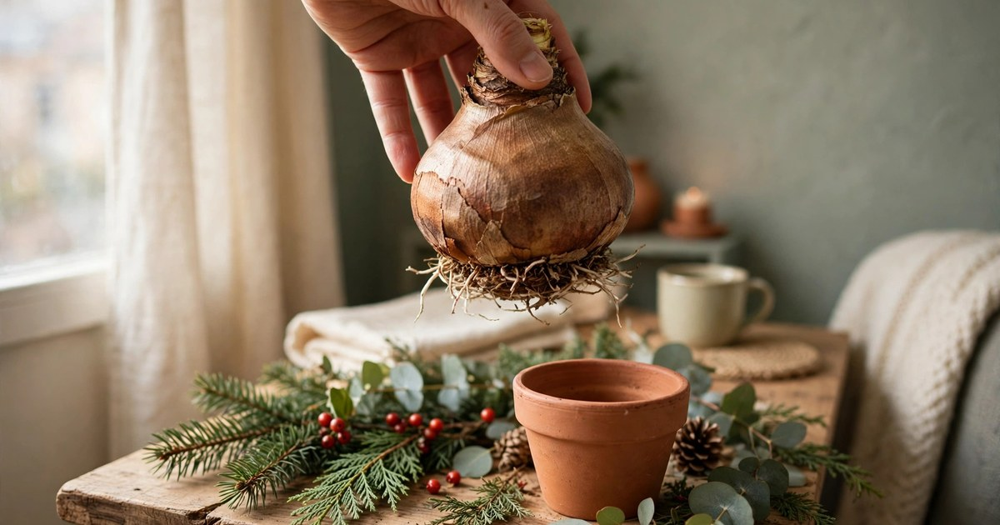
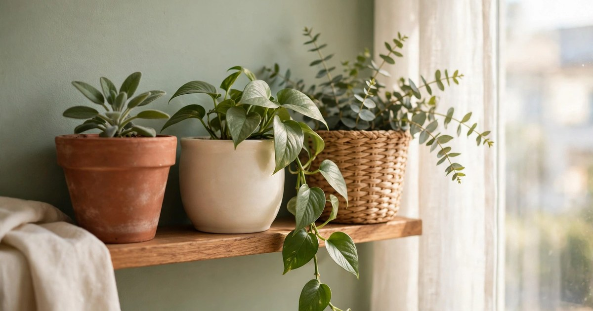
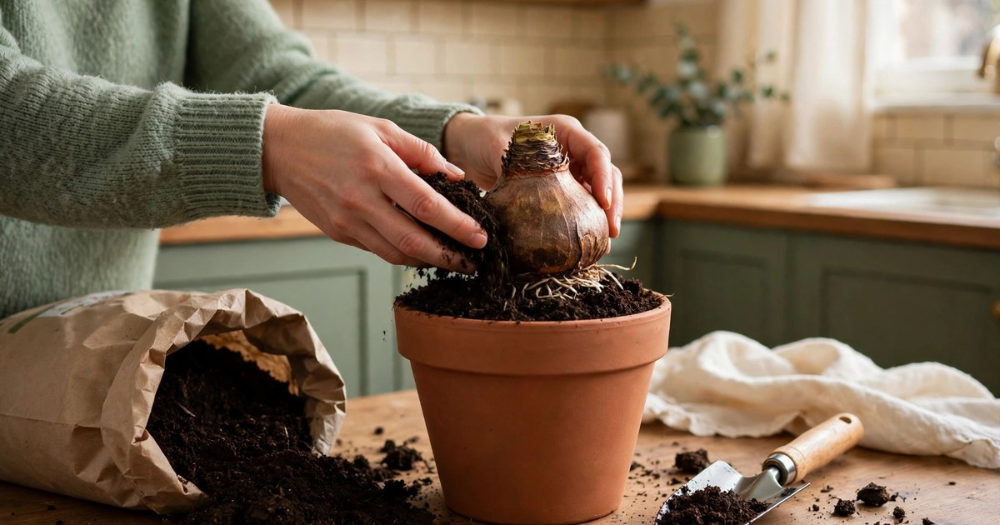
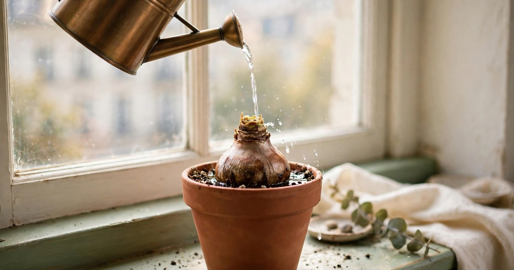
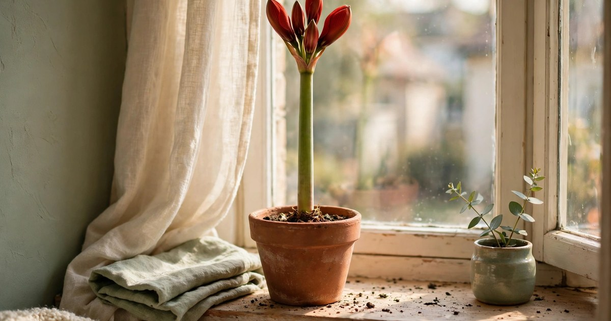
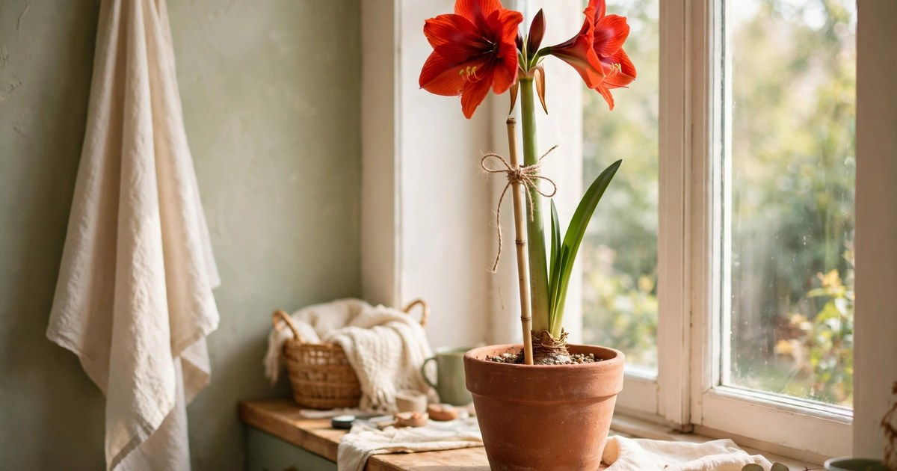
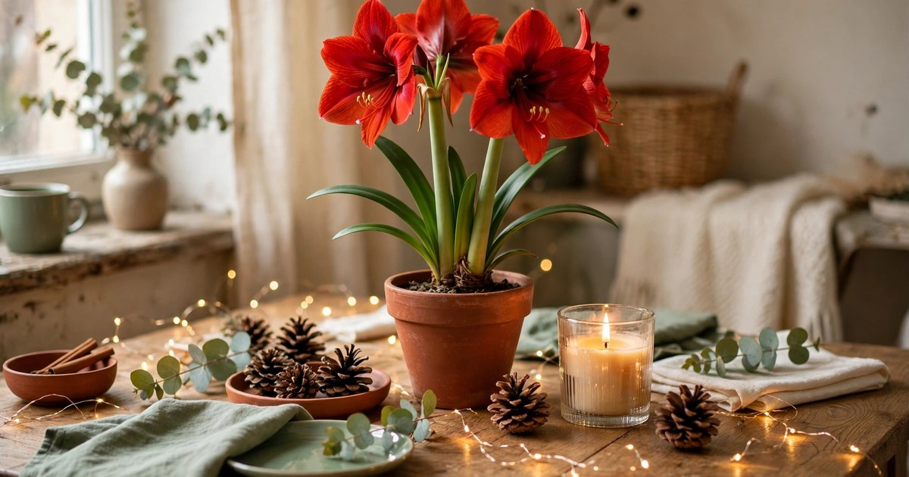
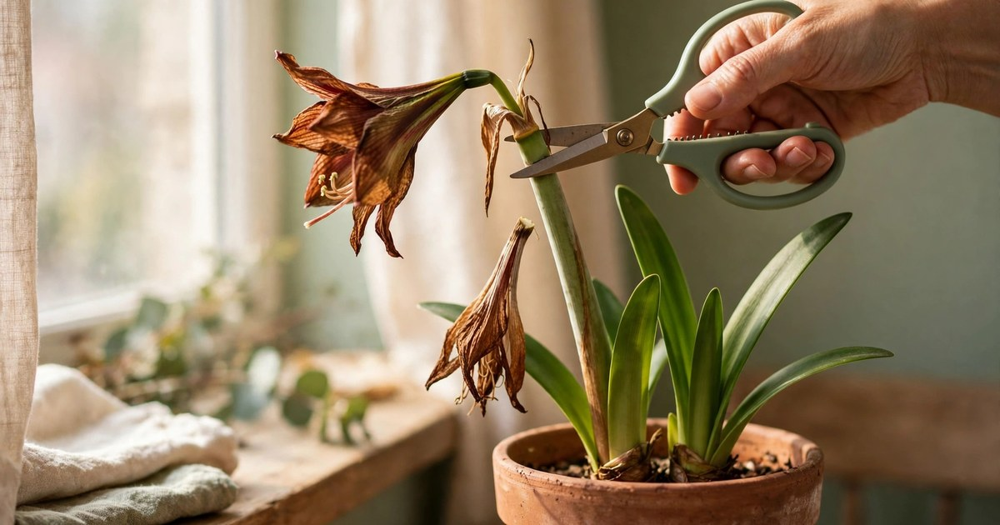

Few Christmas flowers give a small flat as much drama for as little money as an amaryllis. One bulb, planted in early November, throws up a stem up to 60 cm tall and crowns it with trumpet-shaped blooms the size of your hand — red, white, pink or striped — and it does the whole performance on a windowsill with almost no skill from you. For renters, that is the perfect combination: maximum festive impact, minimum commitment, and nothing nailed, drilled or stuck to a landlord's wall.

The trick is timing. Most amaryllis take six to eight weeks from planting to flowering, which means a bulb potted in the first week of November should open its first blooms in the week before Christmas, right when you want them. Plant in mid-December and you will get a lovely January flower, but the Christmas moment will have passed. So this guide works backwards from Christmas Day, step by step, with the practical details — bulb sizes, pot sizes, watering amounts, temperatures — that make the difference between a tall, proud stem and a floppy one leaning towards the window.

Everything here is budget-first. A single good bulb costs less than a bunch of cut flowers and lasts three to four weeks in bloom, and the pot, the soil and the stake can all be reused or improvised from things you already own. If you have never forced a bulb before, amaryllis is the kindest place to start: it is far more forgiving than most festive plants, and even a slightly neglected bulb usually flowers. Follow the eight steps below and your smallest room will have the biggest Christmas flower in the building.

## Step 1: Choose the Right Bulb

Start with the bulb itself, because everything that follows depends on it. Buy early — the first two weeks of November are ideal for Christmas blooms — and choose the largest, firmest bulb you can afford. Bulbs are graded by circumference, and the difference matters: a bulb measuring 30–32 cm around will usually produce two flower stems with four blooms each, while a smaller 24–26 cm bulb may manage only one stem. The bigger bulb costs a pound or two more and delivers roughly twice the flowers, so it is the best value in the whole project.

Pick the bulb up and give it a gentle squeeze. It should feel solid and heavy for its size, like a firm onion, with no soft spots, mould or shrivelled skin. A little papery flaking on the outside is normal and nothing to worry about. Avoid bulbs that feel light, spongy or damp, and skip any with green mould on the neck. If you are buying online, order from a seller that states the bulb size in the listing — vague descriptions usually mean small bulbs — and check the delivery date carefully, since a bulb that arrives in late November will bloom in January rather than at Christmas.

Variety is where the styling starts. Classic red, such as 'Red Lion', is the obvious Christmas choice and looks superb against cream walls and terracotta pots. White 'Christmas Gift' is softer and suits a calm, minimal flat, while pink 'Apple Blossom' brings a gentler, almost vintage feel. Striped varieties like 'Minerva' add pattern without needing any extra decoration. In a small apartment, one statement variety in a single colour reads far better than a mixed jumble — pick one colour and let it own the room. If you want more than one pot, repeat the same variety rather than mixing colours, and the display will look deliberate instead of accidental. For a ready-made starting point, our roundup of [amaryllis bulb kits under $25](/amaryllis-bulb-kits-under-25/) compares the best-value kits, including waxed bulbs that need no soil at all.

## Step 2: Pick a Pot That Fits a Small Space

Amaryllis bulbs like to feel snug, which is excellent news when space is tight. Choose a pot only about 2–3 cm wider than the bulb on each side — for a standard bulb, that usually means a pot around 15–18 cm across. A pot that is too large holds wet soil the bulb does not need and invites rot; a snug pot dries out sensibly between waterings and keeps the plant stable once the heavy flower head develops. Weight matters too: a terracotta or ceramic pot gives a top-heavy stem far more stability than a thin plastic one, so favour heavier materials even if they cost a little more.

Drainage is non-negotiable. The pot must have at least one drainage hole, and it needs a saucer or a cachepot underneath to protect your furniture and your deposit. If you fall in love with a pot that has no hole, use it as an outer cover and keep the bulb in a plain plastic nursery pot hidden inside — you get the look you want and the drainage the bulb needs. A woven basket works the same way and adds a lovely rustic texture, provided you line it with a plastic saucer first. In a rental, that saucer is your best friend: it catches every drip and means the pot can sit directly on a wooden side table or a painted windowsill without a mark.

Think about where the pot will live before you buy it, not after. A tall, narrow pot suits a windowsill; a wider, heavier one suits a side table or a stack of books. Measure the spot — windowsills in small flats are often only 12–15 cm deep, so check the pot's base diameter against the sill before you commit. A pot that overhangs the edge looks precarious and will get knocked over. If your surfaces are truly tiny, consider a wall-mounted shelf or a plant stand that lifts the amaryllis to eye level, where its height becomes a feature rather than a hazard. One bulb, one good pot, one well-chosen spot: that is the whole space strategy.

## Step 3: Pot It Up — Soil, Depth and Drainage

Potting an amaryllis takes about ten minutes and no special equipment. Start with a layer of drainage material in the bottom of the pot — a handful of small stones, broken terracotta pieces or even a crumpled piece of mesh — then add fresh, free-draining compost until the pot is about a third full. Ordinary multi-purpose compost works well, but mix in a handful of perlite or coarse grit if you have it; amaryllis bulbs rot in soil that stays soggy, and the extra drainage costs pennies. Never reuse old compost from a spent summer plant, since it may carry pests or disease into your Christmas display.

Set the bulb on the compost with its pointed nose facing up and its flat base down, then fill compost around it until the bulb sits with its top third exposed above the soil line. This is the detail most first-timers get wrong: amaryllis should never be buried completely. The exposed "shoulders" of the bulb need light and air, and burying the neck invites rot. Firm the compost gently with your fingertips — do not stamp it down — and leave about 2 cm of space between the soil surface and the rim of the pot so water does not spill over when you water.

Finish with a thin top dressing if you like: a layer of small pebbles, moss or bark chips hides the bare compost, slows evaporation and makes the pot look finished from day one. Moss is particularly good for a Christmas look and costs very little from a garden centre. Water lightly after potting — just enough to settle the compost around the roots, roughly half a mug for a standard pot — and then leave the bulb alone. Resist the urge to keep watering daily; the bulb contains everything it needs to start growing, and overwatering at this stage is the single most common cause of failure.

## Step 4: The First Water and Where to Put It

After potting, the amaryllis needs warmth more than water. Place the pot somewhere warm and fairly dark for the first week or two — on top of a kitchen cupboard, in an airing cupboard, or on a shelf near a radiator — at around 20–23°C. This warm start encourages roots to form before the stem shoots up, which gives you a stronger, sturdier plant later. Keep the compost just barely damp during this period: check it with a fingertip every few days and add only a small splash of water when the top 2–3 cm feels dry. A bulb sitting in wet compost will rot from the base, and there is no coming back from that.

Once you see a green shoot emerging from the nose of the bulb — usually after one to two weeks — move the pot into bright light. A south- or west-facing windowsill is ideal, but any bright spot within a metre of a window will do. This is the moment the plant switches from root-growing to stem-growing, and light is what keeps the stem short and strong rather than pale and stretched. If your flat is short on natural light in winter, even a few hours of direct sun through the window each day makes a real difference, and a cheap clip-on grow light can fill the gap for under £15 if you plan to force bulbs every year.

Watering from this point on follows a simple rhythm: water thoroughly when the top 2–3 cm of compost feels dry, then let it drain completely and empty the saucer after 15 minutes. In a warm flat that usually means watering once a week, using roughly a mugful for a standard pot. Never let the pot sit in standing water, and never water from above onto the neck of the bulb — water around the edge of the pot instead. A small, consistent routine beats enthusiastic drowning every time, and it is the habit that keeps the plant healthy all the way to Christmas.

## Step 5: Light and Temperature for Strong Stems

Light and temperature are the two levers that decide whether your amaryllis grows into a proud, upright stem or a pale, leaning one. Once the shoot appears, the plant wants as much bright light as your flat can offer — ideally four to six hours of direct or strong indirect light a day. Rotate the pot a quarter turn every two or three days so the stem grows straight instead of bending towards the window; this takes five seconds and is the easiest styling trick in the whole guide. A stem that leans badly early on rarely straightens later, so start rotating as soon as the shoot is a few centimetres tall.

Temperature is the second lever, and it controls the speed of the show. At 20–23°C the plant grows fast and may bloom early; at 15–18°C it grows more slowly and the flowers last longer once they open. That gives you a useful bit of control: if the stem is racing ahead in early December and you worry it will bloom before Christmas, move the pot to a cooler room — a spare bedroom or a hallway — to slow it down by a few days. Conversely, if mid-December arrives and the buds still look tight, move the pot somewhere warmer to hurry things along. A difference of just 3–4°C can shift the bloom by several days, which is often exactly the adjustment you need.

Watch out for the two classic winter hazards: radiators and draughts. A pot sitting directly above a hot radiator will dry out fast and the stem may grow weak and spindly, while a cold draught from a badly sealed window can check growth overnight. Keep the pot at least 30 cm from a radiator and away from doors that open onto a cold hallway. Once the flowers open, cooler conditions are your friend — a room at 15–18°C will keep the blooms looking fresh for three to four weeks, while a hot room can cut that to ten days. That is why the amaryllis often looks its best on a cool windowsill rather than beside the fire.

## Step 6: Staking and Supporting Tall Blooms

An amaryllis in full flower is top-heavy by design: a 60 cm stem carrying four dinner-plate-sized blooms is a lot of weight on a narrow base, and a small apartment adds its own risks — a cat brushing past, a curtain catching the stem, a wobble from a crowded windowsill. Staking early is cheap insurance. Insert a slim bamboo cane, a decorative twig or a thin metal plant support into the compost when the stem is about 15–20 cm tall, pushing it in near the edge of the pot so you do not spear the bulb. Waiting until the stem is fully grown risks damaging roots and makes the whole operation clumsier.

Tie the stem to the support loosely, in two places: once about halfway up and once just below the flower head. Use soft garden twine, raffia or even a strip of fabric — never wire or tight string, which can cut into the stem as it thickens. The tie should be a loose figure-of-eight loop that holds the stem close to the cane while letting it move a little; a stem held rigidly against its support is more likely to snap in a draught than one with a little give. If you prefer a cleaner look, a single discreet cane painted in a colour that matches your pot disappears almost entirely once the leaves fill in.

If the stem does start to lean despite your efforts, do not try to bend it back by force — you will snap it. Instead, rotate the pot so the lean faces away from the light, which encourages the stem to correct itself slowly, and add a second tie higher up. For very tall varieties, a small ring support or a tripod of three canes gives more stability than a single stake and looks charmingly rustic in a terracotta pot. A staked amaryllis can survive a crowded Christmas table, a curious cat and a clumsy guest, which is exactly the resilience a small flat demands.

## Step 7: Styling and Displaying It

This is the fun part, and it is where a single bulb becomes a whole Christmas display. Start with the pot itself: a plain terracotta pot looks wonderful on its own, but a simple swap can change the mood entirely. Slip the nursery pot into a woven basket for a rustic look, a cream ceramic cachepot for a calm minimal feel, or a metallic pot for a touch of glamour. A length of ribbon tied around the pot, a sprig of eucalyptus tucked behind the stem, or a few pinecones arranged at the base costs almost nothing and makes the display feel finished. Keep the dressing simple — the flower is the star, and too much decoration around it just competes.

Think in vignettes rather than single objects. An amaryllis on a side table looks twice as good with a small companion: a battery candle in a glass holder, a stack of two or three books, or a tiny dish of baubles beside it. On a dining table, the amaryllis makes a natural centrepiece — keep it low enough that guests can see over it, and pair it with a linen runner and a few sprigs of greenery laid flat along the table. On a windowsill, group it with other festive plants at different heights: a small rosemary plant, a Christmas cactus or a forced paperwhite in a shorter pot creates a layered, collected look that reads as intentional rather than accidental. If you love forcing bulbs, our guide to [forcing paperwhite bulbs for Christmas](/force-paperwhite-bulbs-christmas-guide/) pairs beautifully with this one, since paperwhites are shorter, fragrant and flower on a similar timetable.

Height is your styling superpower in a small flat. An amaryllis on the floor disappears; the same plant raised 30 cm on a plant stand, a stool or a stack of books becomes a focal point. Use that lift to place the flower at eye level where you sit — beside the sofa, at the end of the dining table, or on the shelf you see when you walk in the door. And remember that the display can move: keep the pot in its brightest spot while the buds develop, then shift it to its show position once the flowers open, when light matters less and looks matter more. A plant that travels from windowsill to tabletop over December is a plant that earns its keep twice.

## Step 8: Aftercare — After the Flowers Fade

When the last bloom fades — usually three to four weeks after opening — resist the urge to throw the bulb away. A well-looked-after amaryllis can flower again next Christmas, and the aftercare is simpler than most people expect. Start by snipping off each spent flower as it fades, cutting the flower stalk just above the point where it joins the main stem. Once all the flowers on a stem are finished, cut the whole stem down to about 5 cm above the bulb, taking care not to damage the leaves. The leaves are the important part now: they are the solar panels that will rebuild the bulb for next year.

Keep watering and feeding the plant through spring and summer as if it were an ordinary houseplant. Place it in the brightest spot you have, water when the top few centimetres of compost dry out, and feed it every two weeks with a balanced liquid fertiliser at half strength from March to August. The leaves should grow long and strap-like — that is a good sign, not a problem. If the weather is warm, you can move the pot outside into a sheltered spot from late May onwards, which usually produces even stronger leaves, but bring it back indoors before the first frost.

In early autumn, stop watering and let the leaves die back naturally over about eight weeks, then cut off the dead foliage and store the bulb somewhere cool, dark and dry — a cupboard or a garage shelf works well. Rest it for eight to ten weeks, then repot it in fresh compost in early November and start the cycle again. The second-year flowers may be slightly smaller than the first, but a bulb that has been fed well through the summer will often surprise you with two stems. Even if you decide not to keep it, the pot, the stake and the compost can all be reused, so the only real cost of next Christmas's display is a new bulb.

## Frequently Asked Questions

### How long do amaryllis flowers last indoors?

In a cool room at 15–18°C, amaryllis blooms usually last three to four weeks from the first flower opening to the last one fading. A hot room above 23°C can shorten that to ten days, so keep the plant away from radiators once the flowers open. Snip off each spent bloom as it fades to keep the display tidy and to direct the plant's energy into the remaining flowers.

### When should I plant amaryllis bulbs for Christmas?

Plant in the first two weeks of November for Christmas blooms, since most varieties take six to eight weeks from planting to flowering. A bulb planted in early November should open its first flowers in the week before Christmas. Planting later pushes the display into January, which is still lovely but misses the festive window.

### Can amaryllis grow in a small apartment without a garden?

Yes — amaryllis is one of the best bulbs for small flats because it needs only a single pot on a windowsill and no garden at all. A snug pot 15–18 cm across, bright light and weekly watering are enough. Its upright habit takes up very little floor space, and its height makes it visible across a small room.

### How much water does an amaryllis need?

Water thoroughly when the top 2–3 cm of compost feels dry — usually about once a week, roughly a mugful for a standard pot — and always empty the saucer after 15 minutes so the bulb never sits in standing water. Water sparingly in the first two weeks after potting, when the bulb is forming roots, and never pour water onto the neck of the bulb itself.

### Will my amaryllis bulb flower again next year?

Yes, if you look after it after flowering. Keep the leaves growing through spring and summer with regular watering and fortnightly feeding, then let the bulb rest cool and dry for eight to ten weeks in autumn before repotting in fresh compost in early November. A well-fed bulb will usually flower again, sometimes with two stems.
