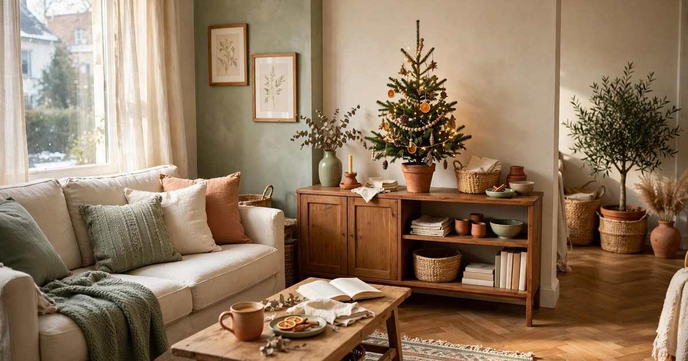
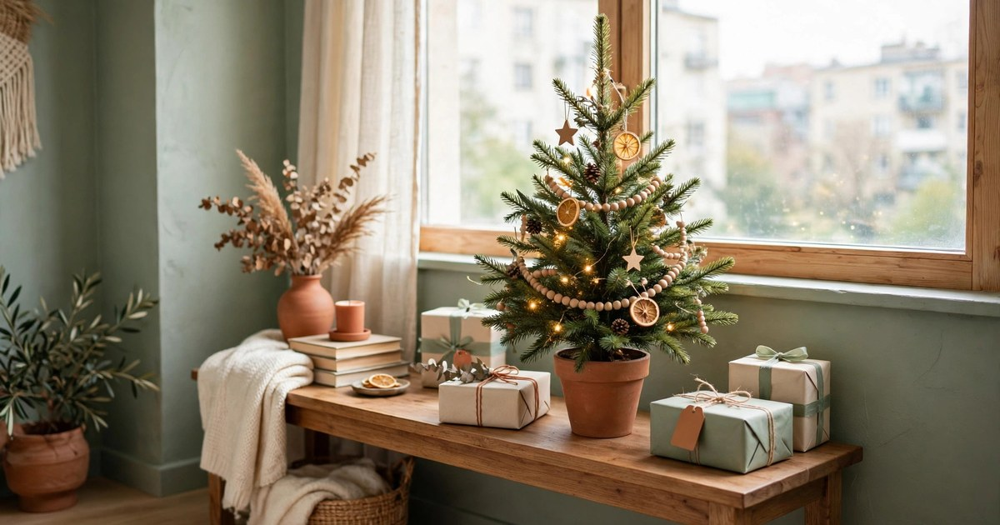
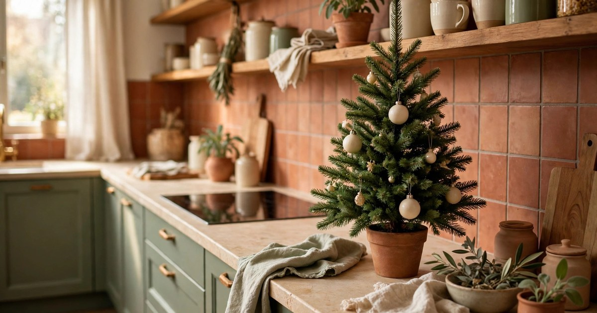
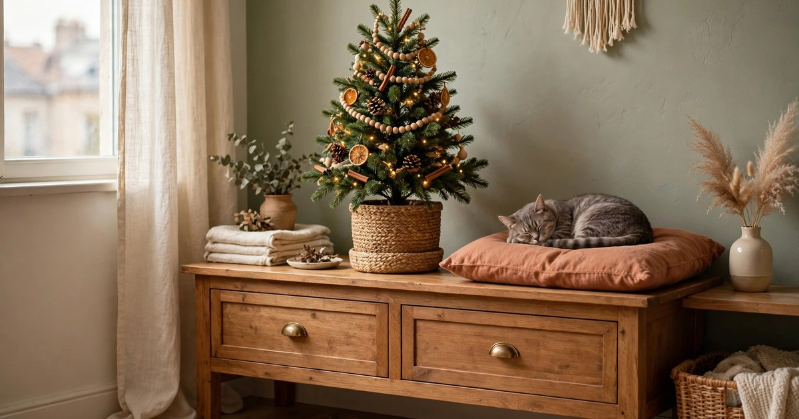

A full-size Christmas tree is a lovely idea until you measure your living room and realise the only free corner is the one the door swings into. In a small apartment, the mini tree is not the compromise — it is the smarter tree. A 60–90 cm tabletop tree fits on a sideboard, a shelf, or the top of a bookcase, costs a fraction of a full-size one, and, styled properly, looks every bit as festive as the six-footer in the window of the house down the road.

The secret is treating a mini tree like a design project, not a shrunk version of a big tree. The proportions change, the tricks change, and the budget drops dramatically — most of the trees in this guide cost under $30 all-in, and every step is renter-friendly, with no holes in the wall and nothing you can't pack away in January.

Work through these eight steps in order and you'll have a tree that photographs beautifully, survives a curious cat, and comes down without a single mark on the deposit.

## Step 1: Pick the right size and shape for your space

Before you buy anything, measure. A mini tree that is too big for its surface looks top-heavy and nervous; one that is too small disappears under its own ornaments. The sweet spot for most apartments is a tree between 60 and 90 cm tall, including its pot — tall enough to read as a real tree from across the room, short enough to sit safely on a sideboard or shelf without brushing the ceiling.

Shape matters as much as height. A slim, pencil-style tree suits a narrow hallway console or a shelf where depth is limited, while a full, bushy tree works on a wide sideboard or dining table where it can spread a little. If your flat is short on floor space but long on surfaces, look for a half-tree or wall-hugging design — flat on the back, full at the front — which sits flush against the wall and takes up half the footprint.

Think about where the tree will live before you fall in love with one in the shop. Measure the surface, check the clearance above it, and note the nearest socket (or plan for battery lights, which we'll get to in step five). A tree bought for the space it will actually occupy always looks better than a tree bought for the space you wish you had.

## Step 2: Choose the spot before you decorate

Where you put a mini tree changes everything about how it reads. The best spots in a small apartment are the ones that already draw the eye: the top of the sideboard opposite the sofa, a console table in the entryway, the end of the dining table, or a sturdy shelf at eye level. A tree at eye level looks twice as grand as the same tree on the floor — height is free, so use the furniture you already own.

Avoid the classic small-space mistakes. Don't squeeze the tree behind the sofa where only the top pokes out, don't put it on a wobbly plant stand, and don't place it where the front door swings or where coats get thrown. A tree that gets brushed past ten times a day will shed needles and ornaments, and you'll stop enjoying it by the second week of December.

Light is the other half of the decision. A tree near a window catches daylight and glows in the evening; a tree in a dark corner needs more lights to avoid looking flat. If your best spot is far from a socket, that's fine — battery fairy lights and [LED candles](/battery-christmas-candles-small-apartments-under-20/) exist precisely for renters. Choose the spot, then choose the lights to suit it.

## Step 3: Pick a tree that fits your budget

You have three good options, and the cheapest one is genuinely lovely. A real mini tree — a potted spruce or fir from a garden centre — costs $10–20, smells wonderful, and can be planted outside or kept on a balcony after Christmas. A small artificial tree costs $15–30, packs flat, and comes back out every year, which makes it the cheapest option by year three. And a DIY branch tree — a few foraged or florist-bought branches in a heavy vase — costs almost nothing and suits a minimalist or Scandi-style flat perfectly.

For renters, artificial wins on practicality. There's no watering, no needle drop on a carpet you'll be charged to clean, and no dying tree to dispose of in January. Look for one with dense, hinged branches rather than the cheapest wire-and-tinsel style — a fuller tree needs fewer ornaments to look finished, which saves money twice over.

Secondhand is the budget move nobody talks about. Mini trees flood thrift shops and local buy-nothing groups every November, often still in the box for $5. Check the branches for drooping and the base for cracks, fluff it out in the shop if you can, and you've saved enough to spend on the lights instead. [Shop mini artificial Christmas trees](https://www.amazon.com/s?k=mini+artificial+christmas+tree+tabletop&tag={{AMAZON_TAG}})

## Step 4: Secure the base so it can't topple

A mini tree is light, which means a curious cat, a toddler, or an elbow in a narrow flat can send it flying. Before a single ornament goes on, make the base boringly stable. If your tree came in a plastic pot, drop that pot inside a heavier one — terracotta, ceramic, or a woven basket weighted with a bag of pebbles or a brick wrapped in cloth. The weight should sit low and the pot should be wide enough that the tree can't tip forward.

For a tree on a shelf or a high surface, add a layer of museum putty or removable adhesive strips under the pot. Both are renter-safe, peel off cleanly, and stop the tree sliding when someone bumps the furniture. If you're using a basket as a cover, wedge the pot in with scrunched paper or a rolled tea towel so it can't wobble inside.

This is the least glamorous step and the one that saves your ornaments. A tree that fell once in week one will spend the rest of December looking slightly traumatised, and you'll spend the season re-hanging baubles. Five minutes of stabilising now is the whole insurance policy.

## Step 5: Light it first, before a single ornament

Lights go on before ornaments, always — that's the rule professionals follow and the one most people skip. Start at the base, wind the string up the tree in a loose spiral, tucking the wire deep into the branches rather than draping it on the surface. Deep lights glow from inside the tree; surface lights look like a string draped over a bush.

For a mini tree you need far fewer lights than you'd think: 50–100 warm-white micro LEDs are plenty for a 60–90 cm tree. Battery-powered fairy lights are the renter's best friend here — no socket hunting, no trailing cable, and a timer function that switches them off after six hours so you're not paying to light an empty room. A pack of two strings costs $8–12 and will last for years. [Shop battery fairy lights with timer](https://www.amazon.com/s?k=battery+fairy+lights+warm+white+timer&tag={{AMAZON_TAG}})

Warm white is the colour to choose for a small space. Cool white reads clinical and makes a tiny tree look like a shop display; warm white flatters terracotta, cream, and sage — the palette most small flats already live in — and makes the whole corner feel like candlelight. Test the lights in the evening before you decorate: if the tree glows softly from across the room, the count is right.

## Step 6: Layer ornaments from big to small

Here's the styling rule that makes a mini tree look expensive: hang the biggest ornaments first, deepest in the branches, then work outwards and upwards to the smallest. Big baubles near the trunk give the tree visual weight and fill the gaps between branches; small ornaments on the tips add sparkle without overwhelming the shape. A mini tree needs only 12–20 ornaments total — far fewer than you'd expect, and fewer is what keeps it looking curated rather than cluttered.

Pick a tight colour story and stick to it. Three colours maximum, plus metallics: terracotta, cream, and gold is warm and modern; sage, cream, and wood is calm and Scandi; classic red, gold, and green works if your flat already leans traditional. Buy one mixed pack of baubles in your palette ($10–15) rather than ten individual ornaments, and fill the gaps with what you already own — [dried orange slices](/dry-citrus-flowers-winter-decor-guide/), cinnamon sticks tied with string, [pinecones](/pinecone-decor-ideas-winter-cost-almost-nothing/) from the park, and a few paper stars.

Hang ornaments with short lengths of ribbon or twine instead of wire hooks. Ribbon is cheaper, looks intentional, and lets you adjust the drop height so nothing dangles into the branches below. Step back after every five ornaments and check the balance from across the room — a mini tree is small enough that one heavy side is visible instantly.

## Step 7: Dress the base and hide the mechanics

The base is where most mini trees give themselves away. A bare plastic pot, a tangle of battery packs, and a visible wire are the difference between a styled tree and a tree that just arrived. Hide all of it. A woven basket, a chunky knitted tree skirt, a folded throw, or even a large piece of hessian wrapped around the pot turns the base into part of the decoration — and costs nothing if you already own the pieces.

The battery pack is the thing people forget to hide. Tuck it behind the pot, inside the basket, or under the tree skirt, with the switch facing out so you can reach it without dismantling the display. If the cable is visible, wrap it in the same ribbon you used for the ornaments, or run it behind the furniture to the socket.

Add a finishing layer at the very bottom: a small tray or a folded linen cloth under the tree catches fallen needles and protects the furniture surface — important in a rental where a ring mark on a wooden sideboard is a deposit conversation. It also frames the tree, like a mat frames a picture, and makes the whole arrangement look deliberate rather than plonked down.

## Step 8: Add the topper and the finishing touches

A mini tree does not need a full-size topper — it needs a small one, or none at all. A full-size star or angel will dwarf a 60 cm tree and make it look like a hat on a child. Choose a topper no taller than about 10 cm, or skip the traditional topper entirely and finish with a simple bow, a paper star, or a sprig of dried eucalyptus tied to the top branch. A bow made from the same ribbon as your ornaments ties the whole tree together for about $2.

The last touches are the ones that make the tree feel personal rather than purchased. A short garland of wooden beads or dried orange slices draped loosely around the tree adds texture without weight. A few sprigs of [fresh eucalyptus](/eucalyptus-decor-winter-ideas/) or rosemary tucked into the branches add scent — and in a small flat, scent is half the Christmas atmosphere. Keep it to one garland and two or three sprigs; a mini tree has no room for a second idea.

Finally, style the space around the tree, not just the tree itself. A couple of wrapped empty boxes at the base, a candle (battery, if the tree is near curtains), and a small stack of books beside it turn a tree on a sideboard into a Christmas corner. Then switch the lights on, step back, and enjoy the one corner of your flat that now looks like a magazine — for under $30, with nothing nailed, drilled, or damaged.

## Frequently Asked Questions

### What size mini Christmas tree is best for a small apartment?

A tree between 60 and 90 cm tall, including its pot, suits most small apartments. It reads as a real tree from across the room, fits safely on a sideboard, shelf, or console table, and needs only 12–20 ornaments to look finished. Measure your surface and the clearance above it before you buy.

### Can I put a mini Christmas tree in a rental without losing my deposit?

Yes. Use a freestanding tree on furniture you already own, secure the pot with removable adhesive strips or museum putty, and use battery fairy lights so there are no cables or wall fixings. Avoid nails, screws, and anything glued to the walls — a tree on a sideboard needs none of them.

### Are battery fairy lights safe on a mini Christmas tree?

Yes — battery LED fairy lights are the safest option for a mini tree. LEDs stay cool to the touch, and a timer function switches them off automatically after a few hours. Choose warm-white micro LEDs, hide the battery pack inside the basket or under the tree skirt, and keep real candles away from the branches.

### How many ornaments does a mini Christmas tree need?

Only 12–20 ornaments for a 60–90 cm tree. Hang the largest baubles first, deep in the branches near the trunk, then work outwards to the smallest ornaments on the tips. A tight palette of three colours plus metallics looks far more expensive than a random mix, and dried orange slices, pinecones, and cinnamon sticks fill gaps for almost nothing.

### Should I buy a real or artificial mini Christmas tree?

For renters, artificial usually wins: no watering, no needle drop on carpets, and it packs flat for next year, making it the cheapest option by year three. A real potted tree costs $10–20 and smells wonderful, and it can live on a balcony afterwards — just be ready to water it and sweep up needles daily.
