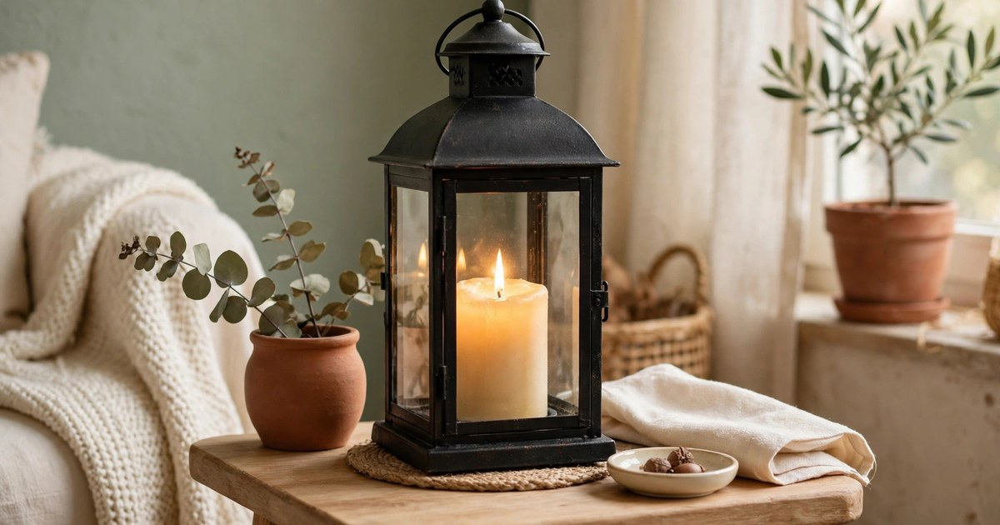
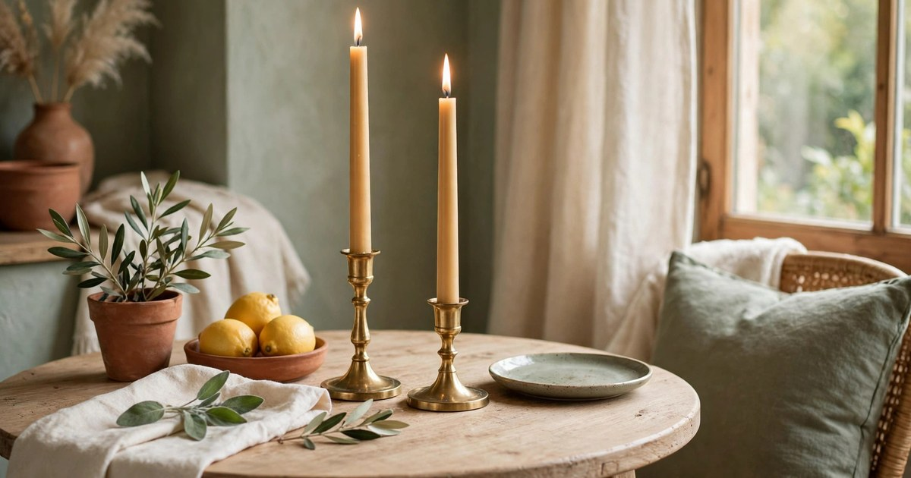
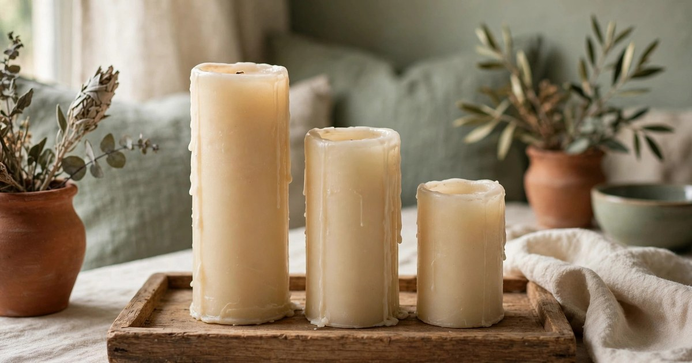
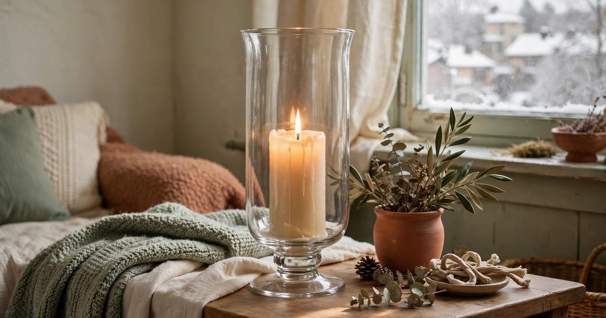
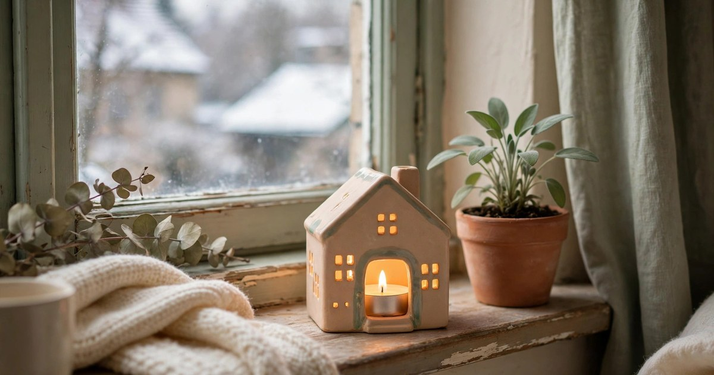
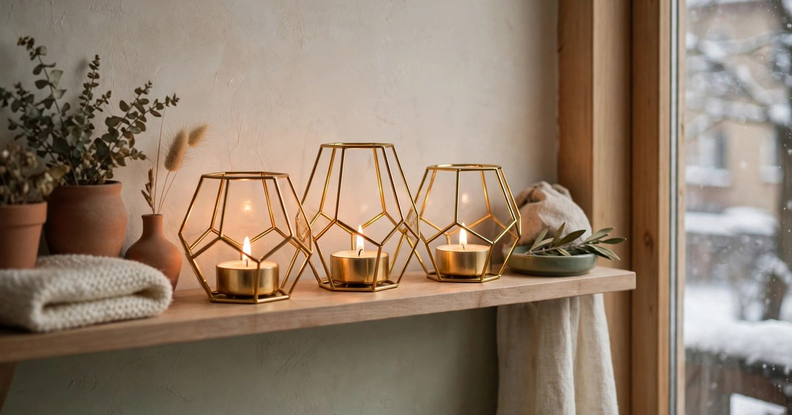
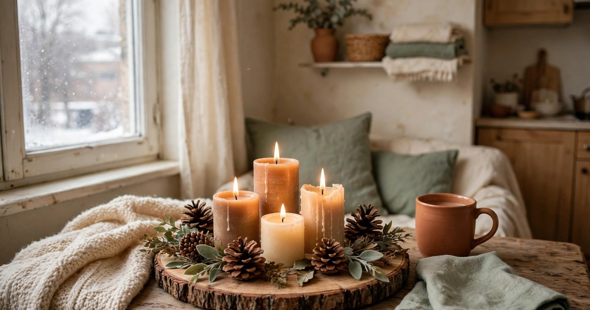
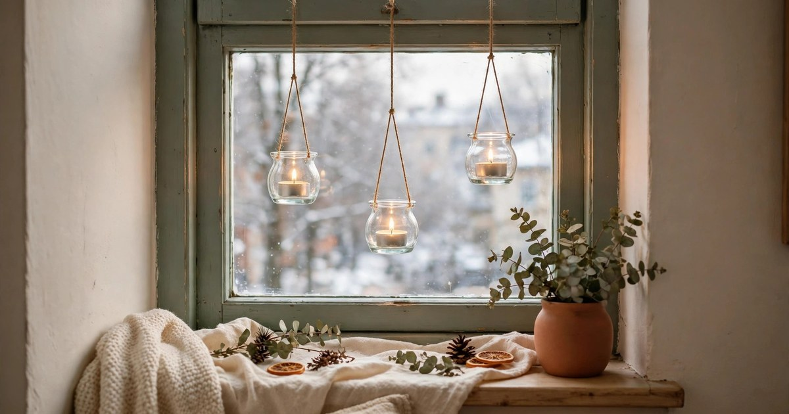
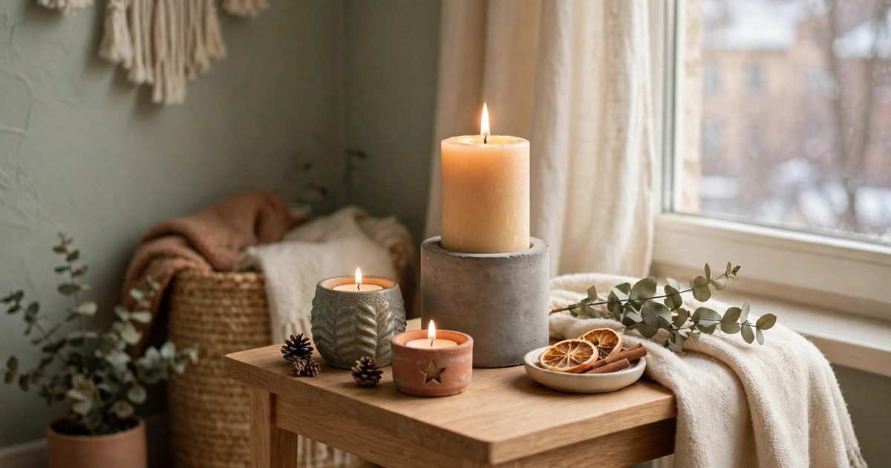

Candlelight is the cheapest warmth a small apartment can buy, but a bare candle on a bare table looks like an afterthought — and in a small flat, an afterthought looks like clutter. A candle holder turns the same candle into a deliberate display: it catches the wax, frames the flame, and gives the light a place to belong. Every holder below is under $25, fits a small space without eating a whole surface, and works in a rental with no installation at all. If November has you reaching for candles every evening, one of these is the difference between a candle you lit and a corner you styled.

### 1. Black metal lantern

Why it works: a lantern frames a candle in glass and metal, which makes the flame look intentional and keeps it safe from draughts, curtains, and curious pets. The glass panels magnify the glow, so one candle lights more of the room than a bare pillar ever would, and the handle means the whole display moves in one lift.

Where it fits: on a side table, a windowsill, or the floor beside the sofa in a small living room. A lantern is also the rare candle holder that works outdoors on a balcony in mild weather, then comes back inside for winter without missing a beat.

Budget tip: look for [black metal lanterns](https://www.amazon.com/s?k=black+metal+lantern+candle+holder&tag={{AMAZON_TAG}}) sold in sets of two or three — the per-piece price drops sharply, and a trio of different heights on one tray looks far more styled than a single lantern alone.

### 2. Brass taper holders, set of two

Why it works: brass taper holders lift candlelight to eye level, which is where it flatters a room most, and brass itself catches and throws the light around in a way no other material does. A pair on a dining table turns an ordinary weeknight dinner into something that feels like an occasion, for the price of a takeaway.

Where it fits: on a small dining table, a console, or a mantel if your rental has one. Tapers are slim, so a pair of holders takes up almost no surface — the whole display is narrower than a dinner plate.

Budget tip: solid brass costs more, but brass-finished holders look identical in candlelight and cost a fraction. Search for [brass taper candle holders](https://www.amazon.com/s?k=brass+taper+candle+holders+set+of+2&tag={{AMAZON_TAG}}) and check the base width — a wide, heavy base is what keeps a tall taper from tipping on a small table.

### 3. Wooden pillar candle tray

Why it works: a wooden tray corrals several pillar candles into one display, protects the surface underneath from wax and heat, and adds a warm natural texture that suits winter perfectly. Three pillars of different heights on one tray is the classic stylist arrangement, and the tray is what makes it look deliberate instead of accidental.

Where it fits: on a coffee table as the room's centrepiece, or on a dining table as a permanent winter display that dinner simply works around. When you need the table, the whole tray lifts away in one move.

Budget tip: buy the tray and the candles separately — bundled sets usually overcharge for the candles. Look for [wooden candle trays](https://www.amazon.com/s?k=wooden+candle+tray+decorative&tag={{AMAZON_TAG}}) in mango or acacia wood, which are sturdy, warm-toned, and cheap for the quality.

### 4. Glass hurricane holder

Why it works: a hurricane holder is a tall glass cylinder that surrounds a pillar candle, shielding the flame from draughts while letting all the light through. In a small flat with radiators, open windows, and foot traffic, draughts kill bare candles constantly — a hurricane keeps the flame steady and the room evenly lit.

Where it fits: on a dining table as a centrepiece, on a sideboard, or on the floor in a corner where a tall glow is wanted without a floor lamp. The glass reads as almost invisible, so the holder suits any style from minimal to maximal.

Budget tip: hurricanes are often cheapest bought singly in the size you actually need, rather than in sets. Search for [glass hurricane candle holders](https://www.amazon.com/s?k=glass+hurricane+candle+holder&tag={{AMAZON_TAG}}) and measure your pillar candles first — the glass should clear the candle by at least a few centimetres so the flame breathes.

### 5. Ceramic tealight house

Why it works: a ceramic house with cut-out windows turns a tealight into a tiny glowing cottage, and the light shining through the windows is the cosiest light there is. It is also the smallest candle holder on this list — it fits on a windowsill, a shelf, or the corner of a desk that has no room for anything else.

Where it fits: on a windowsill where it glows outward in the evening, on a bookshelf between books, or in a bathroom where a tealight is the whole lighting plan. A row of three houses on a mantel or shelf is a village, and a village is a display.

Budget tip: ceramic houses are widely sold under $15, and white or cream ones suit every interior. Look for [ceramic tealight houses](https://www.amazon.com/s?k=ceramic+tealight+house+candle+holder&tag={{AMAZON_TAG}}) with a removable roof or base, which makes swapping the tealight easy without burning your fingers.

### 6. Gold geometric tealight holders, set of three

Why it works: geometric holders in gold add a touch of glamour to winter candlelight, and a set of three in different shapes or heights gives a shelf an arranged look with zero styling effort. The metallic finish reflects the flame, so three small tealights punch above their weight in a small room.

Where it fits: on a bookshelf, a console table, or a bathroom shelf where a little glamour is welcome. Small holders are the answer to small surfaces — they decorate the shelf without displacing the books.

Budget tip: sets of three are almost always better value than singles, and gold-tone metal is far cheaper than solid brass. Search for [gold geometric tealight holders set of 3](https://www.amazon.com/s?k=gold+geometric+tealight+holders+set+of+3&tag={{AMAZON_TAG}}) and favour heavier bases, which keep small holders stable on a crowded shelf.

### 7. Rustic wood slice candle plate

Why it works: a wood slice — a cross-section of a log, bark edge and all — is a candle plate that looks like it came from a cabin, and it brings a natural, woodland texture into a flat that otherwise has none. Pair it with a pillar candle and a pinecone or two, and you have a winter centrepiece that cost less than a pizza.

Where it fits: on a coffee table, a dining table, or an entryway console as a seasonal display. The bark edge contains wax drips and gives the arrangement a finished border, so the candles never look like they were just set down.

Budget tip: wood slices are sold very cheaply in craft sizes, and a single large slice holds two or three candles. Look for [wood slice candle plates](https://www.amazon.com/s?k=wood+slice+candle+holder+plate&tag={{AMAZON_TAG}}) that are sanded flat on top, so candles sit level and safe.

### 8. Hanging glass tealight holders

Why it works: hanging holders take candlelight off the surfaces entirely, which is the small-apartment superpower — light at eye level or above, with zero table space used. Glass globes or cups hung from a curtain rod, a hook, or a branch bring a floating, magical quality to a room that a table display cannot match.

Where it fits: in a window, where the glow doubles in the glass at night; over a dining table hung from a removable ceiling hook; or in a corner where a plant hanger holds a candle instead of a plant for winter. Use battery tealights in hanging holders near curtains or above head height, for obvious safety reasons.

Budget tip: hanging holders are often sold in sets of four or six, which brings the per-piece price well under $25 for the set. Search for [hanging glass tealight holders](https://www.amazon.com/s?k=hanging+glass+tealight+holders&tag={{AMAZON_TAG}}) with sturdy wire or cord, and hang them where they cannot be knocked by a door or a tall guest.

### 9. Stone or concrete pillar holder

Why it works: a stone or concrete holder is heavy, stable, and modern — the antidote to the wobbly lightweight holder that tips when the cat walks past. Its weight is the feature: a thick candle in a heavy holder is the safest candle arrangement in a small flat, and the raw material suits winter's earthy palette perfectly.

Where it fits: on a side table, a hearth, or a bathroom shelf where stability matters more than delicacy. Concrete and stone suit minimalist, industrial, and rustic interiors alike, because the material itself is the decoration.

Budget tip: concrete holders are cheaper than carved stone and look nearly identical once a candle is lit. Look for [concrete candle holders](https://www.amazon.com/s?k=concrete+candle+holder+pillar&tag={{AMAZON_TAG}}) with a felt or cork base pad, which protects your table and keeps the heavy holder from scratching a rental's surfaces.

## One Holder, One Corner, One Evening at a Time

You do not need all nine holders — you need one, in the corner where you actually sit in the evening. Start there, light the candle at the same time every night, and notice how the room changes: a small flat with one deliberate pool of candlelight feels larger, warmer, and more finished than a brightly lit flat with no focal point at all. That is the whole secret of winter candlelight, and it costs less than $25 to try tonight.

## Frequently Asked Questions

### What is the safest candle holder for a small apartment?

A heavy holder with a wide base — stone, concrete, or a lantern with glass panels — is safest, because it cannot tip easily and it shields the flame from draughts. Always keep candles away from curtains and never leave them burning unattended.

### Can I use candle holders if my tenancy bans open flames?

Yes — every holder on this list works just as well with a battery-operated pillar or tealight, and lanterns and hurricanes in particular look identical with a flickering LED candle inside. Check your tenancy terms first, and use LED candles wherever flames are restricted.

### How many candle holders does a small apartment need?

One per room you sit in during the evening is plenty — usually one for the living room and one for the bedroom or bathroom. More than that turns candlelight from a focal point into clutter, which is the opposite of what a small space needs.

### Do candle holders work with any candle size?

No — match the holder to the candle. Pillars need pillar holders or hurricanes, tapers need taper holders, and tealights need tealight cups. Measure your candles before buying, especially for hurricanes, where the glass must clear the flame.
