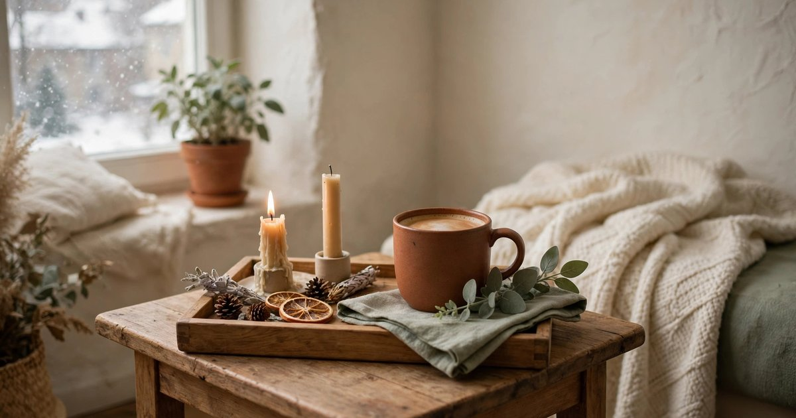
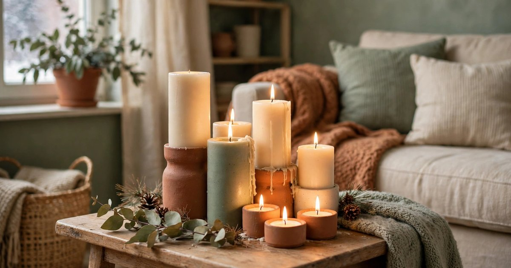
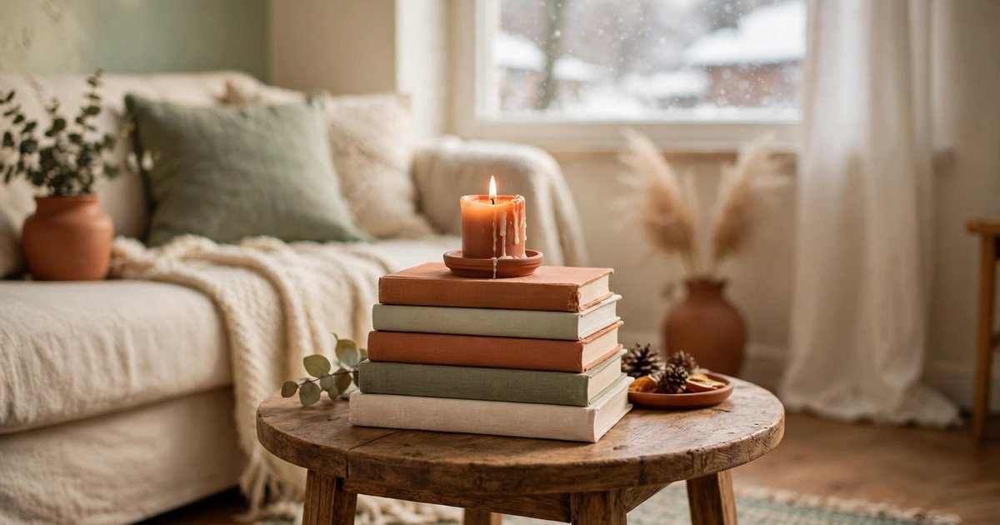
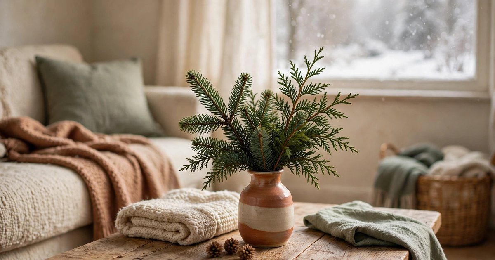
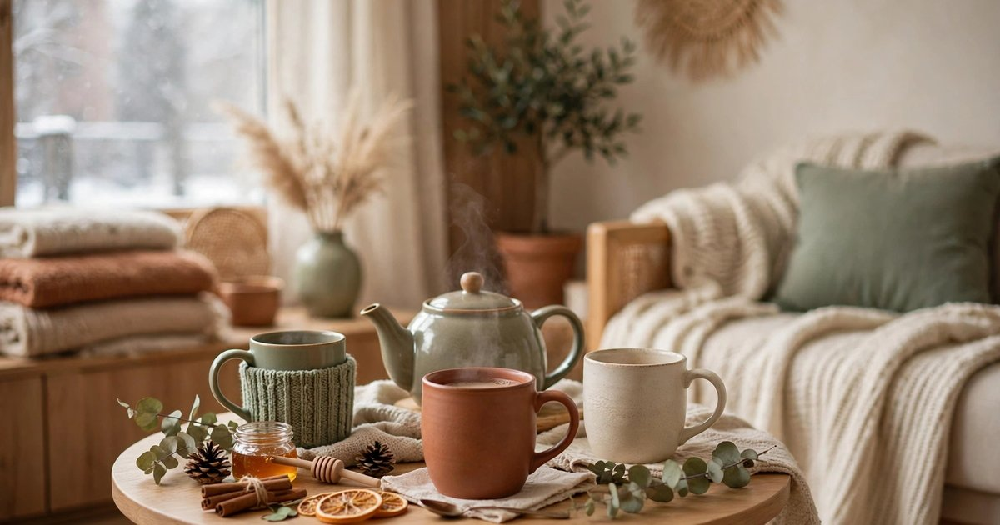
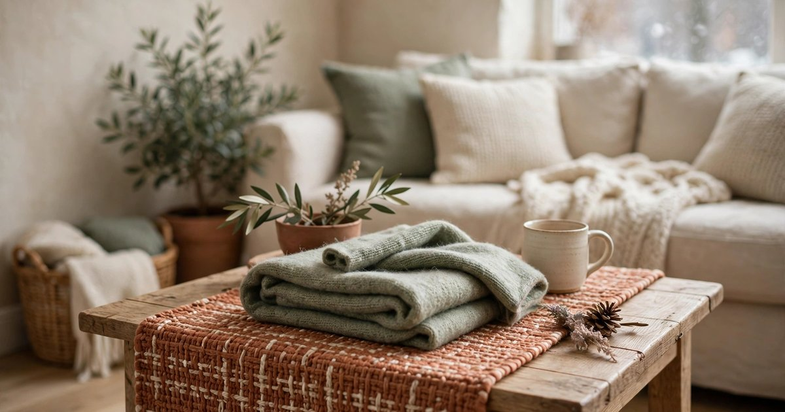
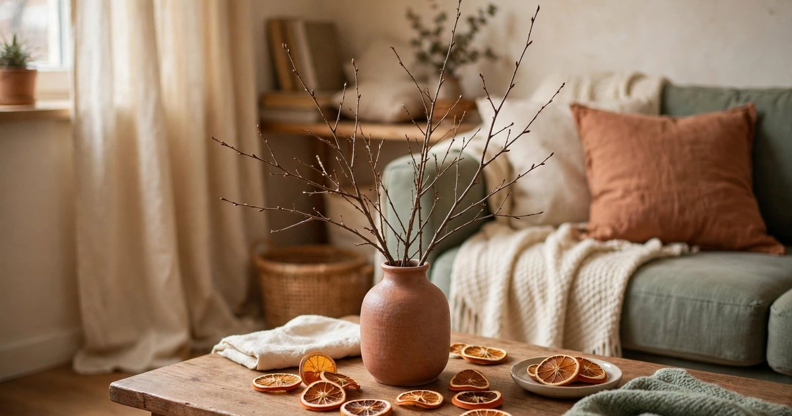
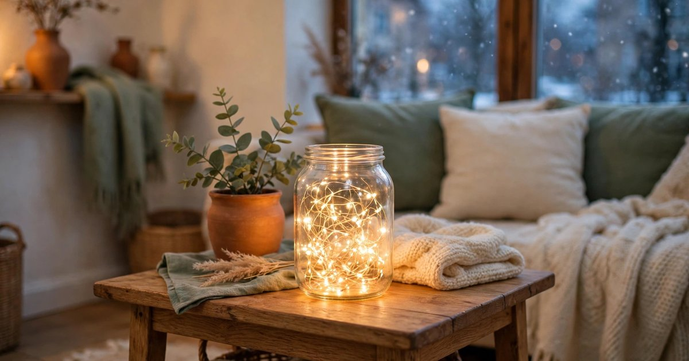
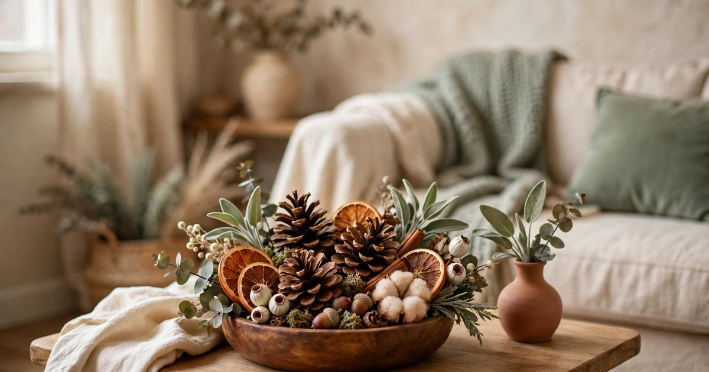
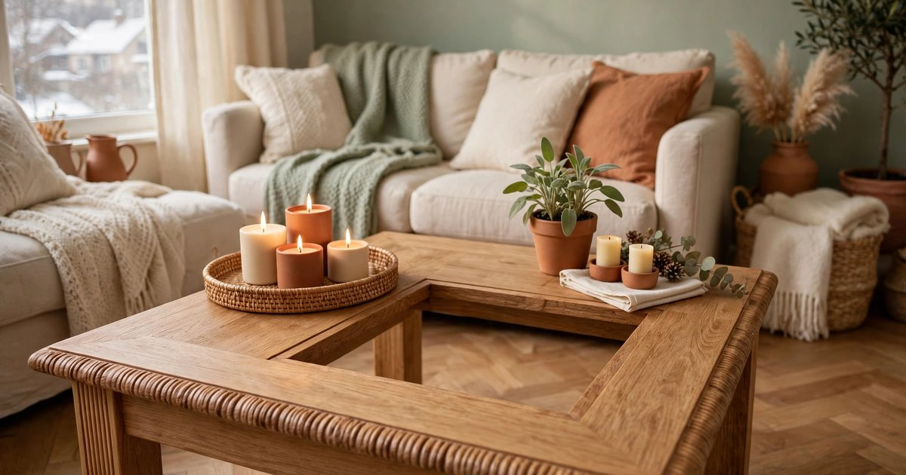

The coffee table is the hardest-working surface in a small apartment. It holds your tea, your book, your laptop, the remote you can never find, and — in winter — it is the first thing you see when you sit down with a hot drink at the end of a short, cold day. Styling it well does not need a big budget or a big table. It needs a few thoughtful layers, a little warmth, and the discipline to leave some space empty so the table can still do its job.

These ten ideas are all renter-friendly and budget-first: nothing here needs drilling, gluing, or anything you cannot pack into a box when you move. Most of them use things you already own — a tray, a stack of books, a candle, a mug — rearranged with a winter eye. Start with one idea and add another layer only if the table still has room to breathe.

### 1. Start With a Tray

A tray is the single best investment for a small coffee table, because it does two jobs at once: it gathers your decor into one tidy group, and it protects the table underneath from rings, wax and crumbs. A wooden tray, a rattan tray, or even a large serving board you already own will do. Pick one that leaves at least a third of the tabletop clear, so there is still somewhere to put a mug down without moving anything.

Group three things on the tray — a candle, a small stack of books, and something green — and you have a finished vignette. When friends come over, lift the whole tray off the table and you have a clear surface in seconds. A tray also makes cleaning easy: wipe the tray, not the table, and the whole arrangement stays put.

### 2. A Cluster of Candles

Nothing says winter like candlelight, and a cluster of candles is the cheapest way to make a small living room feel cosy after dark. Use three candles of different heights grouped close together — pillar candles, jar candles, or a mix of both — and the glow multiplies. Stick to one scent family, such as cedar, cinnamon or vanilla, so the room smells intentional rather than confused.

Safety matters in a small flat, especially with soft furnishings close by. Never leave a lit candle unattended, keep flames away from curtains and throws, and use a sturdy holder or a ceramic plate underneath each candle to catch drips. If you have pets or small children, battery candles with a flickering flame effect give you the same warm glow with none of the worry, and they cost very little to run.

### 3. A Stack of Books

A stack of two or three books is the classic coffee table move, and it works because it adds height, colour and personality in one go. Use books you actually like — a cookbook, a novel you are reading, a photography book — rather than books bought for their covers. Stack them largest at the bottom, smallest on top, and turn the top book slightly sideways so the stack looks relaxed rather than rigid.

The top of the stack is a ready-made pedestal for something small: a candle, a tiny plant, or a favourite ornament. The books also give you a place to rest a mug without it wobbling on an uneven surface, and they invite guests to pick something up and flick through it. If your table is very small, one book is enough — a single beautiful book with a candle beside it is a complete arrangement. Charity shops are the best source for handsome hardbacks at a fraction of bookshop prices.

### 4. A Sprig of Evergreen

A sprig of evergreen is winter decor at its simplest and cheapest. A few cuttings of pine, fir or [eucalyptus](/eucalyptus-decor-winter-ideas/) in a small vase or laid along the table bring scent, colour and life into a room for almost nothing. Ask a Christmas tree seller for offcuts, trim a branch from your own tree, or gather fallen sprigs on a walk — just check they are safe to bring indoors and give them a shake outside first.

Keep the arrangement small so it does not crowd the table. A single stem in a slim vase, or three short sprigs laid across a tray, is plenty. Evergreen lasts for weeks if you change the water and trim the stems every few days, and when it finally dries out, it still looks good — dried evergreen has a softer, silvery look that suits January perfectly. If [fresh greenery](/make-dried-flower-wreath-winter-guide/) is hard to come by, a good-quality faux sprig, bought once and reused every year, is the budget-friendly alternative.

### 5. A Mug Station for Slow Mornings

Winter mornings in a small flat are made for slow cups of tea and coffee, so give your favourite mugs a proper home on the coffee table. A small tray with two mugs, a jar of tea bags or coffee, and a tiny spoon turns the table into a drinks station and makes the whole room feel hospitable. It is decor you actually use, which is the best kind in a small space.

Choose mugs with some character — a handmade ceramic mug, a charity-shop find in a warm glaze, a mug from a place you love — and keep the colours in the same warm family as the rest of the table. A small teapot or a cafetière adds height and makes the arrangement feel generous. The trick is to keep the station tidy: two mugs, not six, and a coaster under each one so the table stays free of rings.

### 6. Layer Texture With a Runner or Throw

Texture is what makes a winter table feel warm rather than just decorated, and the cheapest way to add it is a runner or a folded throw laid across the table. A woven runner in cream or terracotta, a piece of linen, or even a folded wool throw draped across one end of the table softens the hard surface and ties the table into the rest of the room. It also protects the tabletop, which matters in a rental.

Keep the fabric low and flat so it does not get in the way of mugs and books — a runner should sit under your decor, not compete with it. Choose machine-washable fabrics, because a coffee table runner will meet coffee sooner or later. A runner is also the easiest way to change the look of the table for Christmas: swap a plain runner for a checked or festive one and the whole table changes with it.

### 7. A Small Vase of Winter Branches

Bare winter branches in a small vase are the most elegant — and cheapest — winter arrangement there is. A few twigs gathered on a walk, arranged in a jar or a small vase, bring height and sculpture to a coffee table without taking up much space. Add a couple of dried orange slices threaded on string, or a few cinnamon sticks tied with twine, and you have a decoration that smells as good as it looks.

Keep the branches short enough that they do not block the view across the table or poke anyone sitting on the sofa. A vase with a narrow neck holds branches upright better than a wide one, and a little water is not needed for bare twigs — they will keep for the whole season. This is a lovely idea for renters because it costs nothing, weighs nothing, and leaves nothing behind when you move. Swap the oranges for a few paper snowflakes in January and the arrangement carries you through the whole winter.

### 8. Fairy Lights in a Jar

Fairy lights in a jar are the small-apartment answer to a fireplace: a warm, flickering glow at eye level that makes the whole room feel softer. Fill a large glass jar, a lantern, or a clear vase with a short string of battery fairy lights, and you have a centrepiece that costs a few pounds and takes a minute to make. The glass magnifies the light, so even a short string looks generous.

Battery lights are the renter-friendly choice — no trailing wires, no socket needed, and a timer function means they switch themselves off. Keep the jar on a tray or a coaster so it does not scratch the table, and choose warm white lights rather than cool white, which can look harsh in a small room. A fairy-light jar works just as well on a dark January evening as it does in December, and it is one of the few Christmas-adjacent decorations that never needs to come down.

### 9. Pinecones and Natural Finds

[Pinecones](/pinecone-decor-ideas-winter-cost-almost-nothing/), acorns and dried seed heads are free winter decor, and a small bowl of them on the coffee table is the most honest kind of seasonal styling. Gather them on a walk, rinse them, and let them dry on a baking tray in a low oven for twenty minutes to kill any tiny passengers before bringing them indoors. A wooden bowl, a ceramic dish, or even a large mug holds them neatly and keeps them from rolling across the table.

A bowl of pinecones works because it is tactile — guests pick one up, turn it over, put it back — and because it is genuinely seasonal without shouting Christmas. Mix in a few cinnamon sticks or dried orange slices for scent, and keep the bowl small enough that it leaves room for everything else on the table. When spring arrives, tip the pinecones into the garden or the compost and the bowl is free for something else.

### 10. Keep a Clear Centre

The best winter coffee table idea is the one nobody lists: leave the middle clear. In a small apartment, the coffee table is a working surface, and a table so full of decor that you cannot put a mug down is a table that has failed. Push your styling to the edges — a tray on one side, a candle cluster on the other — and keep a clear space in the centre for cups, plates, books and board games.

A clear centre makes the whole arrangement look calmer, because the eye has somewhere to rest. It also makes the table easier to live with: you can eat dinner from it, work from it, or clear it in seconds when guests arrive. Think of your decor as a frame around the useful middle, not as a filling. The cosiest small living rooms are the ones where the table is styled and usable at the same time.

## A Table That Works as Hard as You Do

A winter coffee table does not need to look like a magazine spread. It needs to hold your tea, survive a board game night, and make you smile when you sit down at the end of the day. Start with a tray, add a candle and a book, and let the rest build slowly over the season.

## Frequently Asked Questions

### How do I style a coffee table in a very small apartment?

Keep it to three groups at most — a tray, a candle cluster, and a stack of books — and leave a third of the surface clear. Use a tray to contain the decor so the table can be cleared in seconds, and choose low, flat pieces that do not block the view across the room.

### What is the cheapest way to make a coffee table look wintry?

A tray you already own, three candles of different heights, and a sprig of evergreen or a few pinecones gathered outside. Together they cost very little — often nothing — and they give you warmth, scent and seasonal colour in one arrangement.

### Are candles safe on a coffee table in a rental?

Yes, with care: use sturdy holders on a ceramic plate or tray, keep flames away from throws and curtains, and never leave a lit candle unattended. Battery candles with a flickering effect are a worry-free alternative and are ideal if you have pets or small children.

### How do I stop coffee table decor from looking cluttered?

Follow the rule of three — three groups, not ten loose objects — and leave the centre of the table clear. Corral small items on a tray, keep everything low, and remove one thing before you add another.

### Can I use Christmas decor on my coffee table without it looking overdone?

Yes — pick one or two Christmas-adjacent touches, such as a sprig of evergreen, a few pinecones, or warm fairy lights, rather than a full festive display. These pieces work all winter long, so the table never looks out of season once December ends.
