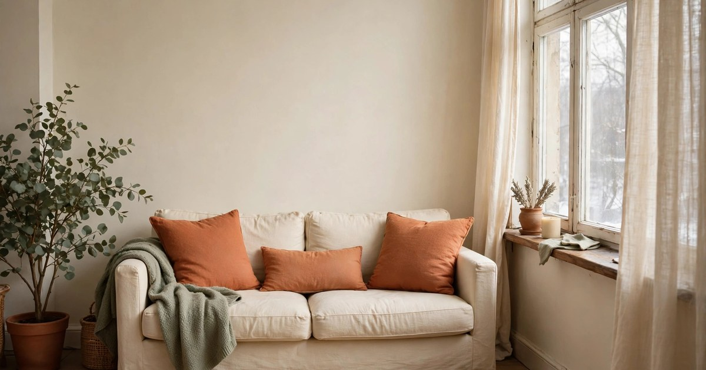
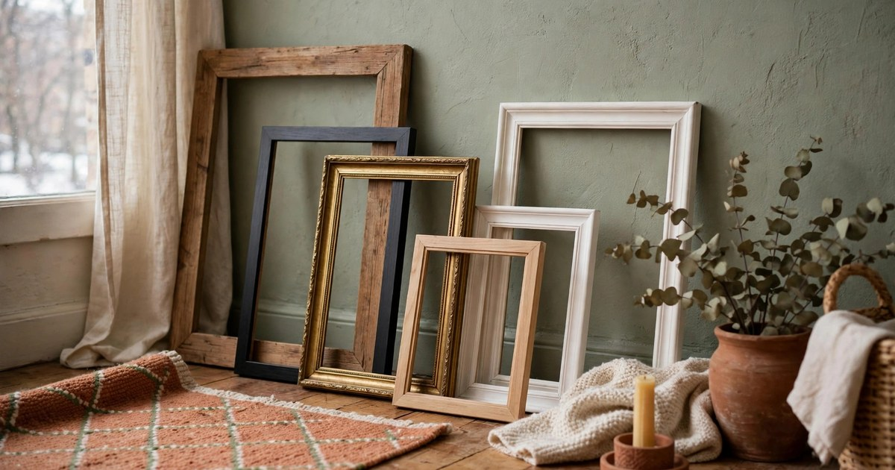
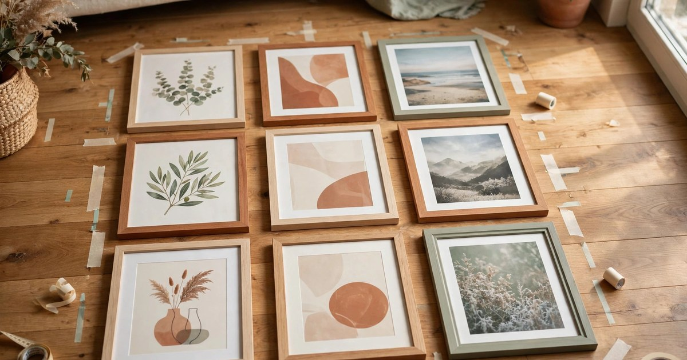
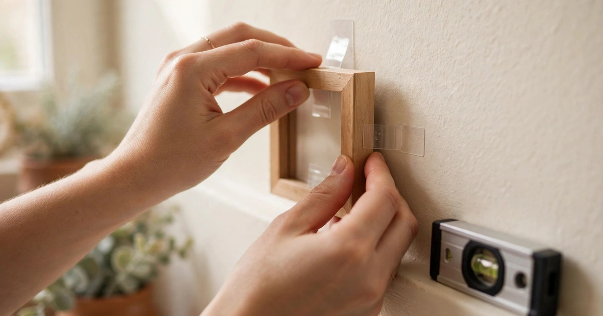
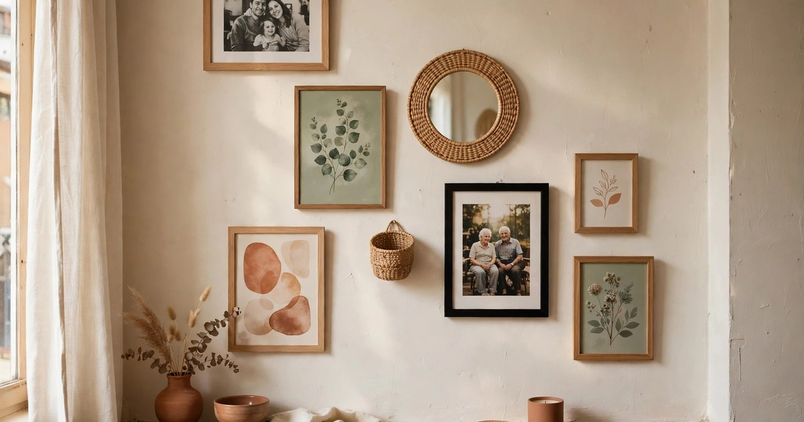
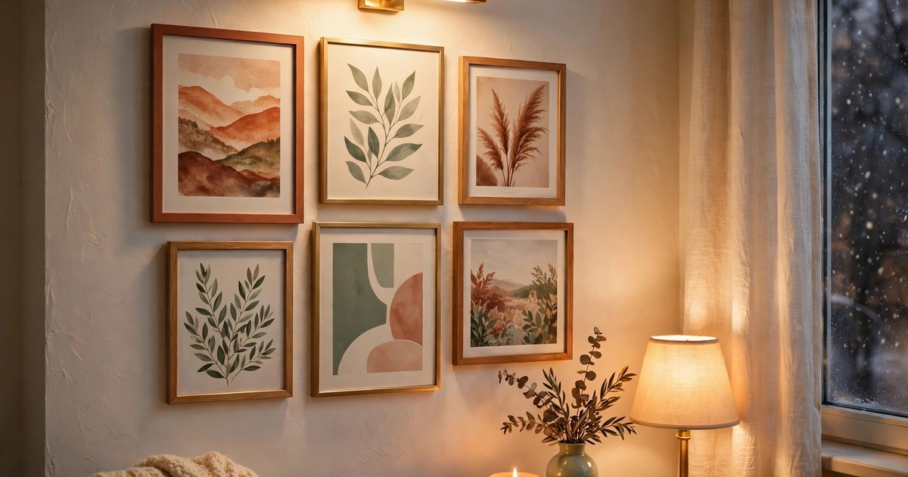

A gallery wall is the single best thing you can do for a small apartment in winter. When the days are short and the light is grey, a wall full of art, photos and things you love turns a plain room into a place that feels warm and personal. It costs almost nothing if you use frames you already own, it needs no drilling, and it makes a small space feel finished in a way that no single picture ever can. This guide walks you through the whole job, step by step, in one afternoon.

The winter angle matters: a gallery wall built for the cold months should feel warm. Think rich colours, textured frames, photos from summer holidays that remind you of sunshine, and prints that glow a little in lamplight. You are not decorating for a magazine; you are building a wall that makes January feel less grey. Every step below keeps renters in mind — nothing here damages a wall, and everything can come down in minutes when you move.

### Step 1. Pick Your Wall and Check the Light

Start by choosing the right wall. The best gallery wall in a small apartment is the one you see most: the wall behind the sofa, the wall opposite your bed, or the long wall in the hallway you walk past ten times a day. Avoid walls that get direct sun for part of the day, because sunlight fades prints faster than you expect, especially in winter when the sun sits low and shines straight in. A wall that gets soft, indirect light is ideal — your art will look its best in the evening lamplight, which is when you are actually home to enjoy it.

Stand in the room and look at the wall as a whole, not as a blank space to fill edge to edge. A gallery wall needs breathing room around it: leave at least fifteen centimetres between the outermost frame and the edge of the wall, the ceiling and the furniture below. In a small room, a gallery wall that stops short of the edges looks deliberate; one that runs into the corners looks accidental. Mark the outer edges lightly with painter's tape so you can see the shape before you hang a single frame.

### Step 2. Gather Frames You Already Own

Before you buy anything, gather every frame in the flat. Check the bedroom, the hallway, the top of the wardrobe — most of us own more frames than we realise, and a gallery wall is the perfect place to use them all. Mismatched frames are not a problem; they are the style. A mix of wood, black, gold and white frames looks collected and personal, while a set of identical frames looks like a furniture catalogue. The winter gallery wall should feel like it grew over time, even if you built it in one afternoon.

If you need more frames, charity shops are the best source: a pound or two per frame, and the odd sizes and old-fashioned finishes are exactly what makes a gallery wall interesting. Wash the glass, check the backs still close, and replace any cracked glass before you hang it. You need one frame more than you think — a spare lets you swap pieces around until the arrangement feels right, and it covers you if one frame turns out to be the wrong size once it is on the wall.

### Step 3. Choose a Colour Story for Winter

A gallery wall needs a colour story, and for winter the warm end of the spectrum works best. Pick two or three colours that repeat across the wall — terracotta, mustard and sage, for example, or burgundy, cream and gold — and let those colours appear in several different pieces. The repetition is what makes a wall of different pictures feel like one composition instead of a random pile. You do not need every piece to match; you need the colours to echo.

Lay your art and photos out and look for the repeats. A terracotta sunset, a mustard abstract, a sage botanical print and a cream photograph already share a story, even if they have nothing else in common. If one piece clashes badly with the rest, move it to another room — it will be happier there, and the wall will be happier without it. For winter specifically, favour warm tones and soft light in the images themselves: golden-hour photos, candlelit scenes and warm landscapes will make the whole wall glow when the lamps come on.

### Step 4. Lay It Out on the Floor First

Never hang a gallery wall straight onto the wall — always lay it out on the floor first. Clear a space on the floor the same size as your wall, and arrange the frames there, moving them around until the composition feels balanced. Start with the biggest piece slightly off-centre, then build outwards, keeping the gaps between frames roughly even — about five to eight centimetres works well. Step back and look at it from the doorway, because that is how you will see it every day.

Take a photo of the floor layout with your phone before you start hanging. You will forget the exact arrangement the moment you pick up the first frame, and the photo is your map. If the layout feels lopsided, check the visual weight: a dark, heavy frame on one side needs a dark frame or a cluster of small frames on the other side to balance it. Keep adjusting until the floor version makes you smile — the wall version will only ever be as good as the floor version.

### Step 5. Hang It Without Holes

Renters hang gallery walls with removable adhesive strips, and the trick is to use the right size for the weight. Check the weight rating on the packet and weigh your frames on kitchen scales if you are unsure — a large frame with glass is heavier than it looks. Clean the wall with a dry cloth first, press the strip firmly for thirty seconds, and wait an hour before hanging the frame so the adhesive bonds properly. For the heaviest piece, use two strips, one on each side, to spread the load.

Work from the centre outwards, hanging your anchor piece first and building around it. Use a small spirit level on your phone to check each frame, and stand back after every three or four frames to check the whole wall. If a frame is crooked, the strip lets you peel it off and reposition it — that is the whole point. When you move out, pull the strip tab straight down slowly and it comes off cleanly, leaving the wall exactly as you found it.

### Step 6. Mix Art, Photos and Objects

The best gallery walls are not all pictures. Mix in a small woven basket, a tiny mirror, a dried flower in a frame, a postcard, a piece of fabric — anything flat enough to hang and light enough for a strip. Objects break up the rectangles and make the wall feel like a collection rather than a display. In winter, natural textures work beautifully: a woven disc, a wooden ornament, a sprig of dried eucalyptus in a small frame. They add warmth that a print alone cannot.

Keep the objects small and light, and give each one the same spacing as the frames around it. One or two objects are enough; more than that and the wall starts to look like a shelf that fell over. The objects should also follow your colour story — a terracotta woven disc fits a terracotta wall, a gold mirror fits a gold wall. If an object does not fit the colours, it will stick out for the wrong reason.

### Step 7. Light It and Live With It

A gallery wall comes alive in the evening, so give it light. A battery picture light clipped above the centre piece, a string of warm fairy lights along the top edge, or simply a lamp angled towards the wall all make the art glow after dark. Battery lights are the renter's friend: no wiring, no drilling, and a remote control means you never have to reach up to switch them off. Warm white light, not cool white, keeps the winter colours rich.

Then live with the wall for a week before you judge it. You will notice things in daily use that you missed on hanging day — a frame that sits slightly high, a gap that wants a small print, a photo that deserves a better spot. Because everything is on removable strips, swapping pieces takes minutes. A gallery wall is never really finished; it grows with you, and the winter version is just the beginning. By spring you will have new photos and new favourites to add.

## Your Wall, Your Winter

A gallery wall is the most personal project in a small apartment, and winter is the best time to build one. It costs little, damages nothing, and turns the wall you stare at most into the wall you love most. Start with the frames you already own, follow the floor-first rule, and hang everything with strips. When the lamps come on tonight and the wall glows, you will wonder why the wall stayed blank for so long.

## Frequently Asked Questions

### How do I hang a gallery wall in a rental without damage?

Use removable adhesive strips rated for the weight of each frame. Clean the wall first, press the strip for thirty seconds, wait an hour before hanging, and pull the tab straight down slowly when you remove it. Heavy frames need two strips. Never use nails or screws in a rental unless your tenancy agreement allows it.

### How many frames do I need for a gallery wall?

Five to nine frames fill a typical small-apartment wall nicely. Fewer than five can look sparse unless the frames are large; more than nine gets hard to balance. Start with what you own, fill gaps with postcards and small prints, and add pieces over time rather than buying everything at once.

### What is the best layout for a small gallery wall?

Lay the frames on the floor first, start with the largest piece slightly off-centre, keep gaps of five to eight centimetres between frames, and leave breathing room at the edges of the wall. Take a photo of the floor layout and use it as your map when hanging.

### How do I choose art for a winter gallery wall?

Pick a colour story of two or three warm colours — terracotta, mustard, sage, burgundy, gold — and choose pieces where those colours repeat. Favour warm-toned images, golden-hour photos and textured pieces, because they glow in winter lamplight and make the room feel cosy after dark.
