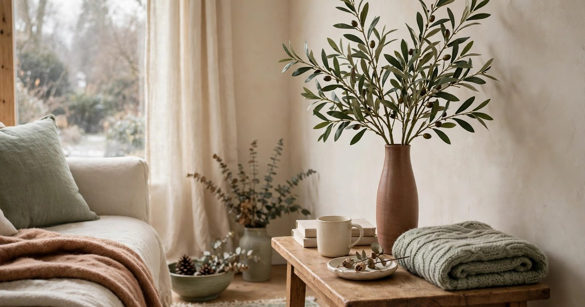
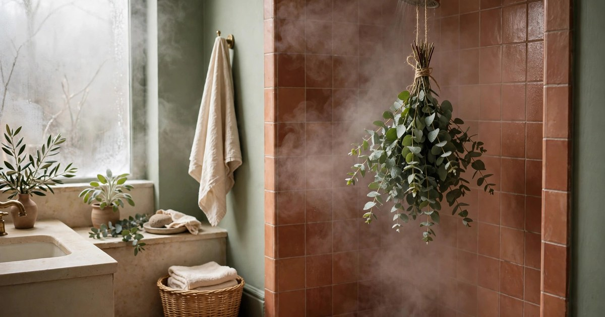
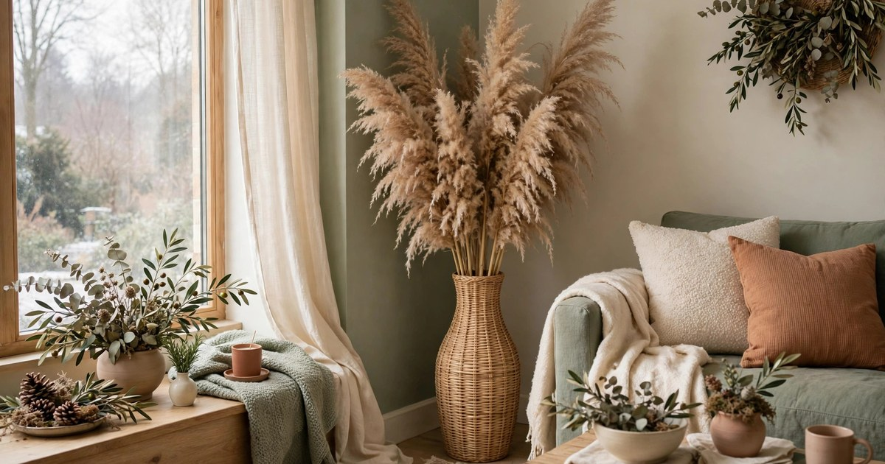
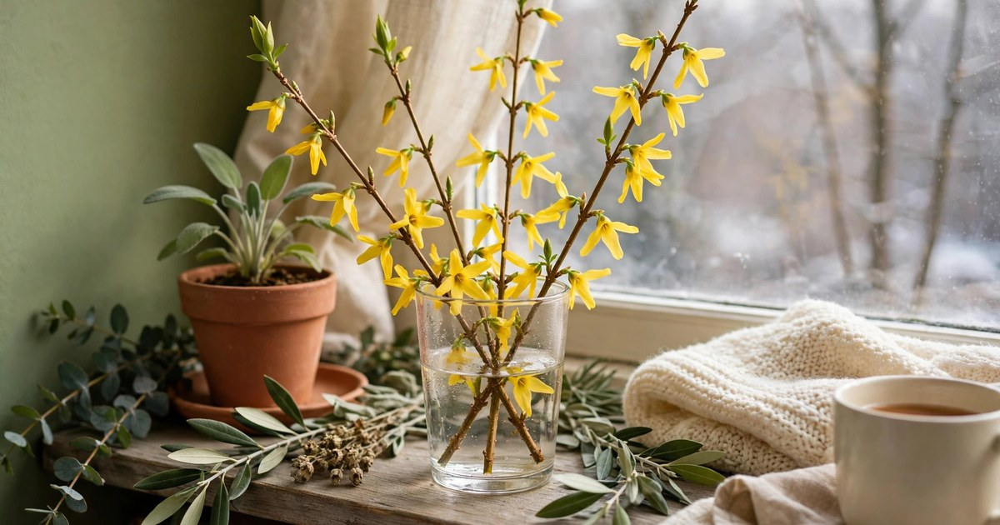
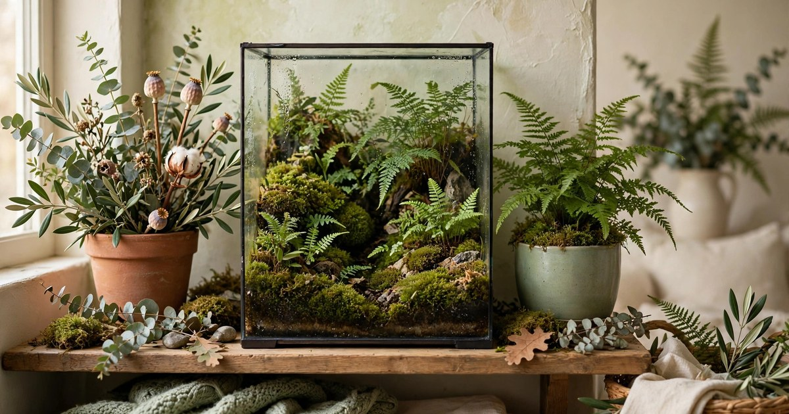
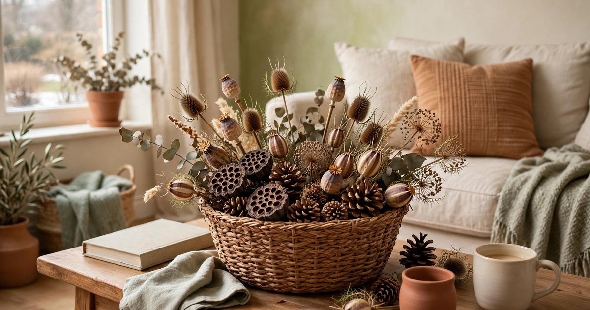
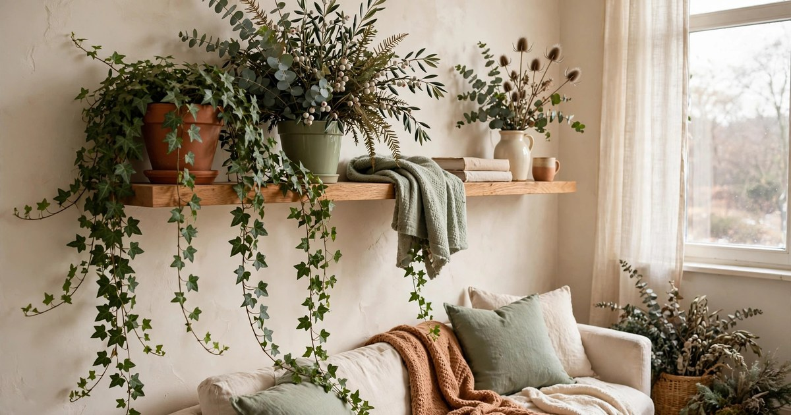
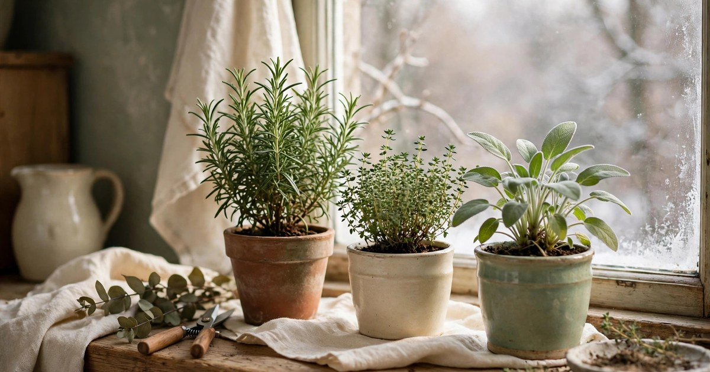
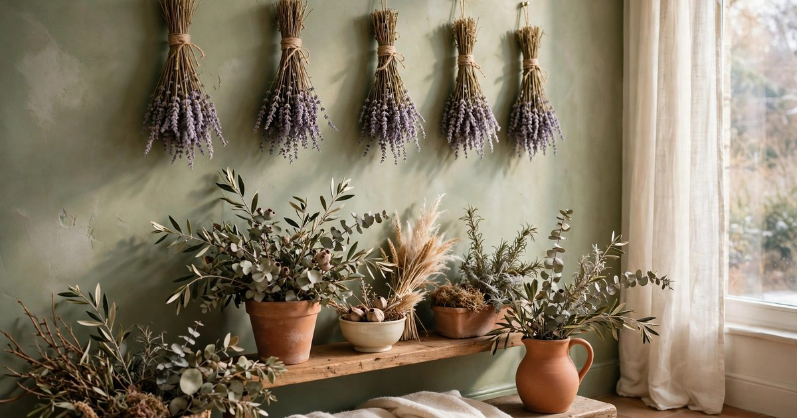
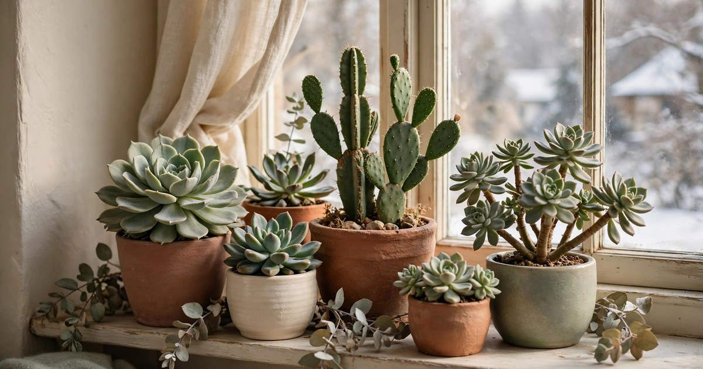

Not everyone wants their home to look like Christmas from November to January, and not every green thing in winter is festive. There is a whole world of winter greenery that has nothing to do with baubles and tinsel: olive branches, eucalyptus, dried grasses, forced branches, and herbs that smell wonderful and look sculptural. These ideas keep a flat green and alive through the darkest months, they work in any rental, and — best of all — they do not need to come down in January, because they were never Christmas decorations in the first place.

### 1. Olive branches in a tall vase

Olive branches are the quiet luxury of winter greenery: silvery-green, slender, and sculptural, with a softness that no other branch has. A tall bunch in a simple vase — ceramic, glass, or terracotta — looks like a deliberate design choice rather than a decoration, and it suits every room from a hallway console to a bedroom dresser. Fresh branches last two to three weeks in water; dried ones last all winter and still look beautiful.

The trick is height and sparseness. Use a vase tall enough that the branches arc above it, and do not crowd them — five or six stems with room to breathe look more expensive than a packed bunch. Olive branches are also wonderfully forgiving in a small flat: they take up almost no surface area, they need no light, and they bring a Mediterranean calm to a grey winter room. If you love the trailing-plant look but want something seasonal, our [trailing plant winter styling ideas](/trailing-plants-small-apartment-winter-ideas/) pair beautifully with a vase of olive branches.

### 2. Eucalyptus bundles in the shower

Hanging a bundle of eucalyptus from the shower head is the winter greenery idea that people become evangelical about, because it works on two senses at once. The steam releases the eucalyptus oils, so every shower smells like a spa, and the silvery bundle looks beautiful against tile. Tie a small bunch with twine, hang it from the shower head or a hook where it catches steam but not the direct water stream, and replace it every two to three weeks.

Fresh eucalyptus from a florist or supermarket costs a few pounds or dollars and lasts well in a humid bathroom. If your bathroom has no window, eucalyptus is ideal because it is cut greenery, not a plant — it needs no light at all. Keep the bundle out of the direct spray so it dries between showers rather than going soggy, and when the scent fades, crush a few leaves between your fingers to wake it up before replacing the bunch.

### 3. Dried pampas grass in a floor vase

Pampas grass is the winter greenery for people who kill plants, because it is already dried and therefore impossible to kill. A tall bunch in a floor vase fills an awkward corner — the spot behind a door, the gap beside a bookcase — with soft, feathery height, and it does it without light, water, or any care at all. In a small flat, that combination of impact and zero maintenance is hard to beat.

Choose a vase heavy enough that the plumes cannot topple it, and keep the bunch away from radiators and open flames, because dried grass is flammable. A light hairspray mist over the plumes reduces shedding, which is pampas's one annoying habit. The colour matters too: natural cream and beige plumes suit a warm, neutral flat, while dyed plumes in terracotta or sage can echo your room's palette. One tall bunch is enough — two bunches in a small room start to look like a field.

### 4. Force branches into early bloom

Forcing branches is the closest thing to magic in winter decorating: cut a few forsythia, cherry, or willow branches in late winter, bring them indoors, and within two to three weeks they bloom on your windowsill while it is still freezing outside. The branches cost nothing if you have a garden or a neighbour who prunes, and the flowers — bright yellow forsythia, soft pink cherry — are the first colour of the year in a grey flat.

Cut branches on a mild day, smash or split the cut ends so they take up water, and stand them in a tall vase of warm water in a bright spot. Change the water every few days and mist the buds, and most branches bloom within three weeks. Willow and forsythia are the most reliable for beginners; cherry is more temperamental but worth it for the blossom. When the flowers fade, the branches themselves still look sculptural for weeks, so nothing is wasted.

### 5. Build a moss and fern terrarium

A terrarium is a whole green world in a jar, and winter is the perfect season for one, because it thrives on neglect and low light. Layer pebbles, charcoal, and soil in a glass container, add a small fern, a patch of moss, and maybe a tiny fittonia, and you have a self-contained garden that needs watering only every few weeks. It sits on a shelf, a desk, or a windowsill, and it stays green while everything outside is bare.

The closed or semi-closed terrarium is the easiest version: the glass traps humidity, so the plants water themselves from condensation. Keep it out of direct sun (which cooks the plants) and in bright indirect light, and open the lid occasionally if condensation gets heavy. For a small flat, a terrarium is ideal because it concentrates greenery into one beautiful object instead of spreading pots across every surface — one jar, maximum impact, minimum work.

### 6. Fill a basket with pinecones and seed heads

A basket of pinecones, dried seed heads, and interesting seed pods is winter greenery at its most honest: no flowers, no fuss, just the shapes nature leaves behind. Collect pinecones on a walk, add dried allium heads, teasels, or lotus pods from a florist, and pile them in a woven basket on the coffee table or the hearth. The result looks gathered rather than bought, which is exactly the charm.

This is the cheapest idea on the list if you forage — pinecones are free — and the most forgiving, because nothing can die and nothing needs care. Keep the basket where it can be touched and rearranged, because part of the pleasure is handling the shapes. If the basket starts to look dusty, a quick shake outside refreshes it. And unlike Christmas decorations, a basket of seed heads stays out all winter and into spring without ever looking out of season.

### 7. Let ivy trail from a shelf

Ivy is the winter plant that actually likes winter: it tolerates low light, cool rooms, and forgetful watering better than almost any other houseplant, and its trailing stems turn a bare shelf into a green waterfall. Put a pot on a high shelf or in a hanging planter, let the stems cascade, and trim them when they get too long — the cuttings root in water, so one plant becomes several within a season.

In a small flat, trailing plants are space-efficient greenery because they use vertical space — shelves and walls — instead of floor and surface area. Ivy suits a cool hallway, a north-facing room, or a bathroom with a window, all the spots where fussier plants fail. Keep the soil barely moist rather than wet, and wipe the leaves occasionally, because dusty leaves photosynthesise poorly in weak winter light. If you want more trailing ideas, our winter trailing-plant guide covers the best varieties for small spaces.

### 8. Grow a winter herb garden on the sill

A windowsill herb garden is winter greenery you can eat, which makes it the most practical idea on this list. Rosemary, thyme, and sage all tolerate cool windowsills and weak winter light, they smell wonderful every time you brush past them, and they turn ordinary winter cooking — roasts, soups, stews — into something that tastes like you meant it. Three small pots on a kitchen sill are enough to start.

Give herbs the brightest windowsill you have, water sparingly (winter herbs rot faster from overwatering than from thirst), and snip regularly, because cutting encourages bushy growth. If your sill is very dark, a small grow light makes the difference between surviving and thriving — and at under $25, it is a small investment for fresh herbs all winter. For the full windowsill approach, our [winter windowsill garden guide](/winter-windowsill-garden-guide/) covers pots, soil, and light in detail.

### 9. Hang dried lavender bundles

Dried lavender is summer's scent preserved for winter, and a few bundles tied with twine and hung on a wall or a door are both decoration and aromatherapy. The purple-grey colour suits a winter palette beautifully — muted, soft, and calm — and the scent releases every time you pass, especially in a warm room. Hang bundles in the bedroom for the calmest version, or in the hallway where every arrival gets a breath of summer.

Buy dried bundles from a florist or dry your own in summer by hanging fresh stems upside down for two weeks. Lavender keeps its scent for months, and when it fades, crumbling a few buds into a sachet refreshes it. Unlike fresh flowers, dried lavender needs no water, no light, and no care — it simply hangs there, smelling faintly wonderful, until you decide to take it down. In a rental, a bundle on a removable hook is the definition of no-damage decorating.

### 10. Display sculptural succulents and cacti

Succulents and cacti are winter's most sculptural plants: architectural shapes, muted greens and blues, and a tolerance for dry air and neglect that makes them perfect for heated flats. A group of three or five in terracotta pots on the sunniest windowsill looks like a deliberate collection rather than a random assortment, and the variety of shapes — rosettes, columns, trailing strings — gives you visual interest without a single flower.

Winter care is minimal: water only when the soil is fully dry, which may mean once a month, and keep them in the brightest spot you have, because weak light makes them stretch. Rotate the pots occasionally so they grow evenly. Succulents are also the best winter greenery for travellers, because a fortnight away over the holidays will not harm them at all — unlike most houseplants, they prefer to be left alone.

## Green All Winter, No Tinsel Required

Winter greenery does not need a holiday to justify it. Olive branches, eucalyptus, pampas, forced branches, terrariums, seed heads, ivy, herbs, lavender, and succulents keep a flat alive and beautiful from November to March, and none of them need to come down in January, because they were never pretending to be Christmas. Start with the easiest one — a bundle of eucalyptus in the shower, or a basket of pinecones on the table — and let the green build from there. By February, when everyone else's flat is bare again, yours will still be growing.

## Frequently Asked Questions

### What greenery can I display in winter without it looking like Christmas?
Olive branches, eucalyptus, pampas grass, dried lavender, and succulents all read as winter rather than festive, especially without red, gold, or fairy lights. Keep the palette muted — silver-green, cream, terracotta — and avoid baubles, tinsel, and red ribbon.

### How do I keep cut winter greenery fresh indoors?
Stand fresh branches in water, change the water every few days, and mist them regularly. Eucalyptus lasts two to three weeks in a steamy bathroom; olive branches last two to three weeks in a vase. Dried greenery — pampas, lavender, seed heads — needs no care at all.

### Which winter plants survive a dark apartment?
Ivy, ferns in a terrarium, and succulents on the brightest sill are the most forgiving. For herbs on a dark windowsill, a small grow light makes the difference between surviving and thriving through winter.

### Is dried greenery safe in a small flat?
Yes, with one caution: dried grass and seed heads are flammable, so keep them away from radiators, candles, and open flames. Otherwise they are ideal for small flats — no water, no light, no mess, and nothing to store in spring.
