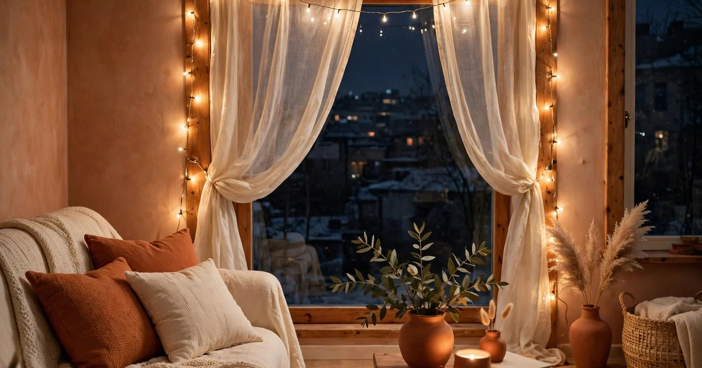
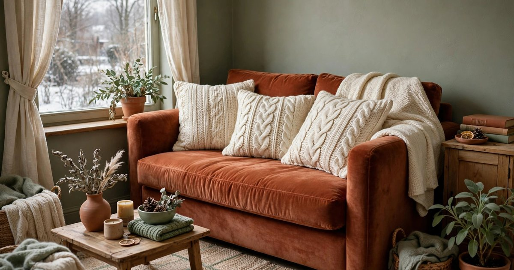
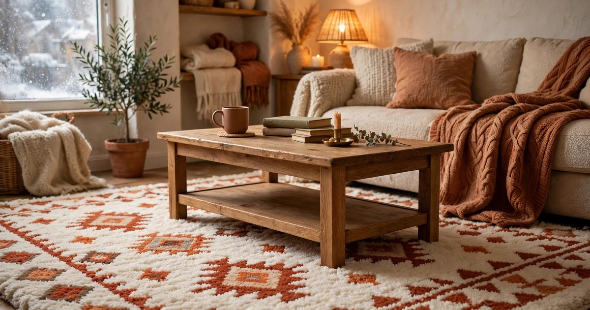
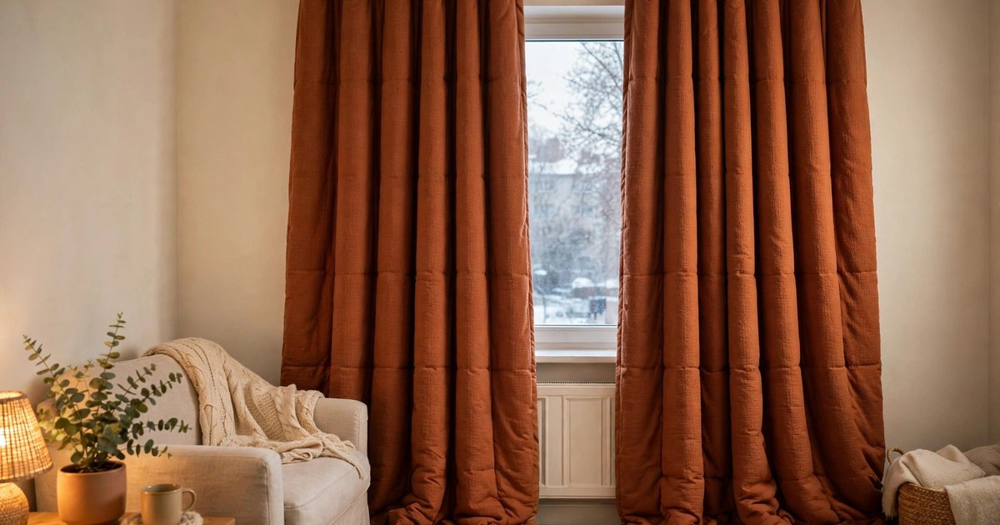
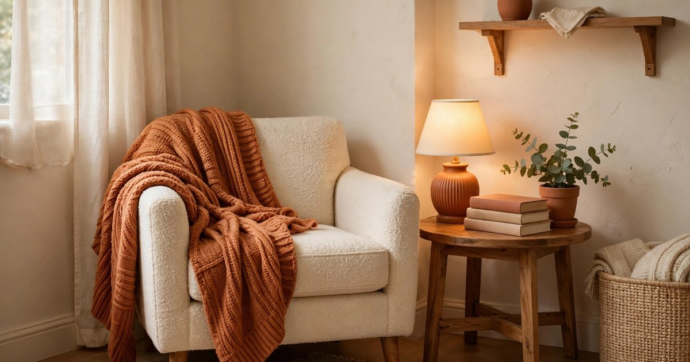
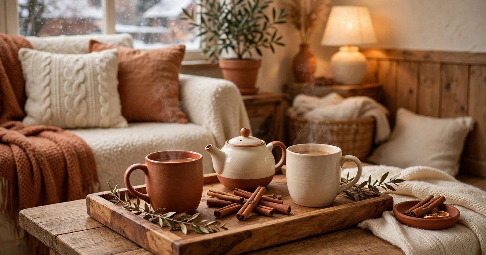
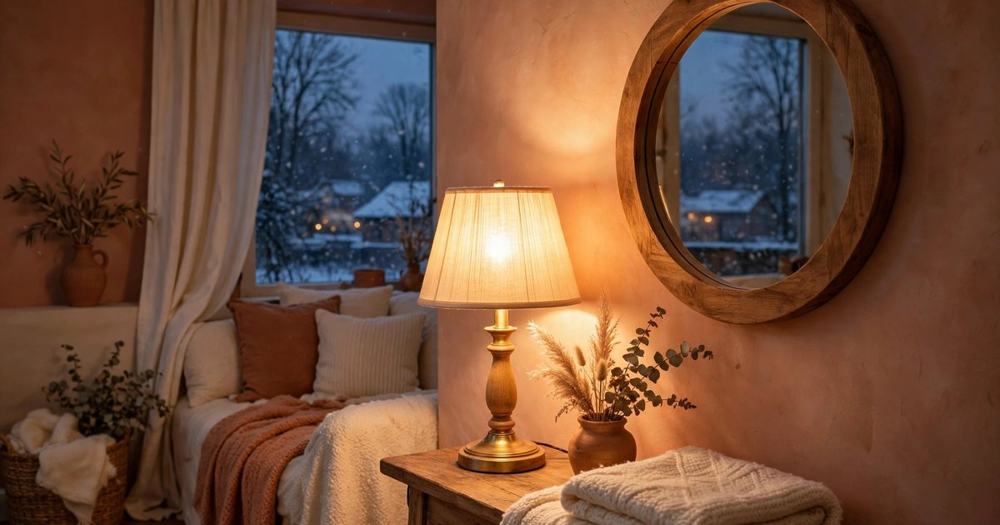

When winter arrives, a small apartment living room can feel like the coldest spot in the flat. The sofa sits against a chilly wall, the bare floor feels icy underfoot, and the thin curtains you loved in summer now let every draught through. But a small room is also the easiest room to warm up — there is less space to fill, less furniture to dress, and every single change you make is visible from the sofa. A few well-chosen layers can turn a cold, bare living room into the cosiest corner of your home, and you do not need a big budget or a landlord's permission to do it.

The trick with winter decorating in a small apartment is to think in layers rather than in purchases. Winter is the season of texture: thick knits, soft fleece, warm lamplight, the smell of a candle, a rug under your feet. Each layer you add does two jobs at once — it looks warmer and it feels warmer. A chunky throw draped over the sofa arm is both a colour accent and something to pull over your knees. A rug is both a design anchor and a barrier between your feet and a cold floor. A string of fairy lights is both decoration and a soft, warm glow that makes the whole room feel smaller and safer on a dark evening.

Every idea in this guide is renter-friendly and budget-first. Nothing here needs drilling, painting, or a landlord's written approval, and every idea is built around pieces that cost under $25 — the kind of small, clever buys that transform a room without transforming your bank balance. Most of them can be packed away in a single box when spring comes, and the best ones do double duty all year round. Here are ten winter living room decor ideas that work in the smallest of flats.

### 1. Drape a chunky knit throw over the sofa

Nothing says winter faster than a chunky knit throw. The moment you drape one over the arm of the sofa, the whole room changes: the flat, summery lines of the furniture soften, the colour palette warms up, and the room suddenly looks like somewhere you want to curl up with a book. In a small apartment, where the sofa often dominates the room, a throw is the single highest-impact change you can make for the least money — it covers the largest surface in the room and sets the tone for everything else.

Choose a throw in a warm winter colour that suits your room — terracotta, deep mustard, rust, or a warm cream if your sofa is dark. A chunky knit or waffle texture reads as winter immediately, while a flat, smooth blanket reads as all-year-round. Size matters in a small flat: a throw that is too big will swallow a loveseat and end up trailing on the floor, while one that is too small looks like an afterthought. For a two-seater sofa, a throw of around 130 by 170 centimetres is usually right — long enough to drape across the back and fold over the arm, short enough to stay put.

Styling is simple and forgiving. Drape it casually over one arm or across the back of the sofa rather than folding it into a perfect rectangle — a slightly rumpled throw looks lived-in and inviting, while a perfectly folded one looks like a display in a shop. Tuck one corner behind a cushion to stop it sliding, and keep it within reach so you can actually use it: a throw that gets used every evening is a throw that earns its place. If your sofa is a plain, landlord-issue grey or beige, the throw is also your cheapest way to add colour without buying new furniture. A second, lighter throw in a contrasting colour folded over the first adds depth, and in the coldest weeks you will be glad of the extra layer.

Find a chunky knit throw on Amazon: [chunky knit throw blanket terracotta](https://www.amazon.com/s?k=chunky+knit+throw+blanket+terracotta&tag={{AMAZON_TAG}})

### 2. Add warm candlelight — safely, with battery candles

Candlelight is the cheapest atmosphere money can buy. A few flickering flames on a coffee table or a windowsill turn a plain small living room into a warm, glowing retreat, and the effect is strongest in winter, when the evenings are long and the room is dark by late afternoon. The problem in a small rented flat is that real candles and a landlord's rules do not always mix — a forgotten flame near a curtain in a small room is a genuine risk, and many tenancy agreements ban open flames outright.

Battery-operated LED candles solve the problem completely. Modern flameless candles flicker realistically, cast a warm amber glow, and many come with a remote control and a timer, so they switch themselves on at dusk and off at bedtime. You get the entire atmosphere of candlelight with none of the worry, and you can put them anywhere — inside a lantern on the floor, on a bookshelf next to paperbacks, in a cluster on the coffee table, or on a windowsill where a real flame would be a bad idea. In a small room, three candles of different heights grouped together look far more deliberate than a single candle lost on a big surface.

Style them with the same warm palette as the rest of the room. A cluster of cream pillar candles in a wooden tray, a lantern with a candle inside on the floor beside the sofa, or a single candle on a stack of books all work. The warm light also flatters everything around it — the throw looks softer, the cushions look richer, the whole room looks more expensive than it is. Keep a set on the coffee table where you will actually see them every evening, and set the timer so the room greets you with a glow when you come home. It is a small ritual that makes a rented flat feel like yours.

Find battery candles on Amazon: [battery operated flameless LED candles with remote](https://www.amazon.com/s?k=battery+operated+flameless+LED+candles+remote&tag={{AMAZON_TAG}})

### 3. String fairy lights along the window or shelf

If candles are the cheapest atmosphere, fairy lights are the second cheapest — and in a small apartment they do something candles cannot: they outline the shape of the room itself. A string of warm white fairy lights draped along a window frame, a shelf edge, or the top of a bookcase draws the eye around the room and makes the space feel intentional and glowing, like a little grotto. In the depths of winter, when the light outside fades by mid-afternoon, they are often the difference between a room that feels dark and a room that feels magical.

The key is warm white, not cool white. Cool white fairy lights look like a shop window in December; warm white looks like firelight. Choose a battery-operated set with a timer so you are not hunting for a plug socket behind the sofa, and pick a length that fits the spot you have in mind — a two- or three-metre string is usually right for a window or a single shelf in a small flat. Copper wire lights are the easiest to shape: the thin wire bends around a frame, tucks behind books, or winds through a plant without looking bulky, and the tiny lights disappear into the background while the glow remains.

Placement matters more than quantity. One well-placed string beats three tangled ones. Try them along the top of the window frame, where they soften the hard rectangle of glass and frame the view; or along a shelf, where they light the books and objects from behind and make the shelf feel like a display. In a renter's flat, use clear removable adhesive hooks rather than nails or pins — they hold the wire, come off cleanly, and keep your deposit safe. Avoid draping lights across the ceiling in a small room: it pulls the eye upward and makes the ceiling feel lower. Keep them low, warm, and close to where you sit, and they will do their best work right beside you.

Find warm white fairy lights on Amazon: [warm white fairy lights battery operated copper wire](https://www.amazon.com/s?k=warm+white+fairy+lights+battery+operated+copper+wire&tag={{AMAZON_TAG}})

### 4. Swap in cosy cushion covers in winter textures

Cushion covers are the fastest seasonal swap in any living room, and in a small apartment they are the most efficient one. A sofa takes up a huge share of the room, and changing the cushions changes the look of the sofa without buying anything large. Swap out the thin cotton or linen covers you used in summer for velvet, corduroy, faux fur, or chunky knit, and the sofa instantly looks — and feels — like winter. The cushions you sit against are also the cushions you touch, so the texture change is something you feel every evening, not just something you see.

Keep the palette tight. Two or three cushion covers in warm, coordinating colours — terracotta and cream, mustard and rust, sage and cream — will look far more considered than five random cushions in five different colours. In a small room, too many cushions also eat the seating: two or three well-chosen cushions on a two-seater is plenty, and they leave room to actually sit down. Mix textures rather than patterns for a calm, expensive look: a velvet cushion next to a knit one next to a smooth cotton one in the same colour family reads as layered and deliberate.

The renter-friendly part is the price and the storage. Cushion covers cost very little, they slip over the inserts you already own, and when spring comes they fold flat into a drawer. Buy covers rather than whole cushions — the inserts are the bulky, expensive part, and you already have them. Look for covers with a hidden zip so they are easy to swap and wash, and choose a size that matches your inserts so they sit plump rather than baggy. A set of two or three covers in winter textures is one of the best under-$25 spends in this whole list, because it changes the room every single day for a whole season.

Find winter cushion covers on Amazon: [velvet cushion covers terracotta set](https://www.amazon.com/s?k=velvet+cushion+covers+terracotta+set&tag={{AMAZON_TAG}})

### 5. Lay down a soft rug to warm cold floors

In winter, the floor is where a small apartment feels coldest. Bare laminate, tile, or thin carpet lets the chill straight through, and the first thing your feet touch in the morning sets the tone for the whole day. A rug fixes that in a single move: it insulates the floor, softens the sound of the room, and anchors the furniture into a proper living area instead of a scatter of pieces on a bare floor. It is also one of the most visible changes you can make — a rug covers a large area, so its colour and texture shape the whole room.

Size is the thing most people get wrong. A rug that is too small looks like a doormat and makes the room feel smaller; a rug that is too big swallows the space and creeps under every piece of furniture. In a small living room, aim for a rug that sits under the front legs of the sofa and the coffee table, with a border of floor showing around it — roughly 120 by 180 centimetres works in most small flats. That size is big enough to feel generous underfoot and small enough to fit a room that also holds a television, a bookshelf, and a doorway.

Choose a thick, soft pile in a warm colour — cream, warm beige, or a muted terracotta pattern — and a low-pile or flatweave if you have a vacuum that struggles with deep pile. A rug pad underneath stops it sliding on a hard floor and adds another layer of insulation, which matters on a cold ground floor. In a rented flat, a rug is also a quiet act of protection: it guards the landlord's floor from scuffs and spills, which is exactly the kind of thing that keeps a deposit safe. And when you step out of bed or off the sofa onto something soft and warm instead of cold laminate, you will wonder why you waited until winter to buy it.

Find a cosy living room rug on Amazon: [soft thick area rug living room cream](https://www.amazon.com/s?k=soft+thick+area+rug+living+room+cream&tag={{AMAZON_TAG}})

### 6. Hang heavier curtains or add thermal liners

Windows are where a small apartment loses most of its heat, and thin summer curtains do nothing to stop it. Heavy curtains or thermal liners are the most practical winter decor idea on this list: they look warmer, they genuinely keep the room warmer, and in a rented flat they can cut the draught that makes the sofa feel cold even when the heating is on. A window dressed for winter changes the whole feel of the room — the glass disappears behind soft, heavy fabric and the room feels enclosed and snug.

If you already have curtains, you do not need to replace them. Thermal curtain liners clip or hook onto the back of your existing curtains and add the insulation without changing the look of the room at all. They are cheap, they are renter-friendly, and they come off in spring. If your windows have only blinds, or a flimsy sheer, a pair of heavy curtains in a warm colour — terracotta, deep sage, warm cream — will transform the wall in one move. Hang them from a tension rod inside the window frame if you cannot drill, or from the existing rail if there is one; a tension rod costs very little and leaves no holes at all.

Length matters. Curtains that just skim the windowsill look neat but let cold air pool underneath; curtains that reach the floor look luxurious and block the draught properly. In a small room, floor-length curtains also make the window look taller, which makes the room feel taller. Choose a fabric with some weight — velvet, heavy cotton, or a lined polyester that mimics it — and keep the colour warm. Draw them at dusk, when the temperature drops, and open them in the morning to let in whatever winter sun there is. It is a two-minute habit that makes a real difference to how warm the room feels.

Find thermal curtain liners on Amazon: [thermal curtain liners for windows insulation](https://www.amazon.com/s?k=thermal+curtain+liners+windows+insulation&tag={{AMAZON_TAG}})

### 7. Create a winter reading nook in a corner

Every small living room has a corner that does nothing — the awkward space beside the bookshelf, the gap between the sofa and the wall, the spot by the window that is too small for furniture. In winter, that dead corner is an opportunity: turn it into a reading nook and you have created a whole new reason to love your living room. A nook needs almost nothing — a chair, a light, and something soft — and it gives the room a destination, a place that is not the sofa and not the television.

Start with the seat. An armchair is ideal, but a floor cushion, a pouffe, or even a dining chair with a thick cushion and a folded throw will do. The point is a seat that is yours alone, facing into the room rather than at the screen. Add a small side table or a stack of books for a mug, and a lamp that throws a pool of warm light over the seat — a clip-on reading light or a small table lamp is enough, and in a small flat a battery-operated lamp avoids trailing cables. Drape a throw over the arm of the chair and add one cushion, and the corner is done.

The magic of a reading nook is that it makes the room feel bigger, not smaller. A corner that was empty and awkward now has a purpose, and the room reads as a place with layers — a sofa for company, a nook for solitude. It also gives you somewhere to go on a dark winter evening that is not the bed and not the sofa, which matters more than it sounds when you live in one small room. Keep a book or two on the side table so the nook looks lived-in even when you are not in it, and it will quietly become the warmest spot in the flat.

Find a small reading lamp on Amazon: [small table lamp warm light reading nook](https://www.amazon.com/s?k=small+table+lamp+warm+light+reading&tag={{AMAZON_TAG}})

### 8. Bring in natural winter greenery

Winter decor does not have to mean plastic snowflakes and glitter. The most elegant winter greenery is the simplest: a few stems of eucalyptus in a vase, a branch of pine on the mantel, a small bowl of pinecones on the coffee table. Natural greenery brings colour, scent, and life into a room that can feel grey and still in winter, and it does it without a single battery or plug. In a small apartment, one good vase of greenery is worth more than a whole shelf of ornaments.

Eucalyptus is the easiest starting point. A bunch of dried eucalyptus stems lasts for months, smells wonderful, and looks beautiful in a simple terracotta or ceramic vase — no water needed, no mess, no maintenance. Pine branches are the classic winter choice: a few stems in a tall vase on a side table, or laid along a shelf, bring the smell of a winter forest into the room. If you have houseplants, winter is the season to let them take centre stage: move a trailing plant to the living room shelf, where its green softens the heavy winter fabrics and reminds you that something is still growing.

Style greenery the way you would style anything else in a small room: one statement piece beats a scatter of small ones. A tall vase with eucalyptus on the side table, a pine garland along the top of a bookshelf, or a bowl of pinecones and dried orange slices on the coffee table — pick one or two, not all three, and let them breathe. Keep it away from radiators, which dry stems out fast, and out of reach of a cat that will bat at anything dangling. When spring comes, the dried stems go in the compost and the vase is ready for the next season.

Find dried eucalyptus stems on Amazon: [dried eucalyptus stems bouquet vase decor](https://www.amazon.com/s?k=dried+eucalyptus+stems+bouquet+vase&tag={{AMAZON_TAG}})

### 9. Style a warm drinks station on the coffee table

A coffee table in winter should do more than hold the remote control. Turn it into a warm drinks station and it becomes the heart of the room: a wooden tray with two mugs, a small teapot, a jar of cinnamon sticks, and a candle, all arranged like a little ritual waiting to happen. It looks beautiful, it smells wonderful, and it quietly invites you to slow down and make a cup of tea instead of scrolling on your phone. In a small apartment, where the kitchen and the living room are often steps apart, a drinks tray also saves you trips back and forth with a full mug.

The tray is the key. A wooden or rattan tray corrals everything into one tidy arrangement, protects the table from rings and spills, and can be lifted off the table and carried to the sofa in one move. On it, place two mugs — one for you, one for a guest — a small teapot or a French press, and a few winter touches: cinnamon sticks, a small jar of honey, a couple of star anise. Keep the arrangement simple and useful: everything on the tray should be something you actually reach for. A tray crowded with ornaments you never touch is clutter; a tray with mugs, tea, and a candle is an invitation.

This is also one of the cheapest ideas on the list, because most of it is already in your kitchen. The only thing you may need to buy is the tray itself, and a wooden tray costs very little and works all year round — for breakfast in bed in summer, for drinks in winter. Change the contents with the seasons: cinnamon and star anise in winter, fresh mint in summer. And if you have friends round, the tray does the hosting for you: put the teapot on it, add an extra mug, and the room is ready before anyone sits down.

Find a wooden serving tray on Amazon: [wooden serving tray coffee table rustic](https://www.amazon.com/s?k=wooden+serving+tray+coffee+table+rustic&tag={{AMAZON_TAG}})

### 10. Warm up the light with lamps and a mirror

The single biggest reason a small living room feels cold in winter is not the temperature — it is the light. Overhead ceiling lights are harsh, flat, and cold, and in winter they are on for most of the evening. Swap the ceiling light for lamps and the room changes completely: a warm table lamp beside the sofa and a floor lamp in the corner create pools of golden light that make the room feel smaller, softer, and warmer, even though nothing about the heating has changed. Layered light is the oldest interior design trick there is, and it costs less than almost anything else on this list.

Use warm white bulbs — around 2700K — in every lamp, and keep the ceiling light off in the evenings. A small table lamp on a side table beside the sofa is enough to read by and to warm the whole seating area; a floor lamp in a dark corner lifts the gloom from the far side of the room. Battery-operated or plug-in, it does not matter — what matters is that the light comes from low down and from more than one place, so the room has depth instead of a single flat glare from above.

Then add a mirror. A mirror opposite or beside a window bounces what little winter daylight there is deeper into the room, and in the evening it doubles the glow of your lamps and fairy lights. In a small apartment, a round mirror above a side table or a tall mirror leaning against a wall also makes the room feel larger, which is a welcome bonus in winter when you spend more time indoors. Use removable adhesive hooks or a leaning mirror if you cannot drill, and keep the frame warm — wood, brass, or rattan — so it fits the winter palette. Warm light plus a mirror is the cheapest way to make a small room feel like a cosy, glowing retreat, and it works every single night of the season.

Find a warm table lamp on Amazon: [warm white table lamp small living room](https://www.amazon.com/s?k=warm+white+table+lamp+small+living+room&tag={{AMAZON_TAG}})

A small living room does not need a big budget to feel like winter has been welcomed in rather than endured. Start with the throw and the light — a chunky knit over the sofa and a warm lamp instead of the ceiling light — and the room will already feel different tonight. Add the rug under your feet and the candles on the table, and by the weekend you will have a room that smells of cinnamon, glows amber at dusk, and makes you want to stay in. Every idea here is renter-friendly, costs under $25, and packs away in a single box when spring comes, so there is no reason to wait for a bigger flat or a bigger budget. Winter in a small apartment can be the cosiest season of all — you just have to layer it in.

## Frequently Asked Questions

### How can I make a small living room cosy for winter on a budget?

Start with the highest-impact, lowest-cost layers: a chunky knit throw over the sofa, a soft rug under your feet, and warm lamplight instead of the ceiling light. These three changes cost under $25 each and transform how the room looks and feels in a single evening. Then add smaller layers — battery candles, fairy lights, and winter cushion covers — one at a time, so the room builds up gradually rather than all at once.

### What colours work best for winter living room decor in a small apartment?

Warm, earthy colours work best: terracotta, rust, mustard, deep sage, and warm cream. These colours read as warm even in a cold room, and they make a small space feel enclosed and snug rather than stark. Keep the palette to two or three coordinating colours so the room feels deliberate, and use cream or warm white to keep the space from feeling too dark.

### Are fairy lights and battery candles safe in a rented flat?

Yes — battery-operated fairy lights and LED candles are among the safest winter decorations you can use in a rented flat, because there is no open flame and no mains cable to trip over. They are also renter-friendly to install: use removable adhesive hooks for fairy lights and keep candles on stable surfaces away from curtains. Always check your tenancy agreement, but flameless lights are allowed in almost every rental.

### How do I keep a small living room warm without turning the heating up?

Layer textiles and block draughts. A thick rug insulates a cold floor, heavy curtains or thermal liners stop heat escaping through the windows, and a draught excluder at the door keeps cold air out. Soft furnishings like throws and cushions also make a room feel warmer, even though they do not change the temperature — the feeling of warmth matters as much as the thermostat reading.

### What is the best rug size for a small living room?

For most small living rooms, a rug of around 120 by 180 centimetres works well — large enough to sit under the front legs of the sofa and the coffee table, with a border of floor showing around the edges. A rug that is too small looks like a doormat and makes the room feel smaller, while one that is too big swallows the space. Measure your seating area before you buy, and leave at least 15 centimetres of floor visible around the rug.

### Can I decorate for winter without making my small living room look cluttered?

Yes, if you decorate in layers rather than in ornaments. Choose one statement piece per surface — a throw on the sofa, a tray on the coffee table, a vase of greenery on the side table — and leave empty space around each one. In a small room, a few well-chosen winter layers look cosy, while a scatter of small decorations looks cluttered. When in doubt, take one thing away rather than adding another.
