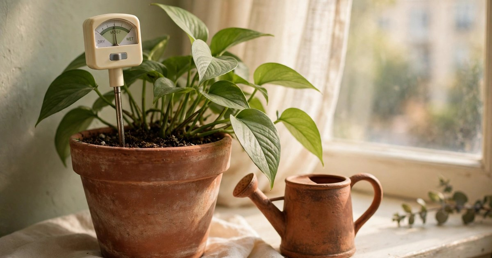
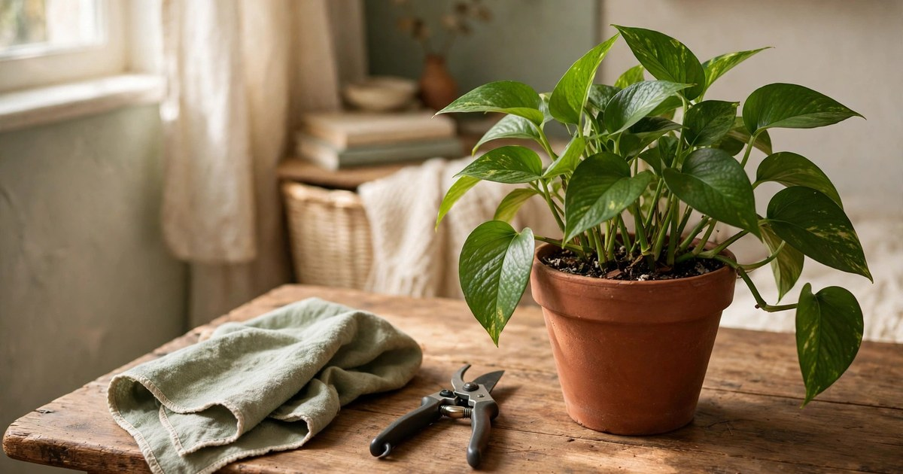
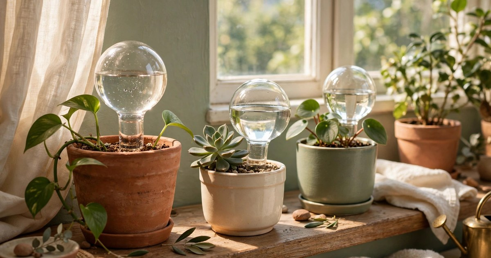
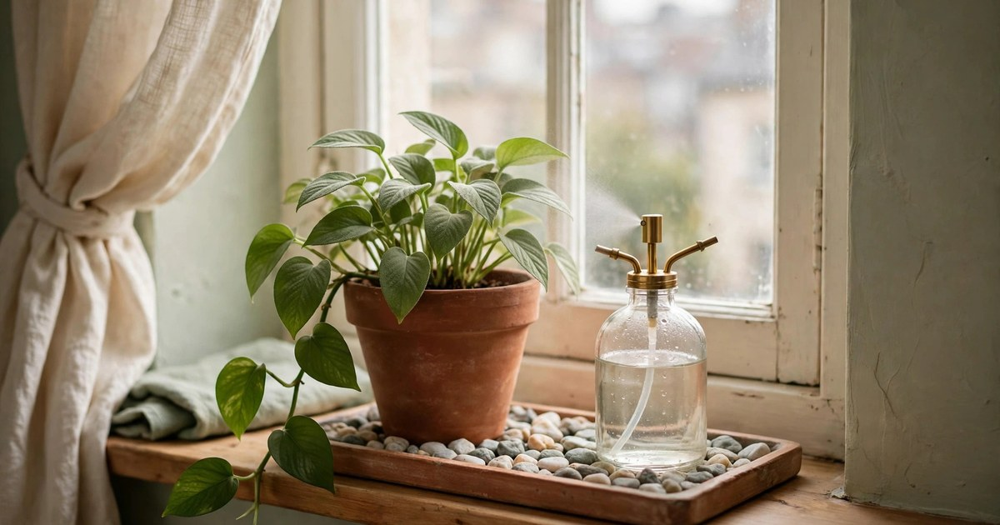
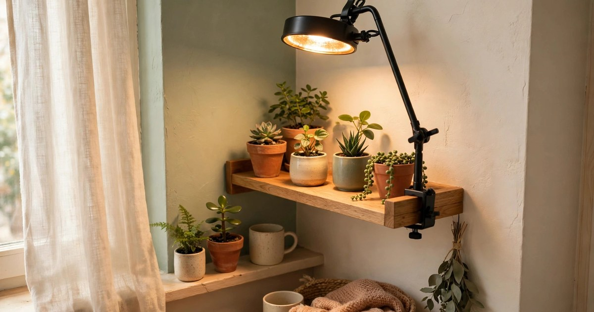
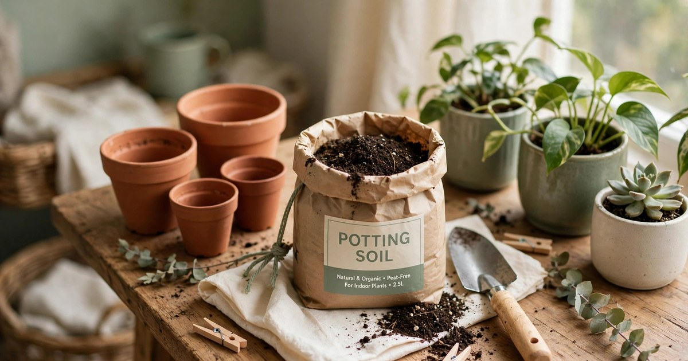
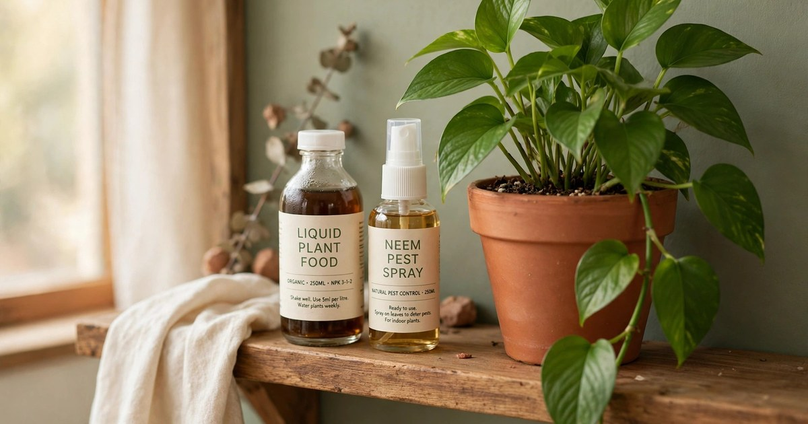
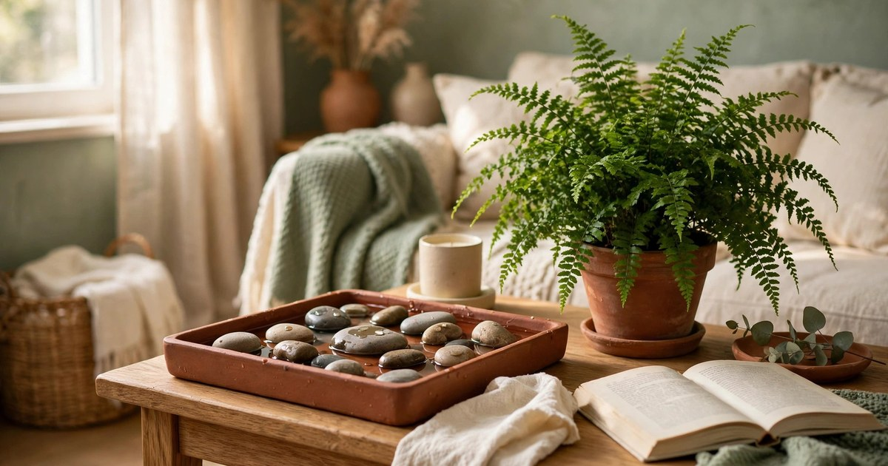
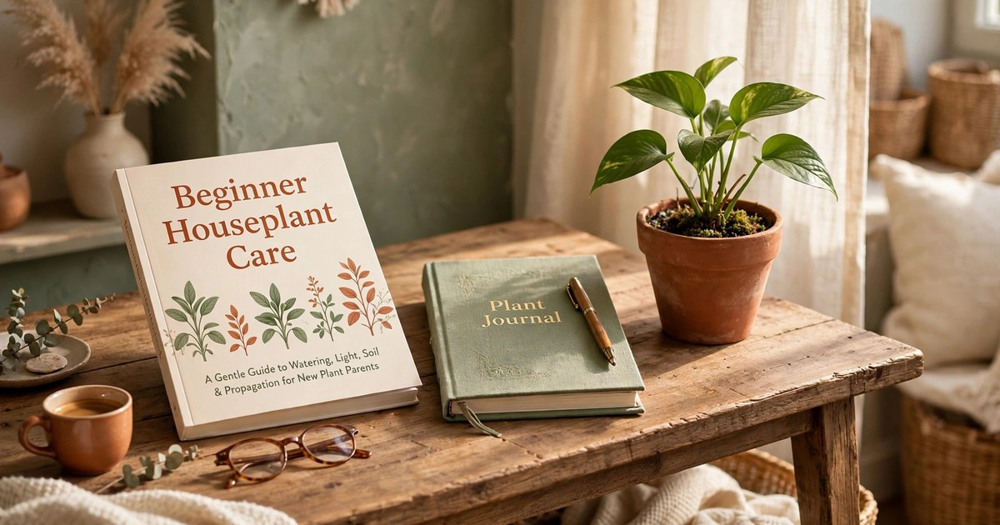

Winter is the season that sorts new plant parents from confident ones. Short days, dry heated air, cold draughts from windows, and soil that stays wet far longer than it did in summer — all of it conspires against houseplants, and most of it is invisible until a leaf turns yellow or drops. The good news is that none of the fixes are expensive, and none of them need a big house, a greenhouse, or a landlord's permission. A few small, well-chosen kits can carry a whole indoor jungle through to spring.

Every kit in this roundup costs under $25, and every one is renter-friendly: nothing is drilled into a wall, nothing is plumbed in, and everything fits in a small flat, from a studio [windowsill](/winter-windowsill-garden-guide/) to a single shelf above a radiator. They also make excellent gifts for the new plant parent in your life, because each one solves a real winter problem rather than just looking pretty on a shelf. Think of this list as a winter survival bundle, bought one small kit at a time.

### 1. Moisture meter + watering can set

Why it works in winter: overwatering is the number one houseplant killer in winter, because cooler rooms and weaker light mean soil dries out far more slowly. A moisture meter takes the guesswork out of it — push the probe into the soil and it tells you, plainly, whether the plant actually needs water. Paired with a small watering can, it stops the classic beginner mistake of watering on a schedule instead of watering when the soil is dry.

Where it fits in a small flat: the meter lives in the pot itself or tucked behind it, and a slim 1-litre can hangs on a hook or sits on the windowsill. No cupboard space required, which matters when your kitchen storage is already full.

Budget tip: buy the meter and can as a bundle rather than separately — combined sets usually land around $12–15, and a single saved plant pays for the whole kit. [Shop moisture meter and watering can sets](https://www.amazon.com/s?k=moisture+meter+watering+can+set+houseplant&tag={{AMAZON_TAG}})

### 2. Pruning snips and leaf-cleaning kit

Why it works in winter: plants grow slowly in winter, but they still shed the odd yellow leaf, and dusty leaves photosynthesise even less in weak winter light. Sharp snips let you remove dead growth cleanly instead of tearing stems, and a soft cloth or leaf-shine wipe restores the leaf surface so every scrap of daylight counts. Clean leaves are also easier to inspect for pests, which love dry winter air.

Where it fits in a small flat: snips and cloth fit in a kitchen drawer or a small basket on a shelf. Keep the snips out of reach of children and pets, and wipe the blades with rubbing alcohol between plants to stop any problems spreading.

Budget tip: skip the fancy branded kits and look for a basic snip-and-cloth set for under $15 — the blades matter, the packaging does not. [Shop pruning snips and leaf cleaning kits](https://www.amazon.com/s?k=pruning+snips+leaf+cleaning+kit+houseplant&tag={{AMAZON_TAG}})

### 3. Self-watering globes set

Why it works in winter: central heating dries the air, but it also makes watering routines erratic — a plant that was fine on a weekly water in October can dry out in days once the radiators come on, or stay soggy if you overcompensate. Self-watering globes release water slowly as the soil dries, smoothing out those swings and buying you a few extra days between waterings.

Where it fits in a small flat: globes slot straight into existing pots, so they take up zero extra floor or shelf space. A set of four covers a typical starter collection, and the glass looks decorative rather than utilitarian on a windowsill display.

Budget tip: glass globes in a four-pack usually cost $10–14, far less than a single replacement plant. Fill them with room-temperature water and refill when empty rather than topping up daily. [Shop self-watering globe sets](https://www.amazon.com/s?k=self+watering+globes+set+houseplant&tag={{AMAZON_TAG}})

### 4. Pebble tray and misting bottle bundle

Why it works in winter: heated rooms can drop indoor [humidity](/humidify-houseplants-without-humidifier/) below 30%, while most tropical houseplants want 40–60%. A pebble tray — a shallow tray of pebbles with water just below the top — raises humidity right around the plant as the water evaporates, and a misting bottle gives an instant boost for ferns and calatheas. Together they fight crispy leaf edges, the classic winter complaint.

Where it fits in a small flat: a pebble tray doubles as a saucer under a pot, so it replaces something you already use rather than adding clutter. The misting bottle lives on the windowsill, and both are fully portable when you move.

Budget tip: you can build a pebble tray from a baking tray and a bag of decorative pebbles for under $10, or buy a ready-made bundle for around $12–18. Either way, keep the pot sitting on the pebbles, not in the water. [Shop pebble tray and misting bottle bundles](https://www.amazon.com/s?k=pebble+tray+misting+bottle+houseplant+humidity&tag={{AMAZON_TAG}})

### 5. Grow-light clip lamp

Why it works in winter: in December and January, a north-facing flat may get only a few hours of weak daylight, and light-hungry plants simply stall. A clip-on grow light tops up the day to a healthy 10–12 hours, keeping growth steady and colours vivid. Modern LED clip lamps use very little electricity and give off almost no heat, so they are safe near leaves and curtains.

Where it fits in a small flat: the clip grips a shelf edge, a desk, or a windowsill frame — no screws, no holes, nothing a landlord could object to. One lamp covers a shelf of small pots, and the flexible neck aims light exactly where it is needed.

Budget tip: a single-head clip lamp with a timer usually costs $15–22; the timer matters, because plants need a dark night too. Run it for the hours when natural light is weakest, not all day. [Shop clip-on grow light lamps](https://www.amazon.com/s?k=clip+on+grow+light+lamp+houseplant+timer&tag={{AMAZON_TAG}})

### 6. Repotting kit with pots and soil

Why it works in winter: winter is not the main repotting season, but new plant parents often receive gifted plants in nursery pots that are root-bound, waterlogged, or sitting in poor soil. A small repotting kit — two or three pots with drainage holes, a bag of houseplant mix, and a trowel — means you can rescue a struggling plant immediately instead of waiting for spring while it declines.

Where it fits in a small flat: repot on a tray or an old sheet on the kitchen table, then shake it out the window and the mess is gone. The pots stack when empty, and a small bag of soil fits on top of a wardrobe or under the sink.

Budget tip: kits with three terracotta pots and a soil bag typically run $18–24. Choose pots only one size up from the current pot — too big a pot holds too much wet soil, which is exactly what winter plants do not need. [Shop repotting kits with pots and soil](https://www.amazon.com/s?k=repotting+kit+pots+soil+houseplant+beginner&tag={{AMAZON_TAG}})

### 7. Plant food and pest spray starter set

Why it works in winter: plants eat less in winter, but they still need occasional feeding, and dry indoor air invites spider mites and fungus gnats. A starter set with a gentle liquid feed and a ready-to-use neem or insecticidal spray covers both needs: feed at half strength once a month, and treat at the first sign of webbing or tiny flies rather than waiting for an infestation.

Where it fits in a small flat: two small bottles fit in a cleaning caddy or under the sink, alongside the rest of your household sprays. Label them clearly so nobody mistakes plant food for anything else, and always spray in a ventilated room.

Budget tip: a combined feed-and-spray starter set is usually $12–18, and both bottles last months at beginner-collection scale. Half-strength feeding in winter beats full-strength feeding — overfed winter plants burn. [Shop plant food and pest spray starter sets](https://www.amazon.com/s?k=houseplant+food+neem+pest+spray+starter+set&tag={{AMAZON_TAG}})

### 8. Humidity tray with decorative stones

Why it works in winter: this is the prettier cousin of the pebble tray, and it earns its place by doing two jobs at once — raising local humidity for moisture-loving plants and looking like a deliberate display piece. Smooth river stones, a shallow ceramic tray, and a fern or calathea on top turn a plant corner into a styled vignette, which matters when your flat is small and every surface is on show.

Where it fits in a small flat: on a side table, a bathroom shelf (where shower steam helps too), or a windowsill grouping. Bathrooms are a secret weapon for humidity-loving plants, as long as there is some natural light.

Budget tip: a ready-made decorative humidity tray runs $14–20, but a charity-shop ceramic dish plus a bag of stones gets the same effect for under $10. Keep the water level below the top of the stones so the pot never sits in a puddle. [Shop humidity trays with decorative stones](https://www.amazon.com/s?k=humidity+tray+decorative+stones+houseplant&tag={{AMAZON_TAG}})

### 9. Beginner plant care book + journal bundle

Why it works in winter: the most valuable winter tool is knowledge — knowing which plants rest in winter, which ones still need water, and which yellow leaves are normal. A beginner care book answers those questions in one place, and a simple journal (watering dates, feeding, new growth) turns guesswork into a pattern you can actually learn from. New plant parents who track their plants keep them alive longer.

Where it fits in a small flat: a paperback and a slim journal live on the same shelf as the plants, ready to consult while you water. No app subscription, no screen, no clutter — and the pair makes a thoughtful gift for anyone who just brought home their first monstera.

Budget tip: book-and-journal bundles typically cost $15–22, and a secondhand care book plus a plain notebook can halve that. Write the plant's name and purchase date on the first journal page — future you will be grateful. [Shop beginner plant care book and journal bundles](https://www.amazon.com/s?k=beginner+houseplant+care+book+journal+set&tag={{AMAZON_TAG}})

## Small flats, healthy plants, all winter

The thread running through all nine kits is restraint: [winter plant care](/winterize-indoor-plants-renter-guide/) is mostly about doing less, more carefully. Water only when the soil says so, add light where the sun no longer reaches, raise humidity around the plants that need it, and leave the rest alone. None of that requires a big budget or a big home — it requires the right small tools, used at the right moment.

Start with the moisture meter if you buy just one kit, add the grow light if your flat is dark, and build the rest of the bundle over the winter as your collection grows. By spring, your plants will not just have survived — they will be ready to grow, and so will your confidence as a plant parent.

## Frequently Asked Questions

### How often should I water houseplants in winter?
Less often than in summer — usually every two to three weeks for most houseplants, but always check the soil first. A moisture meter is the easiest way to be sure, since the top of the soil can look dry while the roots are still wet.

### Do houseplants really need a grow light in winter?
Not all of them, but plants in north-facing rooms or flats with small windows benefit greatly. A clip-on lamp for a few extra hours a day keeps light-hungry plants growing instead of stalling until spring.

### What is the cheapest way to raise humidity for houseplants?
A pebble tray under the pot is the cheapest effective method, and grouping plants together helps too, since they share the moisture they release. A bathroom with natural light is a free humidity boost for ferns and calatheas.

### Should I repot houseplants in winter?
Usually it is better to wait until spring, but repot immediately if a plant is root-bound, waterlogged, or in a pot with no drainage — waiting can do more harm than a careful winter repot.

### Are plant care kits good gifts for new plant parents?
Yes — especially a moisture meter set or a book-and-journal bundle, because they solve the two problems beginners struggle with most: knowing when to water and learning what each plant needs.
