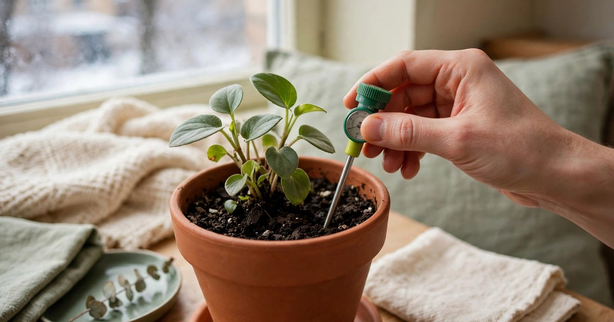
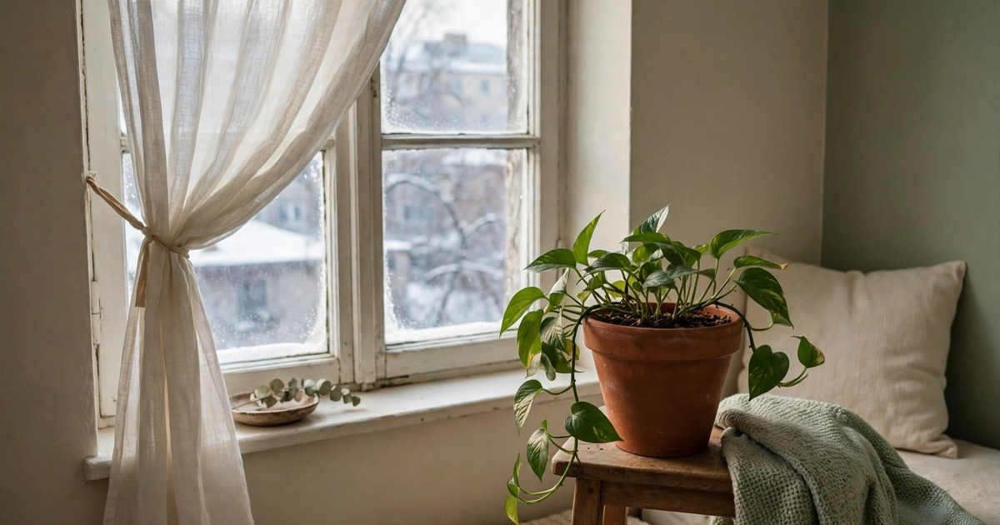
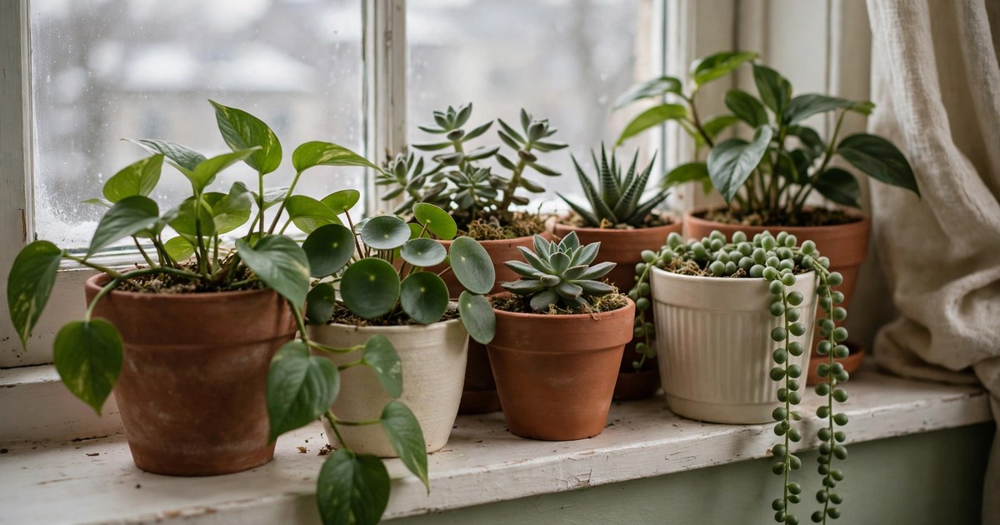
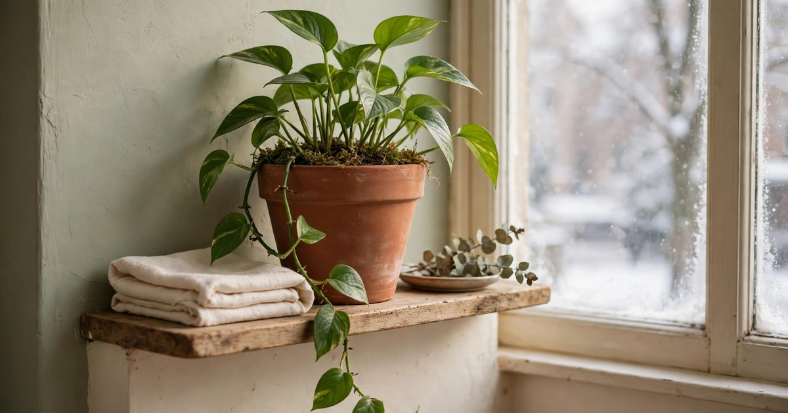
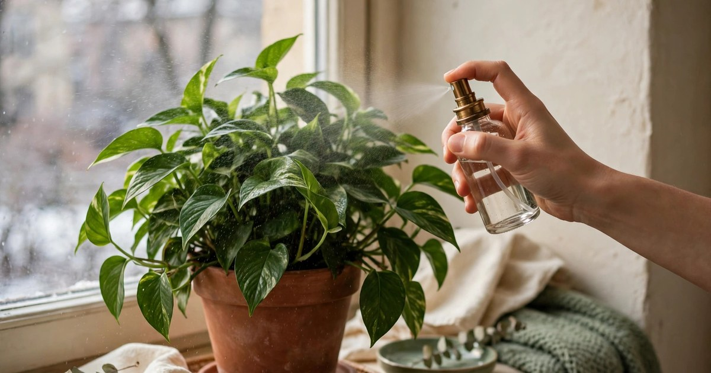
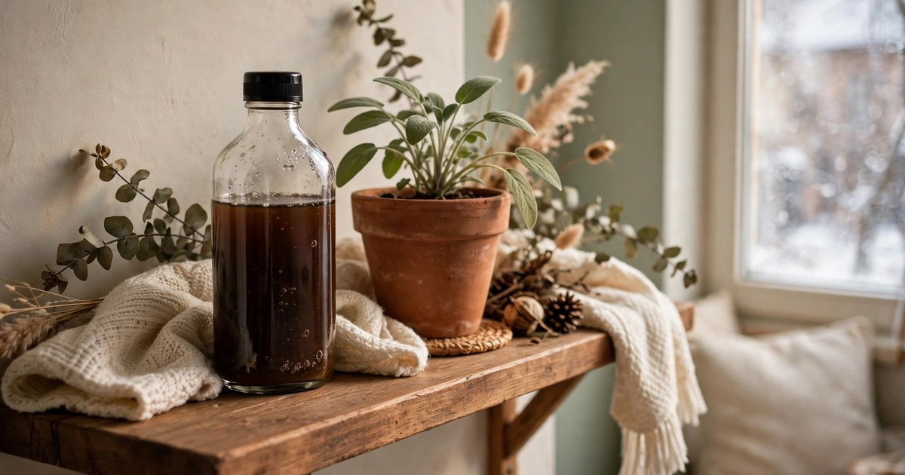
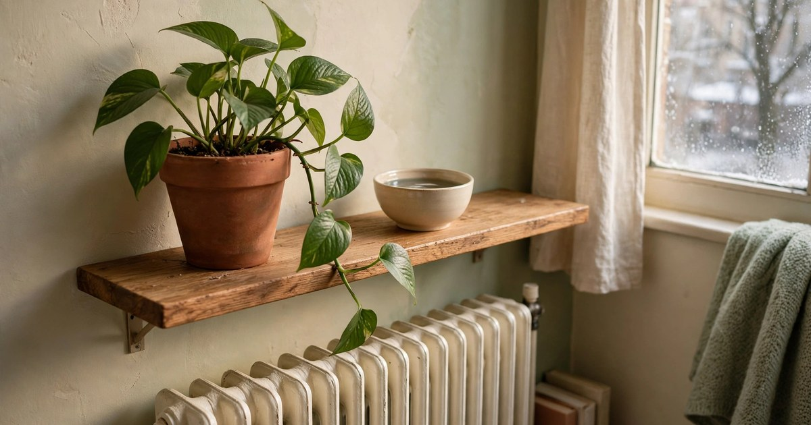
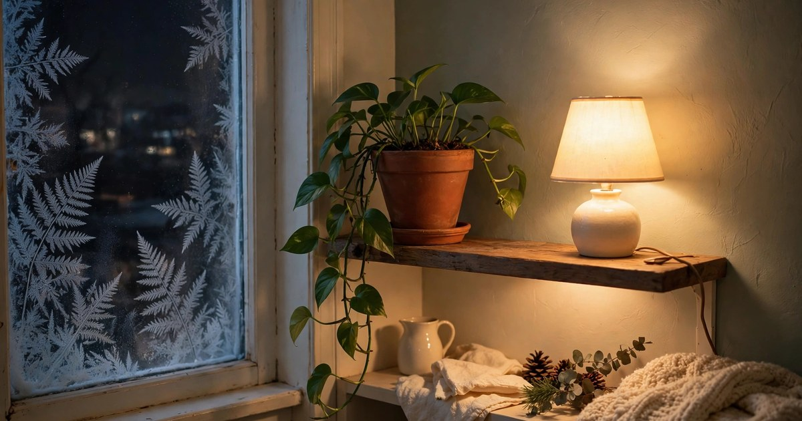
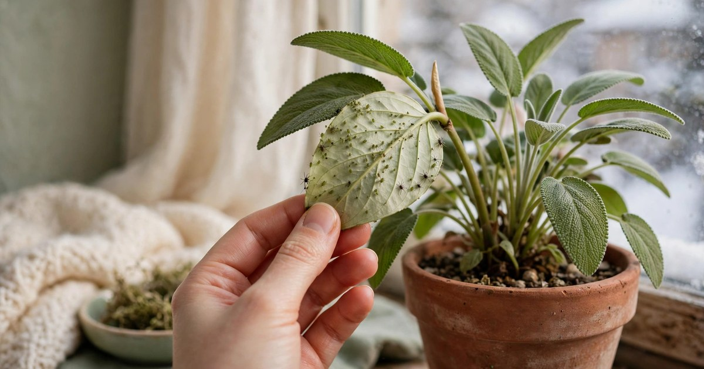
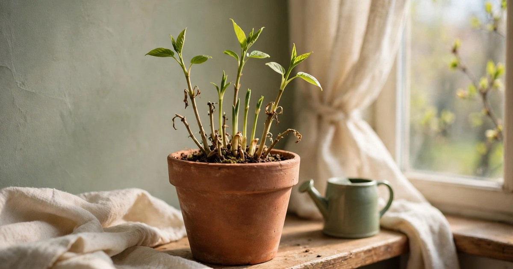

Winter is the season when houseplants die quietly. A plant that thrived all summer on a sunny windowsill can collapse in February, and the cause is rarely one dramatic event — it is a handful of small, well-meaning mistakes that add up in a small flat. Short days, cold draughts, dry radiator air and a watering routine that no longer fits the season are a slow-motion disaster for anything green, and in a rented flat the problem is worse: windows are draughty, heating is uneven, and there is nowhere to move a struggling plant except a few metres in another direction.

The good news is that almost every winter plant death is preventable, and almost every fix is free or costs less than a fiver. You do not need a greenhouse, a humidifier or your landlord's permission — you need to change a few habits before the coldest weeks arrive. The ten mistakes below are the ones that kill the most houseplants in small flats, and each one comes with a cheap, renter-friendly fix that takes minutes. Work through them now, while your plants are still healthy, and they will come out of winter looking better than they went in.

### 1. Watering on a Summer Schedule

The single most common winter plant care mistake is watering on autopilot. In summer your monstera might drink twice a week; in winter, in a cool flat with weak light, the same plant barely grows at all, so it barely drinks. Soil that dried out in three days in July can stay wet for three weeks in January, and roots sitting in cold, soggy compost are a perfect recipe for root rot — the silent killer that turns leaves yellow from the base up and collapses a stem overnight.

Fix it by letting the soil tell you when to water, not the calendar. Push a finger or a wooden skewer deep into the pot: if it comes out damp, walk away and check again in a few days. A [moisture meter](https://www.amazon.com/s?k=soil+moisture+meter+indoor+plants&tag={{AMAZON_TAG}}) costs a few pounds and takes the guesswork out entirely, but a chopstick from the kitchen drawer works just as well. Most houseplants in winter want water only every two to three weeks, and [succulents](/winter-succulent-care-ideas-small-apartments/) want even less. When you do water, do it in the morning so splashes dry before night, and always tip away standing water from the saucer — a pot left in a puddle in winter is a pot on its way to rot.

### 2. Letting Plants Sit in a Cold Draught

A draughty window is winter's quiet assassin. Every time the window frame leaks cold air — and in rented flats they almost always do — the plant nearest the gap gets a blast of freezing air on its leaves. Tropical houseplants, which is what most of yours are, evolved in warm, still air; a draught of 5°C air is enough to blacken leaf edges, drop leaves and, on the worst nights, kill a plant outright. The damage is easy to miss because it shows up days later, long after you have forgotten the cold night that caused it.

Fix it by moving plants a few centimetres back from the glass and sealing the worst gaps. A rolled towel along the sill or a cheap draught excluder helps your heating bill as much as it helps your plants, and a sheer curtain between plant and window softens the cold without blocking the light. If a window is truly icy, pull the plants further into the room overnight and push them back towards the light in the morning — a tray under the pots makes the whole group easy to move in one lift. [Fiddle leaf figs](/keep-fiddle-leaf-fig-alive-winter-guide/) are especially draught-sensitive, so give them the warmest, stillest corner you have and keep them well away from doors that open onto a cold hallway.

### 3. Pushing Plants Too Far from the Light

In summer a plant can sit a metre from the window and thrive. In winter, with the sun low and the days short, that same spot is practically a cave. Light levels in a flat can drop by two-thirds between June and December, and a plant starved of light grows weak, leggy and pale — then, weakened, it falls victim to rot, pests and cold that a healthy plant would shrug off. It is the mistake that makes all the other mistakes worse.

Fix it by moving every plant to the brightest window you own for winter, usually the south-facing one, or whichever gets the most hours of direct sun. Keep leaves just off the glass, wipe the window clean inside and out — winter grime blocks a surprising amount of light — and rotate each pot a quarter turn once a week so it grows evenly instead of leaning. If you have more plants than windowsill space, a cheap tiered shelf or a small [plant stand](https://www.amazon.com/s?k=small+plant+stand+indoor+window&tag={{AMAZON_TAG}}) in front of the window stacks them into the light, and a clip-on grow light is the best money you will spend if your flat has no bright window at all.

### 4. Repotting in Midwinter

A root-bound plant looks like a problem that needs fixing, and winter boredom makes repotting feel like a productive afternoon. It is not. Repotting is surgery: it disturbs roots, breaks fine root hairs and forces the plant to spend energy re-establishing itself — energy it does not have in the middle of winter, when growth has all but stopped. A plant repotted in January often sits sulking for months, its roots rotting in fresh, damp compost it cannot use, and by spring it is weaker than it was before you "helped" it.

Fix it by waiting. If the plant is genuinely bursting out of its pot, the renter-friendly move is to leave it until spring, when longer days and warmer rooms give it the energy to recover in weeks. In the meantime, top-dress instead: scrape off the top few centimetres of tired compost and replace it with fresh mix, which gives the plant a nutrient boost without disturbing a single root. If you absolutely must repot — a cracked pot, say, or a plant that has tipped over — keep the root ball intact, disturb as little soil as possible, and do not water for a week afterwards. The full guide to [repotting houseplants in winter](/repot-houseplants-winter-guide/) explains when it is genuinely safe and when waiting is the kinder choice.

### 5. Misting Instead of Giving Real Humidity

Misting feels like plant care. It is satisfying, it looks lovely in a photograph, and it does almost nothing. A spray of water raises the humidity around a leaf for a few minutes, then it evaporates, leaving the leaf wet — which, in a cool flat, invites fungal spots and bacterial rot. Worse, misting tricks you into thinking you have solved a humidity problem when you have not: your calathea is still sitting in air as dry as a desert, and its leaf edges are still crisping.

Fix it with real humidity, not a performance of it. Group your plants together so they share a pocket of slightly moister air, set pots on a tray of pebbles with water kept just below the pebble tops, and put the humidity-hungry plants in the bathroom, where showers do the work for you. These are the cheapest, most effective tricks in the book, and they are explained in full in our guide to [humidifying houseplants without a humidifier](/humidify-houseplants-without-humidifier/). A small hygrometer costs a few pounds and tells you the truth about your air — most heated flats sit at 25–30% humidity in winter, while tropical plants want 50% or more — so you can stop guessing and start fixing.

### 6. Feeding Plants Through Winter

Feeding a plant in winter feels like kindness: if it is struggling, surely food will help. In reality it is the opposite. Most houseplants are dormant or barely growing from late autumn to early spring, so they cannot use the fertiliser you give them. The salts sit in the soil, build up, and burn the roots — showing up as brown leaf tips, yellowing edges and a plant that looks worse the more you "help" it. It is one of the easiest mistakes to make, because it comes from the best intentions.

Fix it by putting the fertiliser away until spring. Stop feeding entirely from around November to March, and if you suspect you have already overfed, flush the soil: water the pot thoroughly in the sink or bath, let it drain completely, and repeat once more, which washes the excess salts out. When spring arrives and you see new growth, resume feeding at half strength — a plant waking up after winter needs a gentle restart, not a feast. A bottle of liquid feed is cheap and lasts for years when you only use it in the growing season, which is the most budget-friendly way to use it anyway.

### 7. Ignoring Dry Central-Heating Air

Central heating is a slow drought. A radiator dries the air in a small flat to desert levels, and tropical houseplants respond with brown, crispy leaf edges, curling leaves and dropped buds. The damage is often blamed on watering or light, because the air itself is invisible — but if your plants sit near a radiator and their leaf tips are browning, the heating is the prime suspect. Calatheas, ferns, peace lilies and [herbs](/keep-herbs-alive-indoors-winter-guide/) are the first to show it.

Fix it by keeping plants away from the heat source and giving the air a little moisture. Move pots at least a metre from a radiator if you can, put a bowl of water on the radiator itself — as it evaporates it adds humidity to the room — and hang damp washing indoors near the plants on laundry day. Grouping plants together helps too, and the bathroom trick from mistake five works for the fussiest plants: a fern that lives in the bathroom through winter will look dramatically better than the same fern on a hot, dry shelf. None of this needs a humidifier or any permanent change, which is exactly what a renter needs.

### 8. Leaving Plants on a Freezing Windowsill Overnight

A windowsill that is perfect at midday can be lethal at midnight. Glass loses heat fast, and on a frosty night the air right next to a windowpane can drop close to freezing — cold enough to blacken the leaves of any tropical plant that touches the glass, and cold enough to chill the roots of a plant sitting in a thin pot on a stone sill. The damage appears the next morning as black, water-soaked patches on leaves, and it is irreversible: the dead tissue never recovers.

Fix it by treating the windowsill as a daytime spot only. On the coldest nights, pull the plants a few centimetres back from the glass, or move the most tender ones — calatheas, fiddle leaf figs, anything tropical — onto a shelf or table a metre into the room. A thick cork mat or a folded towel under the pot insulates the roots from a cold stone sill, and a heavy curtain drawn between plant and window overnight is a renter-friendly shield that costs nothing. Check the forecast in the evening: if frost is coming, move the plants before bed, not after breakfast.

### 9. Forgetting to Check for Pests That Thrive Indoors in Winter

Winter feels like a pest-free season — after all, the bugs are outside, aren't they? In fact, the opposite is true. Dry, warm, still indoor air is exactly what spider mites love, and fungus gnats breed happily in damp winter soil. Mealybugs hide in leaf joints all winter, and because plants are stressed and growing slowly, a pest population that a healthy summer plant would outgrow can overwhelm a weakened winter plant in weeks. By the time you notice webbing or white fluff, the infestation is already established.

Fix it with a weekly check that takes five minutes. Every Sunday, look at the undersides of leaves, the leaf joints and the soil surface. Spider mites show as fine webbing and tiny speckles on leaves; mealybugs as cottony white clumps; fungus gnats as tiny flies that rise when you disturb the pot. Catch them early and the fixes are cheap: a strong shower in the bath knocks mites off, a cotton bud dipped in rubbing alcohol wipes mealybugs away, and letting the top few centimetres of soil dry out breaks the gnat lifecycle. The weekly check also catches rot and draught damage early, so it is the single best habit in this whole list — five minutes a week beats a dead plant in February.

### 10. Giving Up on a Struggling Plant Too Soon

The last mistake is the saddest one, because it is entirely avoidable. A plant loses a few leaves in January, looks bare and miserable, and goes in the bin — when all it needed was time. Winter is hard on houseplants, and many of them look rough by February: a calathea with crisped edges, a fern that has shed half its fronds, a pothos with a bare stem. But plants are far tougher than they look, and a plant with green stems and firm roots is still alive, even if it has lost most of its leaves.

Fix it by waiting for spring before you judge. Cut back dead leaves, keep the plant in decent light, water sparingly, and give it until April before deciding its fate. Many plants that look dead in February push out fresh growth the moment the days lengthen — ferns, pothos, spider plants and peace lilies are famously forgiving. And if a plant truly does not recover, take a cutting first: a healthy stem in a glass of water costs nothing and often roots within weeks, giving you a second plant for free. Giving up too soon wastes the money you spent on the plant and the months you spent keeping it alive, and spring has a way of surprising even the most pessimistic plant parent.

## Shop this look: winter plant care basics

- **Soil moisture meter** — know when to water instead of guessing. [Shop moisture meters](https://www.amazon.com/s?k=soil+moisture+meter+indoor+plants&tag={{AMAZON_TAG}})
- **Pebble tray for humidity** — a tray and pebbles under the pot raise humidity for pennies. [Shop plant humidity trays](https://www.amazon.com/s?k=plant+humidity+tray+pebbles&tag={{AMAZON_TAG}})
- **Indoor hygrometer** — check the real humidity in your flat before buying anything. [Shop indoor hygrometers](https://www.amazon.com/s?k=indoor+hygrometer+humidity+monitor&tag={{AMAZON_TAG}})
- **Clip-on LED grow light** — the cheapest fix for short winter days. [Shop clip-on grow lights](https://www.amazon.com/s?k=clip+on+led+grow+light+indoor+plants&tag={{AMAZON_TAG}})
- **Small plant stand** — stack pots into the brightest window. [Shop small plant stands](https://www.amazon.com/s?k=small+plant+stand+indoor+window&tag={{AMAZON_TAG}})

## Frequently Asked Questions

### How often should I water houseplants in winter?

Most houseplants need water only every two to three weeks in winter, and only when the top few centimetres of soil are dry. Growth slows dramatically in cold, low-light conditions, so the plant drinks far less. Always check the soil with a finger or a moisture meter before watering, and tip away any standing water from the saucer.

### Why are my houseplant leaves turning yellow in winter?

Yellow leaves in winter are usually caused by overwatering, cold draughts or low light — often all three at once. Check the soil first: if it is wet, stop watering and let it dry out. Then move the plant away from draughty windows and closer to the brightest window you have. If only the oldest leaves are yellowing, that can be normal winter shedding. If your flat is genuinely dark, the real fix may be swapping the plant rather than the spot — these [low-light indoor plants for dark apartments](/low-light-indoor-plants-dark-apartments/) are built for it.

### Should I move my plants away from the window in winter?

Keep them close to the window during the day for the light, but pull them back a few centimetres from the glass on freezing nights. Leaves touching cold glass can blacken overnight, and roots on a cold stone sill can chill. A cork mat under the pot and a curtain drawn at night protect the plant without blocking daytime light.

### Do houseplants need feeding in winter?

No. Most houseplants are dormant or barely growing from November to March, so they cannot use fertiliser, and the salts build up in the soil and burn the roots. Stop feeding entirely in winter and resume at half strength in spring, when you see new growth.

### Can I save a houseplant that is dying in winter?

Often, yes. Cut away dead leaves, move the plant to bright, draught-free light, stop watering until the soil dries out, and wait until spring before judging it. Many plants that look rough in February push out fresh growth in March and April. If the stems are still green and the roots are firm, the plant is alive and worth saving.
