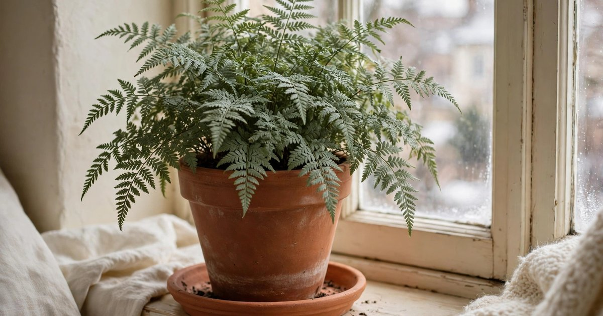
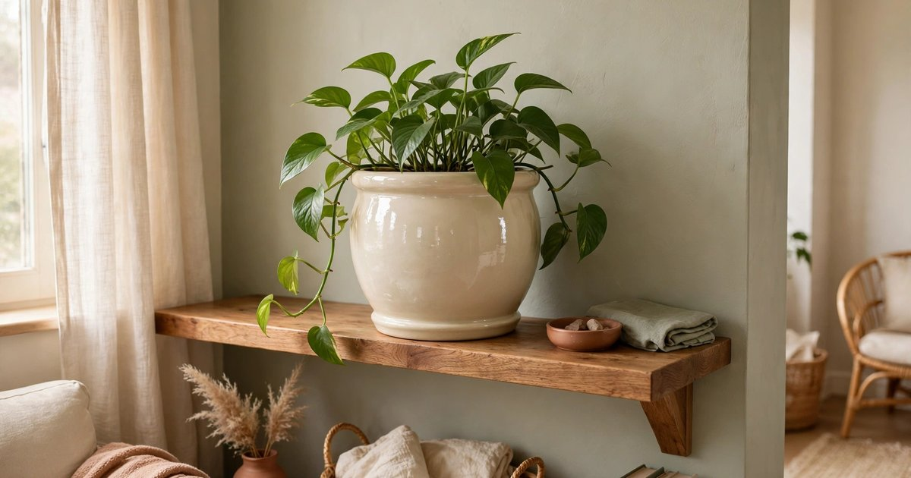
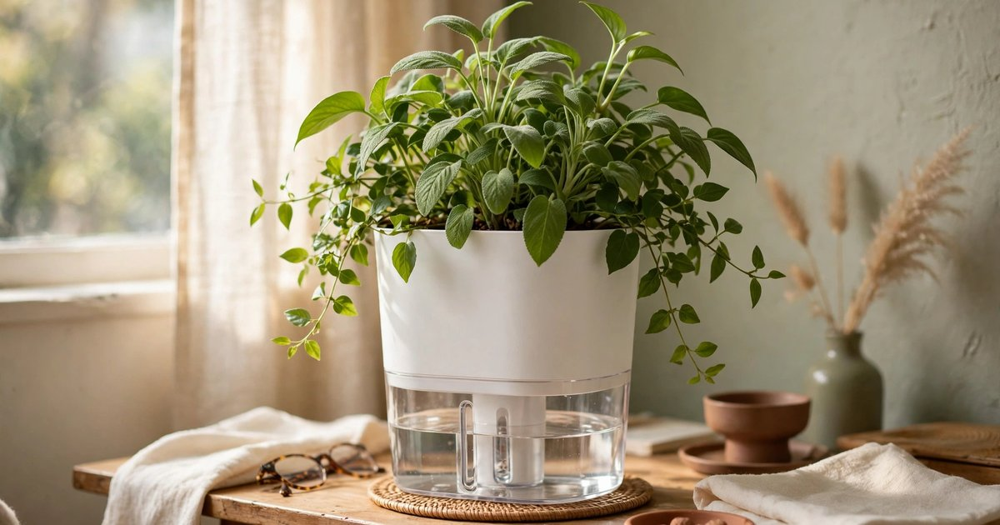
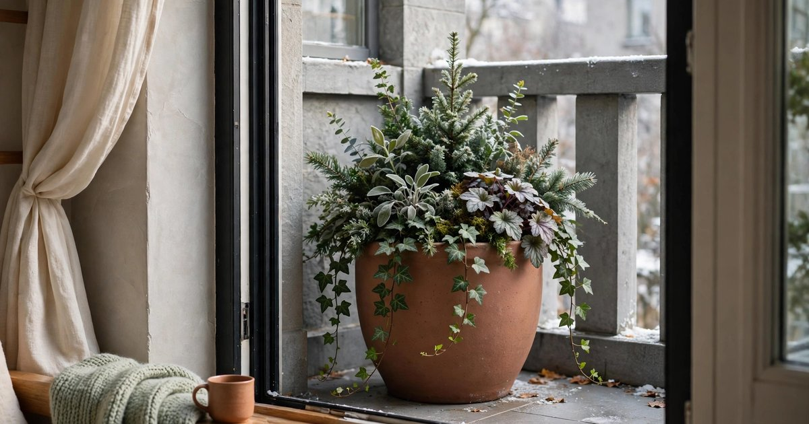
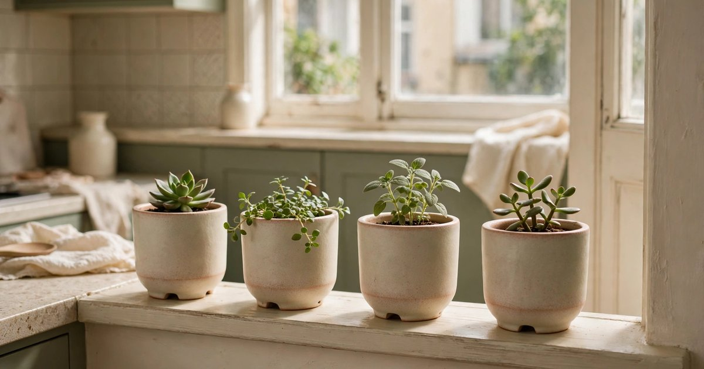
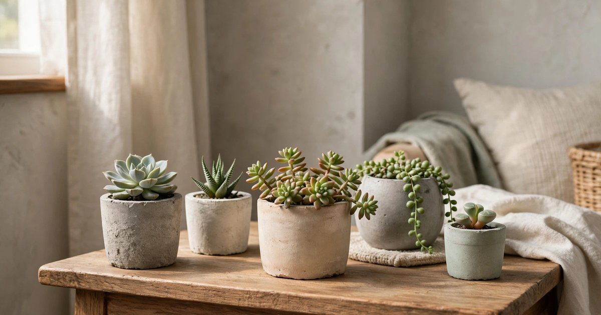
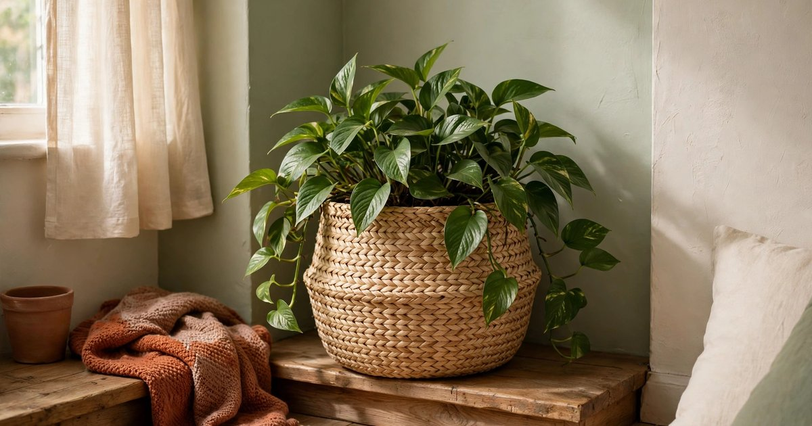
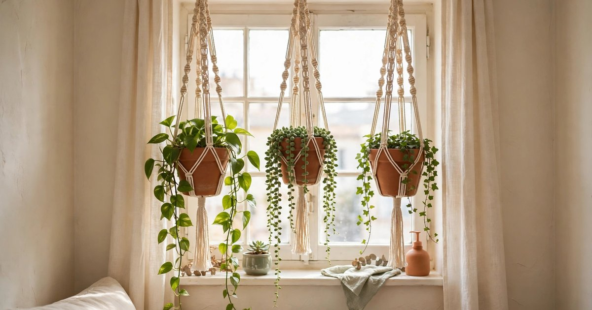
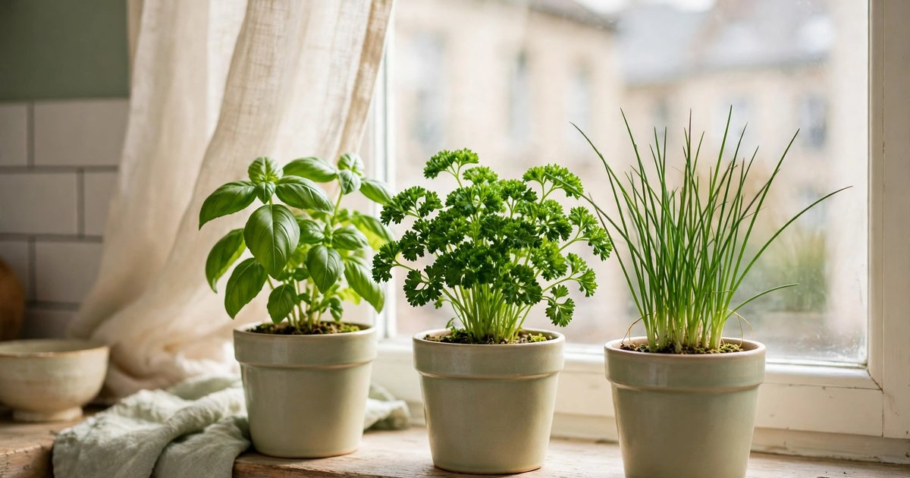

Winter is the hardest season for houseplants in a small flat. The heating dries the air, the light drops, cold draughts sneak in around the windows, and a plant that thrived all summer can sulk by January. The pot it sits in matters far more than most people realise: the right pot protects roots from cold, holds moisture without waterlogging, and stops a leak ruining a landlord's windowsill. Every pick in this roundup is under $25, renter-friendly, and chosen for small apartments — light enough to move, small enough for a sill, and good-looking enough to earn its place.

A quick note on winter watering before you shop: plants need far less water in winter because they grow slowly and the soil dries out more slowly. Always choose a pot with drainage holes and a saucer, water only when the top few centimetres of soil feel dry, and keep pots away from radiators and cold window glass. A pot that looks good and drains well is the single best winter upgrade you can give a plant.

### 1. Classic Terracotta Pot with Saucer

The classic terracotta pot is the oldest trick in the book, and it is still the best winter pot for most houseplants. Terracotta is porous, so it breathes: excess moisture evaporates through the walls instead of sitting around the roots, which is exactly what you want when winter watering mistakes are easy to make. A matching saucer catches the drips and protects your windowsill or shelf, and the warm orange-brown colour looks wonderful against winter greenery. A set of three in different sizes usually costs well under $25, so you can repot several plants at once.

Why it works: the breathable clay prevents root rot, the saucer keeps rental surfaces dry, and the colour suits every winter plant from ferns to snake plants. Where it fits: on a sunny windowsill, grouped on a shelf, or on a plant stand near the window. Terracotta dries out faster than plastic, so check the soil weekly, and bring balcony pots indoors before a hard frost — wet clay can crack.

[Shop terracotta pots with saucers](https://www.amazon.com/s?k=terracotta+pots+with+saucer+set+small&tag={{AMAZON_TAG}})

### 2. Glazed Ceramic Pot in Cream

A glazed ceramic pot in cream is the polished, grown-up choice for a plant that lives on display. The glaze seals the clay, so the pot holds moisture far longer than raw terracotta — a real advantage in winter, when dry heated air pulls water out of the soil and you may forget to water for a week. Cream is the most versatile colour for small apartments: it brightens a dark winter corner and makes green leaves look richer by contrast. Look for a pot with a drainage hole and a matching saucer, because a sealed pot with no drainage is a drowning risk.

Why it works: the glaze keeps soil moist through dry winter weeks, and the cream finish makes even a humble pothos look like a styled display. Where it fits: on a bookshelf, a side table or a kitchen counter, wherever a plant doubles as decor. Glazed ceramic is heavier than plastic, so keep it on a sturdy surface and lift it with two hands when the soil is wet.

[Shop glazed ceramic plant pots cream](https://www.amazon.com/s?k=glazed+ceramic+plant+pot+cream+drainage&tag={{AMAZON_TAG}})

### 3. Self-Watering Pot for Forgetful Waterers

A self-watering pot is the best friend of anyone who travels over Christmas or simply forgets to water. The pot has a hidden reservoir at the bottom that lets the plant draw up water as it needs it, so the soil stays evenly moist for one to two weeks without you touching it. In winter, when overwatering is the most common way to kill a plant, that steady, gentle supply is far safer than a big splash once a week. Most self-watering pots are lightweight plastic or ceramic-look resin, so they are easy to move around a small flat.

Why it works: the reservoir stops both underwatering and overwatering, the two biggest winter plant killers. Where it fits: beside the bed, on a desk, or anywhere a plant is easy to forget — and it is ideal for thirsty plants like ferns and peace lilies. Do not fill the reservoir to the brim in winter; half full is usually enough.

[Shop self-watering plant pots](https://www.amazon.com/s?k=self+watering+plant+pot+indoor+small&tag={{AMAZON_TAG}})

### 4. Frost-Proof Fibre-Clay Balcony Pot

If your plants live on a balcony, an ordinary terracotta pot can crack when the temperature drops below freezing, because wet clay expands as it freezes. Fibre-clay pots solve that problem: they are made from clay mixed with fibres, which makes them lighter than stone, tougher than plain terracotta, and frost-proof through a cold winter. They look like natural stone or aged clay, so they suit a balcony or a front step beautifully, and they come in generous sizes that still fit a small balcony corner. Under $25 buys a good medium size, and the lighter weight makes it far easier to carry up the stairs.

Why it works: the frost-proof material survives freezing nights that would shatter a normal pot, and the light weight suits renters who have to carry everything themselves. Where it fits: on a balcony, a front step, or a fire-escape landing, holding hardy winter plants like ivy, winter heather or a small evergreen. Raise the pot on small feet so water drains freely and the roots never sit in ice water.

[Shop frost-proof fibre clay plant pots](https://www.amazon.com/s?k=frost+proof+plant+pot+fibre+clay+outdoor&tag={{AMAZON_TAG}})

### 5. Small Ceramic Pots with Drainage Holes, Set of Four

A set of four small ceramic pots is the easiest way to start a windowsill garden without spending much. Small pots are perfect for the plants that thrive in winter light — succulents, small ferns, trailing pothos cuttings and young herbs — and a matching set looks intentional rather than cobbled together, which matters in a small flat where everything is on show. The drainage hole in each pot is the important detail: without it, a small pot waterlogs in days. Look for a set that includes saucers or a bamboo tray, so four small pots do not mean four small puddles on your sill.

Why it works: four matching pots turn a bare windowsill into a display, and the small size suits the plants that cope best with low winter light. Where it fits: a kitchen windowsill for herbs, a bathroom shelf for humidity-loving ferns, or a desk for a cutting you are rooting. Keep the set together in one spot rather than scattering it around the flat — a group of small plants creates a microclimate that holds humidity better than a lone plant on a dry sill.

[Shop small ceramic pots with drainage holes set](https://www.amazon.com/s?k=small+ceramic+plant+pots+drainage+holes+set+of+4&tag={{AMAZON_TAG}})

### 6. Concrete-Effect Mini Pots

Concrete-effect mini pots are the modern, sculptural pick for succulents and cacti, the plants that ask the least of you in winter. The grey, stone-like finish contrasts beautifully with green leaves and with the warm terracotta and cream of the rest of the room, and the small size is ideal for a desk, a bedside table or a narrow shelf where a big pot would never fit. Real concrete is heavy, but most budget versions are made from lightweight cement or resin, so you get the look without the weight — and a set of three or four mini pots is easily under $25.

Why it works: the minimalist shape makes a small plant look like a design object, and the small size is perfect for the low-maintenance plants that thrive on winter neglect. Where it fits: a desk, a bedside table, a bathroom shelf, or grouped in threes on a coffee table. Succulents in concrete pots need very little winter water — once every two or three weeks is usually plenty.

[Shop concrete mini plant pots](https://www.amazon.com/s?k=concrete+mini+plant+pots+succulent+set&tag={{AMAZON_TAG}})

### 7. Seagrass Basket Cache Pots

A seagrass basket is not a pot at all — it is a cache pot, a decorative cover that hides a plain plastic nursery pot inside. That is exactly why it is so useful: you keep the plant in its cheap, well-draining nursery pot and slip it into a basket that looks warm, handmade and expensive. The woven texture adds the cosy, natural feel that winter rooms crave, and baskets come in every size, from a tiny one for a succulent to a large one for a floor plant. They are also the lightest option on this list, which matters when you rearrange a small flat every few weeks.

Why it works: you get the look of an expensive planter for the price of a basket, and the plant keeps the drainage it needs. Where it fits: on the floor beside the sofa, on a plant stand, or in a corner that needs softening. Always keep the nursery pot inside the basket, and lift the plant out to water it over the sink — a basket with no drainage will hold water at the bottom and rot the roots if you water inside it.

[Shop seagrass basket planters](https://www.amazon.com/s?k=seagrass+basket+planter+cache+pot+indoor&tag={{AMAZON_TAG}})

### 8. Hanging Terracotta Pots

When floor and shelf space run out, the only direction left is up — and hanging terracotta pots are the prettiest way to do it. A small terracotta pot in a rope or macramé hanger holds a trailing plant like pothos, string of pearls or spider plant, and lets it cascade down in front of a window, where it gets the best winter light in the flat without taking up a single centimetre of surface. Hanging pots are cheap, light, and renter-friendly, because they need nothing more than a removable hook or a tension rod. Hang them at different heights for a layered look that makes a small window feel like a greenhouse.

Why it works: it uses vertical space a small flat cannot spare on the floor, and the trailing plant softens a bare window in the darkest months. Where it fits: in front of a kitchen or living-room window, above a desk, or in a bathroom where the steam suits trailing ferns. Check the weight before you hang it — a wet terracotta pot is heavier than a dry one — and use a hook rated for well above the pot's weight.

[Shop hanging terracotta plant pots](https://www.amazon.com/s?k=hanging+terracotta+plant+pot+macrame+hanger&tag={{AMAZON_TAG}})

### 9. Mini Herb Garden Pot Set

A mini herb garden pot set turns a kitchen windowsill into something useful all winter. Basil, parsley, chives and mint grow happily indoors if they get a few hours of light, and a matching set of small pots — often sold with labels, a tray and sometimes seeds — keeps the whole project tidy on a narrow sill. Fresh herbs in winter cooking are a small luxury that costs almost nothing once the pots are bought, and the green leaves brighten a kitchen that otherwise gets very little colour in December and January. A set of three to five pots is comfortably under $25, and the tray underneath catches every drip.

Why it works: it is decor that you can eat, and the daily habit of snipping herbs means you notice the plants and water them before they suffer. Where it fits: the sunniest kitchen windowsill you have, as close to the glass as possible without touching it on frosty nights. Rotate the tray every few days so all sides get light, and harvest little and often — regular snipping keeps plants bushy instead of leggy in low winter light.

[Shop mini herb garden pot sets](https://www.amazon.com/s?k=mini+herb+garden+pot+set+windowsill+indoor&tag={{AMAZON_TAG}})

## Start with the Plant You Already Own

You do not need nine new pots, and you do not need to buy anything to help your plants through winter. Start with the plant that matters most to you and check its pot. Does it drain? Does it have a saucer? Is it sitting in a cold draught or pressed against freezing glass? Fix that one pot first, using a pick from this list, and your plant will notice the difference within a week. A small apartment fills up fast, but a plant in the right pot earns its place every single day of winter.

If you are still building your indoor jungle, pair these pots with our [hanging planters for small apartments](/hanging-planters-small-apartments-under-25/) and our [bedroom plant styling ideas](/bedroom-plant-styling-ideas/) for more ways to fit greenery into a small space.

## Frequently Asked Questions

### What is the best pot material for plants in winter?

Terracotta is best for plants that hate wet roots, because the porous clay lets moisture evaporate. Glazed ceramic is better for plants that like steady moisture, because the glaze holds water in the soil longer. For a balcony, choose frost-proof fibre-clay or plastic, because plain terracotta can crack in a freeze.

### Do indoor plant pots need drainage holes in winter?

Yes, always. Drainage holes are more important in winter than in summer, because plants drink slowly and water sits in the soil for longer. A pot without drainage is the fastest way to rot a plant's roots. Always use a saucer underneath to protect your furniture and floors.

### How often should I water houseplants in winter?

Most houseplants need water half as often in winter as in summer. Check the soil first: push a finger a few centimetres into the soil, and water only if it feels dry. Succulents may need water only once every two or three weeks, while ferns may still want a drink weekly.

### Can I leave plant pots on a balcony all winter?

Only if the pot is frost-proof and the plant is hardy. Fibre-clay and plastic pots survive freezing nights, but plain terracotta and glazed ceramic can crack. Move tender plants indoors before the first frost, and raise outdoor pots on feet so water drains away.

### How do I stop plant pots leaking on a rental windowsill?

Use a saucer under every pot, and check that it is big enough to catch the water that drains through. Water plants over the sink when you can, empty the saucer after watering, and put a cork mat or a small tray under the saucer for extra protection on wooden sills.
