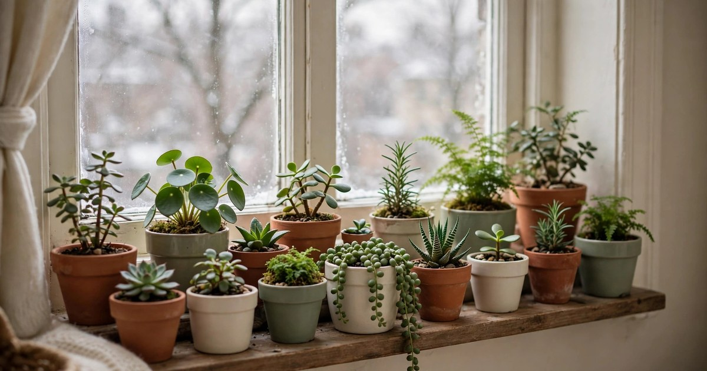
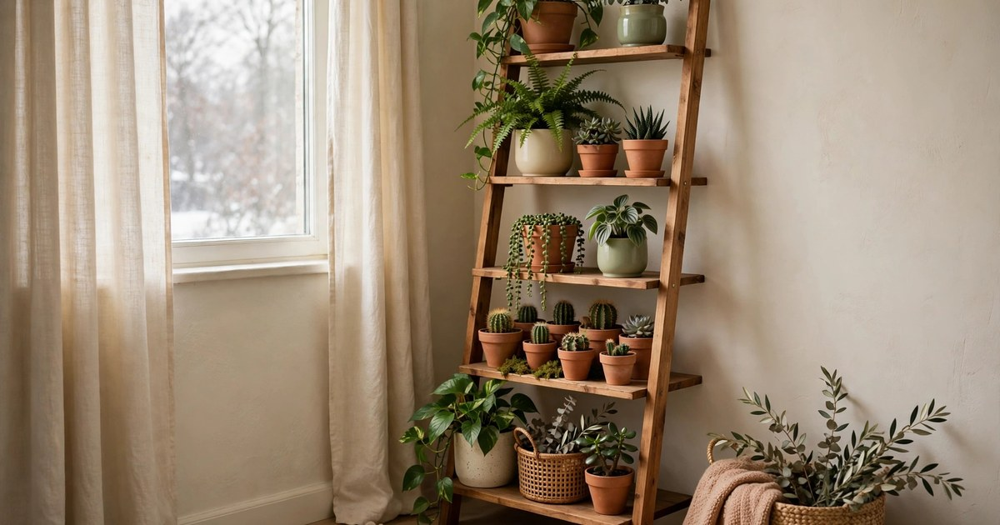
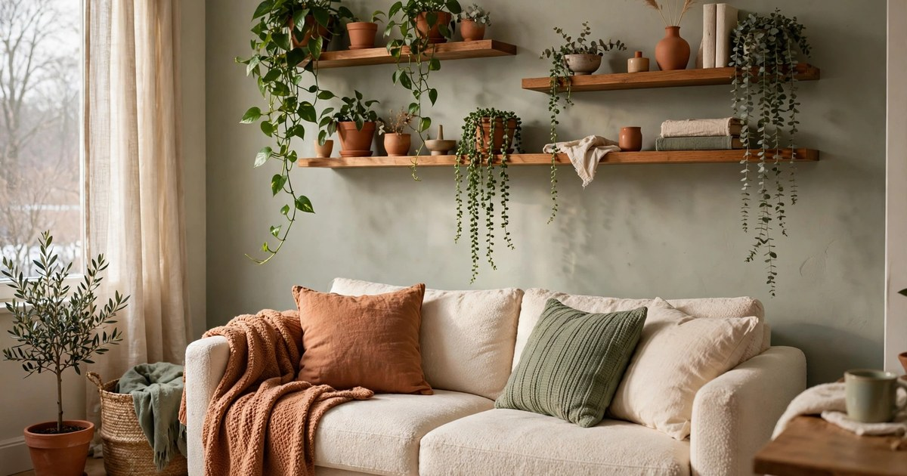
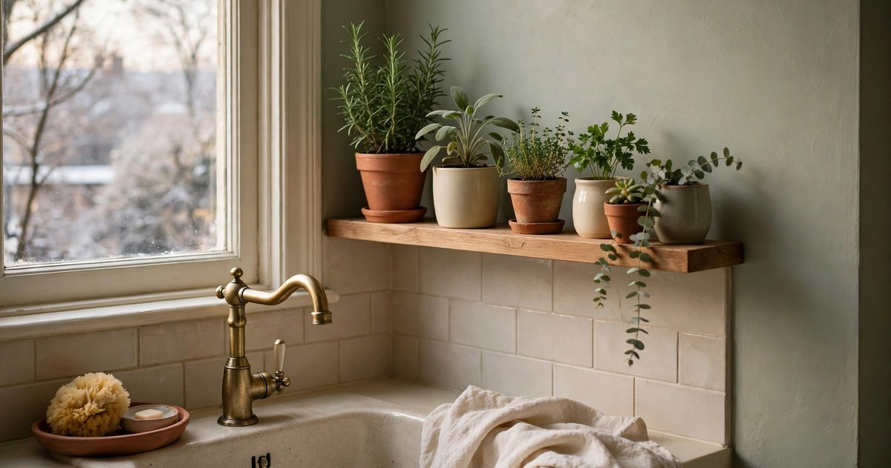
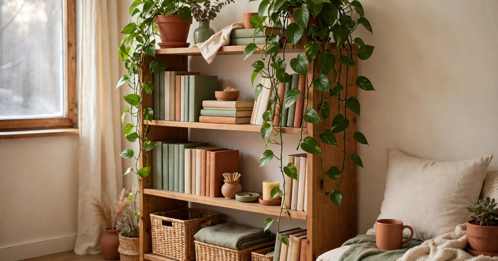
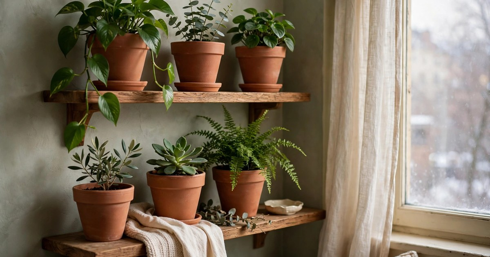
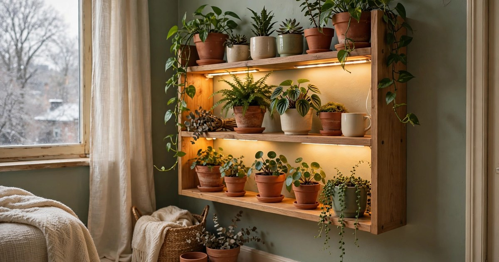
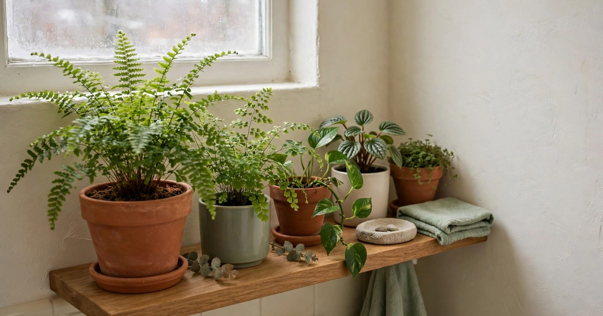
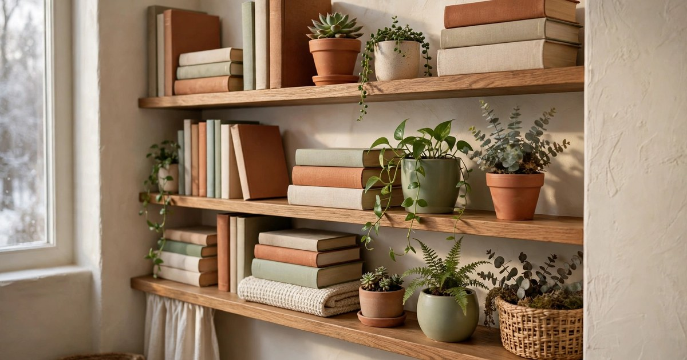
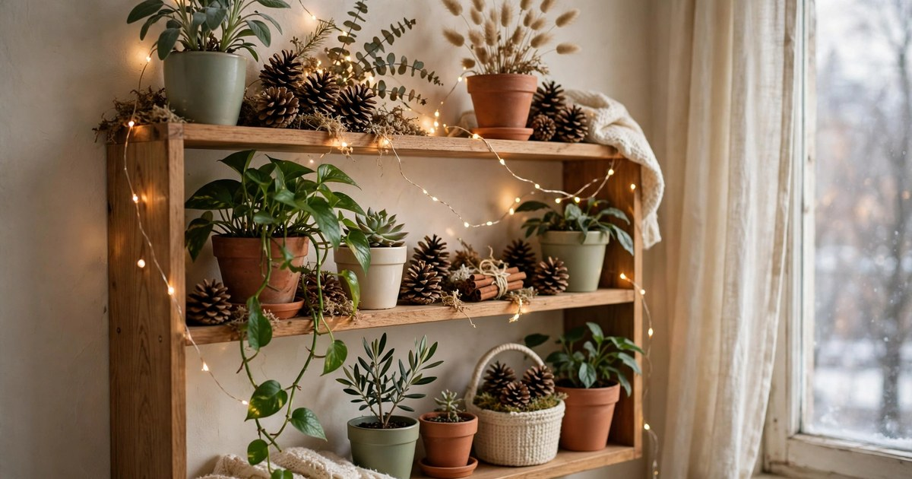

A plant shelf is the best answer to the small-apartment plant problem: you want greenery everywhere, but the floor is full and the windowsills are taken. A shelf lifts your plants up where they can catch the light, keeps them out of the way of everyday life, and turns a plain wall into a living display. In winter, when the garden is asleep and the days are short, a shelf full of green is the thing that makes a small flat feel alive.

These ten ideas work in rented flats — no drilling required for most of them, and the ones that use floating shelves can be hung with heavy-duty removable strips if the shelf is light. Start with the shelf you already have, even if it is just a windowsill, and build from there. Your plants do not need a perfect display; they need light, a little water, and a spot where you will actually notice them.

### 1. The Windowsill Shelf

The windowsill is the original plant shelf, and in winter it is the most valuable real estate in a small flat because it gets the most light. Make the most of it by adding a narrow shelf or a small riser on the sill itself, so you can stack plants in two rows: tall ones at the back, small ones at the front. A simple wooden board on two small brackets, or a stack of books used as a riser, doubles the number of plants a single windowsill can hold.

Keep the plants that need the most light on the sill — succulents, cacti and herbs — and move the shade-lovers, like pothos and ferns, to a shelf a little further into the room. In winter, watch for cold draughts from the window: if the glass is icy, move tender plants a few centimetres back from the pane. A windowsill shelf costs almost nothing and it is where your plants will be happiest all winter.

### 2. A Ladder Shelf in the Corner

A ladder shelf leans against the wall, needs no fixing, and turns a dead corner into a plant display. The tiers get wider towards the bottom, which is perfect for plants: big pots on the bottom shelf, medium ones in the middle, and small ones on top where they catch the light. Because it leans rather than hangs, a ladder shelf is completely renter-friendly — it leaves no marks, and you can move it in minutes when you rearrange.

Put the plants that need the most light on the top tier, closest to the window, and the shade-tolerant ones lower down. Trailing plants on the top tier will cascade down the ladder and soften the whole structure, which is exactly the look you want. A ladder shelf in a corner also solves the problem of the empty corner every small flat has — the one that is too small for furniture and too big to ignore.

### 3. Floating Shelves Above the Sofa

Floating shelves above the sofa turn dead wall space into a plant display, and they put greenery at eye level where you actually see it. Two or three shelves, spaced about forty centimetres apart, hold a surprising number of plants: trailing pothos on the top shelf, a fern in the middle, and small succulents on the bottom one. The plants soften the wall above the sofa and make the whole seating area feel like a garden nook.

If your tenancy allows small screws, floating shelves are a solid choice. If not, look for lightweight shelves designed for removable strips, and keep the pots small and the plants light — a heavy terracotta pot is not a good idea on a strip-hung shelf. Water the plants in place with a small jug and a saucer under each pot, so drips never reach the sofa below.

### 4. A Shelf Above the Kitchen Sink

The shelf above the kitchen sink is the most practical plant shelf in a small flat. It gets the humidity from the sink, the steam from cooking, and the light from the kitchen window — three things most houseplants love in winter. Herbs are the obvious choice here: rosemary, thyme and mint in small pots, within arm's reach when you are cooking. A herb on the kitchen shelf is the only decoration that makes dinner taste better.

Keep the shelf narrow and the pots small, because kitchen shelves are usually shallow and the last thing you want is a plant falling into the washing up. A small tension rod or a rail under the shelf gives trailing plants something to hang from, and a row of matching pots keeps the display tidy. Water the herbs when you are already at the sink — it is the easiest watering routine you will ever have.

### 5. Trailing Plants on the Top Shelf

Trailing plants are made for top shelves. A pothos, a string of hearts or a spider plant on the highest shelf of a bookcase will send its vines cascading down past the books, softening the whole unit and making it look like a living thing. The effect is best in winter, when the bare branches outside make the green inside feel even more precious. One trailing plant on a top shelf does more for a room than five small plants scattered around it.

Let the vines grow long — resist the urge to trim them until they reach at least halfway down the shelf below. Pin the vines to the side of the bookcase with small removable hooks if you want them to frame the shelf rather than hang straight down. Water from the top with a long-spouted jug, and put a saucer under the pot, because trailing plants on high shelves are the ones most likely to drip on the books below.

### 6. A Shelf of Matching Pots

Matching pots are the simplest way to make a plant shelf look deliberate rather than accidental. A row of identical terracotta pots, or a set of cream ceramic pots in the same shape, turns a collection of different plants into a display. The uniformity of the pots lets the plants themselves be the stars — the different leaf shapes, heights and colours stand out more when the pots are quiet. It is the same principle as a gallery wall: repetition creates order.

You do not need to buy a matching set. Paint plain terracotta pots the same colour with a sample pot of paint, or cover mismatched pots with the same fabric or paper. The plants do not care what the pots look like; your eye does. A shelf of matching pots is also the easiest plant display to photograph, which matters if you share your flat on social media — and it is the one that makes visitors ask where you bought it.

### 7. Grow Lights Tucked Under a Shelf

Winter light is the hardest problem for indoor plants, and a grow light tucked under a shelf is the most elegant solution. A slim LED bar, stuck to the underside of the shelf above your plants, gives the shelf below it exactly the light it needs — no bulky lamp, no floor space, nothing to trip over. The plants on the lit shelf will grow through winter as if it were spring, while the ones on unlit shelves slow down and rest.

Choose a full-spectrum LED bar rather than the purple grow lights, because the purple glow makes a living room look like a nightclub. Full-spectrum light looks like ordinary warm white light, so the shelf looks natural and the room stays cosy. Put the light on a timer for ten to twelve hours a day, and your plants will think it is May. A grow light under a shelf is the single best investment for anyone who wants a green flat all winter.

### 8. A Bathroom Shelf for Humidity Lovers

The bathroom is the warmest, most humid room in a small flat, and a shelf there is paradise for ferns, calatheas and other humidity lovers that struggle in dry, heated living rooms. A small shelf above the sink or over the toilet holds two or three plants that will thrive on the steam from your shower alone. Ferns that go brown in the living room stay green in the bathroom, and the plants make the smallest room in the flat feel like a spa.

Check the light before you commit: a bathroom with a window is ideal, but a windowless bathroom needs a plant that tolerates low light, such as a pothos or a snake plant. Use plastic or ceramic pots rather than terracotta in a bathroom, because the humidity keeps terracotta damp and it can grow mould. Water sparingly — the steam does half the work — and wipe the leaves occasionally, because bathroom plants collect dust and soap residue.

### 9. A Shelf Styled With Books and Plants

Books and plants belong together on a shelf. The books give the plants structure and height, the plants soften the hard edges of the books, and the combination looks like a home rather than a garden centre. Try a stack of three books with a small plant on top, a row of upright books with a trailing plant at the end, or a plant nestled between two bookends. The rule is simple: the plants and the books should share the shelf, not compete for it.

Keep the plants small on a bookshelf, because a big plant will shade the books and a big book will shade the plant. Succulents, air plants and small ferns are the best bookshelf plants — they stay compact, they need little water, and they look good next to a row of spines. Put a saucer under every pot, because a water stain on a bookshelf is forever, and rotate the plants every few weeks so they grow evenly towards the light.

### 10. A Rotating Seasonal Shelf

A rotating seasonal shelf is a plant display that changes with the year, and winter is the best season to start one. Keep the plants the same, but change the decorations around them: pinecones and fairy lights in December, dried orange slices in January, a small vase of forced bulbs in February. The plants stay put, the shelf stays fresh, and you get the pleasure of redecorating without buying a single new plant.

The trick is to keep the seasonal touches small and light, so they never crowd the plants. A string of fairy lights, a few pinecones, a small candle — that is enough. The shelf should still be a plant shelf first and a seasonal display second. When spring comes, swap the pinecones for a small vase of fresh flowers, and the shelf will feel new again without any effort at all.

## One Shelf Is Enough to Start

You do not need ten shelves to have a green flat. One shelf — a windowsill, a ladder shelf, a floating shelf above the sofa — is enough to change how a small apartment feels in winter. Start with the shelf you already have, put your healthiest plants on it, and give them light and a little attention. By the time spring arrives, the shelf will be full, the plants will be thriving, and you will be looking for a second shelf. That is how a plant collection grows: one shelf at a time.

## Frequently Asked Questions

### Where is the best place for a plant shelf in a small apartment?

Near a window, where the plants get the most light. A windowsill, a shelf beside a window, or a ladder shelf in a bright corner all work well. Avoid shelves above radiators, because the dry heat will stress the plants, and avoid dark hallways unless you add a grow light.

### How do I hang a plant shelf in a rental without damage?

Use a leaning ladder shelf, which needs no fixing at all, or a lightweight floating shelf hung with heavy-duty removable strips rated for the weight. Keep pots small and light on strip-hung shelves, and always check the weight rating before you trust it.

### Which plants are best for a winter plant shelf?

Pothos, snake plants, spider plants and ferns are the most forgiving choices for a winter shelf. They tolerate low light and irregular watering, and they look good trailing or upright. Succulents and cacti suit the brightest shelf; herbs suit the kitchen shelf.

### How do I water plants on a high shelf without making a mess?

Use a long-spouted watering can or a small jug, water slowly, and always keep a saucer under each pot. Water in the morning so any drips dry during the day, and wipe the shelf down once a week. For very high shelves, take the plant down to water it and put it back once it has drained.
