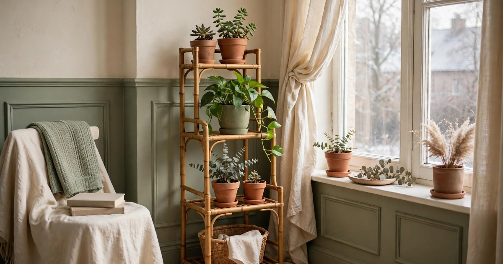
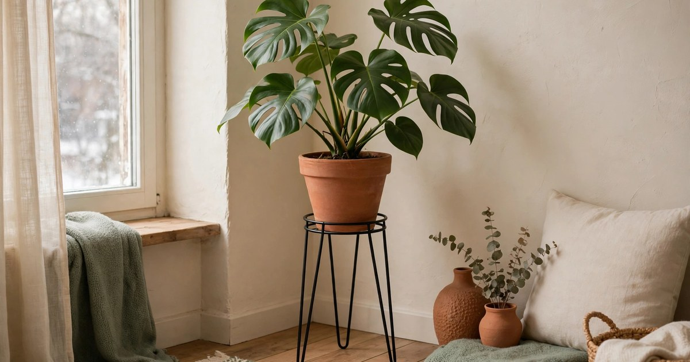
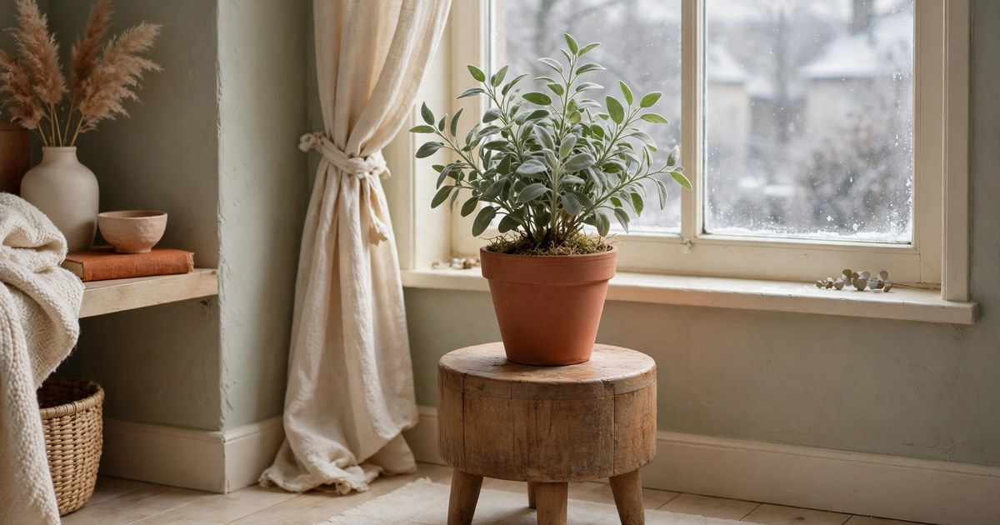
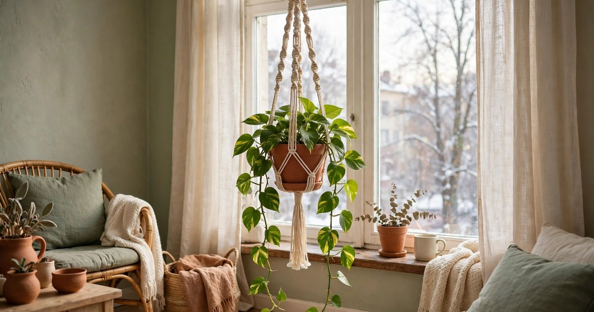
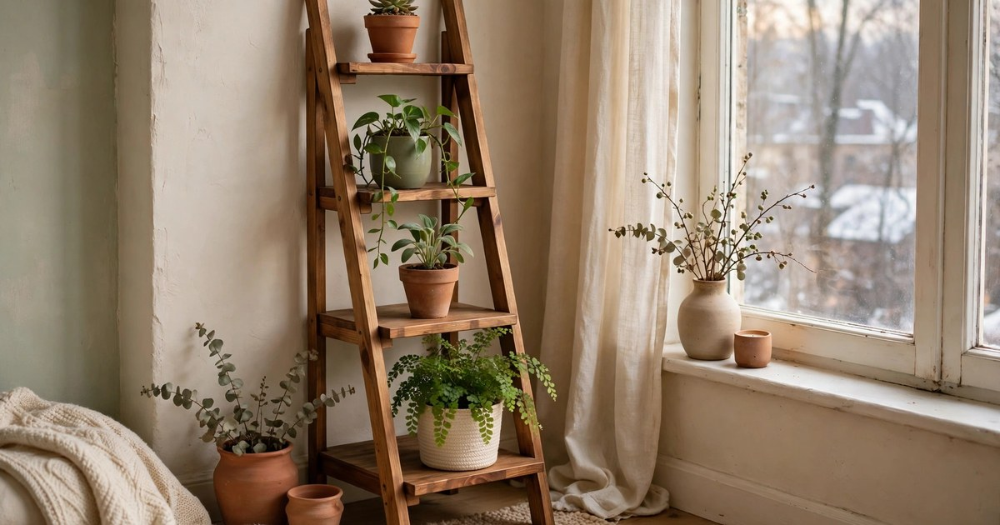
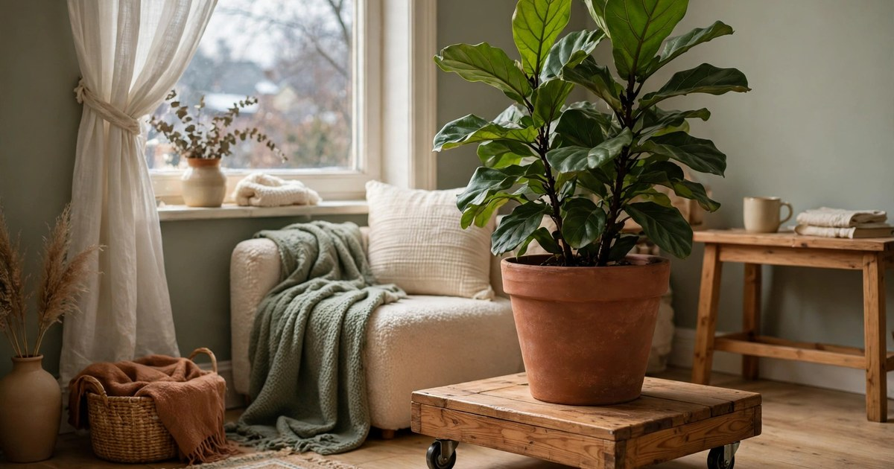
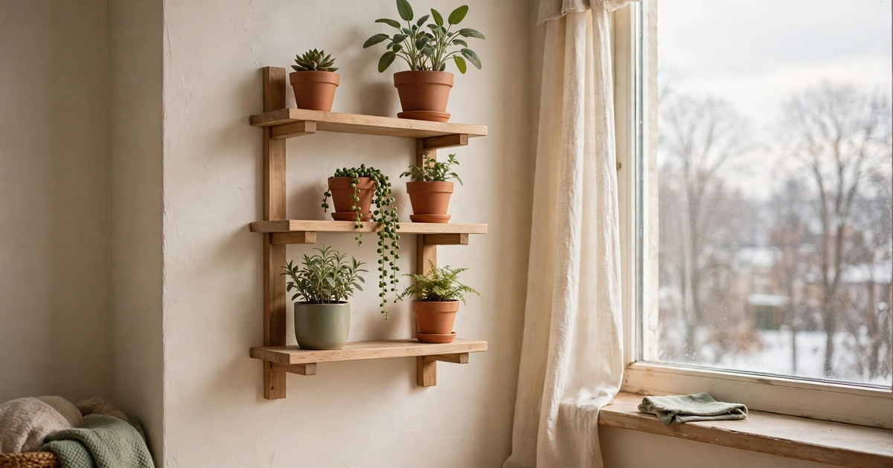
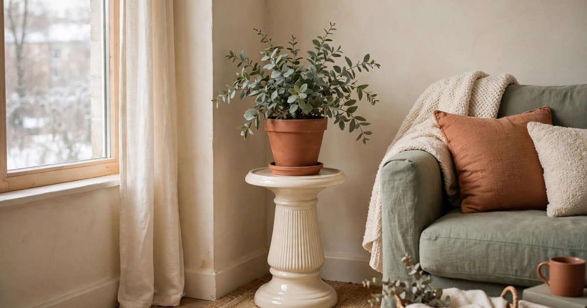
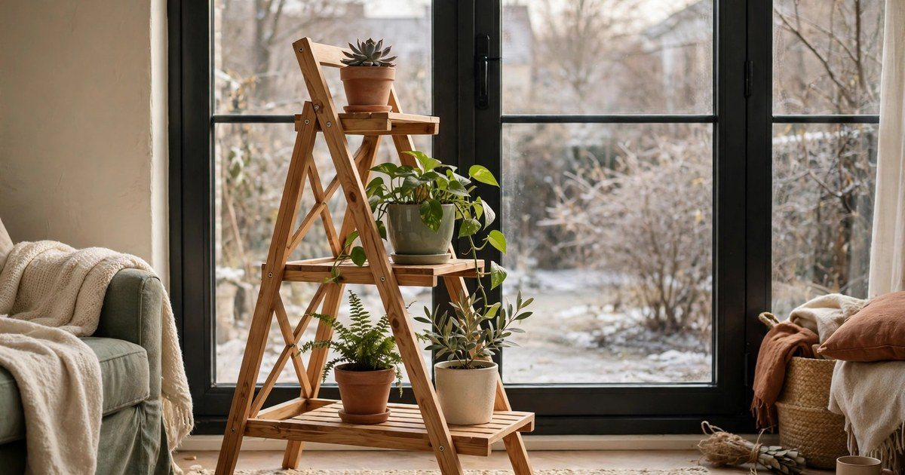

Winter is the hardest season for houseplants in a small flat. The days are short, the sun sits low, and the light that does reach the window is weaker than anything your plants saw in summer. A plant sitting on the floor is often a plant sitting in shadow, because the brightest light in a room hugs the window glass and the sill. The cheapest fix is not a new grow light or a fancier plant — it is height. Lifting a pot by thirty or sixty centimetres can move it from gloom into the brightest patch of the room, and a small stand does exactly that without demanding the floor space of another piece of furniture.

That is why a plant stand is one of the best-value buys a renter can make in winter. Every stand in this roundup costs $25 or less, and most come in well under that, yet each one solves a real winter problem: getting plants off cold floors, closer to windows, and away from radiators that dry the air to a crisp. They are all light enough to move with one hand, none of them needs drilling or permanent fixings, and all of them leave your deposit intact when you move out. Where a price is quoted for a set rather than a single stand, we say so — a three-pack at $21 is a very different deal from a single stand at $21, and we flag the difference every time so you can compare honestly.

Every pick below was chosen for a small apartment first and a plant second. That means a small footprint, a height that suits a window sill or a bright corner, and a look that suits a rented room rather than dominating it. Warm wood, slim black metal, woven fibres and soft ceramics all feature, because a stand should make a corner feel finished, not cluttered. Pick one for your sunniest window, and your plants will thank you all winter.

## 1. Bamboo Tiered Plant Stand

The bamboo tiered stand is the workhorse of small-space plant care, and it earns its place at the top of this list for one simple reason: it holds three or four plants in the footprint of one. Most versions under $25 are two or three tiers, with the top shelf sitting roughly knee height and the lower shelves stepping down towards the floor. That staggered shape means every plant gets its share of window light instead of the back row sitting in the front row's shadow. Bamboo suits winter especially well, because its warm honey tone reads cosy against grey January light, and the slatted shelves let air move around the pots instead of trapping damp underneath them.

Prices usually run $18–25 for a two- or three-tier bamboo stand, and the very best value is the folding style that packs flat when you move house. Check the shelf spacing before you buy: you want at least 25 cm between tiers so a trailing plant has room to hang and a bushy plant does not squash against the shelf above. If your pots are heavy terracotta, look for stands with thicker bamboo poles and a crossbar under each shelf, as those hold weight without bowing over a long winter.

**Why it works:** It turns one patch of floor into a mini plant shelf, so three plants share the brightest spot in the room instead of fighting for it.

**Where it fits:** Beside a south- or west-facing window in the living room, or at the end of a narrow hallway where a single row of plants would block the walkway.

[Shop bamboo plant stands](https://www.amazon.com/s?k=bamboo+tiered+plant+stand+indoor&tag={{AMAZON_TAG}})

## 2. Metal Hairpin-Leg Plant Stand

A metal hairpin-leg stand is the minimalist's answer to winter plant display: a slim steel frame, usually in matte black or brushed gold, that holds a single pot at the perfect height to catch low winter sun. Because the legs are thin, the stand almost disappears, and the plant itself becomes the decoration. It is the right choice when you own one statement plant — a fiddle-leaf fig, a monstera, a tall snake plant — and you want it lifted off a cold floor without adding visual bulk to a small room.

Expect to pay $12–20 for a single hairpin-leg stand, with taller versions at the upper end of that range. Measure your pot before ordering, because these stands are sized to the pot's diameter, and a pot that is too wide will sit awkwardly on the rim while one that is too narrow will wobble. If your flat has draughty floors, the raised base is a genuine benefit in winter: cold air pools at floor level, and even fifteen centimetres of lift keeps roots a little warmer and drier. Pair it with a saucer inside the stand so watering does not drip onto the frame.

**Why it works:** It lifts one plant into the light with almost no visual weight, so a small room still feels open.

**Where it fits:** Next to an armchair, in an empty corner by the balcony door, or flanking a television unit where a larger piece of furniture would crowd the room.

[Shop metal hairpin plant stands](https://www.amazon.com/s?k=metal+hairpin+plant+stand+indoor&tag={{AMAZON_TAG}})

## 3. Wooden Stool Plant Stand

The humble wooden stool is the renter's secret weapon, because it is a plant stand, a side table and a step stool in one, and nobody will ever mistake it for a single-purpose purchase. A small round or square stool, usually in pine or rubberwood, raises a plant to just the right height for a window sill that is too narrow for pots, and when the plant moves outside in spring, the stool becomes a place for a book and a cup of tea. Look for a stool with a flat, solid top rather than a slatted one, so small pots sit steadily and saucers do not tip.

Prices sit around $14–22 for a single wooden stool stand, and the best deals are often sold as a set of two at $20–25 — that is a set price, not a single-stool price, so read the listing carefully. A stool around 30 cm tall suits floor plants, while one nearer 45 cm works for a plant you want at sill height beside a low window. Sanded edges matter more than you would think in a small flat, where you brush past furniture constantly, and a light natural finish suits the terracotta and cream palette that makes winter rooms feel warm.

**Why it works:** It is the most versatile stand you can buy — a plant pedestal in winter, a side table in summer, and it moves with you.

**Where it fits:** Beside a low window in the bedroom, under a kitchen window where herbs need light, or in the bathroom where a plant can enjoy the steam.

[Shop wooden stool plant stands](https://www.amazon.com/s?k=wooden+stool+plant+stand+indoor&tag={{AMAZON_TAG}})

## 4. Hanging Macrame Plant Stand

When floor space is the scarcest thing in your flat, the answer is to stop using the floor altogether. A macrame plant hanger lifts a trailing plant into the brightest air in the room — right up by the window, where the light is strongest — and it costs almost nothing. The woven cotton cords suit winter beautifully, softening hard window frames and adding texture to a room that can feel bare once the summer plants have come inside. A single hanger holds one pot, and a pair hung at different heights turns a bare window into a green curtain.

Most macrame hangers cost $8–15 each, and sets of two or three often land at $15–22, which is a set price and excellent value if you have several trailing plants. Check the weight limit before you buy, and stick to lightweight plastic or ceramic pots rather than heavy terracotta, because a wet hanging pot is heavier than it looks. Hang from a tension rod across the window, a ceiling hook, or a curtain rail bracket — all renter-friendly fixings that leave no holes. If you already love trailing plants, our guide to [hanging planters for small apartments under $25](/hanging-planters-small-apartments-under-25/) has more ideas in the same spirit.

**Why it works:** It puts a plant in the brightest part of the room using zero floor space, and the soft woven texture warms up a bare winter window.

**Where it fits:** In front of a sunny kitchen window for trailing herbs, or in a bright bathroom where a pothos can trail down beside the mirror.

[Shop macrame plant hangers](https://www.amazon.com/s?k=macrame+plant+hanger+indoor+hanging&tag={{AMAZON_TAG}})

## 5. Corner Ladder Plant Stand

Corners are wasted space in most small flats, and a ladder stand is designed to claim them. Shaped like a narrow A-frame or a leaning ladder with three or four shallow shelves, it tucks neatly into a corner and holds a whole collection — a small fern on top, a trailing plant in the middle, a sturdy snake plant at the bottom. The open ladder shape lets light filter through to every shelf, which matters in winter when each shelf is competing for a small pool of sunlight. Bamboo and pine versions are the most common under $25, and both bring a warm, natural tone to a room.

Prices typically run $20–25 for a three- or four-tier corner ladder, which is at the top of this roundup's budget but buys you room for four plants at once. Measure your corner before you order, because some ladder stands are wider than they look in photos, and a stand that juts into the walkway will be bumped daily. If your corner is beside a radiator, leave a gap of at least 30 cm between the stand and the heat source, or the lowest plants will dry out faster than you can water them. For a festive corner, a small [Norfolk pine dressed for Christmas](/norfolk-pine-decor-ideas-christmas/) looks lovely on the top shelf of a ladder stand.

**Why it works:** It converts a dead corner into a tiered plant display, with every shelf angled towards the room's light.

**Where it fits:** An empty living-room corner by the window, or the awkward corner beside a wardrobe where nothing else quite fits.

[Shop corner ladder plant stands](https://www.amazon.com/s?k=corner+ladder+plant+stand+indoor&tag={{AMAZON_TAG}})

## 6. Rolling Plant Caddy

A rolling plant caddy is the most practical stand on this list, even if it is the least decorative. It is a low, wheeled platform that a heavy pot sits on, and its whole purpose is movement: roll the plant into the sun in the morning, roll it away from a cold draughty window at night, roll it out of the way when you mop. In winter that mobility is genuinely useful, because the sunniest spot in a flat moves as the sun's path changes, and a caddy lets your plant follow it without you lifting a heavy pot. Most caddies are round or square, in wood or dark plastic, with four small castor wheels, two of which lock.

Prices are friendly, usually $9–16 for a single caddy, and sets of two or three often cost $15–24 — again, a set price, so check the listing. Choose a caddy rated for at least the weight of your pot plus wet soil, and pick one with a raised lip so the pot cannot slide off when you roll it across a rug. The caddy also protects wooden floors from water rings and from the cold, damp patch a pot leaves behind over winter. It is not the prettiest stand here, so tuck it under a large plant where the foliage hides the wheels, and let the plant do the talking.

**Why it works:** It lets a heavy plant chase the winter sun around the flat, and it keeps cold, damp pots off your floors.

**Where it fits:** Under a large floor plant that migrates between the window and the centre of the room, or under a citrus tree that spends winter indoors.

[Shop rolling plant caddies](https://www.amazon.com/s?k=rolling+plant+caddy+with+wheels+indoor&tag={{AMAZON_TAG}})

## 7. Wall-Mounted Shelf Plant Stand

A wall-mounted shelf is a plant stand that uses no floor at all and no ceiling hook either — just a small floating shelf or a pair of L-brackets screwed into a wall, or, for renters, mounted with heavy-duty adhesive strips rated for the weight. In winter, a shelf set at window height turns a bare wall beside the window into a second sill, and small plants that would freeze on a cold window ledge can sit a few centimetres back from the glass where the air is warmer. A single shelf holds two or three small pots; two shelves staggered up the wall hold a whole collection.

A single floating shelf costs $10–18, while a set of two or three shelves runs $18–25 — a set price that works out cheaper per shelf. If your landlord forbids drilling, use adhesive mounting strips and keep each pot light: a small succulent or a baby spider plant rather than a heavy ceramic pot. Keep shelves away from radiators, and wipe them down monthly, because winter condensation on cold walls can leave marks behind pots. If you like the idea of plants on the wall, our guide to [woven baskets for trailing plants](/woven-basket-wall-trailing-plants-guide/) pairs beautifully with a shelf or two.

**Why it works:** It creates a plant display at exactly window height on a wall that was doing nothing, with zero floor space used.

**Where it fits:** On the wall beside a bright window, above a desk where a small plant can enjoy the light, or in a narrow hallway that has light but no floor to spare.

[Shop wall mounted plant shelves](https://www.amazon.com/s?k=wall+mounted+floating+shelf+plant+stand&tag={{AMAZON_TAG}})

## 8. Ceramic Pedestal Plant Stand

A ceramic pedestal stand is the most elegant pick in this roundup — a short, sturdy column, often in cream, sage or terracotta glaze, that raises a single plant like a piece of sculpture. It suits winter because ceramic holds a little warmth and its solid base is stable on uneven rented floors, and because a pedestal makes even a small plant look deliberate rather than temporary. The glazed surface wipes clean after watering, and the colour can echo the terracotta pots around it for a calm, coordinated corner.

Expect $15–25 for a single ceramic pedestal, with smaller ones at the lower end and taller, hand-glazed pieces at the top of the range. Check the top diameter against your pot, because pedestals are unforgiving about size: a pot wider than the pedestal top looks top-heavy and can tip. A pedestal around 25–35 cm tall is ideal for a medium plant you want to raise to sill level, and it works brilliantly beside a sofa or a bed where a leggy stand would catch on bedding or cushions. Because ceramic is heavy, it is also the most stable stand here — useful in a flat with pets or small children.

**Why it works:** It turns one plant into a focal point, raises it off a cold floor, and its weight makes it the most tip-proof stand in the roundup.

**Where it fits:** Beside a bed or sofa as a living sculpture, or in a hallway where a statement plant greets you at the door.

[Shop ceramic pedestal plant stands](https://www.amazon.com/s?k=ceramic+pedestal+plant+stand+indoor&tag={{AMAZON_TAG}})

## 9. Foldable A-Frame Plant Stand

The foldable A-frame stand is the renter's favourite for a reason: it folds flat. Open, it is a sturdy two- or three-tier wooden stand that holds several plants at different heights; folded, it slides behind a door or under a bed. That matters in a small flat, where a plant display that is permanent in December might be in the way by March. Most A-frames are bamboo or pine, with slatted shelves that drain well and let light through, and they assemble in minutes without tools — usually just a couple of wing nuts or a slot-together frame.

Prices run $16–24 for a two- or three-tier folding A-frame, with the three-tier versions at the upper end. Check that the folding mechanism locks firmly when open, and that the shelves are level once assembled, because a wobbly A-frame on a rug will tip a pot sooner or later. In winter, place it where it catches morning light and fold it away if you need the space for guests over the holidays — then pop it back open in January when the plants come back to the window. It is the stand to buy if you are not sure how committed you are to a plant display yet, because it asks for almost no commitment at all.

**Why it works:** It gives you a full tiered display in winter and disappears in seconds when you need the room back.

**Where it fits:** In front of a patio door where plants can soak up winter sun, or in a spare corner that doubles as guest space over the holidays.

[Shop foldable A-frame plant stands](https://www.amazon.com/s?k=foldable+A+frame+plant+stand+indoor&tag={{AMAZON_TAG}})

## Frequently Asked Questions

### How high should a plant stand be in winter?

It depends on your window, but as a rule, lift the plant so its leaves sit at or just below the middle of the window pane, where the light is strongest. For a low sill, a stand of 25–40 cm is usually enough; for a tall floor plant, even 15 cm of lift off a cold floor helps roots stay warm. Move the plant closer to the glass during the day and a few centimetres back at night if the window is draughty.

### Are cheap plant stands under $25 sturdy enough for heavy pots?

Yes, provided you check the weight rating before you buy. Bamboo and metal stands usually list a per-shelf limit, often 10–15 kg, which covers most medium pots with wet soil. Avoid hanging stands for heavy terracotta, and use a rolling caddy or a ceramic pedestal for the heaviest pots. If a stand wobbles when you nudge it empty, it will only be worse with a full pot on it.

### Should plants sit on the floor in winter?

It is best to avoid it where you can. Floors are the coldest part of a room in winter, and a pot sitting directly on tiles or laminate loses heat through its base and can sit in a puddle of condensation. Even a low stand or caddy breaks that contact and improves airflow around the pot. If you have no stand at all, a folded towel or a cork mat under the pot is a better stopgap than bare floor.

### Can I use a plant stand in a rented flat without damaging anything?

Yes — every stand in this roundup is renter-friendly, because none of them needs drilling or permanent fixings. Free-standing stands leave no marks at all, and wall shelves can be mounted with heavy-duty adhesive strips rated for the weight. Put a felt pad under metal feet to protect wooden floors, and use a saucer under every pot so watering does not stain the shelf or the floor beneath.

### How do I keep plants away from radiators in winter?

Place the stand at least 30 cm from any radiator, and never put a plant directly above one, where rising hot air dries leaves in hours. A stand actually helps here, because you can position a plant near the window and away from the heat source instead of leaving it on the floor where the radiator's warmth pools. Grouping plants together on a tiered stand also raises the humidity around them, which softens the drying effect of central heating.
