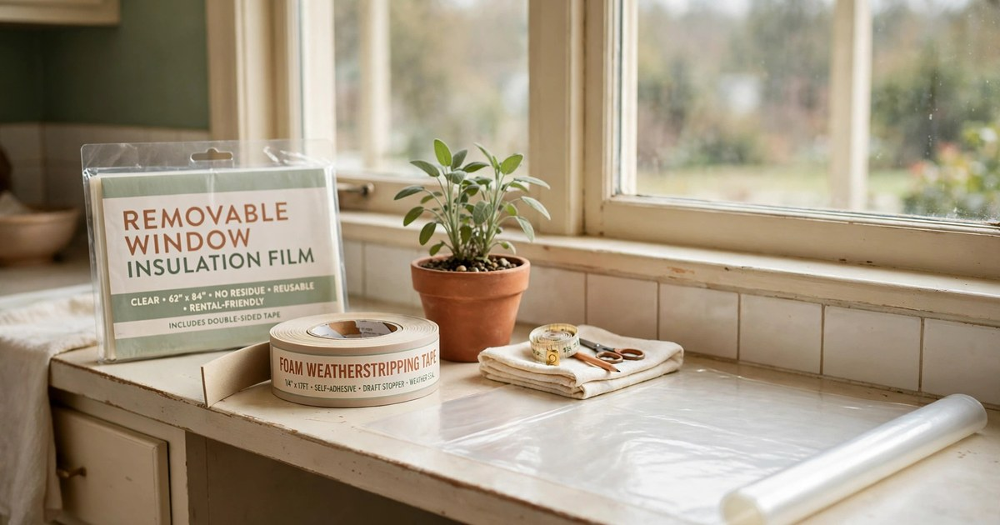
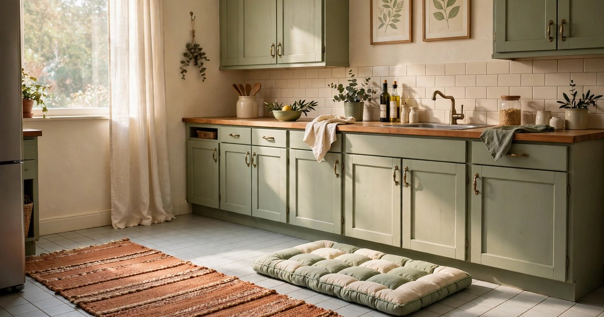
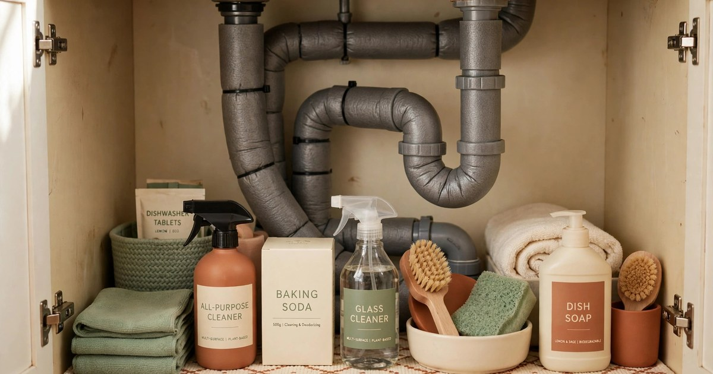
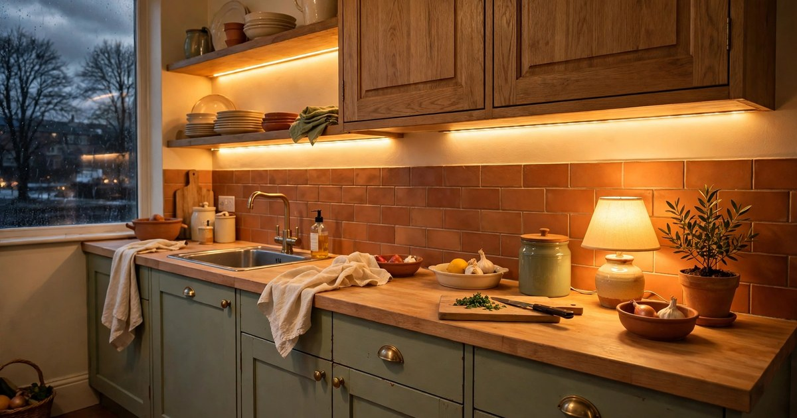
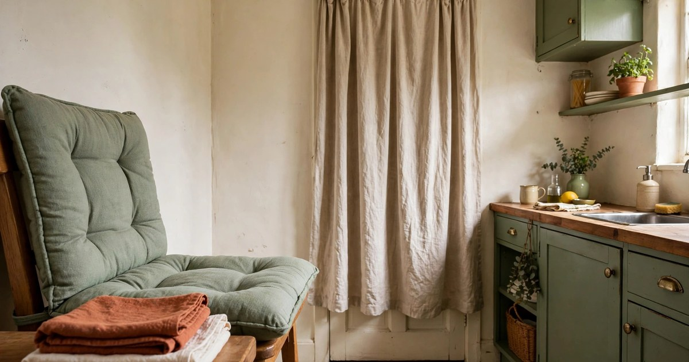
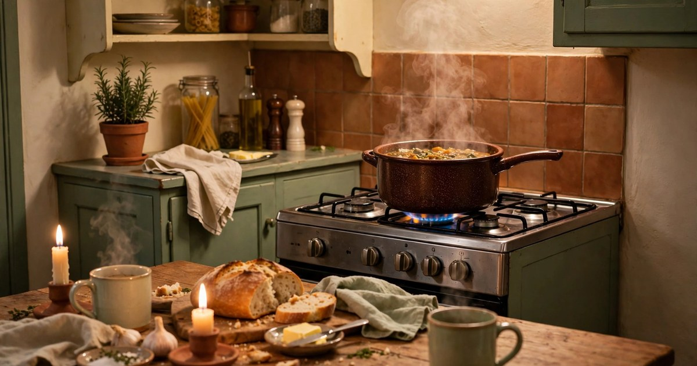

A rental kitchen in winter is a special kind of cold. The draught slips in around the back door, the tiles feel like ice under bare feet at 7am, and the cupboard under the sink is cold enough to chill a bag of onions. You pay the heating bill, the landlord owns the walls, and somehow your money still floats straight out of the window.

Here is the good news: the kitchen is the easiest room in a rental to winter-proof. It is small, it already generates heat every time you cook, and nearly every fix is removable, drill-free and deposit-safe. Work through these eight steps over a weekend, spend well under $100 in total, and your kitchen will hold warmth like a room you actually own — and stay a place you want to cook in, not just rush through.

The rules for every step below: nothing permanent, nothing screwed into the landlord's cabinets, nothing that leaves a mark in spring. If it cannot be peeled off, lifted up or packed away, it does not belong in this guide.

### 1. Find every draught before you fix anything

Do not guess where the cold comes from — hunt it. On a windy evening, switch the heating off, light a candle or a stick of incense, and slowly move it along every window frame, the back door, the extractor fan vent and any pipe that passes through an outside wall. Where the flame flickers or the smoke bends sideways, you have found a leak. Mark each spot with a small piece of painter's tape so you can find it again in daylight.

Kitchens have draught sources other rooms do not. The extractor hood vent is a classic: a flap that never quite closes lets a steady stream of cold air in all winter. The gap around the pipes under the sink is another. And if your kitchen has a back door, check the bottom edge — the gap there can be wide enough to slide a coin under, which is also wide enough to undo half your heating.

Write your leak list down before you shop. A typical rental kitchen has four to seven meaningful leaks, and sealing just the worst three can make the room feel several degrees warmer. It also keeps the hardware-store trip to one visit and stops you buying fixes for draughts you do not have. If the rest of the flat is draughty too, our guide on [how to winter-proof a drafty rental](/winter-proof-drafty-rental-guide/) walks through the same removable fixes room by room.

### 2. Seal windows and doors with removable fixes

Windows are the number one heat thief in a rental kitchen, and the renter's one-two punch works beautifully here: self-adhesive foam weatherstripping on the moving parts, plus shrink-film insulation over the whole window. The film goes on with double-sided tape, shrinks drum-tight with a hairdryer, and peels off clean in spring — it adds an insulating layer of air that single-pane glass desperately needs, and you can still see out of it clearly enough to watch the snow.

For the back door, a draught excluder — the long sausage-shaped cushion that sits along the bottom — costs a few dollars and blocks the worst gap in the room. A [door draught excluder](https://www.amazon.com/s?k=door+draft+stopper&tag={{AMAZON_TAG}}) in a fabric that matches your kitchen towels looks deliberate rather than makeshift, and you can move it to the front door in spring. Add a strip of foam weatherstripping around the door frame itself for the gaps a cushion cannot reach.

Do not forget the extractor vent. A magnetic vent cover, cut to size, sticks over the vent on the inside and peels off when you cook — or leave it on and open a window slightly while you fry. Some renters simply tape a square of cling film over the vent grille on the coldest nights. It is not elegant, but it stops a surprising amount of cold air, and it costs nothing.

### 3. Warm up the cold floor without touching it

Tile and lino floors are the coldest surface in a winter kitchen, and you cannot rip them up — so cover them instead. A washable runner along the worktop line does two jobs at once: it insulates your feet from the cold floor, and it catches the splashes that would otherwise make the tiles slippery. Choose one you can throw in the washing machine, because kitchen rugs earn their keep fast.

For the spot where you stand longest — in front of the sink or the cooker — add a cushioned anti-fatigue mat. A [washable kitchen runner rug](https://www.amazon.com/s?k=washable+kitchen+runner+rug&tag={{AMAZON_TAG}}) in a warm terracotta or sage pattern also does more than warm your feet: it visually warms the whole room, which matters in a space full of hard, cold surfaces.

If the floor is truly icy, interlocking foam tiles under the rug add a hidden insulating layer for a few dollars, and they lift out in spring without a trace. Slippers help too — a thick-soled pair kept by the kitchen door turns the 7am coffee run from a punishment into a pleasure. The goal is not a heated floor; it is a floor you do not dread standing on.

### 4. Keep pipes and cupboards warm

Frozen pipes are the one winter kitchen problem that can cost a renter real money, so this step is about prevention, not comfort. The pipes under the sink and any pipe running along an outside wall are the vulnerable ones. Wrap them in foam pipe insulation — the pre-slit tubes that clip on without tools — which costs a few dollars per length and comes off just as easily. If you can feel cold air coming through the hole where the pipes enter the wall, plug the gap with removable draught-proofing putty or a rolled-up cloth.

Cupboard doors matter too. The cupboard under the sink is often the coldest spot in the kitchen because it sits against an outside wall with pipes running through it. On the coldest nights, leave that cupboard door slightly open so warm room air circulates around the pipes. Move anything that could freeze or go strange in the cold — liquid soap, cleaning sprays, oils — out onto a shelf inside the room.

And the old advice still holds: when the forecast drops well below freezing, let the kitchen tap drip very slightly overnight. A slow drip keeps water moving through the pipes, and moving water does not freeze. It costs pennies in water and can save you a burst-pipe bill and an awkward conversation with your landlord.

### 5. Fix the light before the dark afternoons get you down

A winter kitchen is not just cold — it is dark by 4pm, and flat white overhead light makes the gloom worse. Warm light is the cheapest mood fix in the whole guide. Swap the bulbs in your kitchen fittings for warm-white (2700K) ones and keep the old bulbs in a drawer to put back when you move out. The difference between a cold blue-white bulb and a warm one is the difference between a canteen and a kitchen.

Under-cabinet lighting is the real game changer, and renters have never had it easier. Battery-powered LED strip lights stick on with adhesive pads, run on a remote or a motion sensor, and peel off without a mark. A set of [battery under cabinet LED lights](https://www.amazon.com/s?k=battery+under+cabinet+led+lights&tag={{AMAZON_TAG}}) under the wall cabinets turns the worktop into a warm pool of light exactly where you chop and stir, and makes the whole room feel cosier from the doorway.

Add one small lamp on a worktop or a windowsill if you have the space — a tiny warm glow at counter height softens the room in a way ceiling lights never will. And if your kitchen gets any winter sun at all, keep the windowsill clear: even an hour of low sun on a cream wall is free warmth and free light. For more ideas, our [renter-friendly winter lighting ideas](/renter-friendly-winter-lighting-ideas/) cover every room without a single screw.

### 6. Layer in textiles for instant cosiness

Textiles are insulation you can see. A heavy curtain hung over the back door — on a tension rod wedged inside the frame, no drilling — blocks the draught and softens the coldest wall in the room. A tension rod costs a few dollars, the curtain can be any thick fabric you already own, and the whole thing comes down in two minutes when you move out.

Inside the room, layer the soft stuff you already have: a folded tea towel over the back of a chair, a padded seat cushion on the stool where you eat breakfast, a thick oven glove hanging by the cooker instead of a thin one. None of these is insulation in the technical sense, but they change how the room feels — and in a small kitchen, feeling warm is half the battle.

This is also the moment to check your tea towels and dish cloths. Winter cooking means more soups, more steam and more wiping down, so a stack of thick cotton towels beats a pile of thin ones. Keep a dry one by the sink and a damp one for wiping, and rotate them through the wash so you always have a warm, dry towel to hand. Small comforts, used daily, add up to a kitchen that feels cared for rather than endured.

### 7. Store winter produce so it lasts (and stays warm)

Winter cooking runs on storage vegetables — potatoes, onions, squash, carrots, garlic — and a cold kitchen can either help or ruin them. The trick is knowing which ones want the cold and which ones do not. Root vegetables and onions like a cool, dark, dry spot: a basket in a cupboard away from the cooker is ideal, and they will keep for weeks. Potatoes, though, hate the fridge — cold turns their starch to sugar and makes them sweet and gritty when cooked.

Keep onions and potatoes apart, because onions release gases that make potatoes sprout. A two-tier basket or a pair of separate cloth bags solves it for a few dollars, and it looks far better than plastic bags on the worktop. Squash and garlic are happy at cool room temperature on an open shelf, where they double as decoration — a row of small pumpkins on a windowsill is the cheapest winter styling there is.

Herbs are the exception: they want warmth and light, not a cold cupboard. A small pot of parsley or thyme on the sunniest windowsill will keep producing through winter if you water it sparingly and turn it every few days. Our guide to [keeping herbs alive indoors in winter](/keep-herbs-alive-indoors-winter-guide/) covers watering, light and the varieties that actually survive a rental windowsill.

### 8. Cook, host and stay warm in it

The final step is the best one: use the kitchen the way winter wants you to. Cooking generates heat, steam and good smells — a pot of soup simmering for an hour warms the room more honestly than any gadget, and it feeds you too. Plan one slow, one-pot meal a week: soup, stew, a tray bake. The oven, once hot, keeps radiating warmth long after dinner, so leave the door ajar (if you have no small children or pets underfoot) and let that heat into the room instead of trapping it.

Hosting in a small winter kitchen is about warmth, not space. Two mugs of something hot, a loaf of bread, and a pot on the stove is a complete invitation. Push the table against the warmest wall, light the candles you already own, and let the cooking be the entertainment. Guests remember the smell of soup and the warmth of the room, not the size of the worktop.

And build a tiny winter ritual for yourself: the kettle on first thing, a proper breakfast at the table instead of standing at the counter, the radio on while you chop. A rental kitchen you have made warm and welcoming stops feeling like borrowed space and starts feeling like home — which is, after all, the whole point of winter-proofing it.

## Frequently Asked Questions

### Can I winter-proof a rental kitchen without my landlord's permission?

Yes — everything in this guide is removable and leaves no damage, so it falls under normal tenant use in most rental agreements: weatherstripping, window film, rugs, draught excluders, battery lights and pipe insulation all peel off or lift out. Always check your lease for any specific restrictions, and tell your landlord about anything involving water or pipes, like a slow overnight drip, just so it is on record.

### How much does it cost to winter-proof a rental kitchen?

Most renters can cover all eight steps for $60–$100 in total. The biggest single costs are a washable runner rug and a set of battery under-cabinet lights, usually $20–$30 each. Window film, foam weatherstripping, draught excluders and pipe insulation are all under $10 per item, and several fixes — the overnight tap drip, opening cupboard doors, moving herbs to the windowsill — cost nothing at all.

### Will window insulation film damage my rental windows?

No, not when it is applied and removed correctly. The film sticks with double-sided tape and shrinks tight with a hairdryer, and it peels away cleanly in spring. Warm the tape with the hairdryer before peeling to soften the adhesive, and wipe the frame with warm soapy water afterwards. Never apply film to cracked glass or to windows with broken seals — the heat from the hairdryer can make existing damage worse.

### How do I stop my kitchen pipes from freezing in a rental?

Wrap exposed pipes in foam pipe insulation, plug gaps around pipe entry points with removable putty, and leave the under-sink cupboard door open on the coldest nights so warm air reaches the pipes. When temperatures drop well below freezing, let the tap drip slightly overnight to keep water moving. If a pipe does freeze, tell your landlord straight away — do not try to thaw it with a naked flame or a heat gun.

### What is the best heating for a cold rental kitchen?

Start with the free heat you already make: cooking, the oven cooling down with its door ajar, and the kettle. Then seal the draughts and insulate the floor, which keeps that heat in the room. If you still need more, a small oil-filled radiator is the safest portable option for a kitchen — no exposed element, no fan blowing dust — but check your lease and never leave any portable heater running unattended or near water.
