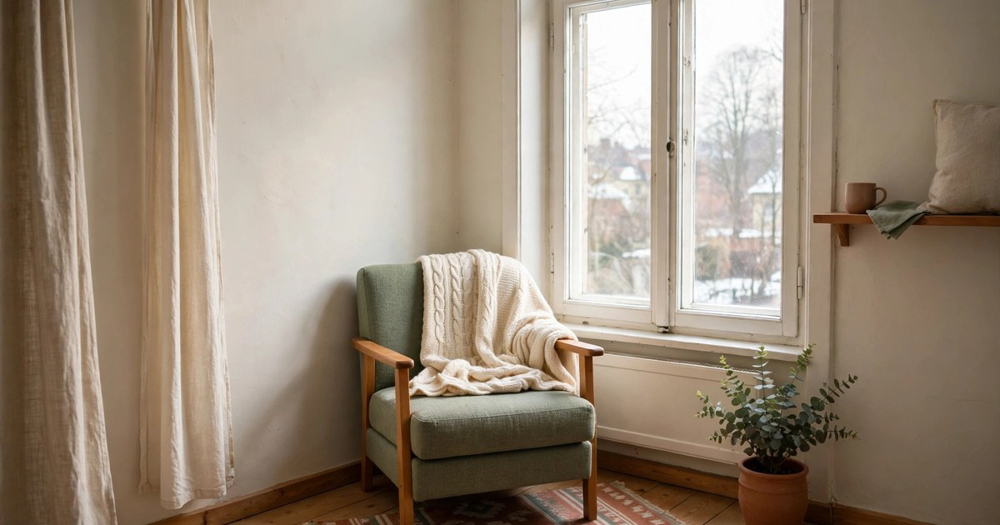
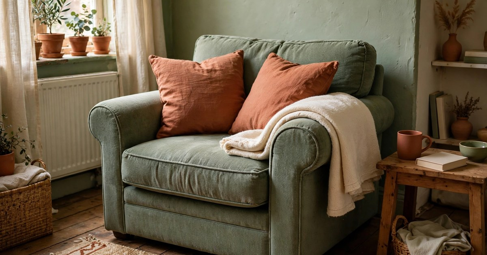
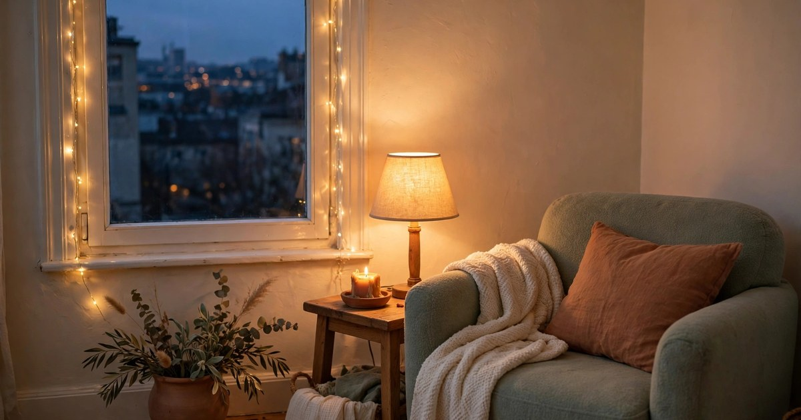
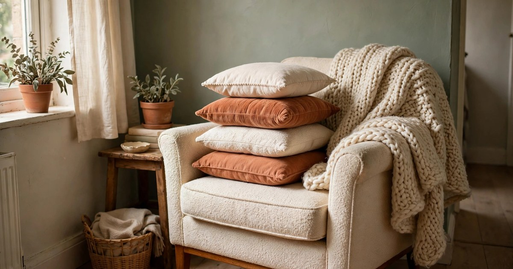
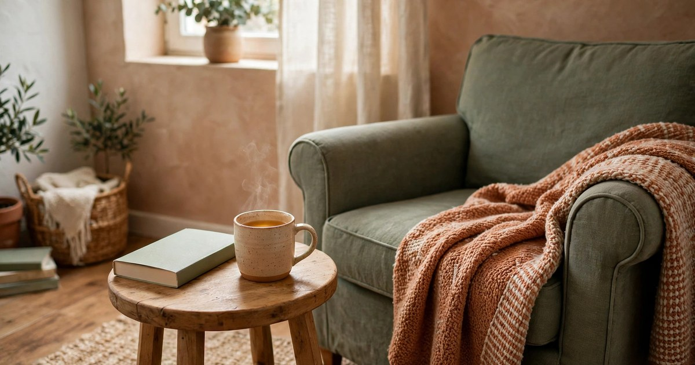
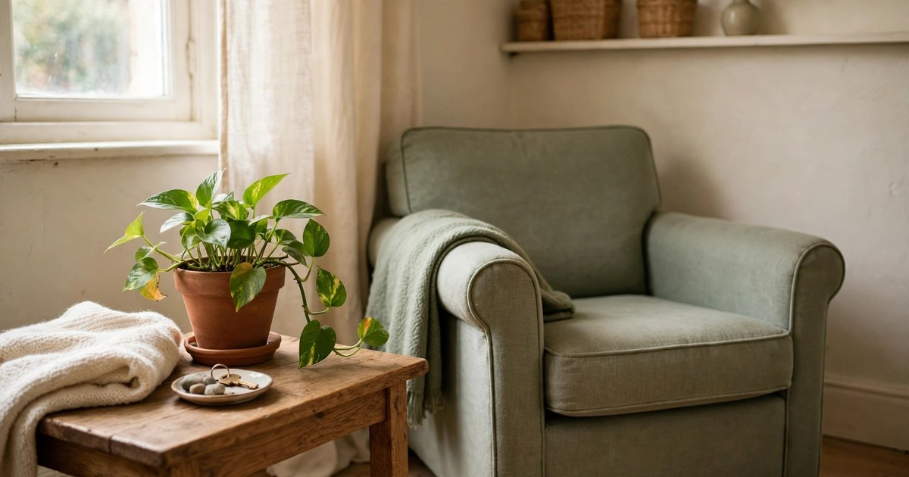
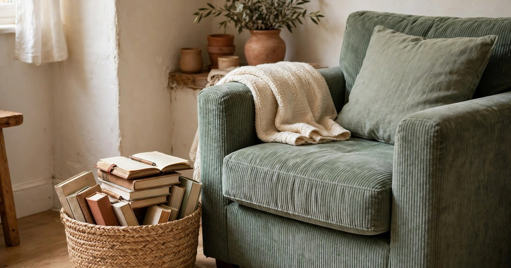
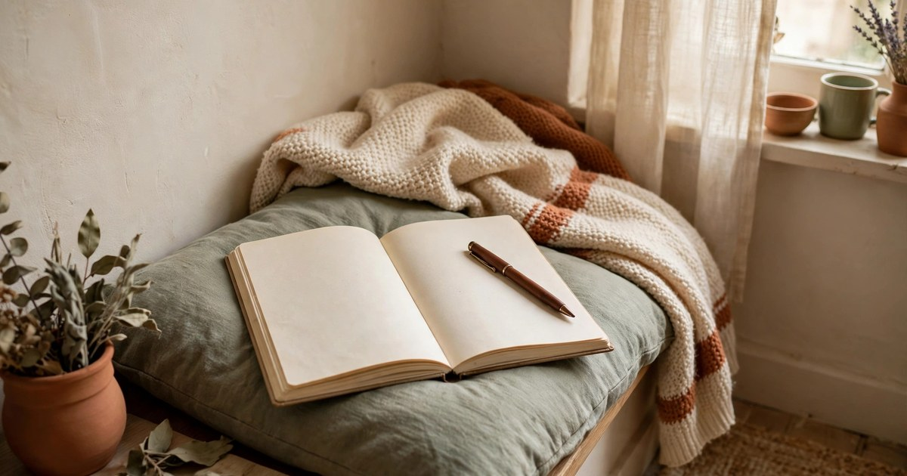
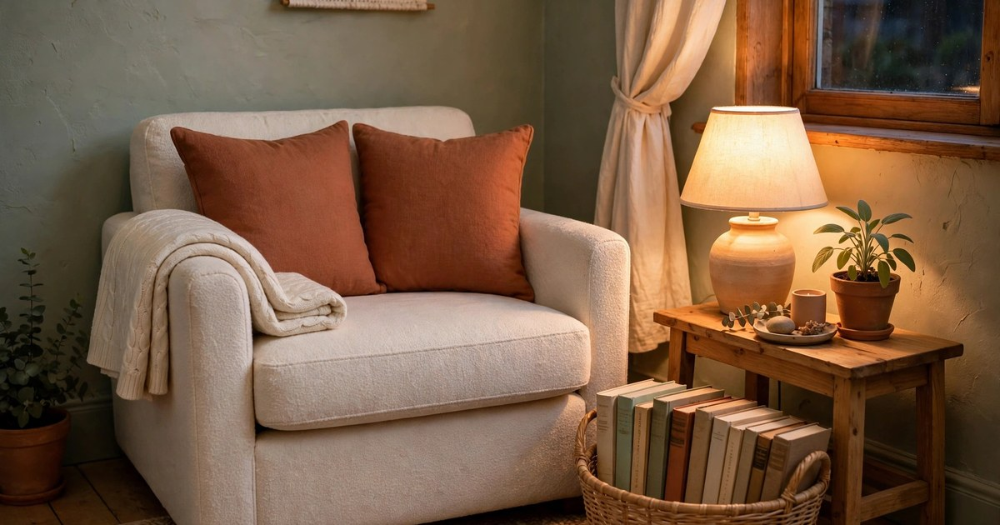

Winter in a small rented flat can feel like the walls are closing in. The evenings arrive before dinner, the light goes grey by four o'clock, and the sofa ends up doing every job at once — office, dining table, cinema, and bed-adjacent doom-scroll station. What most small flats are missing is not space but a boundary: one small corner that belongs to rest and nothing else. A self-care corner is exactly that. It is not a spare room, and it does not need a renovation, a drill, or a landlord's permission. It is one chair, one patch of warm light, and a few small rituals, arranged so that the moment you sit down your shoulders drop.

The whole point of doing it the renter-friendly way is that everything can be picked up and moved. Nothing here is screwed to a wall, nothing is painted, and nothing costs more than a takeaway or two. Most of the ideas below come in under $25, and several cost nothing at all — just a rearrangement of things you already own. Start with the first three ideas and your corner will already work; add the rest over a few weeks and it becomes the part of the flat you look forward to all day. If you have been meaning to carve out a proper [cosy reading nook](/cozy-reading-nook-small-apartment-guide/) but kept waiting for a bigger home, stop waiting. A corner is enough.

### 1. Claim the corner by the window

Every flat has one corner that gets the best light, and it is almost always wasted — a drying rack lives there, or a pile of things waiting to be put away. In winter, that light is precious. Claim the brightest corner you have, ideally beside a window, and declare it off-limits to laundry, boxes, and clutter. You do not need a lot of room: a chair's footprint plus a small table is roughly one square metre, which most flats can spare once the dead-zone furniture is moved.

Start by clearing the corner completely, then put back only what belongs to rest. A floor-length curtain you already own can soften the window and make the corner feel separate from the rest of the room without a single hook in the wall — a tension rod inside the window recess does the job in rentals. If the corner is cold, a draught excluder along the skirting board keeps the chill out, and a thick rug underneath warms the floor under your feet. The act of choosing the corner is half the ritual: once a spot has a purpose, you will find yourself going there instead of sinking into the sofa by default.

Budget tip: this idea costs nothing. Move the drying rack, shift the plant stand, and the corner appears. If you want a visual boundary, a small rug from a charity shop or a [round jute rug](https://www.amazon.com/s?k=round+jute+rug+small&tag={{AMAZON_TAG}}) under $25 marks the territory better than any furniture ever could.

### 2. A chair you actually want to sit in

A self-care corner lives or dies on its chair. If the seat is hard, cold, or slightly too small, you will not use it — you will drift back to the sofa, and the corner will quietly become a plant stand. The chair does not need to be expensive or new. A second-hand armchair, a deep dining chair with a thick cushion, or even a floor cushion with a backrest can work, as long as sitting in it for twenty minutes feels like a reward rather than a chore.

Look for a chair with arms if you can, because arms are what make a seat feel like a nest rather than a perch. Check charity shops, local buy-and-sell groups, and the free section of marketplace apps — good armchairs are given away constantly by people moving house, and a renter who can collect one has the advantage. If the chair you find is a little scruffy, a washable throw draped over the back hides a multitude of sins and makes the seat warmer to sit on. Test it the way you will actually use it: sit with a book, a mug, and your feet up, and see whether you want to stay.

Budget tip: a decent second-hand armchair often costs less than a new cushion set. If buying new, search for [small accent chairs](https://www.amazon.com/s?k=small+accent+chair+apartment&tag={{AMAZON_TAG}}) and filter for ones under $100 — but honestly, the free chair with a $15 throw beats the $90 chair with no throw every time.

### 3. Layered warm lighting

Overhead lighting is the enemy of a self-care corner. The big ceiling light flattens everything, makes the room feel like an office, and kills any chance of calm. What a corner needs is layered warm light: a small lamp at shoulder height, something low and flickering, and nothing overhead at all. Warm white bulbs — around 2700K — are the single cheapest mood change you can buy, and they transform a grey winter evening in minutes.

A small table lamp or a clip-on reading light is the anchor. Add a string of battery fairy lights draped along a shelf or window frame for a soft background glow, and a candle (real or LED) for the flicker that no bulb can fake. None of this needs a single screw: lamps sit on tables, fairy lights hang from removable adhesive hooks, and LED candles go anywhere. For more on getting the glow right without touching the wiring, our guide to [renter-friendly winter lighting](/renter-friendly-winter-lighting-ideas/) covers lamps, bulbs, and no-drill fixes in detail.

Budget tip: a warm-white bulb costs a couple of pounds, and a set of battery fairy lights is usually under $10. Swap the bulb in the lamp nearest your corner first — it is the highest-impact change on this whole list for the lowest price.

### 4. A soft throw and cushion stack

Texture is what makes a corner feel cosy rather than just arranged. A soft throw and two or three cushions turn a plain chair into a place you want to sink into, and they do it for less than the price of a dinner out. The trick is layering: a chunky knit or fleece throw folded over the arm, one firm cushion behind your back, and one soft cushion to hug or tuck under your elbow. Terracotta, cream, and sage keep the palette warm and calm, and they hide tea stains far better than white ever will.

Do not buy a matching set. A corner that looks like a showroom feels like a showroom — a little mismatch is what makes it feel like yours. Mix a charity-shop cushion with a new throw, or a cushion cover you already own in a different colour. Washable covers matter more than thread count in a small flat, because the throw that gets used every night is the one that gets washed every month. Keep the throw folded neatly over the chair arm when you are not using it; a corner that looks inviting at a glance is a corner you will actually sit in.

Budget tip: look for [fleece throw blankets](https://www.amazon.com/s?k=fleece+throw+blanket+cream&tag={{AMAZON_TAG}}) and cushion covers sold in pairs — two covers and one throw usually come in under $25, and they are the fastest way to make any chair look intentional.

### 5. A small side table for tea and books

A self-care corner needs a landing spot. Without one, your tea ends up on the floor, your book slides down the side of the chair, and the whole ritual quietly falls apart. A small side table — anything from a proper C-table to a sturdy stool, a plant stand, or a stack of two large books topped with a tray — gives your mug and your current read a home within arm's reach. The table should be small enough to tuck beside the chair and light enough to move when you need the floor space back.

The ideal height is level with the chair arm, so you can set a mug down without looking. If you are using a stool or a plant stand, a small tray on top stops mugs from wobbling and gives the surface a finished look. Keep it deliberately sparse: a mug, a book, and maybe the candle. The moment the table collects charging cables, post, and keys, it stops being part of the corner and becomes part of the clutter. A tiny table is also the easiest piece of furniture to find second-hand, and it is the piece renters most often forget to buy.

Budget tip: a [small round side table](https://www.amazon.com/s?k=small+round+side+table+apartment&tag={{AMAZON_TAG}}) under $25 is easy to find, but a sturdy stool from a charity shop for $5 does the same job. Put the money you save toward a mug you actually love drinking from.

### 6. A plant for calm

One plant changes a corner more than any object. Something green and alive in your eyeline softens the hard edges of a small room, and caring for it — a little water, a turn toward the light — is itself a small calming ritual. For a winter corner, choose something forgiving: a pothos, a snake plant, or a small fern will all survive the short days and the dry radiator air, and they ask for almost nothing in return.

Keep the plant small and within reach, on the side table or on a stool beside the chair, rather than on the floor where it becomes another obstacle. A terracotta pot or a woven basket cover keeps the look warm and hides the plastic nursery pot underneath. If your corner is the only spot in the flat with decent winter light, the plant will thrive there — and so will you. For display ideas that suit a whole room, not just a corner, our [winter plant shelf ideas](/winter-plant-shelf-display-ideas-small-apartments/) show how to group plants without drilling a single bracket.

Budget tip: a small pothos in a terracotta pot usually costs under $15, and a cutting from a friend costs nothing. Search for [small terracotta plant pots](https://www.amazon.com/s?k=small+terracotta+plant+pots&tag={{AMAZON_TAG}}) if you want a matching set — three small pots for under $20 will cover the corner and the windowsill.

### 7. A basket for books and journals

A self-care corner needs its supplies within reach, but a pile of books on the floor is clutter, and clutter is the opposite of calm. A basket solves it. One woven basket beside the chair holds your current book, a journal, a pen, and whatever you are reading next — everything you need, nothing you do not, and all of it hidden in plain sight. When the corner is not in use, the basket is the tidy-up: everything goes back in, and the corner looks cared for.

Choose a basket that fits under or beside the chair, with handles so it can move to the sofa or the bed on lazy days. Seagrass and woven cotton are the warmest options and they suit the terracotta-and-cream palette, but any sturdy basket works. Keep it to one basket, not three — the point is a contained, finite set of things, not a second bookshelf. If you journal, keep the journal on top so it is the first thing you see when you sit down; a journal buried at the bottom of a basket is a journal that never gets opened.

Budget tip: a [woven seagrass storage basket](https://www.amazon.com/s?k=woven+seagrass+storage+basket+small&tag={{AMAZON_TAG}}) in a small size is usually $15–20. Charity shops are full of them for a few pounds, and a basket that cost $3 holds books exactly as well as one that cost $30.

### 8. Scent: a candle or diffuser

Scent is the fastest way to tell your brain that you have arrived somewhere calm. The moment a candle is lit or a diffuser starts, the corner stops being a chair in a flat and becomes a place with an atmosphere of its own. Choose one scent and stick with it for the whole winter — cedar, amber, cinnamon, or vanilla are all warm enough for the season — so that the smell itself becomes the signal to unwind. When you smell it, you know it is your time.

If your rental agreement or your nerves rule out a real flame, a reed diffuser or an LED candle with a scented wax melt gives you the same ritual without the worry. Reed diffusers are especially good in small flats because they scent continuously and silently, and they look like decor rather than clutter. Keep the candle or diffuser on the side table, never on the floor, and always on a heatproof tray or coaster. One scent, one spot, one small ritual: light it when you sit down, blow it out when you leave, and the corner will smell like rest within a week.

Budget tip: a good scented candle is $10–20 and lasts a month of nightly use. Search for [cedar scented candles](https://www.amazon.com/s?k=cedar+scented+candle+jar&tag={{AMAZON_TAG}}) or pick up a reed diffuser for under $15 — either way, this is one of the cheapest mood changes on the list.

### 9. A screen-free ritual to anchor it

A corner full of beautiful things is still just furniture until it has a ritual. The ritual is what makes it self-care rather than decor: ten minutes with a book, three pages of a journal, a slow cup of tea with no phone in reach. Pick one small thing and do it in the corner every day, at roughly the same time, and the corner will start to feel like a habit rather than a project. It does not need to be impressive. Ten quiet minutes counts.

The screen-free part matters. If the phone comes to the corner, the corner becomes just another place to scroll, and the whole point is lost. Leave the phone charging in the kitchen, or put it in the basket face down, and let the corner be the one place in the flat where nothing buzzes. A journal works well because it gives your hands something to do and your thoughts somewhere to go — three lines a night is enough, and nobody reads it but you. A book works just as well; the ritual is the sitting, not the reading.

Budget tip: this idea is free. A journal you already own and a pen from the kitchen drawer are all it takes. If you want a dedicated notebook, a [lined journal notebook](https://www.amazon.com/s?k=lined+journal+notebook+hardcover&tag={{AMAZON_TAG}}) under $15 will last the whole winter.

### 10. A two-minute nightly reset to keep it inviting

The reason most cosy corners die is not that they were badly designed — it is that they slowly fill up. A mug left from Tuesday, a jumper draped over the arm, a stack of post on the side table, and within a week the corner looks like the rest of the flat. The fix is a two-minute nightly reset: before bed, fold the throw, straighten the cushions, return the book to the basket, and take the mug to the kitchen. Two minutes, every night, and the corner is inviting again every morning.

Make the reset part of the ritual, not a chore tacked on after it. The last thing you do in the corner is tidy it — it is the closing ceremony, the signal that the day is done. Keep a small tray on the side table so the reset has somewhere to start: everything that does not belong goes on the tray, and the tray goes to the kitchen in one trip. A corner that is always ready is a corner you will use, and a corner you use is the only kind worth building. After a week of resets, you will find you do it without thinking, and the corner will stay the calmest square metre in the flat all winter.

Budget tip: free. The reset costs nothing and saves the corner. If you want a cue, set a phone reminder for the same time every night — the reminder is the only time the phone is allowed anywhere near the corner.

## Frequently Asked Questions

### How much space do I need for a self-care corner?

About one square metre is enough: a chair's footprint plus a small side table. Most small flats have a corner by a window or beside the sofa that can hold both once the clutter is cleared. If you genuinely have no spare floor space, a deep window seat or a floor cushion with a backrest against a wall works as a smaller version of the same idea.

### Can I build a self-care corner in a rental without asking my landlord?

Yes — everything in this guide is freestanding and reversible. No drilling, no painting, no adhesive that damages paint, and no furniture fixed to a wall. If you use removable adhesive hooks for fairy lights, choose ones rated for your wall type and remove them carefully at the end of your tenancy.

### What is the cheapest way to start a winter self-care corner?

Start with ideas 1, 9, and 10: claim the brightest corner, pick a screen-free ritual, and reset it nightly. All three are free and they deliver most of the benefit. Then add a warm bulb and a throw for under $25, and build the rest up over a few weeks rather than buying everything at once.

### What should I put in a self-care corner if I only have a tiny budget?

Prioritise the chair, the light, and the throw — in that order. A comfortable seat and warm light are what make you stay; everything else is decoration. A second-hand chair, a warm-white bulb, and a charity-shop throw can bring the whole corner in under $30.

### How do I stop my self-care corner from becoming a clutter pile?

The two-minute nightly reset in idea 10 is the whole answer. Fold the throw, return the book to the basket, and take the mug away every night. The basket is the other half of the system: if it does not fit in the basket, it does not live in the corner.
