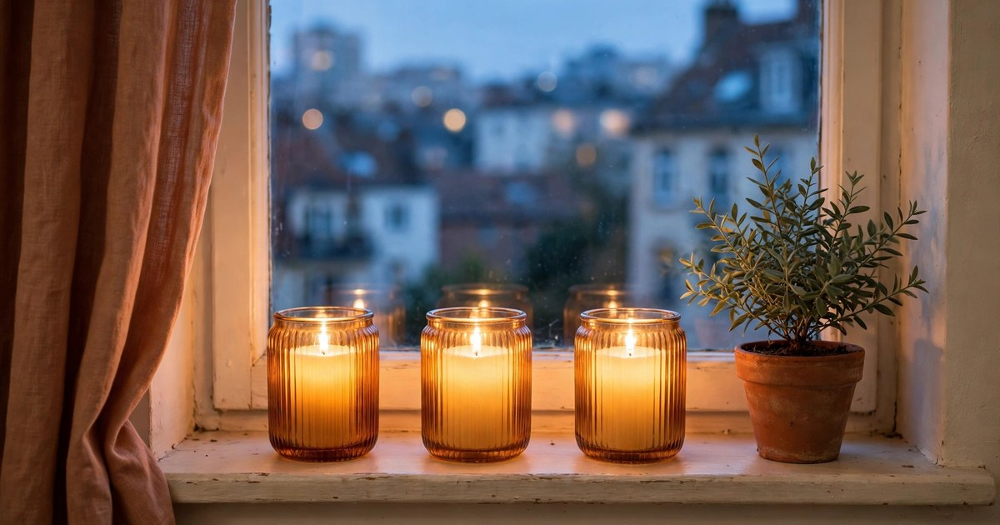
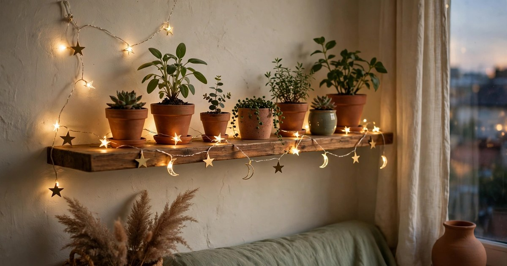
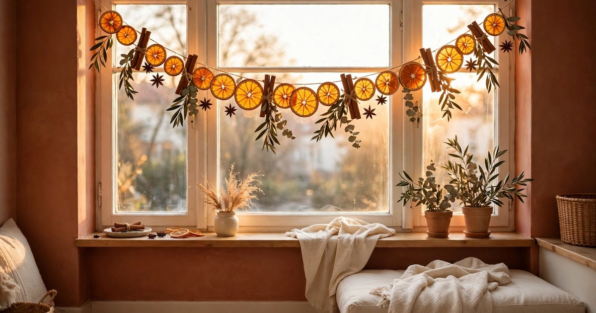
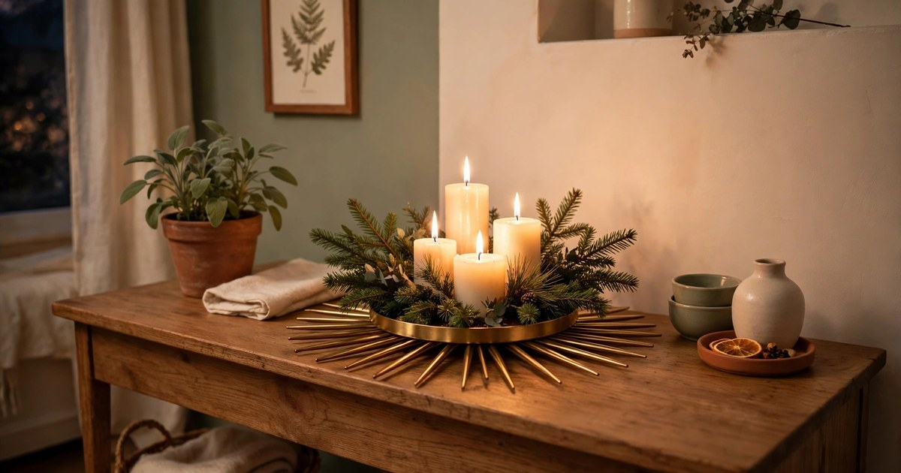
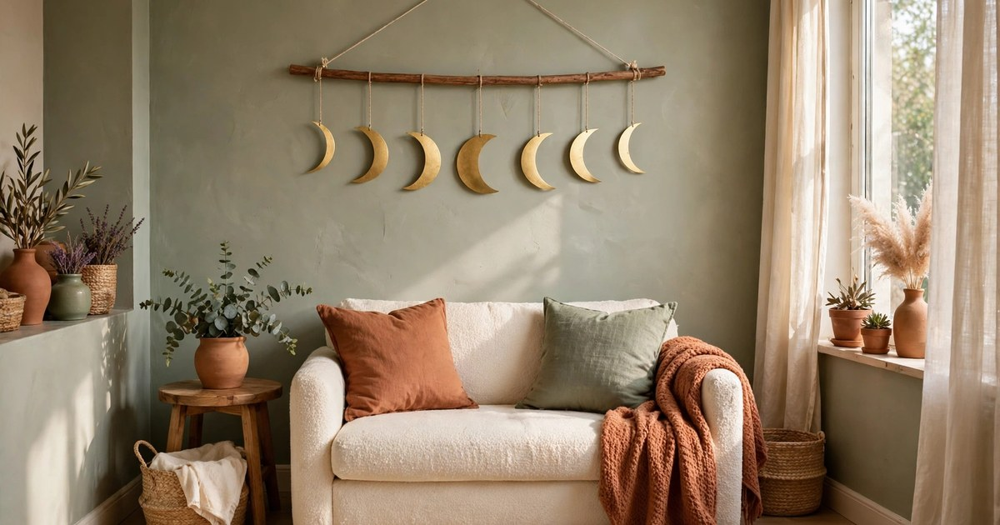

The winter solstice is the shortest day of the year — 21 December, when the sun barely clears the rooftops and the dark arrives before you've finished your tea. For centuries, people have answered that darkness the same way: with candlelight, evergreen branches, a little gold, and a reason to gather. You don't need a big house, a fireplace, or a budget to match the season. In a small rented flat, the solstice might be the easiest celebration of the year to decorate for, because it asks for so little: a few candles, something green, something that catches the light.

That's the beauty of solstice decor for renters. Nothing here needs a nail, a screw, or a landlord's permission. Everything is freestanding, removable, and small enough to live on a windowsill or a side table. And because the palette is candlelight gold, deep green and warm amber, it sits beautifully next to the Christmas decorations you may already have — or stands entirely on its own if Christmas isn't your thing.

This roundup gathers nine picks, all under $25, all suited to small apartments and rental living. Some glow, some smell wonderful, and some simply make a dark December evening feel intentional rather than gloomy. Every pick is deposit-safe, packable, and easy to find online or in a local shop. Prices are approximate and will wobble with sales and stock, so treat the $25 cap as a shopping target rather than a guarantee. If you love the celestial side of the season, our [celestial Christmas decor ideas](/celestial-christmas-decor-ideas-small-apartments/) pair beautifully with these solstice pieces — stars, moons and gold tones that work right through to the new year.

## How to choose your solstice decor

Start with light, because light is what the solstice is actually about. One or two real candles (or good battery ones if your tenancy forbids open flames) will do more for the mood of a room than any ornament. Look for warm-toned light — amber, gold, soft white — and avoid cool blue-white LEDs, which make a cosy room feel like an office. A single cluster of candles on a tray, reflected in a mirror or a gold dish, can light a whole corner of a studio flat.

Next, think in layers rather than objects. Solstice styling works best when a few small things share a surface: a candle, a sprig of evergreen, a brass star, a bowl of dried oranges. One hero piece per surface is plenty in a small flat — a crowded sill reads as clutter, while a small, deliberate grouping reads as a ritual. Pick one surface to style (a windowsill, a coffee table, a sideboard) and leave the rest of the room alone.

Finally, keep it natural and keep it removable. Fresh evergreen branches, dried citrus slices, pinecones and cinnamon sticks cost almost nothing and smell like December. Everything in this roundup is freestanding or hangs from a removable hook — no drilling, no adhesive that might take paint with it in January. When the longest night has passed and the light starts returning, the whole display should pack into a single box.

## 1. LED pillar candles in amber glass holders

If you buy one thing from this list, make it this. A set of LED pillar candles in amber glass holders gives you the flickering golden glow of real candlelight with none of the risk — no open flame, no wax on the sill, and no worries if your tenancy agreement bans candles outright. Most sets come with a remote and a timer, so they switch themselves on at dusk and off at bedtime, which is exactly the kind of quiet magic the solstice is about.

Why it works: amber glass turns a plain white LED into something that genuinely looks like candlelight. The warm tone flatters everything around it — the wood of the sill, the green of a plant, your own face — and a trio of different heights creates a little skyline of light that anchors a whole corner. In a small flat, three candles on a tray can replace an entire lamp for the evening, and the effect is far cosier.

Where it fits: a windowsill (where the glow shows from the street as well as inside), a coffee table, or a bathroom shelf for a solstice bath. Group the three holders together on a small wooden tray or a gold-toned plate so the display reads as one intentional piece rather than three stray objects.

Renter tip: if your landlord allows real candles, the same amber holders work with tea lights too — just never leave them burning unattended, and keep them well away from curtains. LED versions are the safer default, and many renters keep both.

Shop this style: [amber glass LED pillar candles on Amazon](https://www.amazon.com/s?k=amber+glass+led+pillar+candles+flameless&tag={{AMAZON_TAG}})

## 2. Brass star and moon string lights

Stars and moons are the oldest solstice symbols there are, and a string of tiny brass stars and crescents on warm-white fairy lights brings that symbolism into a flat without any effort at all. The metal shapes catch the light even when the string is switched off, so they look good by day as well as by night — which matters when the sun sets at four in the afternoon and you're looking at your decor in daylight as well.

Why it works: in a small apartment, string lights are the highest-impact, lowest-effort decor you can buy. They add height and sparkle to a shelf or a window frame without taking up any surface space at all, and the star-and-moon shapes make the display feel seasonal rather than generic. Draped along a picture ledge or looped around a curtain rail, they turn a plain wall into the focal point of the room.

Where it fits: along a shelf, around a window frame, or draped over a headboard. Battery-operated strings are the renter's friend here — no trailing cable, no socket hunt, and you can put them anywhere. Use a removable adhesive hook (the kind that peels off cleanly) to hold the ends in place.

Renter tip: choose warm white, never cool white, and look for a timer function. A string that switches itself on at dusk and off after six hours will outlast the season without you ever thinking about it.

Shop this style: [brass star moon fairy lights warm white on Amazon](https://www.amazon.com/s?k=brass+star+moon+fairy+lights+warm+white&tag={{AMAZON_TAG}})

## 3. Dried orange slice and cinnamon garland

A garland of dried orange slices, cinnamon sticks and star anise is the solstice in a single decoration: citrus for the returning sun, spice for warmth, and a scent that fills the whole flat every time the heating kicks in. You can buy one ready-made for well under $25, or make your own from a bag of oranges and a low oven — but the ready-made versions are beautifully even, and they arrive already strung and ready to hang.

Why it works: this is the only pick on the list that decorates two senses at once. Visually, the translucent amber of dried orange glows when it's backlit by a window; aromatically, the cinnamon and citrus make the flat smell like a bakery without you baking anything. It's also wonderfully light and flat, which means it hangs from a single removable hook and takes up no surface space at all — a genuine win in a studio.

Where it fits: across a window, along a shelf edge, or draped over a mirror. Hang it where daylight or candlelight can shine through the orange slices — that's when the amber colour really comes alive. It also looks lovely looped around a small potted evergreen or a tabletop tree.

Renter tip: keep it away from radiators and steam, which can soften the fruit and dull the scent. Stored flat in a paper bag between layers of tissue, a good garland will last two or three winters.

Shop this style: [dried orange cinnamon garland on Amazon](https://www.amazon.com/s?k=dried+orange+slice+cinnamon+garland&tag={{AMAZON_TAG}})

## 4. Evergreen and eucalyptus tabletop wreath

A small tabletop wreath — evergreen mixed with eucalyptus, a few gold berries, maybe a pinecone or two — is the solstice centrepiece that does everything at once. It smells wonderful, it looks expensive, and it gives you a ready-made stage: set a candle in the middle and you have a centrepiece; lay it flat on a sideboard and you have a styled vignette; hang it on a door and you have a wreath.

Why it works: the circle is the solstice's own shape — the wheel of the year, the returning sun — and a wreath brings that symbolism into the room in the most natural way possible. The mix of deep green fir and silvery eucalyptus keeps it from looking like a Christmas-only piece, and the gold berries pick up the candlelight beautifully. At 30 cm or so across, a tabletop size fits a coffee table, a dining table for two, or even a wide windowsill.

Where it fits: flat on a coffee table with a pillar candle in the centre, on a sideboard as a standalone display, or hung on the inside of the front door with a removable hook. If you have a small dining table, it makes an instant solstice supper setting with no other styling needed.

Renter tip: fresh wreaths dry out in heated air, so mist the greenery lightly every couple of days, or choose a good faux version — modern faux evergreen looks remarkably real and will last for years. Our [fresh evergreen branch decor ideas](/fresh-evergreen-branch-decor-ideas-small-apartments/) have more ways to use greenery without spending much.

Shop this style: [small evergreen eucalyptus tabletop wreath on Amazon](https://www.amazon.com/s?k=small+evergreen+eucalyptus+tabletop+wreath&tag={{AMAZON_TAG}})

## 5. Gold starburst candle tray

A gold starburst tray — a round metal tray with a radiating sunburst pattern — is the piece that ties a solstice display together. On its own it's a pretty object; loaded with candles, a sprig of evergreen and a few pinecones, it becomes a complete vignette that looks deliberate and finished. The reflective gold surface bounces candlelight around the room, which makes the whole corner feel brighter and warmer than it has any right to.

Why it works: in a small flat, a tray is a styling cheat code. It corrals small objects into one neat, movable group, protects the surface underneath from wax and water, and lets you pick up the entire display and move it when guests arrive or when you need the table back. The starburst pattern is unmistakably solstice — a little sun, brought indoors for the longest night.

Where it fits: on a coffee table, a sideboard, or a dining table as a centrepiece. It also works beautifully on a windowsill, where the gold catches the low winter sun. Pair it with the amber candles from pick one for a display that costs very little and looks like a magazine shoot.

Renter tip: a tray also protects your deposit. Wax drips, water rings and pine sap all land on the tray instead of on a landlord's table, and a quick wipe is all the cleaning it ever needs.

Shop this style: [gold starburst candle tray decorative on Amazon](https://www.amazon.com/s?k=gold+starburst+candle+tray+decorative&tag={{AMAZON_TAG}})

## 6. Mini potted norfolk pine with gold ornaments

A mini Norfolk pine — a small living evergreen in a terracotta or ceramic pot, dressed with a handful of tiny gold baubles — is the solstice tree for flats that can't fit a real Christmas tree. It stands about 30 to 45 cm tall, lives happily on a side table, and unlike a cut tree it doesn't shed needles all over the carpet or end up in the bin in January.

Why it works: a living plant brings the one thing no ornament can — actual green life in the darkest week of the year. The Norfolk pine's soft, layered branches look festive without screaming Christmas, so it suits solstice celebrations, mixed-faith households, and anyone who wants winter greenery without the full tree commitment. The gold ornaments tie it into the rest of your solstice palette, and the whole thing costs less than a takeaway.

Where it fits: a side table, a bookshelf, or a windowsill where it gets bright indirect light. It also makes a lovely gift — a living solstice present that keeps growing long after the night itself has passed. Keep it away from radiators and cold draughts, and water it when the top couple of centimetres of soil feel dry.

Renter tip: a Norfolk pine is a houseplant first and a decoration second, so it stays with you when you move — no disposal, no waste. If it outgrows its pot, repot it in spring and enjoy it for years.

Shop this style: [mini norfolk pine potted plant on Amazon](https://www.amazon.com/s?k=mini+norfolk+pine+potted+plant&tag={{AMAZON_TAG}})

## 7. Moon-phase wall hanging on a wooden dowel

A moon-phase wall hanging — a row of gold or wooden crescent moons strung on a wooden dowel, showing the moon from new to full — is the most striking piece on this list, and it costs less than a pizza. It hangs from a single removable hook, fills a blank stretch of wall with something meaningful, and it speaks directly to what the solstice is: the turning of the year, measured by the moon and the sun.

Why it works: in a small flat, wall decor has to earn its place — it can't be too big, too heavy, or too permanent. A moon-phase hanging is light, flat, and about 40 cm wide, which is exactly right for the wall above a sofa, a bed, or a desk. The gold finish catches the light and warms up a white rental wall, and the crescent shapes echo the fairy lights and the star ornaments elsewhere in your display, so the whole room feels coordinated.

Where it fits: above a sofa, over a bed, or on the wall beside a window where the evening light can reach it. It also works in a hallway or an entryway, where it greets you every time you come home in the dark. One removable hook holds it — no drilling, no damage, no deposit worries.

Renter tip: hang it at eye level and keep the wall around it clear. A moon-phase hanging needs a little breathing room to read properly; crowding it with other frames dilutes the effect.

Shop this style: [moon phase wall hanging gold on Amazon](https://www.amazon.com/s?k=moon+phase+wall+hanging+gold+boho&tag={{AMAZON_TAG}})

## 8. Cinnamon and clove simmer pot kit

A simmer pot kit — a little bag or jar of cinnamon sticks, whole cloves, star anise, dried orange slices and a bay leaf or two — is the cheapest pick on this list and possibly the most effective. Tip it into a small saucepan of water, bring it to a simmer, and within ten minutes your whole flat smells like a winter market. It's not decor you look at; it's decor you breathe, and on the longest night of the year that matters more than you'd think.

Why it works: scent is the fastest way to change how a room feels, and a simmer pot does it for pennies per use. Unlike a scented candle, you control the strength — add more water to soften it, more spice to deepen it — and a single kit usually makes four or five pots, which takes you right through the festive season. It's also the most shareable pick here: simmer a pot when friends come round and the flat feels instantly welcoming.

Where it fits: on the hob, obviously — but the kit itself, in a pretty glass jar, looks lovely on an open kitchen shelf or a windowsill, so it decorates even when it's not simmering. Keep the jar somewhere visible and it becomes part of the kitchen styling rather than something hidden in a cupboard.

Renter tip: never leave a simmer pot unattended on the hob, and top up the water before it runs dry — a burnt pot smells like the opposite of cosy. The used spices make excellent compost, so nothing is wasted.

Shop this style: [stovetop simmer pot kit cinnamon clove on Amazon](https://www.amazon.com/s?k=stovetop+simmer+pot+kit+cinnamon+clove&tag={{AMAZON_TAG}})

## 9. Cosy amber throw blanket in a basket

The last pick isn't a decoration at all — it's a ritual. A soft amber or terracotta throw blanket, folded into a woven basket beside the sofa, is the invitation to actually celebrate the solstice: light the candles, put the kettle on, wrap up, and sit with the dark instead of fighting it. A good budget throw costs under $25, and the basket (if you don't already own one) turns it into a piece of decor in its own right.

Why it works: solstice is a festival of staying in, and a throw makes staying in feel like a choice rather than a default. The warm amber tone ties the whole room together — it picks up the candlelight, the gold tray, the orange garland — and the texture of a soft knit or fleece adds the cosiness that hard surfaces can't. Folded in a basket, it also solves a small-flat storage problem: the blanket is always to hand and never draped over the back of a chair looking untidy.

Where it fits: beside the sofa, at the foot of the bed, or draped over a reading chair. If you already have a basket, a throw on its own is one of the cheapest buys here; if you need both, look for a set or check charity shops, where woven baskets are plentiful and often cost less than a coffee.

Renter tip: a throw is the easiest solstice purchase to justify because it earns its keep all winter. Buy the colour that works with your room year-round, not just for one night — amber, terracotta and warm cream all do that beautifully. Our [cosy winter rugs under $25](/cosy-winter-rugs-small-rentals-under-25/) guide has more ways to warm up a cold rental floor on the same budget.

Shop this style: [amber throw blanket soft cosy on Amazon](https://www.amazon.com/s?k=amber+throw+blanket+soft+cosy&tag={{AMAZON_TAG}})

## How to celebrate the solstice in a small flat

You don't need a party, a ritual, or a plan. The simplest solstice evening goes like this: as the light fades, switch off the overhead lights and light your candles. Put the simmer pot on. Lay the wreath on the table with a candle in the middle. Sit down with a hot drink and the throw blanket, and let the room be dark and golden for an hour. That's it — that's the celebration.

If you want a little more ceremony, write down one thing you're glad to leave behind in the dark half of the year and one thing you're looking forward to as the light returns. You can burn the first note safely in a fireproof dish (or simply tear it up), and keep the second somewhere you'll see it in January. The solstice has always been about that turning point — the night the light starts coming back — and marking it, even quietly, makes the winter feel shorter.

Keep the display up as long as you like. Solstice decor has no expiry date the way Christmas decor does: candlelight, evergreen and gold look right all through January, and there's no rule that says you must take it down on a particular day. When you're ready, pack the ornaments into a single box, compost the greenery, and keep the candles for the next dark evening.

## Frequently Asked Questions

### When is the winter solstice in 2026?

The winter solstice falls on 21 December 2026. It's the shortest day and the longest night of the year in the Northern Hemisphere, and from the day after, the daylight starts getting longer again — by just a minute or two at first, but it adds up fast.

### Is winter solstice decor the same as Christmas decor?

Not quite, though they overlap beautifully. Solstice decor leans on natural, seasonal symbols — candlelight, evergreen, gold, stars and moons, citrus and spice — rather than Santa, reindeer or red-and-green Christmas imagery. That makes it a good fit for mixed-faith households, for people who don't celebrate Christmas, and for anyone who wants their winter decor to last beyond 25 December.

### Are these solstice ideas renter-friendly?

Yes — every pick in this roundup is freestanding, removable, or hangs from a single removable hook. Nothing is drilled, nailed or glued to the property, and the whole display packs into a box when the season ends. If your tenancy bans open flames, use the LED candles in pick one and the fairy lights in pick two for the same golden glow with zero risk.

### Can I decorate for the solstice on a very small budget?

Absolutely. The simmer pot kit costs a few pounds or dollars, and a garland of dried oranges and cinnamon can be made at home for the price of a bag of fruit. Start with one candle cluster and one natural element — a sprig of evergreen in a jar, a bowl of pinecones — and you have a solstice display for less than $10. Add one new piece each year and the collection grows without ever hurting your budget.

### How long can I keep solstice decor up?

As long as you like. Unlike Christmas decorations, solstice decor has no traditional take-down date — candlelight, evergreen and gold tones look right all through January and into February. Fresh greenery will dry out after a few weeks, so replace it or switch to faux pieces if you want the display to last the whole winter.
