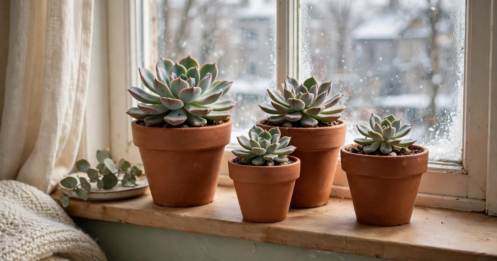
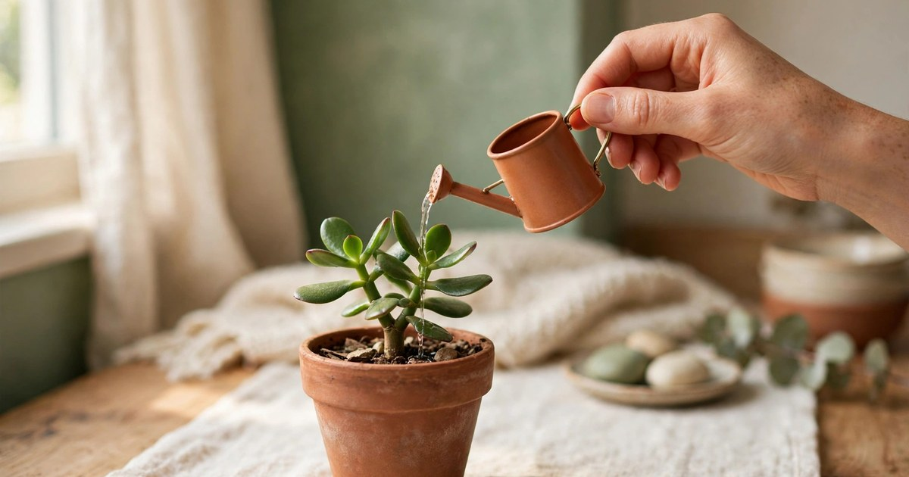
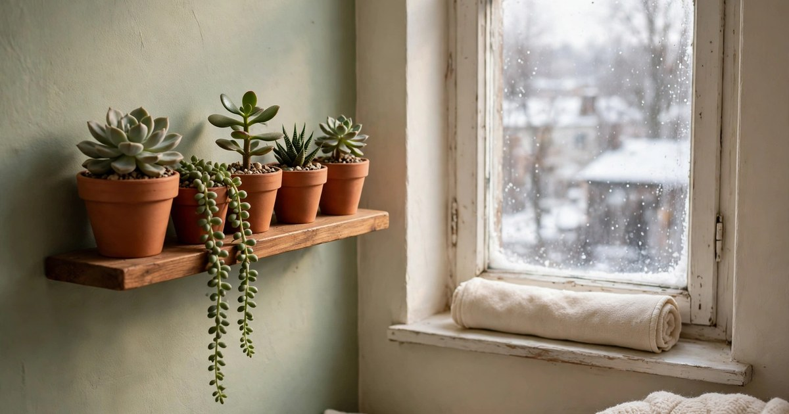
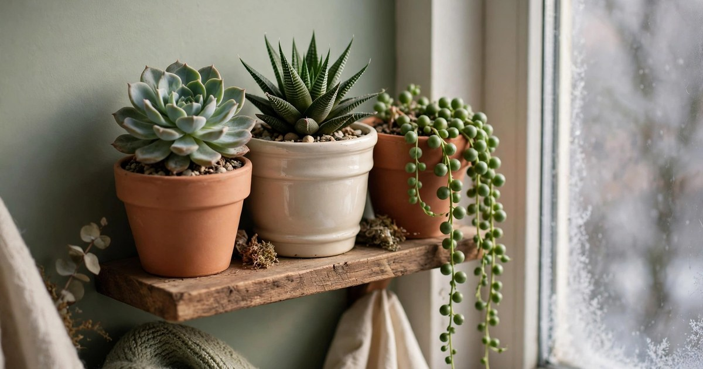
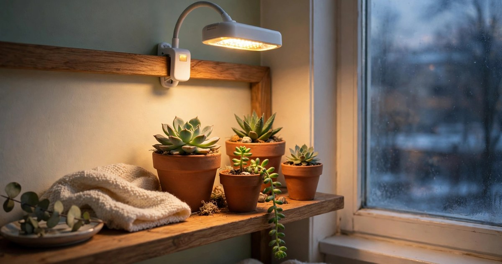
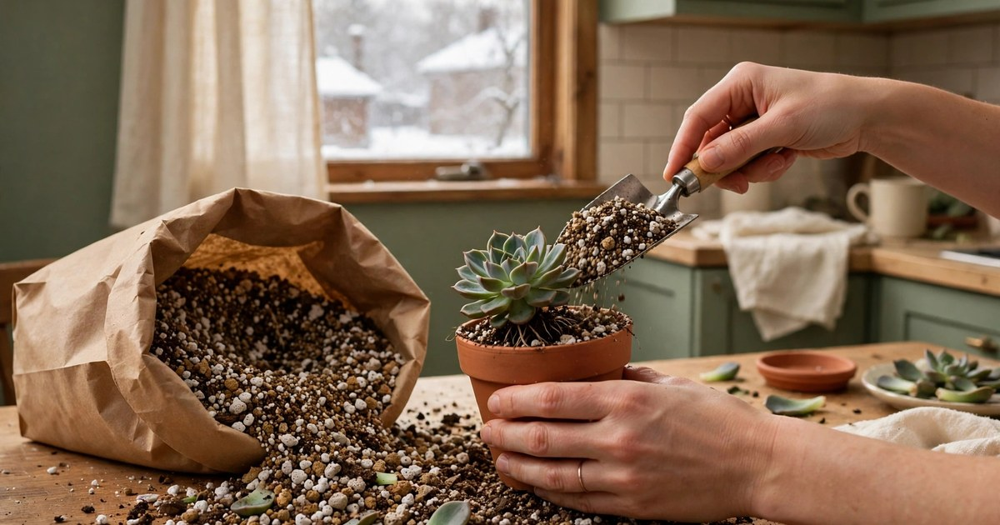
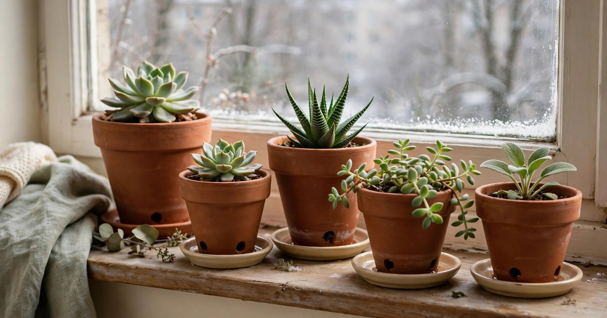
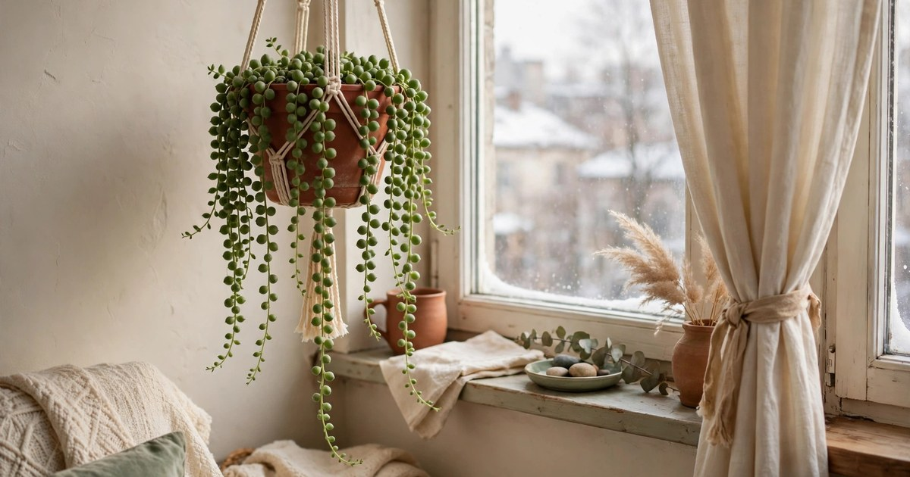
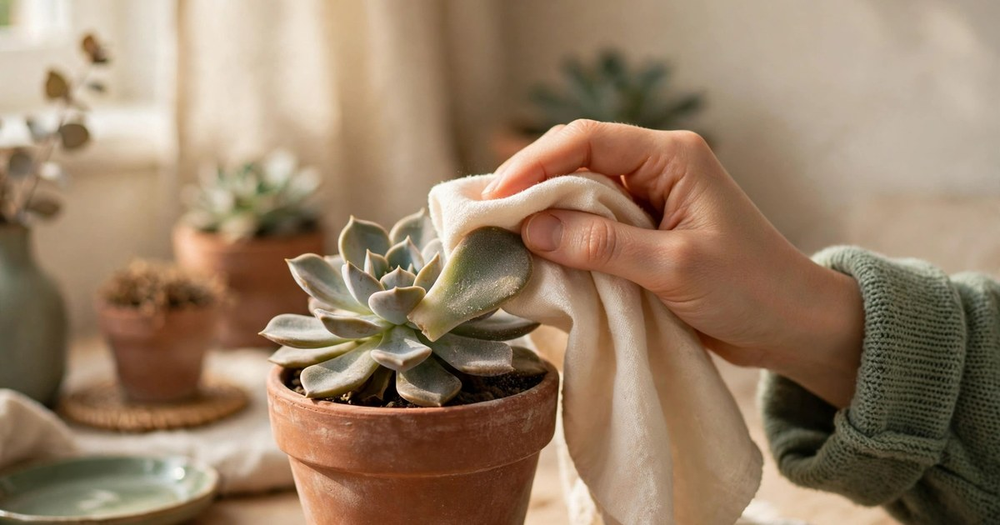
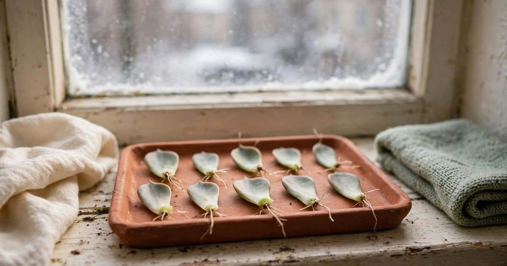

Succulents are the most forgiving plants a renter can own — until winter arrives. Short days, cold windows, dry radiator air and one over-eager watering can turn a plump echeveria into mush in a fortnight. The good news is that winter succulent care is mostly about doing less: less water, less fuss, and a little more light. Succulents are built for dry seasons, so a small apartment in winter is not their enemy — it is just a season that asks you to change the routine you used all summer.

The ten ideas below cost almost nothing, need no drilling, no landlord permission and no floor space, and every one of them works in a rented flat. They cover the four things that actually kill succulents in winter: too little light, too much water, cold draughts and rot. Get those four right and your jade, haworthia, aloe and string of pearls will come out of winter looking better than they went in — many succulents even colour up in the cold, blushing pink and purple at the leaf edges when the light is bright and the water is scarce.

### 1. Move Them to the Brightest Window You Own

Light is the single biggest winter problem for succulents, so start by moving every plant to the brightest window in the flat — usually the south-facing one, or whichever window gets the most hours of direct sun. In summer a succulent can sit a metre from a window and thrive; in winter, with the sun low and the days short, that same spot is too dark. A plant that stretches tall, leans towards the glass or loses its tight rosette shape is telling you it needs more light, and the fix is free: move it closer to the window.

Keep the leaves just off the glass, though, because a cold windowpane on a frosty night can chill a leaf enough to damage it — a gap of a few centimetres is enough. Wipe the window clean inside and out, too: a layer of winter grime can block a surprising amount of light. If you have more plants than windowsill space, stack them on a cheap tiered shelf or [a plant stand](/winter-plant-stands-small-apartments-under-25/) in front of the window so every pot gets its share of sun, and rotate the pots a quarter turn once a week so they grow evenly instead of leaning.

### 2. Water Once a Month — and Mean It

Winter watering is where most succulents die, and the rule is simple: water far less than you think. A succulent in a cool room in December is barely growing, so it barely drinks. Water once a month at most, and only when the soil is bone dry all the way through — push a finger or a wooden skewer down to the bottom of the pot, and if it comes out with any dampness at all, wait another week. Overwatering in winter causes root rot, and root rot in a cold flat is almost always fatal.

When you do water, water thoroughly: soak the soil until it runs out of the drainage hole, then tip away every drop of standing water from the saucer and never let the pot sit in a puddle. Morning is the best time, so any splashes on the leaves dry before night. A good habit is to water on the first of the month and ignore the plants the rest of the time — succulents are desert plants, and a month without water in winter is a holiday for them, not a hardship. If a leaf turns soft and translucent at the base, that is rot from too much water, not thirst.

### 3. Keep Them Away from Cold Draughts and Radiators

Succulents hate two winter extremes: the icy draught by a badly sealed window and the blast of dry heat from a radiator. A plant sitting on [a windowsill](/winter-windowsill-garden-guide/) above a radiator gets cooked from below and chilled from above, which is the worst of both worlds. Move pots at least a few centimetres back from the glass on the coldest nights, and never place them directly above a radiator or next to a door that opens onto a cold hallway. A cheap draught excluder or a rolled towel along the window frame helps the plants as much as it helps your heating bill.

If the only bright spot in your flat is a draughty window, use a small tray or a thick cork mat under the pots to insulate them from the cold sill, and pull the plants a little further into the room overnight when the temperature drops. Most succulents are fine down to about 5°C, but a frosty windowpane or a night of freezing air through a gap can blacken leaves overnight. A sheer curtain between plant and glass is a renter-friendly shield that softens both the cold and the midday sun.

### 4. Group Your Succulents into a Winter Cluster

Grouping your succulents together for winter is free, looks wonderful, and genuinely helps them survive. A cluster of pots creates a tiny pocket of slightly warmer, slightly more humid air, and the plants shelter each other from draughts. It also makes watering easier — you can check a whole group at once — and a crowded shelf of rosettes, spiky haworthia and trailing string of pearls looks like a deliberate display rather than a collection of lonely pots scattered around the flat.

Build the cluster on a tray so you can move the whole group in one lift, which is handy when you need to wipe the windowsill or pull the plants back from a cold night. Put the tallest plants at the back and the trailing ones at the front edge so nothing shades its neighbour, and leave a finger-width gap between pots so air can move and damp cannot linger. A cluster also makes it obvious when one plant is struggling: a rosette that pales or stretches stands out against its healthy neighbours, and you can pull it out for treatment before a problem spreads.

### 5. Add a Cheap Clip-On Grow Light

If your flat has no bright window — a north-facing room, a basement, a window blocked by another building — a clip-on [grow light](/grow-lights-dark-winter-apartments-under-25/) is the cheapest fix in this list, often under $25. Clip it to a shelf, angle it a hand's width above the plants, and run it for 10 to 12 hours a day on a timer plug. The light keeps rosettes tight and colours vivid through the darkest weeks, and it is the difference between a succulent that survives winter and one that stretches into a pale, leggy ghost of itself.

Choose a full-spectrum white bulb rather than a purple one, so the light blends with your room and does not tint your whole living space pink. A timer plug costs a few dollars and means you never have to remember to switch it on or off — set it to run through the morning and switch off at dusk. The grow light needs no drilling and no damage: it clips to a shelf, a table edge or a plant stand, and it moves with you when you move home. In a dark flat it is the single best money you will spend on your plants all winter.

### 6. Switch to Gritty, Fast-Draining Soil

Succulents rot in winter because wet soil stays wet for weeks in a cool room, so the soil matters as much as the watering. Regular potting compost holds too much moisture; a gritty cactus mix — roughly half potting soil and half perlite, pumice or coarse grit — drains in minutes and dries out between waterings. A small bag of cactus soil costs a few dollars, and a bag of perlite from a garden centre is even cheaper and lasts for years of repotting.

Repot in late autumn, before the cold sets in, so the plant has a few weeks to settle before winter. Shake the old soil gently from the roots, trim away any black or mushy roots with clean scissors, and settle the plant into its new gritty mix at the same depth it was before. Do not water for a week after repotting — let any small root nicks heal dry. A gritty mix is also a visual upgrade: top the soil with a layer of small pebbles or coarse sand, which keeps the base of the plant dry, stops soil splashing onto the leaves, and makes a plain terracotta pot look finished.

### 7. Choose Pots with Drainage — or Drill Your Own

No drainage hole, no succulent — that is the rule, and winter is when it bites. A pot without a hole keeps the roots sitting in water long after you have forgotten you watered, and in a cool flat that water never evaporates. Terracotta is the best choice for winter because the clay itself breathes and pulls moisture out of the soil, and a terracotta pot with a hole and a saucer is the safest home a succulent can have. Charity shops and discount stores sell them for pennies.

If you love a pot that has no hole, you have two renter-friendly options. The first is to use it as a cover pot: keep the succulent in a plain plastic nursery pot with holes inside the pretty pot, and lift it out to water, letting it drain fully before putting it back. The second is to drill a hole with a masonry bit, working slowly with water to keep the bit cool — but only if the pot is yours to modify. Either way, always empty the saucer after watering. A succulent that stands in water for a day in winter is a succulent on its way to rot.

### 8. Give Trailing Types a High Spot

Trailing succulents like string of pearls, string of hearts and burro's tail earn their keep in a small apartment because they use vertical space that would otherwise be empty. Hang them from a removable adhesive hook near a bright window, or perch them on the top shelf of a bookcase, and their stems will cascade down like a living curtain. They need the same winter care as other succulents — bright light, very little water — but they have one extra need: the top of the pot must get light too, or the stems will thin and bald at the crown.

Hang the planter low enough that light reaches the soil surface, not just the dangling stems, and rotate it once a week so all sides get sun. Water trailing types even more sparingly than upright ones, because their stems store water along their whole length. A trailing succulent in a high spot also stays out of the way of radiators, pets and clumsy elbows, which is a quiet advantage in a small flat. When a stem gets too long, snip it, let the cut dry for a day, and lay it on soil — it will root and give you a second plant for free.

### 9. Wipe Leaves and Check for Rot Every Sunday

A five-minute Sunday check is the cheapest insurance in this list, and it catches problems while they are still fixable. Dust settles on succulent leaves all winter — especially near radiators — and a dusty leaf photosynthesises less, which matters when light is already scarce. Wipe each rosette gently with a soft, dry cloth or a small paintbrush, and while you are there, look at the base of the plant: any leaf that is soft, translucent or black at the stem is rot, and it needs to come off immediately before it spreads to its neighbours.

Pull off the bad leaf cleanly, let the wound dry for a day, and check the soil: if it smells earthy-sweet or feels damp deep down, hold off watering for another fortnight and move the pot to a warmer, brighter spot. The Sunday check is also your pest patrol — mealybugs show up as tiny white cottony clumps in leaf joints in winter, and a cotton bud dipped in rubbing alcohol wipes them off in seconds. Five minutes a week beats a dead plant in February, and it turns [plant care](/winter-plant-care-kits-under-25/) into a small, calming weekend ritual rather than a chore.

### 10. Propagate a Leaf or Two as Winter Insurance

Winter is the best time to propagate a spare leaf or two, because it costs nothing and gives you a backup plant if the mother plant struggles. Twist a healthy leaf cleanly off an echeveria or a jade, lay it on dry cactus soil on a small tray, and leave it on a bright windowsill. Do not water it at all for the first few weeks — the leaf carries its own water supply, and tiny roots and a miniature rosette will appear at its base within a month. It is one of the most satisfying things in houseplant keeping, and it happens while you do almost nothing.

A propagation tray takes up no more space than a paperback, needs no special equipment, and turns one plant into three or four by spring. Keep the tray out of direct midday sun until roots appear, then mist the soil lightly once a week. If a leaf shrivels without rooting, it cost you nothing — try another. By the time the days lengthen, your spare rosettes will be ready for their own tiny pots, and you will have doubled your collection for free, which is the most renter-friendly, budget-first outcome of all.

## Frequently Asked Questions

### How often should I water succulents in winter?

Once a month at most, and only when the soil is completely dry all the way through. Succulents barely grow in winter, so they barely drink. Overwatering is the most common cause of winter succulent deaths, so when in doubt, wait another week.

### Do succulents need a grow light in winter?

Not always, but they help enormously in dark flats. If your succulents stretch, lean or lose their colour in winter, a cheap clip-on full-spectrum grow light run for 10 to 12 hours a day will keep them compact and healthy until spring.

### Can succulents stay on the windowsill in winter?

Yes, as long as the window is not draughty and the leaves do not touch freezing glass. Keep pots a few centimetres back from the pane on the coldest nights, and move them away from radiators directly below the sill, which dry the air and heat the roots.

### Why are my succulent leaves going soft and translucent?

Soft, translucent leaves at the base of the plant usually mean root rot from overwatering or soil that stays wet. Stop watering, remove the damaged leaves, let the soil dry out fully, and check that the pot has a drainage hole and gritty, fast-draining soil.

### What is the easiest succulent for a beginner in a small apartment?

Jade, haworthia and aloe are the most forgiving winter succulents for beginners. They tolerate lower light than echeveria, need very little water, and cope well with the dry air of a heated flat. Start with one of these, then add an echeveria once you have a bright window sorted.
