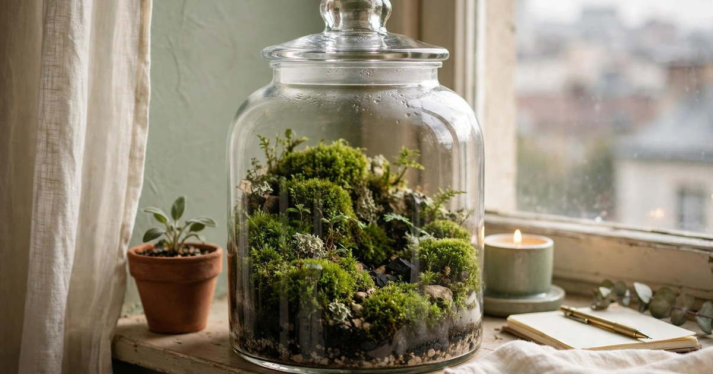
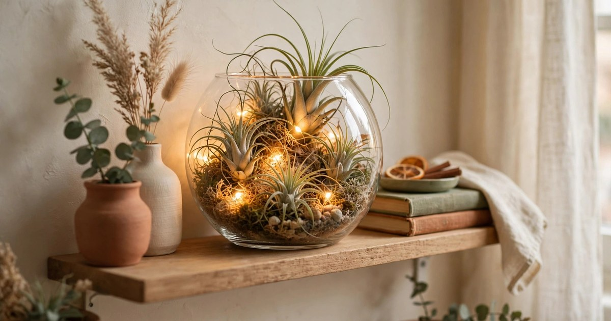
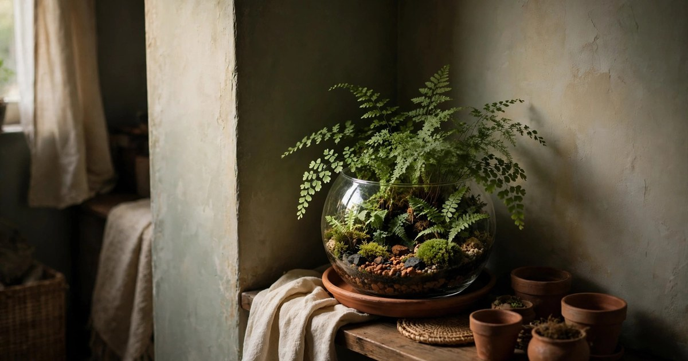
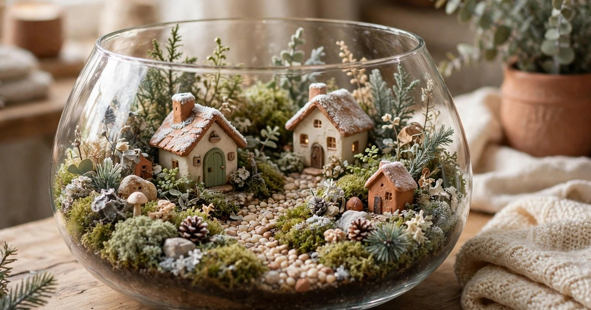
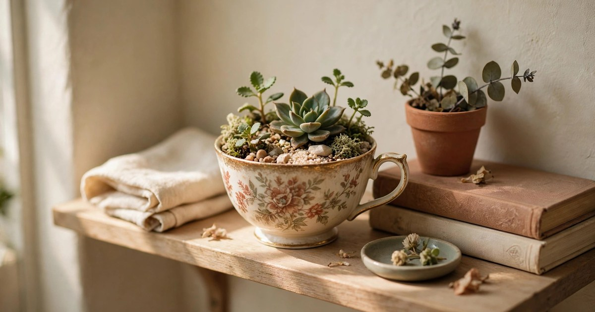
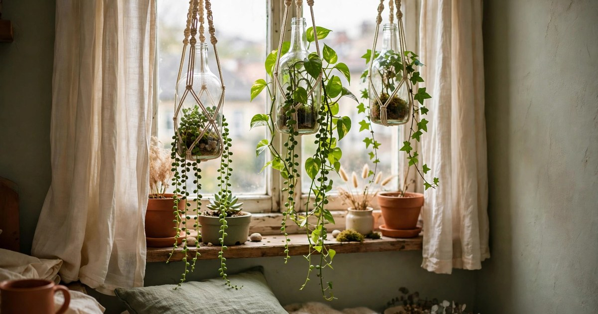
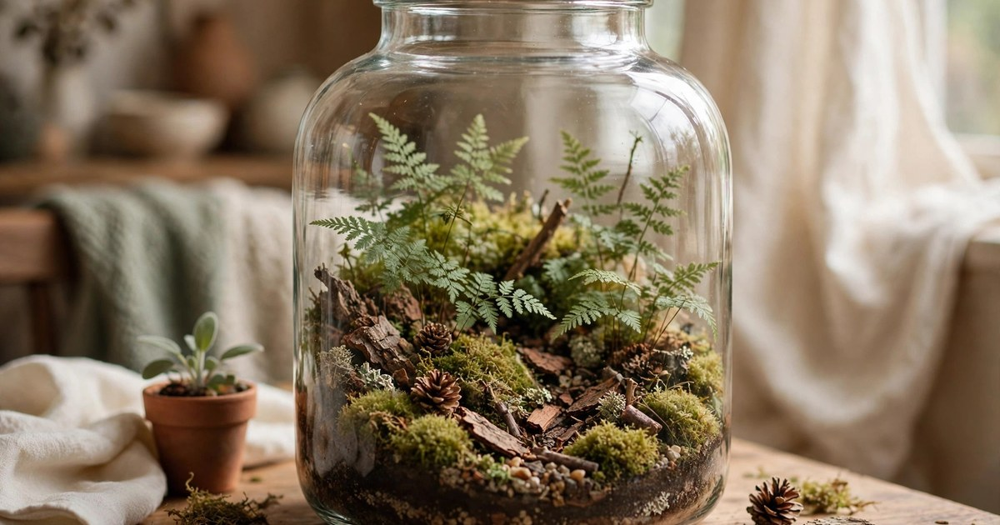
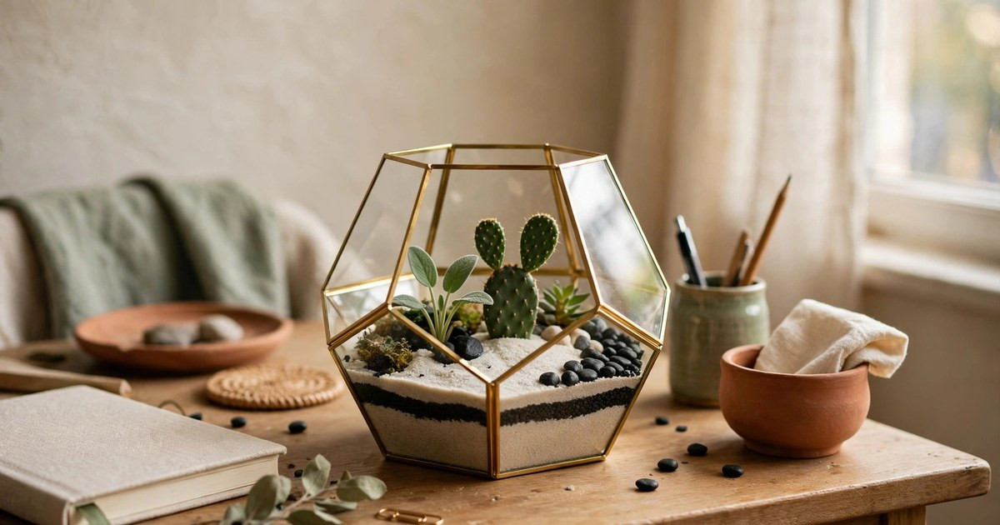
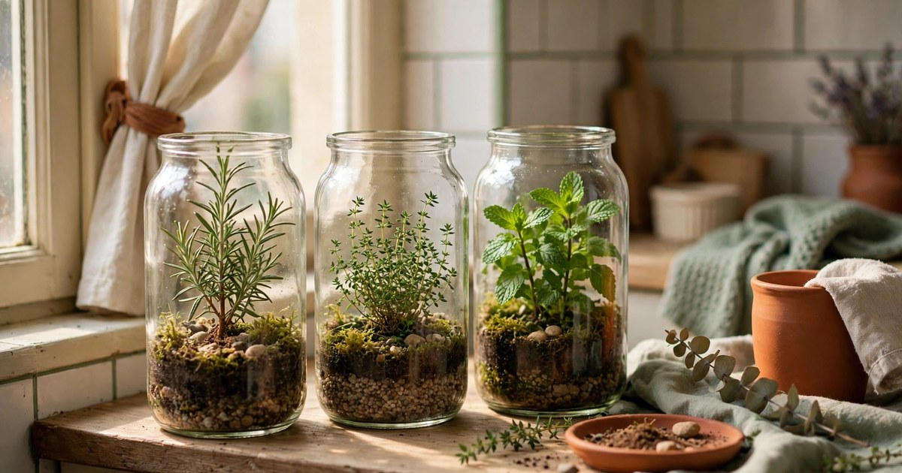
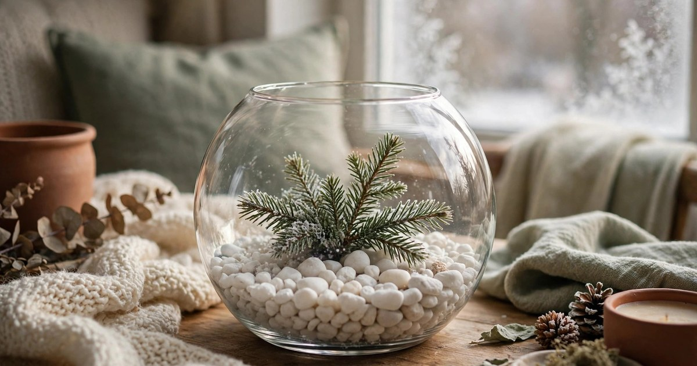

A terrarium is a whole garden in a jar, and in winter it is the easiest way to keep greenery alive in a small apartment. It needs no floor space, almost no watering, and it looks like a tiny world on a shelf, a windowsill or a bedside table. A closed terrarium waters itself through condensation, an open one needs a spray once a week, and both will carry your plants through the darkest months while the garden outside is asleep. Every idea in this list works in a rented flat: no drilling, no damage, and nothing that cannot be moved to a new home in a box.

Start with a clean glass container, a layer of pebbles for drainage, a spoonful of charcoal, and a layer of potting soil — then choose your plants and your theme. The ten ideas below range from a five-minute jar to a full fairy garden, and each one costs less than a takeaway to build.

### 1. The Classic Moss Terrarium in a Jar

The classic moss terrarium is the easiest garden you will ever keep: a large glass jar, a layer of pebbles, a layer of moss, and a lid. Moss needs almost no light, almost no water and no feeding, which makes it the perfect plant for a dark winter flat. Mist it once a month, wipe the glass when it fogs, and it will stay green until spring. A moss jar on a windowsill looks like a piece of forest that moved indoors, and it costs less than a coffee to build if you already own the jar.

Keep the jar out of direct sun — a closed terrarium in sunlight cooks — and choose a spot with soft, indirect light like a north-facing windowsill or a shelf a metre from a window. If the moss turns brown, it is too dry; if it turns slimy, it is too wet. A healthy moss terrarium smells faintly of rain and looks like a tiny landscape, and it is the best first terrarium for anyone who has killed a houseplant before.

### 2. Air Plant Terrarium with Fairy Lights

Air plants are the perfect terrarium plant because they need no soil at all — just air, a little light and a misting once a week. Set two or three air plants in an open glass bowl with a few pebbles and a string of battery fairy lights, and you have a glowing centrepiece that weighs almost nothing and cannot be overwatered. Air plants come in dozens of shapes, from spiky stars to soft curls, and they cost a few dollars each from a garden centre or online.

Hang the terrarium from a removable adhesive hook if you want it off the shelf, or keep it on the dining table where the fairy lights can glow through dinner. Mist the plants once a week and turn them upside down to dry, because air plants rot if water sits in their centre. The fairy lights are the secret: they make the terrarium glow after dark, which is when a winter flat needs it most, and a string of battery lights costs less than the plants.

### 3. Fern Terrarium for a Dark Corner

A fern terrarium is the answer to the darkest corner of a flat — the one where nothing else survives. Small ferns like button fern, maidenhair and baby tears love the humid, sheltered air inside a closed terrarium, and they thrive in low light that would kill a succulent in a week. Build it in a large glass bowl or a demijohn, with pebbles, charcoal and soil, and plant two or three small ferns with a little space between them. They will fill the glass within a few months.

Ferns need humidity more than light, so a closed lid is your friend — it traps moisture and creates the steamy air ferns love. Open the lid for an hour once a week to let fresh air in, and trim any brown fronds with scissors. A fern terrarium in a dark corner turns the worst spot in the flat into the prettiest one, and it proves that a dark apartment is not a plant-free apartment, just one that needs the right plants.

### 4. Winter Fairy Garden Terrarium

A fairy garden terrarium is a tiny world: moss for grass, a miniature house or two, a pebble path, a twig fence and a few small plants, all inside a wide glass bowl or a shallow dish. It is the most playful terrarium on this list, and it is the one children love most — build it together on a rainy afternoon and it becomes a decoration and a memory. The plants are the easy part: moss, a small fern and a baby tears plant will fill the garden without hiding the tiny houses.

Keep the fairy garden in an open container so the miniature houses do not fog up, and water the plants with a small spray bottle once a week. Add a tiny string of fairy lights for winter evenings, and swap the decorations with the seasons — a tiny pumpkin in autumn, a tiny snowman in December. A fairy garden terrarium is not just a plant display; it is a story on a shelf, and it is the terrarium guests always ask about.

### 5. Succulent Terrarium in a Teacup

A succulent terrarium in a teacup is the smallest garden on this list and the most charming: one tiny succulent, a spoonful of cactus soil and a few pebbles, in a chipped teacup from a charity shop. Succulents need bright light and almost no water, so a teacup terrarium belongs on the sunniest windowsill in the flat, and it needs a drink only once a month in winter. The teacup makes it a decoration as well as a plant — a little piece of vintage charm on a shelf.

Build a row of three teacup terrariums in different cups for a windowsill display, or give one as a gift — a teacup succulent is the present that costs a few dollars and looks like it cost much more. Do not use a closed lid for succulents: they need dry air and airflow, and a sealed jar will rot them in weeks. An open teacup, a sunny sill and a monthly watering is all a succulent asks, and it will reward you by staying alive through the whole winter.

### 6. Hanging Bottle Terrarium

A hanging bottle terrarium turns an empty window into a garden: a glass bottle or a small jar, hung from a removable adhesive hook with twine, holding a trailing plant like string of pearls or a small pothos cutting. The bottle needs no floor space and no shelf space, which makes it the best terrarium for a truly tiny flat, and a row of three bottles at different heights makes a window look like a living curtain. The plants grow down, not up, so they never outgrow the bottle.

Fill the bottle with water for a cutting, or with pebbles and soil for a planted terrarium, and hang it where it gets soft light — a window with a sheer curtain is ideal. Change the water every two weeks if it is a water terrarium, and trim the trailing stems when they reach the sill. A hanging bottle terrarium is the cheapest way to add greenery to a flat with no surfaces left, and it is the one guests photograph most.

### 7. Woodland Terrarium with Pinecones

A woodland terrarium brings the forest indoors: moss, a small fern, a few mini pinecones, a piece of bark and a pebble or two, all layered in a large glass jar. It smells faintly of pine, it looks like a walk in the woods, and it costs almost nothing if you gather the pinecones and bark yourself. The plants are the same as a moss terrarium — moss and ferns that love humidity and low light — but the woodland dressing makes it a winter decoration as well as a plant display.

Add a tiny mushroom ornament or a small wooden deer for a storybook feel, and keep the jar in soft light with the lid on to hold the humidity. A woodland terrarium suits a flat with wooden furniture and warm textiles, and it is the terrarium that looks most at home next to a Christmas tree. When spring comes, the moss and ferns can move to a bigger pot, and the pinecones go back outside — nothing wasted.

### 8. Cactus Terrarium in a Geometric Glass

A cactus terrarium in a geometric glass container is the modern choice: clean lines, sharp angles, and a tiny cactus or two in pale sand, with a few black pebbles for contrast. Cacti need bright light and almost no water, so this terrarium belongs on the brightest sill in the flat, and it needs a drink only once a month in winter. The geometric glass makes it a design object as well as a plant — a little piece of architecture on a desk or a shelf.

Choose small, slow-growing cacti and leave space between them, because cacti grow wider, not taller, and a crowded terrarium is a prickly problem. Use cactus soil and a layer of pebbles for drainage, and never use a lid — cacti rot in humid air. A cactus terrarium is the best choice for a forgetful plant owner, because it thrives on neglect, and it is the terrarium that looks most at home in a modern, minimal flat.

### 9. Herb Terrarium for the Kitchen Windowsill

A herb terrarium is a garden you can eat: rosemary, thyme and mint in a wide glass bowl or a row of small jars on the kitchen windowsill, growing through winter while the garden outside is frozen. Herbs need bright light and good airflow, so an open terrarium on the sunniest kitchen sill is ideal, and a weekly watering keeps them happy. Snip what you need for cooking and the plants bush out — a herb terrarium is the only decoration that makes dinner taste better.

Keep the herbs in separate small pots inside the terrarium rather than planting them together, because mint will take over any container it shares. Rosemary and thyme are the hardiest winter herbs, and they smell wonderful when you brush past them. A herb terrarium on the kitchen sill means fresh herbs in January without a trip to the shop, and it is the terrarium that earns its keep every single day.

### 10. Snow Globe Terrarium with White Pebbles

A snow globe terrarium is winter in a jar: white pebbles for snow, a small evergreen sprig or a tiny artificial tree, a dusting of fake snow, and a few small plants that like it cool and humid. It is the most seasonal terrarium on this list, and it is the one that makes a shelf feel like Christmas without a single bauble. Build it in a round glass bowl or a large jar, layer the white pebbles over the soil, and add the evergreen sprig last so it stands proud of the snow.

Keep it in a cool spot — a windowsill is ideal, because the cold glass and the white pebbles make the whole thing feel frosty — and mist it lightly once a week. A snow globe terrarium is a decoration first and a garden second, so choose plants that look good rather than plants that grow fast: moss, a small fern and a baby tears plant are the safest choices. When spring comes, lift out the evergreen sprig and the fake snow, and the terrarium becomes a spring garden with the same plants.

## One Jar, Ten Gardens

A terrarium is proof that a small apartment is not a barrier to greenery — it is an invitation to think smaller and more creatively. One jar, one bowl or one teacup is enough for a whole garden, and ten of them together make a flat feel like a greenhouse. Start with one, learn what it needs, and add another when the first one thrives. By spring, your windowsills will be full, and you will wonder why you ever thought you had no room for plants.

## Frequently Asked Questions

### How often should I water a terrarium in winter?

A closed terrarium needs water once a month or less in winter — the lid traps moisture and the plants recycle it. An open terrarium needs a light misting once a week. If the glass fogs heavily, open the lid for a few hours; if the soil looks dry, add a spoonful of water.

### What plants are best for a winter terrarium?

Moss, ferns, baby tears and air plants are the best choices for a closed terrarium, because they love humidity and low light. Succulents and cacti suit open terrariums on bright windowsills. Avoid plants that grow fast or tall — they will outgrow the glass within weeks.

### Do terrariums need direct sunlight?

No — most terrarium plants prefer soft, indirect light, and a closed terrarium in direct sun will overheat and cook the plants. A north-facing windowsill or a shelf a metre from a window is ideal for moss and ferns; succulents and cacti are the exception and need the brightest sill you have.

### Can I keep a terrarium in a rented flat?

Yes. A terrarium needs no drilling, no damage and no floor space, and it moves to a new home in a box. It is one of the most renter-friendly ways to keep plants, and it is also one of the cheapest — a jar, some pebbles and a small plant cost less than a takeaway.
