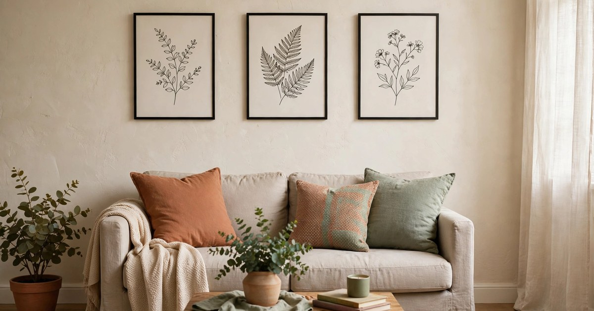
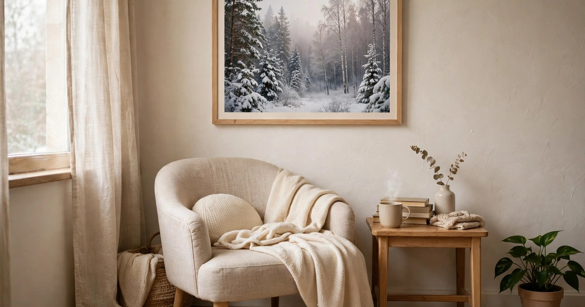
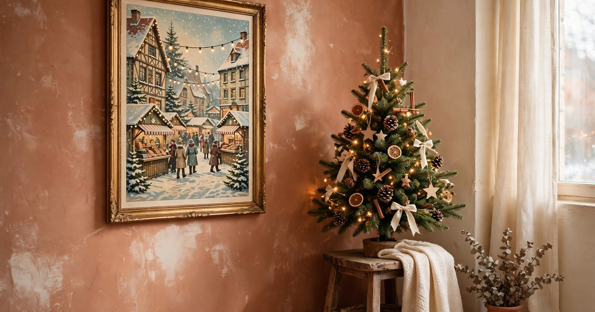
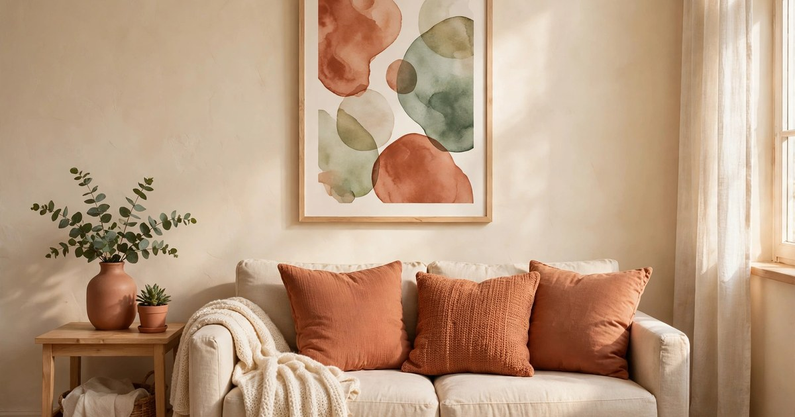
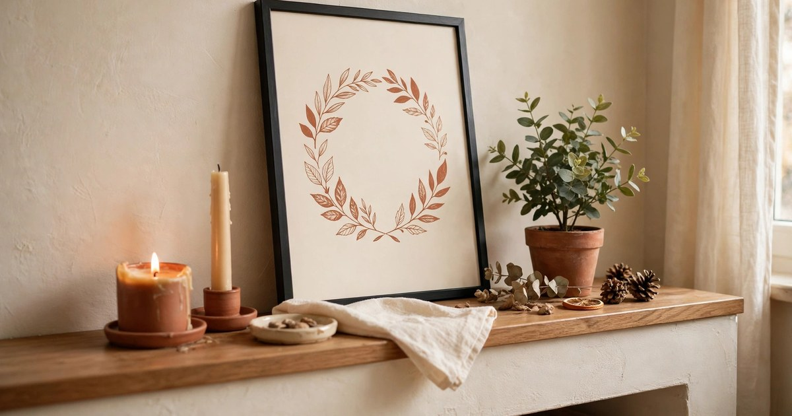
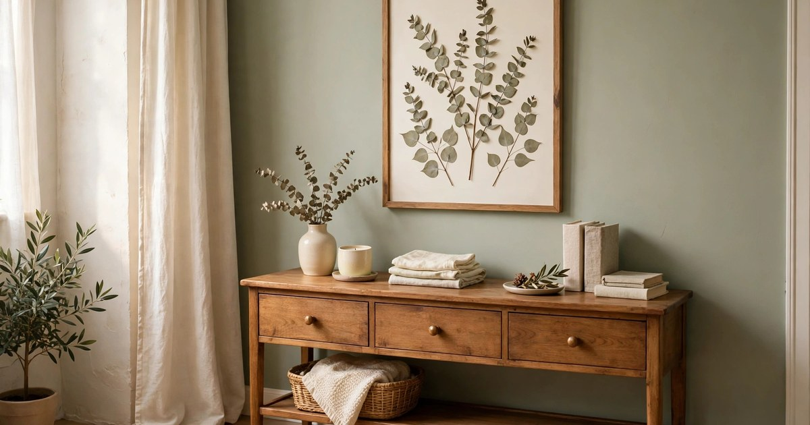
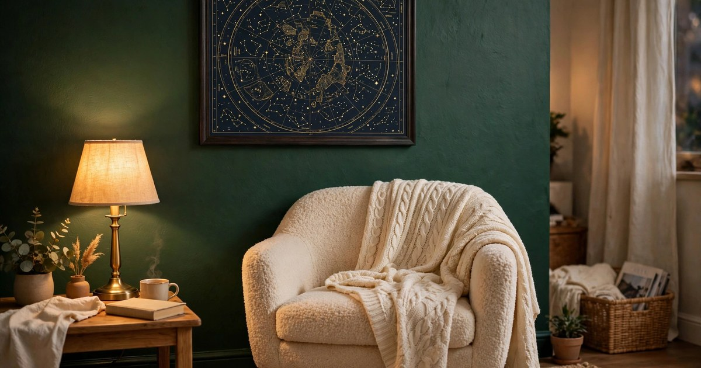
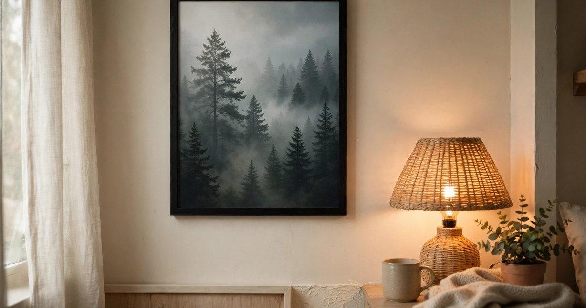
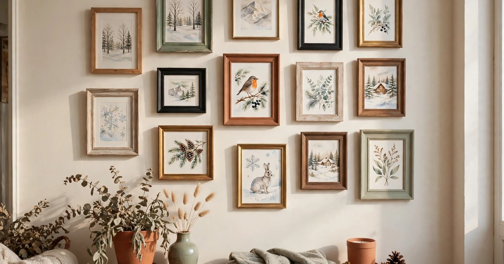

Winter is when a small apartment needs its walls to work hardest. The days are short, the light is grey, and you spend more hours than ever staring at the same four walls — so what hangs on them matters more than it does in summer. The good news is that wall art is the cheapest big-impact change a renter can make: a few well-chosen prints can turn a plain cream wall into a room that feels warm, finished and entirely yours, and every pick below costs under $25.

The trick with small spaces is proportion and palette. One oversized canvas can overwhelm a studio wall, while a handful of smaller prints in a shared colour story — terracotta, cream and sage, for instance — makes the room feel layered rather than cluttered. Every print on this list is light enough to hang with removable adhesive strips, so there is no drilling, no nails and no deposit lost when you move out. Mix two or three styles from the list rather than buying a matching set: the contrast is what makes a wall look collected instead of catalogue-bought.

A note on sizes before you shop. In a small apartment, A4 and A3 prints are your best friends. A4 (roughly 8 x 10 inches) suits shelves, bedside walls and narrow hallways, while A3 (about 11 x 14 inches) is the sweet spot above a sofa or desk. Anything larger needs a big wall to breathe — and in a rental, bigger frames also mean heavier hanging hardware, which is exactly what you want to avoid. Buy the print first, then choose a frame you already own or a cheap lightweight one; many of the picks below look wonderful in simple black or light-wood frames, and several work unframed, held by washi tape or a magnetic poster hanger.

If you want to turn these prints into a full display, our [winter gallery wall guide](/winter-gallery-wall-small-apartment-guide/) walks through planning the layout on the floor first and hanging it damage-free. And if your tastes run more colourful, the [dopamine decor ideas for small living rooms](/dopamine-decor-living-room-ideas-small-apartments/) show how bold prints can lift a grey winter afternoon. For now, here are nine winter wall art prints that all come in under $25 — and every one of them earns its place on a small wall.

### 1. Botanical line-art prints

Botanical line art — a single continuous ink line tracing a eucalyptus sprig, a fern or a bare winter branch — is the quiet hero of small-space wall decor. It brings the outdoors in without the colour chaos of a full photograph, and the fine black line on warm cream paper reads as calm and grown-up, even in a room full of flat-pack furniture. Winter versions with bare branches, pine sprigs or dried seed heads feel seasonal without screaming Christmas, so they can stay up from November through March.

**Why it works:** the minimal line keeps the wall visually light, which matters enormously in a small room where heavy, dark art can make the walls close in. A set of two or three small line-art prints in matching frames creates rhythm without bulk, and the neutral palette pairs with almost any sofa, bedding or rug you already own.

**Where it fits:** above a small sofa, flanking a bedroom mirror, or in a row along a hallway wall. Hang with removable strips — a single A4 frame weighs almost nothing. [Shop botanical line-art prints](https://www.amazon.com/s?k=botanical+line+art+prints+set+minimal&tag={{AMAZON_TAG}})

### 2. Winter landscape photography prints

A misty winter landscape — snow-dusted pines, a frozen lake at dawn, low hills under a pale sky — gives a small room something it desperately needs in winter: a sense of depth. A good landscape print acts like a window, pulling the eye past the wall and making the room feel bigger than it is. Look for prints with soft, muted tones rather than high-contrast drama; foggy, overcast scenes sit far more comfortably in a small space than a stark black-and-white mountain shot.

**Why it works:** landscape photography adds visual breathing room. The eye travels into the scene instead of stopping at the wall, which is the oldest small-space trick in the book. Muted winter palettes — soft grey, sage green, warm cream — also echo the cosy palette of throws and cushions, so the whole room feels coordinated without any effort.

**Where it fits:** the wall opposite your bed, so it is the first thing you see in the morning, or above a desk where a window view would normally go. One larger A3 print beats three small ones here — let the landscape have room to breathe. [Shop winter landscape photography prints](https://www.amazon.com/s?k=winter+landscape+photography+print+snowy+forest&tag={{AMAZON_TAG}})

### 3. Vintage Christmas market posters

Vintage Christmas market posters — the kind advertising a 1950s German Christkindlmarkt or a snowy Alpine village fair — are pure nostalgia in print form. The faded reds, creams and forest greens feel festive without the plastic glitter of modern Christmas decor, and the retro typography adds character that a plain seasonal print simply cannot match. They are also gloriously cheap: unframed vintage-style reproductions routinely sell for under $15.

**Why it works:** a vintage poster brings warmth and story to a wall, and its slightly worn, old-paper feel suits rented flats perfectly — it looks collected, not bought yesterday. Because the style is so distinctive, a single poster can carry a whole corner, which is ideal when you only have one good wall to work with.

**Where it fits:** beside the Christmas tree, above a sideboard dressed with candles, or in the hallway as a festive welcome. Keep it up through December, then swap it for a plain winter landscape in January. [Shop vintage Christmas market posters](https://www.amazon.com/s?k=vintage+christmas+market+poster+print&tag={{AMAZON_TAG}})

### 4. Abstract terracotta-and-sage prints

Abstract prints in terracotta and sage are the easiest way to make a rental feel designed rather than decorated. Soft arches, sun shapes, organic blobs and gentle colour blocks in warm clay and muted green tie together the two colours that dominate budget winter decor — terracotta throws, sage cushions, cream walls. They are also forgiving: because the shapes are abstract, they never clash with your furniture the way a figurative painting might.

**Why it works:** a shared palette is what makes a small room feel calm instead of chaotic, and these prints do that work for you. The warm terracotta tones glow in lamplight, which is exactly the light your flat gets most in winter, while the sage keeps things fresh rather than heavy. Our [iridescent decor accents under $25](/iridescent-decor-accents-under-25/) show how a small pop of shimmer can lift the same palette even further if you want a touch of sparkle alongside.

**Where it fits:** above a sofa or bed as the anchor piece of a gallery wall, or paired with a botanical line-art print for a two-piece arrangement that looks far more expensive than it is. [Shop abstract terracotta sage prints](https://www.amazon.com/s?k=abstract+terracotta+sage+wall+art+print&tag={{AMAZON_TAG}})

### 5. Seasonal typography and quote prints

A short winter quote — "let it snow", "cosy season", "home is where the cocoa is" — in a clean serif or handwritten script is the fastest way to make a room feel seasonal. Typography prints are the cheapest art on this list, often under $10 unframed, and they do something no other print does: they say the quiet part out loud. In a small flat, one well-chosen phrase can set the whole mood of a room.

**Why it works:** words create instant atmosphere, and a typography print is small, light and endlessly swappable. Because they cost so little, you can change them with the season — a snowy quote in December, a hopeful one in January — without feeling guilty about the spend. Keep the wording short and the type large; a single line in a big, confident font reads far better than a paragraph in tiny type.

**Where it fits:** on a shelf leaning against the wall (no hanging needed at all), above a desk, or in the kitchen where a little warmth goes a long way. Leaned prints are the ultimate renter move — zero holes, zero strips, total flexibility. [Shop seasonal typography quote prints](https://www.amazon.com/s?k=winter+quote+typography+wall+art+print&tag={{AMAZON_TAG}})

### 6. Framed dried-flower art prints

Pressed and dried-flower prints — real botanicals flattened behind glass, or photographic prints of them — bring a soft, natural texture to winter walls when every plant outside is dormant. Eucalyptus, lavender, dried grasses and ferns in muted greens and golds feel warm and organic, and the thin frame-and-glass format keeps the look light and airy rather than heavy.

**Why it works:** dried-flower art bridges the gap between a print and a plant. It adds the organic, living feeling that small flats often lack in winter, without any watering, light or upkeep. The soft, faded colours also sit beautifully next to wood furniture and woven textures, so it ties a room together without shouting.

**Where it fits:** above a sideboard or dresser, in the bedroom where its calm tones help you wind down, or as part of a bathroom gallery — the humidity-resistant frame matters there, so choose one with sealed glass. [Shop framed dried-flower art prints](https://www.amazon.com/s?k=framed+dried+flower+art+print+pressed+botanical&tag={{AMAZON_TAG}})

### 7. Celestial and star-map prints

Winter has the longest nights of the year, so celestial art — star maps, moon phases, constellations in gold on deep navy or charcoal — feels exactly right from November onwards. A star map of the night sky on the date you moved in, or the moon phases in a neat row, adds a personal, slightly magical note that generic decor cannot match. Gold foil details catch the lamplight beautifully in the evenings.

**Why it works:** dark celestial prints add drama and depth without needing a large size, which makes them perfect for small walls. The deep background colour creates a focal point that draws the eye, while the fine gold or cream linework keeps it elegant rather than heavy. They also pair wonderfully with the celestial Christmas decor trend if you want a coordinated festive look.

**Where it fits:** the bedroom, where moon and star imagery feels most at home, or a dark corner that needs a little glow. One framed star map above a bedside table is enough — let it be the star of that wall. [Shop celestial star-map prints](https://www.amazon.com/s?k=celestial+star+map+print+gold+moon+phases&tag={{AMAZON_TAG}})

### 8. Moody forest prints

Moody forest prints — fog rolling between dark pines, a shadowy woodland path, bare branches against a grey sky — are winter's answer to the bright botanical prints of summer. They bring a rich, cocooning feeling to a room, the visual equivalent of a heavy blanket. In a small apartment, one moody print adds the depth and drama that pale walls often lack, especially on the short, dark evenings.

**Why it works:** the deep greens and soft greys of a forest print make a small room feel intimate rather than cramped, provided you balance it with light furniture and warm lighting nearby. The layered trees also create the same sense of depth as a landscape photograph, so the wall seems to recede rather than press in. It is the print equivalent of turning the lights down low.

**Where it fits:** a living-room feature wall, the wall behind a reading chair, or a hallway that needs a destination at the end of it. Pair with a warm lamp or candle nearby so the dark tones feel cosy, not gloomy. [Shop moody forest prints](https://www.amazon.com/s?k=moody+forest+print+foggy+pine+trees+wall+art&tag={{AMAZON_TAG}})

### 9. Mix-and-match gallery print sets

If choosing one style feels impossible, a mix-and-match gallery set solves the problem for you. These are curated bundles — typically four to six prints in mixed sizes — that combine two or three of the styles above: a landscape, a botanical, an abstract shape, a quote. Buying the set is almost always cheaper than buying each print separately, and the curation means the colours already work together, which takes the guesswork out of a gallery wall entirely.

**Why it works:** a set gives you an instant, coordinated gallery wall for the price of one takeaway dinner. The variety of sizes and subjects creates the collected, layered look that takes most people months to build up print by print. And because the prints are small and light, the whole set can go up with removable strips in under an hour.

**Where it fits:** the big blank wall every small flat seems to have — above the sofa, along the hallway, or the wall your desk faces. Lay the prints out on the floor first to find an arrangement you love, then hang them one by one. [Shop gallery print sets winter](https://www.amazon.com/s?k=winter+gallery+wall+print+set+mix+match&tag={{AMAZON_TAG}})

## Frequently Asked Questions

### How do I hang wall art in a rental without damaging the walls?

Use removable adhesive strips or hooks rated for the weight of your frame — most A4 and A3 frames weigh well under a kilo, so a pair of medium strips is plenty. Clean the wall first, press the strip firmly for thirty seconds, and wait an hour before hanging the frame. When you move out, pull the tab straight down slowly and the strip releases cleanly. Avoid nails, screws and picture-hanging wire in rentals: the repair cost at the end of a tenancy is never worth it.

### What size wall art works best in a small apartment?

A4 prints suit shelves, bedside walls and narrow hallways, while A3 is the sweet spot above a sofa or desk. As a rule of thumb, art above furniture should span roughly two-thirds of the furniture's width — so a 90 cm sofa suits a print or arrangement about 60 cm wide. One well-sized piece almost always looks better than several tiny ones scattered across a wall.

### Can I mix different art styles on one wall?

Yes — and you should. A gallery wall looks best when it mixes two or three styles that share a colour palette, such as a botanical line drawing, an abstract terracotta print and a winter landscape in similar tones. The shared palette is what holds the mix together. What to avoid is mixing wildly different palettes, like neon brights next to muted vintage tones, which makes a small wall feel chaotic.

### How much should I budget for winter wall art?

Under $25 per print is entirely realistic, and a full small gallery wall of four to six prints can come together for $60–100 if you buy prints unframed and use frames you already own or cheap lightweight ones. Spend the most on the one anchor piece — usually the largest print — and save on the smaller supporting prints. Swap prints seasonally rather than buying new frames each time.

### How do I stop my prints looking cheap?

Frame choice matters more than print price. A simple thin black, light-wood or gold frame instantly makes an inexpensive print look intentional, while a flimsy plastic frame does the opposite. Keep glass clean, hang prints level, and leave breathing room around each piece — crowded, crooked art is what reads as cheap, not the print itself.
