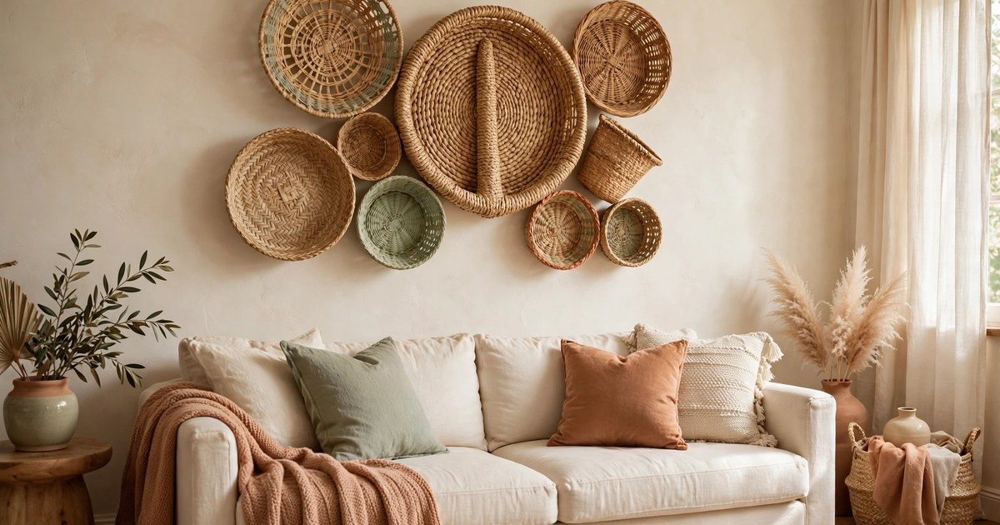
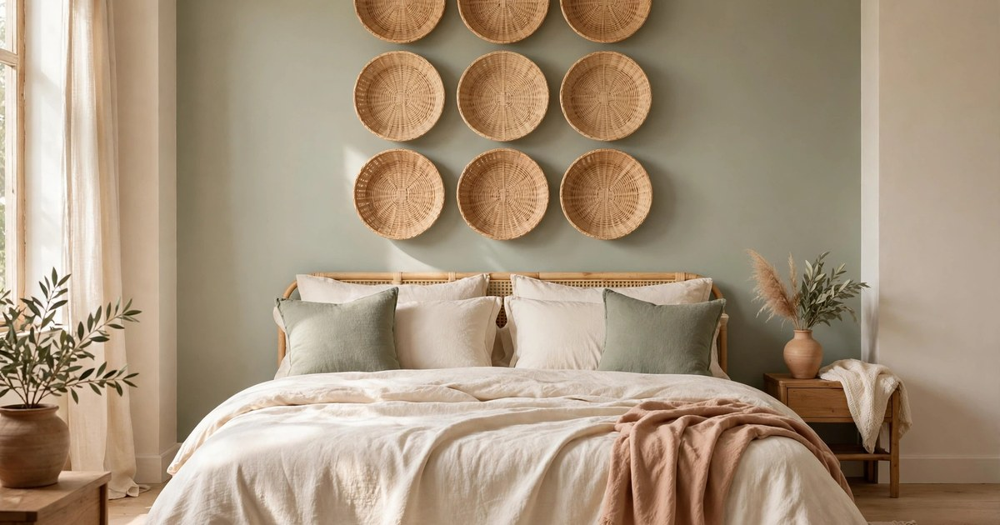
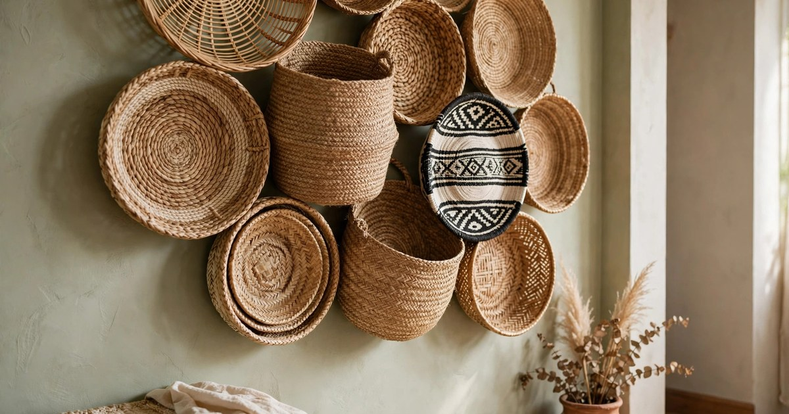
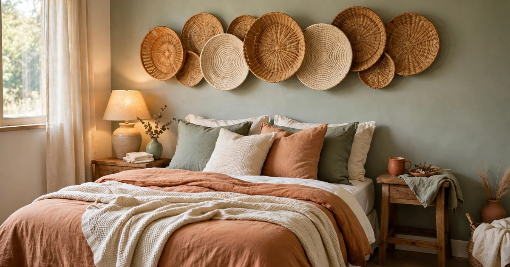
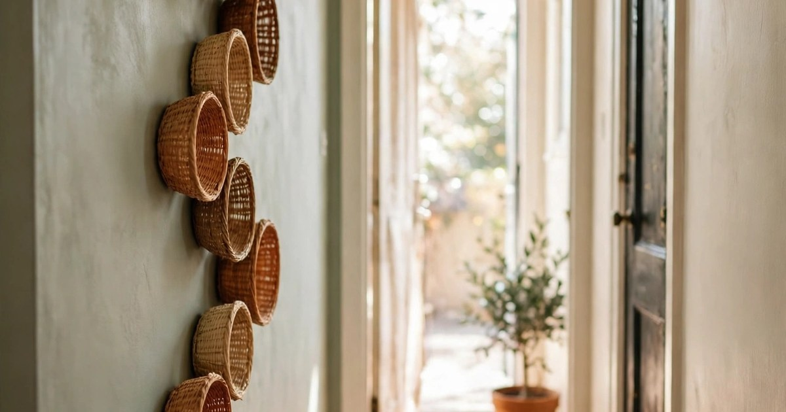
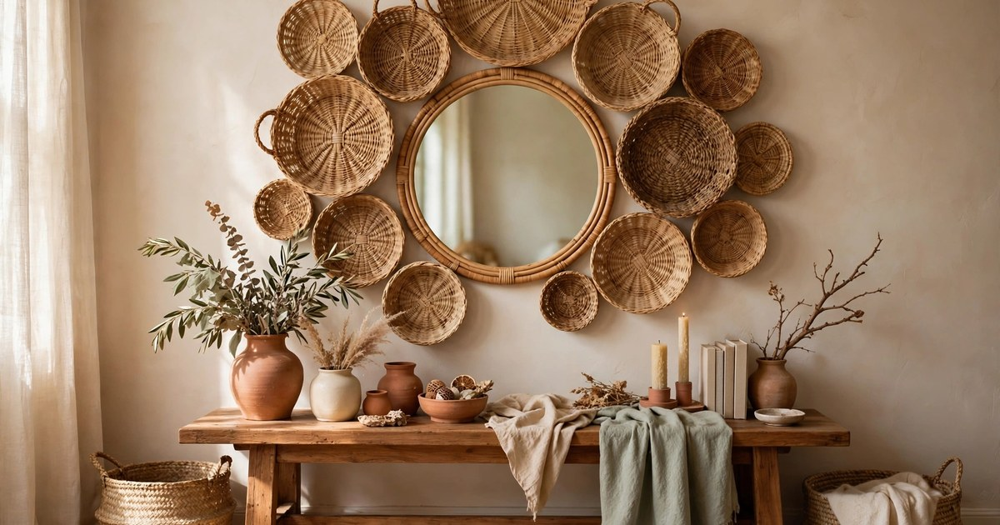
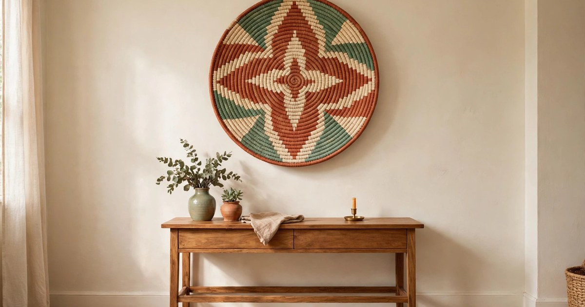
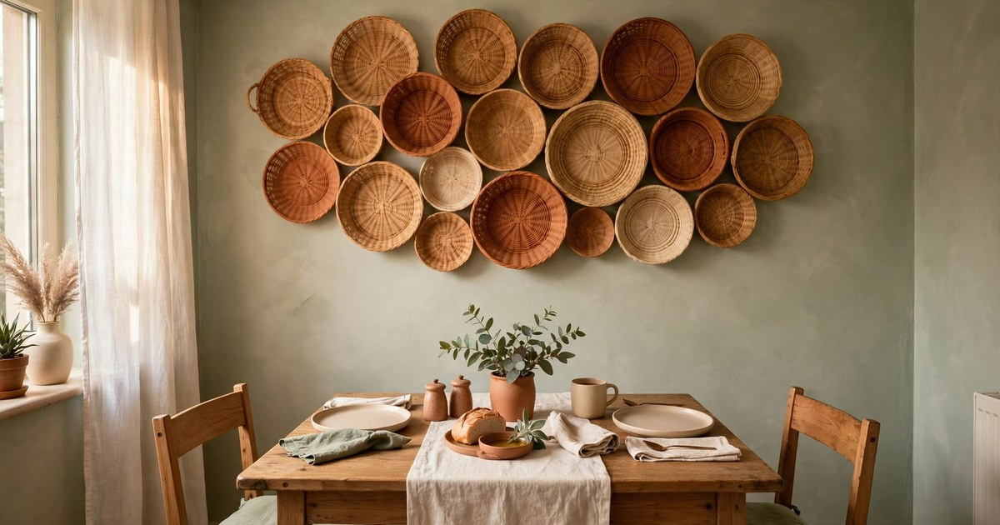
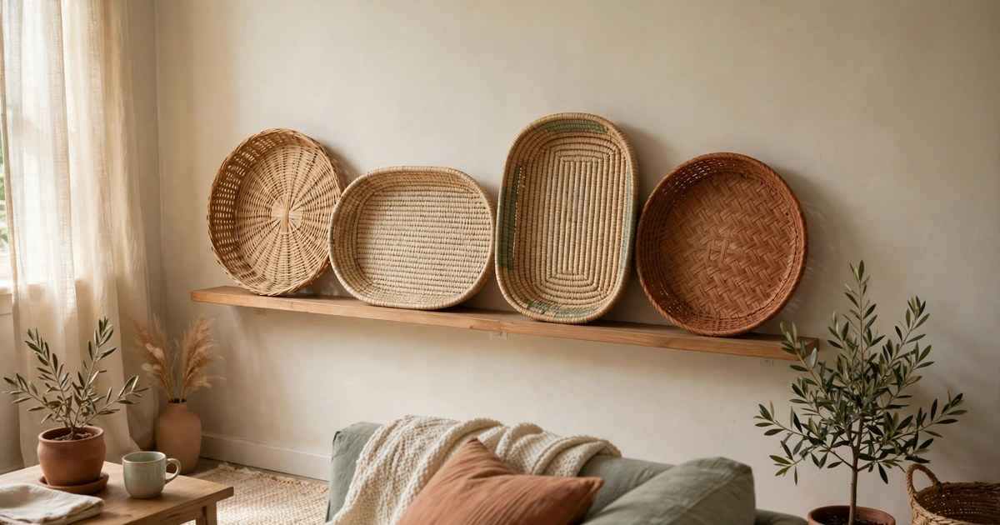
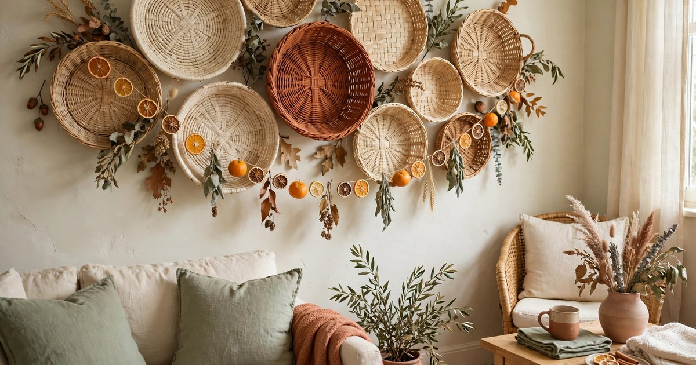

A woven basket wall is the fastest way to turn a blank rental wall into the warmest spot in your home. A handful of seagrass, jute and rattan baskets, arranged with a little intention, gives you texture, pattern and that collected-over-time look that costs a fortune in a furniture store — except here it costs very little, hangs without a single drill hole, and comes down cleanly on move-out day. It is also the heart of the Afrohemian trend, the Pinterest Predicts 2026 favourite that mixes African-inspired woven fibres, mudcloth patterning and earthy palettes with soft boho warmth. In other words, this is a wall treatment that is both bang on trend and genuinely timeless.

The reason basket walls work so well in rentals is that they solve three problems at once. They fill a big empty wall without heavy furniture or expensive art, they add warmth to the white-box rooms landlords love, and every single piece is lightweight, so adhesive hooks and picture ledges do the whole job. A basket rarely weighs more than a kilogram, which means no nails, no wall anchors and no deposit drama. And because baskets are everywhere — thrift shops, flea markets, discount homeware aisles, online marketplaces — you can build a whole feature wall for less than the price of one framed print.

This list is about baskets as wall art in their own right: arrangements, clusters, mixed sizes, statement walls above sofas and beds, and hallway displays that make a narrow space feel considered instead of forgotten. No plants required — the weave, the shape and the pattern do all the talking. Pick one idea for a small wall, or combine two or three across a room, and remember the golden rule of basket walls: a mix always beats a matching set. Mismatched sizes, fibres and patterns look collected and expensive; identical baskets look like a shop display.

### 1. The Classic Cluster Above the Sofa

Start with the most-loved basket wall of all: a loose cluster above the sofa. This is the arrangement you see all over Pinterest for a reason — it fills the wide, low wall every living room has, it balances the horizontal line of the sofa, and it works in every style from boho to modern farmhouse. Aim for five to nine baskets in at least three sizes, with one large basket of around forty to fifty centimetres across as the anchor and smaller ones orbiting it in a loose, slightly off-centre oval or triangle.

Lay the arrangement out on the floor first, then step back and look at it from across the room. The cluster should be about two-thirds the width of the sofa — wide enough to feel intentional, narrow enough to leave breathing room at the edges. Leave ten to fifteen centimetres between baskets so the wall colour shows through and each piece gets its own moment. Hang the largest basket first, dead centre or just off-centre, then build outwards, alternating sizes so no two neighbours are the same size.

Everything here hangs on large adhesive hooks rated for two to three kilos, one per basket, with a loop of jute twine threaded through the weave near the top rim. Test one hook with a basket for a day before hanging the rest, and hang the heaviest baskets lowest, where a fall would do the least damage. [Shop woven basket wall sets](https://www.amazon.com/s?k=woven+basket+wall+decor+set&tag={{AMAZON_TAG}}) to get a ready-made mix of sizes, or hunt thrift shops for a cheaper, more characterful collection gathered over a few weeks.

### 2. A Symmetrical Grid for a Calm, Collected Look

If loose clusters feel too boho for you, a grid is the calmer cousin — and it is the one exception to the never-match rule. Nine baskets of the same size in a neat three-by-three grid, or six in a three-by-two, reads as deliberate and architectural, almost like a woven tile installation. It suits minimalist rentals, bedrooms that need calm rather than energy, and anyone who likes their decor to feel orderly.

The trick is precision. Use a spirit level and painter's tape to mark the grid before a single hook goes up, and keep the spacing identical — five to eight centimetres between baskets looks tailored, while wider gaps start to look accidental. Flat woven discs and shallow trays work best here because they sit flush to the wall, while deep baskets cast shadows that break the clean lines. Keep the colour palette tight too: all natural seagrass, or all dark rattan, with at most one patterned piece as a quiet accent in the centre.

A grid above a bed makes a wonderful headboard substitute, especially in a rental where a real headboard feels like too much furniture. It costs a fraction of the price, adds the same visual weight, and comes down in minutes. [Shop flat woven wall baskets](https://www.amazon.com/s?k=flat+woven+wall+basket+decor&tag={{AMAZON_TAG}}) in matching sets made for grid displays, and measure twice before you stick anything — a grid forgives nothing, but done right it looks like it was designed by a professional.

### 3. Mixed Sizes, Shapes and Weaves — the Collected Look

This is the arrangement that makes a basket wall look like it was collected on travels rather than bought in one trip — and it is the easiest way to make a budget display look expensive. Mix at least three fibres: pale fine seagrass, warm rope-like jute, dark structured rattan, and one coiled raffia or flat woven disc for a completely different surface. Add shapes too — round, oval, shallow bowls, deep trays — and let the variety do the styling for you.

The Afrohemian angle shines here. Look for one or two baskets with black or cream mudcloth-style patterning, a dyed terracotta piece, or a basket with a woven geometric design, and let those patterned pieces anchor the display while plain baskets fill the gaps. The pattern echoes the textiles in the rest of the room — a mudcloth cushion, a woven throw — and pulls the whole space together without a single new purchase elsewhere.

Thrift shops are your best friend for this look. A mismatched collection gathered over a few weeks will always look better than a matching set bought in one trip, and most baskets cost a few pounds or dollars each secondhand. Check each one for sturdiness, give it a shake and a wipe, and leave any musty find in the sun for an afternoon before it goes on the wall. [Shop mixed woven baskets](https://www.amazon.com/s?k=mixed+woven+seagrass+baskets+wall+decor&tag={{AMAZON_TAG}}) if you want to start with a varied bundle and add thrifted pieces around it.

### 4. A Basket Wall as a Headboard Alternative

A bed without a headboard can make a whole bedroom feel unfinished, but a real headboard is bulky, expensive and a pain to move. A basket wall above the bed solves it in an afternoon. A wide, low arrangement — seven to nine baskets spread across the width of the bed, with the largest in the centre — gives you the same visual anchor as a headboard, adds texture right where your eyes land when you wake up, and costs less than a takeaway dinner for two.

Keep the arrangement low and wide rather than tall: the bottom row should sit about fifteen centimetres above the mattress or pillows, and the whole display should span roughly the width of the bed. Flat and shallow baskets are safest here — nothing deep that could catch a pillow or, worse, fall on a sleeping head. Use two adhesive hooks per basket for anything above the bed, and give the hooks a full day to cure before you sleep under them.

Warm tones work beautifully in a bedroom: honey rattan, cream seagrass and one terracotta-dyed piece pick up the colours of bedding and lamplight. If your bedding is plain, let a patterned basket or two be the statement; if your bedding is already busy, keep the baskets plain and let the texture speak. [Shop woven baskets for above bed decor](https://www.amazon.com/s?k=woven+basket+wall+decor+above+bed&tag={{AMAZON_TAG}}) to find shallow, lightweight pieces that are safe and stylish above a bed.

### 5. The Hallway Gallery That Makes a Narrow Space Shine

Hallways are the most neglected walls in any rental — narrow, dark, and usually left blank because nothing seems to fit. A basket wall is the exception: baskets are shallow, so they never jut into the walkway, and their warm texture makes a corridor feel like a room instead of a passage. A vertical arrangement of five to seven baskets, running in a gentle zigzag or a loose column down the wall, draws the eye along the hallway and makes it feel longer and more intentional.

Scale down for a hallway. Small baskets of fifteen to twenty-five centimetres across are the right size; anything larger overwhelms the space and crowds anyone walking past. Stick to a tight palette — all natural fibres, or natural with one dark accent — so the narrow space reads as calm rather than cluttered, and keep the arrangement on one wall only. Two basket walls facing each other in a narrow hallway feels like a tunnel.

Lighting makes all the difference in a hallway, which is often the darkest part of a flat. If you have a wall light or a picture light, angle it towards the baskets so the weave casts soft shadows; if not, a battery-operated picture light on an adhesive mount does the same job with no wiring. [Shop small woven wall baskets](https://www.amazon.com/s?k=small+woven+wall+baskets+decor&tag={{AMAZON_TAG}}) sized for hallways and narrow walls, and hang them with adhesive hooks so the whole display comes down cleanly when you move.

### 6. Baskets and Mirrors — the Reflective Mix

Pairing baskets with a mirror is one of those combinations that looks far more considered than the effort it takes. The mirror bounces light around the room and makes a small space feel bigger, while the baskets soften the hard edge of the glass and stop the mirror from feeling cold or stark. A round mirror in the centre, ringed by six to eight baskets in a loose halo, is the classic version — and it works above a console table, in an entryway, or over a sideboard.

Balance is everything here. The mirror should be the largest single piece, with baskets in two or three sizes orbiting it at a consistent distance of about ten centimetres from the frame. Keep the baskets lighter than the mirror visually — pale seagrass and cream rattan around a dark-framed mirror, or darker baskets around a light rattan-framed one — so the mirror stays the star and the baskets play supporting roles.

Hang the mirror on a leaner stand or a heavy-duty adhesive hook rated well above its weight, and use picture-hanging strips for the baskets around it. If you are nervous about adhesive and glass, lean the mirror on a console table instead and hang only the baskets — the effect is almost identical and the risk is zero. [Shop round rattan mirrors](https://www.amazon.com/s?k=round+rattan+mirror+boho&tag={{AMAZON_TAG}}) to find a frame that echoes the basket weave, and build the halo around it.

### 7. A Single Statement Basket as Wall Art

Sometimes one basket is enough. A single oversized woven piece — sixty centimetres across or more — hung alone above a console table, a sideboard or a reading chair has the same presence as a large framed print, for a fraction of the price and with far more texture. It is the minimalist's basket wall: one bold decision instead of a dozen small ones, and it suits renters who like clean walls with a single focal point.

Choose a basket with something to say: a bold geometric pattern, a deep sculptural bowl shape, a striking two-tone weave, or a vintage piece with a story. Plain baskets disappear when they are alone, so the pattern or shape has to carry the whole display. Hang it dead centre above the furniture below it, with the centre of the basket at roughly eye level, and keep the wall around it completely bare — the empty space is what makes it feel like art rather than storage.

A large basket needs proper support: two large adhesive hooks side by side, or an adhesive picture-hanging strip rated for its weight, with the hanging loop threaded through the weave at the top rim so the basket sits upright and flush. [Shop large woven wall baskets](https://www.amazon.com/s?k=large+woven+wall+basket+decor+statement&tag={{AMAZON_TAG}}) for oversized pieces made to hang as wall art, and measure the wall before you buy — a statement basket that is too small for its wall just looks lost.

### 8. The Dining-Room Basket Wall

The dining area is often the most forgettable corner of a rental — a table pushed against a wall, a couple of chairs, nothing to look at while you eat. A basket wall changes that instantly, and it is one of the warmest backdrops a meal can have. A generous cluster above the table, in warm honey and terracotta tones, makes even a weeknight dinner feel like an occasion, and the texture photographs beautifully if you like sharing your table on social media.

Go warm and generous here. Dining rooms suit larger baskets and richer colours than bedrooms do: deep rattan, terracotta-dyed seagrass, baskets with black patterning that echo a table runner or placemats. A wide arrangement that spans the length of the table works best, with the largest basket centred over the middle of the table and smaller ones stepping down towards the ends.

Keep baskets away from the cooking zone and out of reach of steam and splashes, and avoid hanging anything directly above a hob or a sink. Above a dining table, the height is forgiving — the bottom of the lowest basket should clear the table by at least forty centimetres so nobody knocks it reaching for the salt. [Shop boho woven basket wall decor](https://www.amazon.com/s?k=boho+woven+basket+wall+decor+dining+room&tag={{AMAZON_TAG}}) to build a warm, generous cluster that makes your dining corner the best seat in the house.

### 9. Basket Wall on a Picture Ledge — Zero Hooks, Zero Holes

If even adhesive hooks feel like too much commitment, the picture ledge is your answer. A single narrow wooden ledge, mounted with adhesive strips or leaning against the wall on a console, holds a row of baskets upright like books on a shelf — and you can rearrange them in seconds, swap pieces seasonally, and take the whole display down in under a minute. It is the most renter-friendly basket wall there is, because nothing touches the wall at all except the ledge itself.

Stand flat baskets and shallow trays upright on the ledge, leaning them gently against the wall, and overlap them slightly so they read as one continuous display rather than separate objects. Mix sizes along the ledge — tall at one end, stepping down to small at the other — and tuck a small woven bowl or a ceramic vase in front to add depth. Two ledges, one above the other, give you a double row and twice the impact for very little extra effort.

The ledge itself is the only thing to mount, and a narrow picture ledge on two large adhesive strips holds a row of lightweight baskets easily. Check the weight rating, wait the full curing hour before loading it, and keep the heaviest baskets nearest the wall. [Shop picture ledges for wall decor](https://www.amazon.com/s?k=wooden+picture+ledge+wall+shelf&tag={{AMAZON_TAG}}) and [shop flat woven baskets for ledge display](https://www.amazon.com/s?k=flat+woven+decorative+baskets+wall&tag={{AMAZON_TAG}}) to build a display you can restyle whenever the mood strikes.

### 10. Seasonal Swaps — One Wall, Four Looks a Year

The best thing about a basket wall is that it is never finished — it is a display you can restyle in minutes, season after season, without buying anything new. Keep your core baskets in place year-round and swap just one or two accent pieces, or add a small seasonal touch, to give the whole wall a fresh look four times a year. In autumn, add a terracotta-dyed basket and a dried citrus garland draped between two baskets; in winter, a cream woven disc and a battery candle on the ledge below; in spring, a pale seagrass piece and a small woven bowl of dried flowers; in summer, a sun-bleached rattan basket and a straw-toned accent.

The swap takes ten minutes because everything hangs on adhesive hooks — lift one basket off, hang another on, done. Store the out-of-season baskets in a larger basket on the floor, which doubles as storage and keeps the spares looking intentional rather than cluttered. Photograph your favourite arrangement before you change it, so you can recreate it next year without starting from scratch.

This is also the cheapest way to keep your home feeling current: one new thrifted basket per season, for a few dollars, refreshes a display that would cost hundreds to replace as framed art. [Shop seasonal woven basket decor](https://www.amazon.com/s?k=seasonal+woven+basket+wall+decor+terracotta&tag={{AMAZON_TAG}}) for accent pieces in autumnal and spring palettes, and let your basket wall evolve with the year instead of staying frozen in the month you hung it.

## Frequently Asked Questions

### How do you hang woven baskets on a wall without drilling?

Use large adhesive hooks rated for two to three kilos, one per basket, with a loop of jute twine threaded through the weave near the top rim. Clean the wall first, press the strip firmly for thirty seconds, and wait a full hour before hanging anything. For heavier baskets, use two hooks side by side. Flat baskets can also hang from adhesive picture-hanging strips, and shallow baskets can simply lean on a picture ledge with no wall fixings at all.

### How many baskets do you need for a basket wall?

Five to nine baskets make a statement wall above a sofa or bed, three to five suit a smaller wall or hallway, and a single oversized basket works as standalone art. Whatever the number, use at least three sizes — one large anchor, a few medium pieces and several small ones — because the size variation is what makes the arrangement look collected rather than shop-bought.

### What is the best way to arrange baskets on a wall?

Lay the arrangement on the floor first and step back to judge it from across the room. A loose, slightly off-centre cluster in an oval or triangle shape looks the most natural, with the largest basket as the anchor and smaller ones orbiting it. Leave ten to fifteen centimetres between baskets so the wall colour shows through, and mark positions with painter's tape before you hang anything.

### Will adhesive hooks hold a woven basket wall?

Yes, for almost every basket wall. A basket plus its hanging loop rarely weighs more than a kilogram, well within the rating of a large adhesive hook. The failures almost always come from skipping the instructions — a dirty wall, no curing time, or an overloaded hook. Test one hook for a day, hang the heaviest baskets lowest, and never hang a basket directly above anything you would regret it landing on.

### Where can I buy woven baskets for a wall cheaply?

Thrift shops, charity shops, flea markets and discount homeware aisles are the cheapest sources, usually a few dollars per basket, and a mismatched collection gathered over a few weeks looks better than a matching set. Online, look for mixed-size bundles and flat woven wall-basket sets, which are made to hang and often cost less per piece than buying baskets one at a time.

### Can a basket wall work in a small apartment?

Yes — it is one of the best wall treatments for small spaces. Baskets are shallow, so they never jut into the room, and their warm texture makes a small room feel cosy rather than cramped. Scale the baskets down for narrow walls, keep the palette tight, and use a single feature wall rather than spreading baskets across the room. A hallway or a wall above a small sofa is often the perfect spot.
