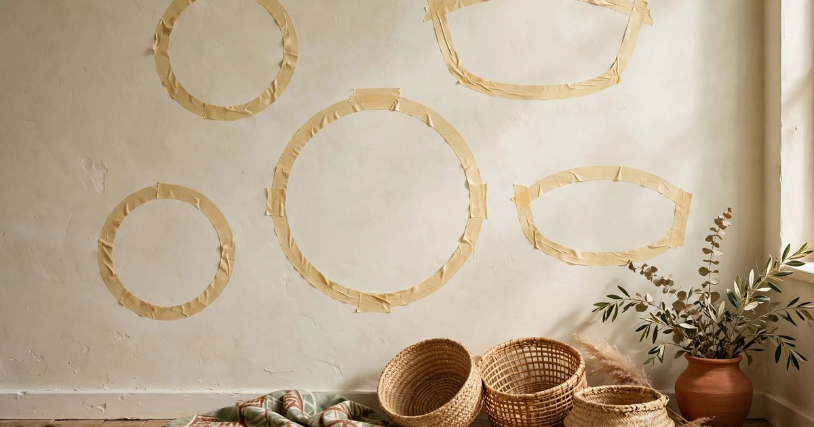
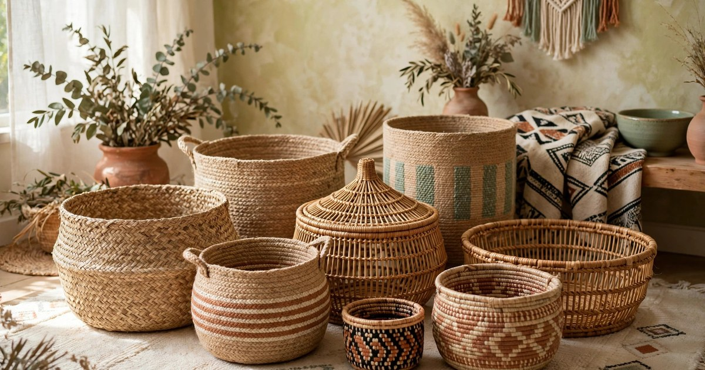
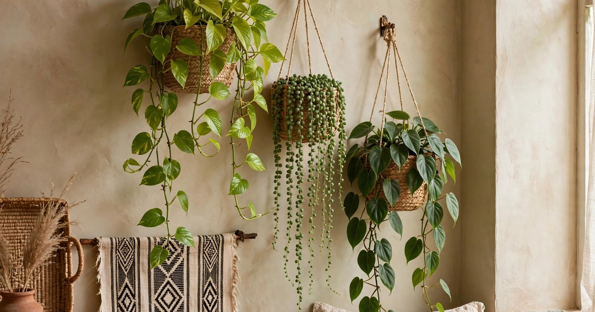
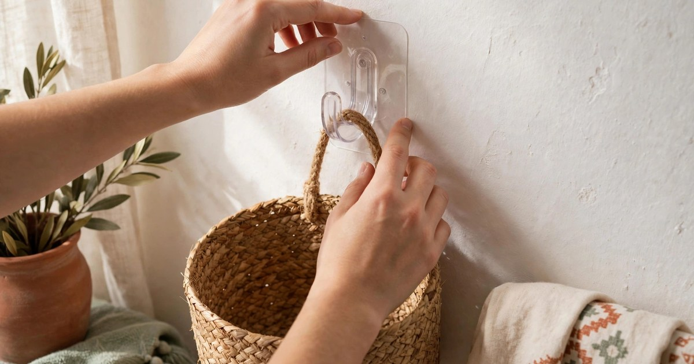
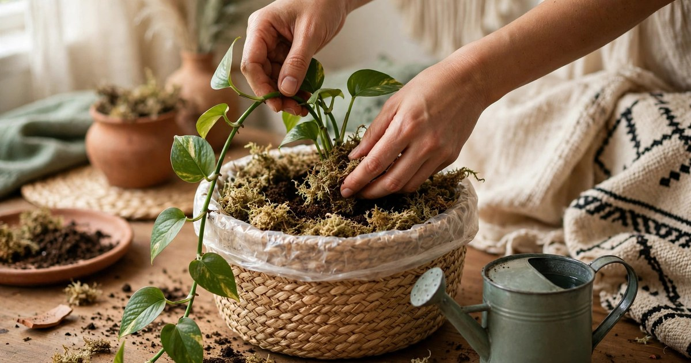
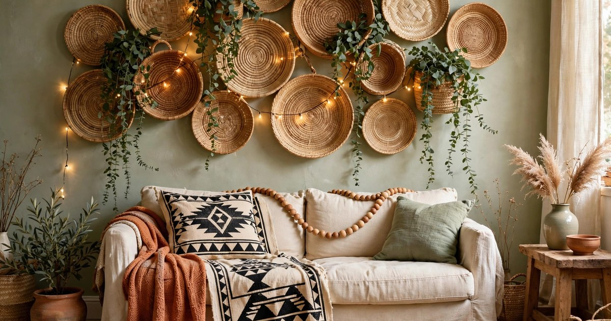
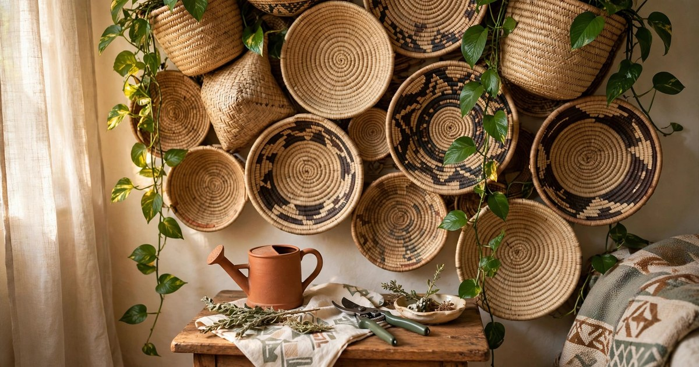

A woven basket wall is the kind of decor that looks far more expensive than it is. A handful of seagrass, jute and rattan baskets, a few trailing plants and a single afternoon can turn a bare rental wall into the warmest spot in your home — no drilling, no paint and no landlord drama. It is also one of the standout looks of the Afrohemian trend, the Pinterest Predicts 2026 favourite that mixes African-inspired textures, woven fibres and earthy palettes with boho softness. In other words, this is a wall treatment that is both on-trend and genuinely timeless.

The magic is in the combination. Baskets alone give you texture and warmth; trailing plants alone give you movement and life. Together, the woven fibres soften the greenery and the greenery softens the baskets, so the whole display reads as one intentional piece rather than a collection of random objects. Because everything hangs from adhesive hooks or removable hardware, the whole arrangement is renter-friendly, and because baskets and cuttings cost very little, it is firmly budget-first. This guide walks you through the whole project in seven steps, from choosing your baskets to keeping your plants trailing beautifully through winter.

### Step 1. Pick your wall and map the layout

Before you buy a single basket, choose the wall. The best spot is one you look at every day but never quite know what to do with — the wall behind a sofa, the blank stretch above a sideboard, the awkward gap beside a bookshelf, or a narrow hallway wall that currently holds nothing but a light switch. A basket wall works best as a single feature, so resist the temptation to spread it across two walls. One generous arrangement reads as a deliberate statement; two small ones read as leftovers.

Light matters almost as much as placement. Trailing plants need bright, indirect light to grow long and full, so a wall within a couple of metres of a window is ideal. If your only free wall is far from natural light, that is not a deal breaker — simply choose shade-tolerant trailers like pothos or philodendron, which will happily cascade in lower light, and keep the arrangement smaller so each plant still gets its share of what light there is. Check how the sun moves across the room at different times of day before committing, and avoid walls directly above radiators, where hot dry air will crisp the ends of your vines.

Once you have your wall, map the layout on the floor first. Lay your baskets out on a rug or bed in the arrangement you imagine, then step back and look at it from a few paces away. Most basket walls work best in an organic, slightly off-centre cluster — a loose triangle, an asymmetrical oval, or a scattered group with one large anchor basket and smaller ones orbiting it. Trace each basket's outline onto paper or mark the positions with painter's tape on the wall, and leave breathing room between baskets so the trailing vines have somewhere to fall. A gap of ten to fifteen centimetres between baskets looks generous rather than crowded, and it leaves space for the plants to grow into the display instead of being squeezed behind it.

### Step 2. Choose baskets in mixed sizes, shapes and textures

The single biggest mistake with basket walls is buying a matching set. A row of identical baskets looks like a shop display; a mix of sizes, shapes and weaves looks collected, personal and expensive. Aim for five to nine baskets for a statement wall, or three to five for a smaller space, in at least three sizes. One large basket, around forty to fifty centimetres across, makes a natural anchor. Two or three medium ones fill out the shape, and a handful of small ones — fifteen to twenty-five centimetres — add detail and let you tuck baskets into the gaps between larger pieces.

Texture is what makes the Afrohemian look work, so mix your fibres rather than buying everything in the same material. Seagrass brings a pale, fine weave; jute adds a warm, rope-like roughness; rattan gives you a darker, more structured pattern; and a flat woven disc or a coiled raffia basket adds a completely different surface. If you love the mudcloth and earthy palette that runs through the Afrohemian trend, look for baskets with black or cream patterning, or one painted or dyed piece to echo the rest of your room. For more ideas on pulling the trend together affordably, our roundup of [Afrohemian decor finds under $25](/afrohemian-decor-finds-under-25/) is a good place to start.

Budget is on your side here. Thrift shops, charity shops, flea markets and the homeware aisle of discount stores are full of woven baskets for a few pounds or dollars each, and a mismatched collection gathered over a few weeks will always look better than a matching set bought in one trip. Check that each basket is sturdy, free of mould or a musty smell, and deep enough to hold a small pot if you plan to plant directly into it. Shallow decorative discs and flat trays are wonderful as accents, but they cannot hold plants — use them between the planted baskets to vary the depth and keep the wall from looking heavy. Give every basket a good shake and a wipe before it goes on the wall, and if a thrifted find smells musty, leave it outside in the sun for an afternoon before bringing it in.

### Step 3. Pick trailing plants that cascade beautifully

The plants are the living half of this display, so choose trailers that are generous by nature rather than ones you have to coax into length. Golden pothos is the classic for a reason: it grows fast, tolerates low light and neglect, and its heart-shaped leaves look lovely against woven fibres. Philodendron brasil adds a variegated chartreuse stripe that lifts a terracotta and cream palette, while string of pearls and string of hearts give you delicate, beaded trails that contrast beautifully with chunky basket weave. If your wall gets good light, a spider plant or a tradescantia will reward you with fast, full cascades in weeks rather than months.

Think about length and fullness together. A single long vine looks sparse; three or four vines spilling from one basket look lush. When you buy a plant, choose a full pot with several stems rather than a single cutting, or buy two small pots and combine them in one basket. For instant impact, look for plants already trailing at least thirty centimetres when you buy them — nursery plants sold as "hanging" specimens are usually fuller than the same variety sold in a standard pot. If you are working to a tight budget, start with one or two generous plants and a few cuttings from friends or your own collection; pothos and philodendron root in water in a couple of weeks, so a basket wall can be grown rather than bought.

Match the plant to the spot, not the other way round. A north-facing wall in a small flat calls for pothos, philodendron or a hardy spider plant, while a bright wall near a south-facing window can support string of pearls, tradescantia or even a trailing hoya. Avoid plants that need constant humidity right next to a basket, since damp fibres and dry indoor air do not mix well — if you love humidity-hungry plants, keep them in a different room and let the basket wall belong to the tough, forgiving trailers. For more ideas on choosing trailers that suit small, darker spaces, see our guide to [trailing plants for small apartments in winter](/trailing-plants-small-apartment-winter-ideas/).

### Step 4. Hang everything damage-free

This is the step renters worry about most, and it is the easiest to get right. For most baskets, a large adhesive hook rated for two to three kilos is more than enough — a basket plus a small plant and damp soil rarely weighs more than a kilo. Choose hooks with a metal or sturdy plastic hook rather than a thin wire one, and follow the instructions exactly: clean the wall with a dry cloth, press the strip firmly for thirty seconds, and wait an hour before hanging anything. For heavier baskets, use two hooks side by side to spread the load, or a single adhesive picture-hanging strip rated for the weight.

Hanging the basket itself takes a little ingenuity. Many woven baskets have a loop or handle at the back; if yours does not, thread a length of jute twine or clear fishing line through the weave near the top rim and tie it into a loop. For flat decorative baskets, a plate-hanging wire or a pair of small adhesive hooks behind the rim will hold them flat against the wall without any visible hardware. Keep the hanging point at the top of the basket so it sits upright rather than tilting forward, and check from the side that the basket is flush to the wall — a basket that leans out at the top will slowly slide off its hook as the plant grows heavier.

If your landlord allows small picture hooks, a single nail per basket is the most secure option, especially for larger pieces. Otherwise, adhesive is your friend, and it is genuinely reliable when used properly. Test one hook with a basket for a day before hanging the whole wall, and always hang the heaviest baskets lowest, where a fall would do the least damage. Avoid hanging baskets directly above electronics, beds or anything you would regret watering, and keep a small drip tray or a plastic liner inside each planted basket so watering never reaches the wall behind it.

### Step 5. Pot, plant and place the trailing greenery

Never plant directly into an unlined basket. Woven fibres wick moisture, and a damp basket against a painted wall will stain both the basket and the paint. Line each basket with a plastic nursery pot, a clear plastic bag with drainage holes, or a cut-to-size piece of thick plastic sheeting, then set the plant's own pot inside it. If you want the plant to sit higher in a deep basket, add a layer of pebbles or an upturned saucer underneath the pot to lift it to the right height. A ring of sphagnum moss around the rim hides the plastic edge and makes the whole thing look as though the plant grew there naturally.

Watering is where basket walls go wrong, so build your routine around it. Water each plant over a sink or a tray, let it drain fully, and only then return it to its basket — never water a plant while it hangs on the wall, unless you enjoy mopping. A plant in a basket dries out faster than one on a shelf because air circulates all around it, so check the soil weekly in summer and every ten days or so in winter. A moisture meter or the simple finger test — dry to the first knuckle means water — will keep you from the two classic mistakes of overwatering and forgetting entirely.

When you place the plants, think about how the vines will fall. Drape the longest trails over the front rim of the basket so they cascade down the wall, and tuck shorter stems to the sides so they fill the gaps between baskets. Let some vines fall long and free — a trail of a metre or more is the whole point — but keep the ends clear of furniture, radiators and walkways so they do not get knocked or scorched. Rotate each basket a quarter turn every few weeks so the plants grow evenly toward the light instead of leaning, and prune leggy stems back to a leaf node to encourage bushier growth. The cuttings you prune can go straight into water to root, giving you free plants for the next basket.

### Step 6. Layer in texture, colour and light

A basket wall is a strong look on its own, but a few layered details take it from a display to a room. The easiest way is to echo the materials elsewhere in the space: a mudcloth cushion on the sofa below, a jute rug underfoot, a wooden bead garland draped along a shelf, or a terracotta pot on the sideboard. These echoes make the wall feel like part of the room rather than an isolated feature, and they cost very little if you already own the pieces. Keep the palette tight — terracotta, cream, sage, warm wood and black — and the whole scheme will feel calm and collected even with plenty of texture.

Light transforms the display after dark, and it is worth adding. A short string of warm-white fairy lights woven loosely through the top baskets gives the wall a soft glow in the evening, while a small battery-operated picture light or a clip-on spot aimed at the centre of the arrangement makes the textures and the greenery pop. Keep lights away from dry foliage and use battery or USB options so there are no cables trailing down a rental wall. If your wall is near a window, a sheer curtain that filters the light will protect the plants from harsh direct sun while giving the whole corner a soft, diffused glow.

Small accents fill the gaps without competing with the baskets. A single ceramic vase, a tiny framed print in a wooden frame, or a wooden bead strand hung between two baskets adds a focal point and stops the eye from sliding off the arrangement. Resist the urge to add too much — the baskets and the plants are the stars, and every extra object should earn its place. Step back and look at the wall as a whole: if any one basket or accent draws the eye away from the arrangement, move it, shrink it or remove it. A basket wall should feel warm and abundant, never cluttered.

### Step 7. Keep it thriving with a simple care routine

A basket wall is a living display, so it needs a little ongoing care — but not much. Set a weekly five-minute routine: check the soil in each basket, water the ones that need it, and wipe dust from the leaves with a damp cloth so they keep photosynthesizing well. Dust is the silent killer of trailing plants, especially in winter when windows stay shut, so a quick wipe every couple of weeks makes a visible difference to how full and glossy the vines look. While you are there, check the hooks and the twine loops for any sign of wear, and give each basket a gentle tug to confirm it is still secure.

Pruning keeps the display looking intentional rather than wild. Every month or so, trim back any vine that has grown too long for its spot, any bare stem with leaves only at the tip, and any yellowing leaf. Cut just above a leaf node and the plant will branch from that point, growing bushier rather than longer. The trimmings are not waste — pop them in a jar of water on a windowsill and within a fortnight you will have rooted cuttings to fill a gap, start a new basket or gift to a friend. In spring, when growth picks up, a half-strength liquid feed once a month will keep the trails long and the leaves a rich green.

Seasonal changes are simple to manage. In winter, move the most light-hungry baskets closer to the window if you can, cut back on watering as growth slows, and keep vines clear of cold draughts from windows and doors. In summer, watch for sun scorch on leaves that touch the glass, and water a little more often as the baskets dry out faster. If a plant starts to struggle, take it down, give it a soak in the sink, trim the worst of it back and let it recover on a shelf for a few weeks before returning it to the wall. A basket wall is forgiving — individual baskets can be swapped, rotated or replaced without disturbing the rest — which is exactly why it suits renters and small spaces so well.

A woven basket wall with trailing plants is one of those rare projects that is cheap, quick, renter-friendly and genuinely transformative. It brings warmth, texture and living greenery to a wall that was doing nothing, and it does it with materials that cost less than a single framed print. Start with three baskets and one good pothos if you are unsure, and let the wall grow with you — add a basket when you find a beautiful one, swap in a new trailing plant when the mood strikes, and enjoy watching the vines slowly take over. Your blank wall will never look bare again.

## Frequently Asked Questions

### How many baskets do I need for a basket wall?

Five to nine baskets make a satisfying statement wall, while three to five work well in a small flat or a narrow space. The key is variety: mix at least three sizes and two or three different weaves, and include one large anchor basket to give the arrangement a focal point. A wall of identical baskets looks like a shop display, so embrace the mismatch.

### Can I hang a basket wall without drilling holes?

Yes, and most renters do. Large adhesive hooks rated for two to three kilos will hold a basket with a small plant, and two hooks spread the load for heavier pieces. Thread jute twine through the weave to make a hanging loop, or use plate-hanging wire for flat decorative baskets. Always clean the wall first, wait an hour before hanging, and test one hook overnight before hanging the whole wall.

### Which trailing plants are best for beginners?

Golden pothos is the safest first choice — it grows fast, tolerates low light and forgives missed waterings. Philodendron brasil and spider plants are nearly as easy and give you variegation and texture. String of pearls looks beautiful but needs brighter light and careful watering, so save it for a sunny wall once you are confident.

### How do I water plants in a basket wall without making a mess?

Take each plant down, water it over a sink or tray, let it drain fully, and only then return it to its basket. Line every basket with plastic so drips never reach the wall, and never water a plant while it hangs. Check the soil weekly in summer and every ten days in winter — baskets dry out faster than pots on a shelf because air circulates all around them.
