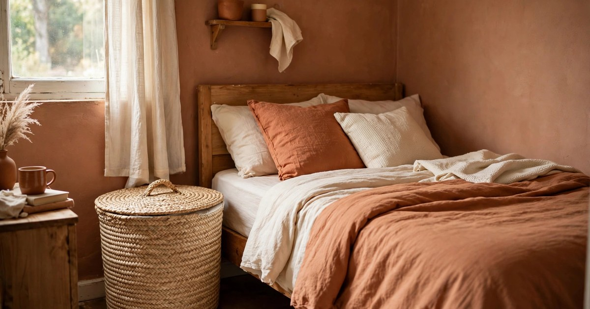
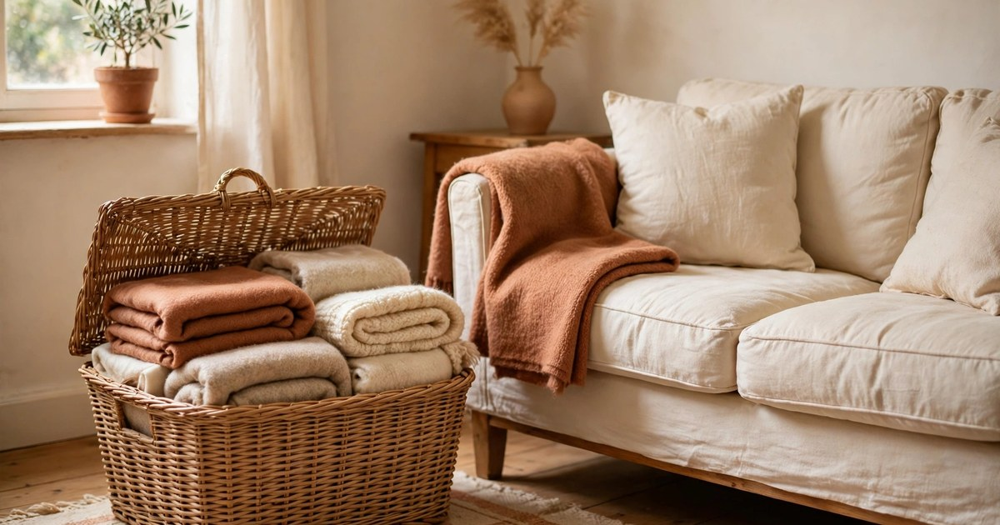
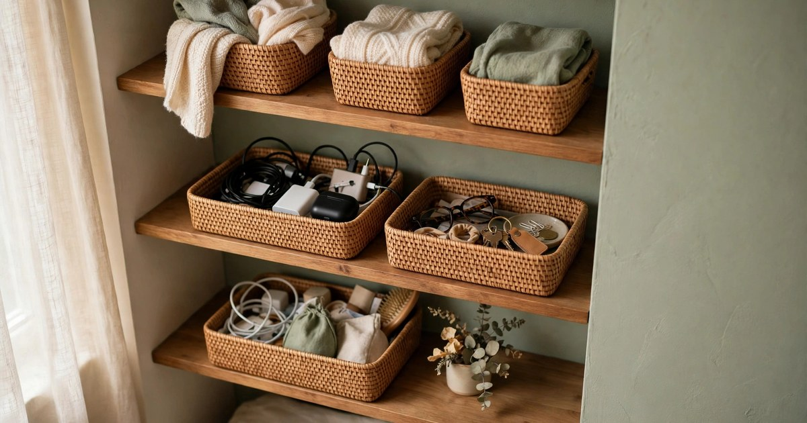
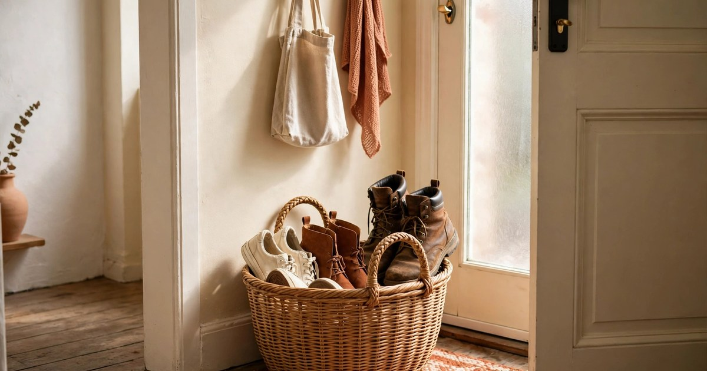
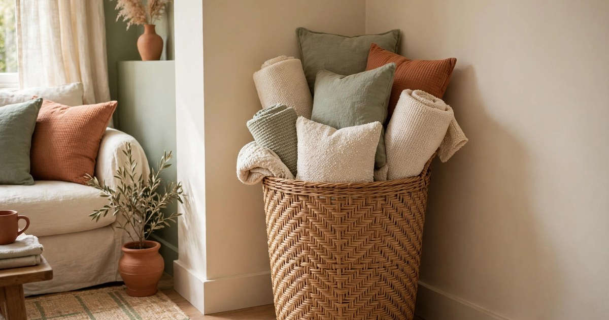
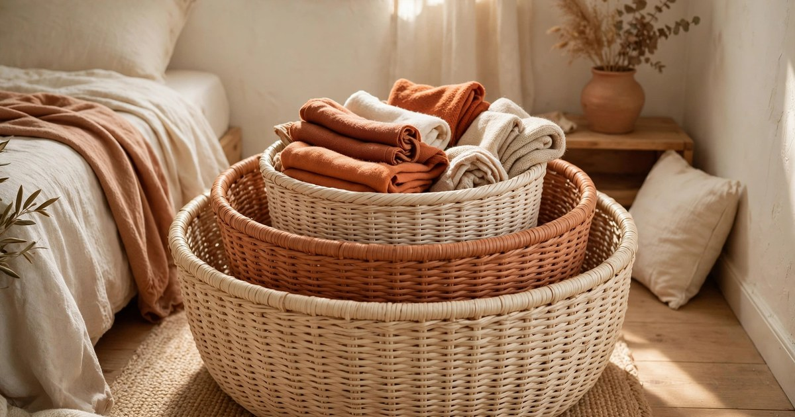
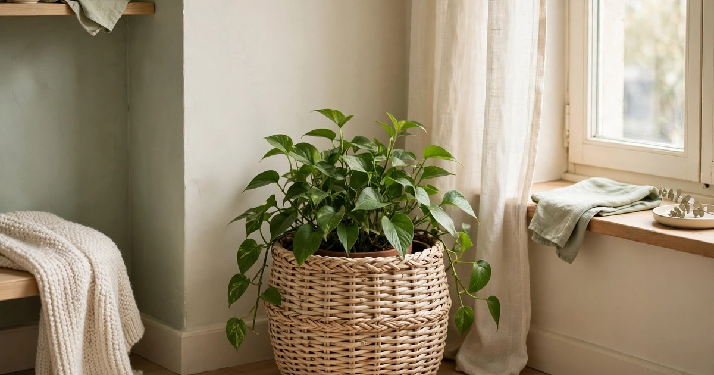
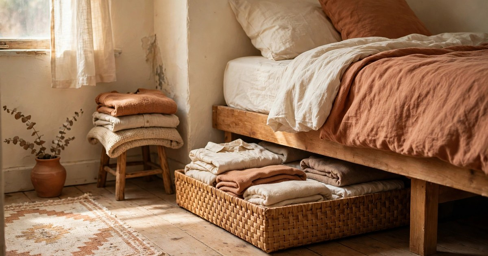
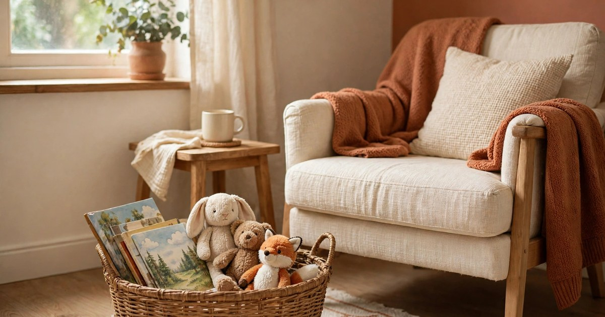

Winter has a way of multiplying clutter in a small rental. Scarves and gloves pile up by the door, extra throws appear on every chair, and the books, toys and bits of everyday life that were easy to ignore in summer suddenly feel like they are taking over. A woven storage basket is the simplest fix there is. It hides the mess, adds warm natural texture, and — crucially for renters — it is completely freestanding. No drilling, no brackets, no holes to fill when you move out. You put it down, you fill it, and the room instantly looks calmer.

This roundup gathers nine woven storage baskets, every one of them under $25, that actually work in small rented flats. Each pick earns its place for a different job, from the laundry basket that doubles as a hamper to the low under-bed basket that rescues the space you forgot you had. They are all made from natural fibres like seagrass, jute, rattan and water hyacinth, so they bring the same warm, earthy texture that makes [a woven basket wall with trailing plants](/woven-basket-wall-trailing-plants-guide/) feel so inviting — only here the baskets are doing practical work instead of hanging on the wall.

A few things to know before you buy. First, measure the spot, not the basket in your head. A basket that looks compact online can be surprisingly wide once it arrives, and in a small rental a few centimetres either way decides whether it slides neatly beside the sofa or blocks a cupboard door. Second, check whether the basket is lined. A fabric or plastic liner stops small items slipping through the weave and protects the fibres from damp laundry or muddy shoes. Third, think about handles. A basket you lift every day needs sturdy, comfortable handles; a basket that stays in one place does not. And finally, remember that natural fibres vary. Slight differences in colour and weave are part of the charm, not a fault, and they are exactly what stops a budget basket from looking like a flat-pack storage box.

Every basket below costs under $25 at the time of writing, and every one of them is the kind of purchase that pays for itself the first time a guest walks in and sees a tidy hallway instead of a pile of winter coats. Here are the nine worth your money.

### 1. Seagrass laundry basket

A proper laundry basket is the single most useful basket a renter can own, and seagrass is the best material for it. The weave is tight enough to hold socks and small items without them poking through, yet open enough for air to circulate, so damp towels and gym clothes do not turn musty while they wait for wash day. A lidded version keeps the contents out of sight, which matters in a small flat where the bedroom often doubles as the laundry room.

Where it fits best is the bedroom corner or the bathroom, wherever the dirty laundry naturally accumulates. Choose a tall, slim shape rather than a wide one if floor space is tight, and look for a removable cotton liner you can toss in the wash. A lined basket also means you can carry the whole load to the machine in one trip, liner and all, without dragging the basket itself across the flat. Expect to pay around $18 to $24 for a generous lidded seagrass basket, and treat it as a long-term piece: seagrass is tougher than it looks and ages gracefully, darkening slightly with use.

Shop this pick on Amazon: [seagrass laundry basket with lid](https://www.amazon.com/s?k=seagrass+laundry+basket+with+lid&tag={{AMAZON_TAG}})

### 2. Lidded basket for blankets and throws

Every small rental accumulates throws. One on the sofa, one on the armchair, one draped over the bed — and by midwinter there are more throws than places to sit. A lidded woven basket solves the problem in one move. Fold the throws, stack them inside, close the lid, and the living room looks tidy again. The lid is the key detail: an open basket full of blankets still looks like a pile of blankets, while a closed one reads as a piece of furniture.

Where it fits is right beside the sofa or at the foot of the bed, where you can reach in and grab a throw without getting up. A rectangular basket suits the space beside a sofa better than a round one, since it tucks flat against the arm, while a round basket works beautifully as a side table in its own right — pop a tray on the lid and it holds a cup of tea. Look for a basket with a hinged or fully removable lid and handles on the sides, and keep it within arm's reach of where you actually sit. A basket stored in a cupboard is a basket you will never use.

Shop this pick on Amazon: [lidded woven basket for blankets](https://www.amazon.com/s?k=lidded+woven+basket+blankets+storage&tag={{AMAZON_TAG}})

### 3. Small woven baskets for shelves

Open shelving is lovely in a small flat until it fills up with the small, awkward things that have nowhere else to go: charging cables, spare keys, sunscreen, batteries, the remote controls. A set of small woven baskets turns those shelves into proper storage. Each basket holds one category of clutter, so you can find what you need without pulling everything out, and the natural weave softens shelves that would otherwise look like a hardware cupboard.

Where they fit is anywhere you have open shelves — the hallway, the living room, the kitchen, even the top of a wardrobe. Buy a set of three or four in the same fibre but different sizes, and measure your shelf height before ordering, leaving a centimetre or two of clearance so the baskets slide in and out easily. A basket that has to be forced onto a shelf will fray at the rim within weeks. If your shelves are deep, choose baskets with a small label holder or tie a luggage tag to the handle so you can tell at a glance which basket holds the chargers and which holds the dog leads. For more ideas on making the most of limited shelf space, see our [small living room storage hacks](/small-living-room-storage-hacks/).

Shop this pick on Amazon: [small woven storage baskets set for shelves](https://www.amazon.com/s?k=small+woven+storage+baskets+set+shelves&tag={{AMAZON_TAG}})

### 4. Woven basket with handles for shoes by the door

The hallway is the hardest-working room in a small rental and the easiest to lose to clutter. Winter makes it worse: boots, trainers, wellies and the shoes you meant to put away all end up in a heap by the door. A woven basket with strong handles gives every pair a home and turns the heap into a tidy row. The handles matter here more than anywhere else, because this is the one basket you will pick up and move — to sweep underneath it, to make room for guests, to carry the shoes to the cupboard.

Where it fits is directly beside the front door, ideally on a boot tray or a wipeable mat so muddy soles never touch the fibres. Choose a wide, low basket rather than a tall one, so shoes sit in a single layer and you can see every pair at a glance. A basket with a plastic liner or a removable base is worth the small premium, since it protects the weave from damp soles and grit. Two medium baskets beat one huge one in a narrow hallway: one for everyday shoes, one for the seasonal extras, and both easy to lift out of the way when you need the floor clear.

Shop this pick on Amazon: [woven basket with handles for shoe storage](https://www.amazon.com/s?k=woven+basket+handles+shoe+storage+entryway&tag={{AMAZON_TAG}})

### 5. Tall basket for throws and cushions

A tall, narrow basket is the best friend of a small living room. It takes up barely more floor space than a floor lamp, yet it swallows an astonishing amount: two or three throws, a couple of spare cushions, the chunky knit you only reach for on the coldest evenings. Rolled rather than folded, throws slide in and out easily, and the tall sides keep everything upright and visible instead of collapsing into a heap.

Where it fits is the corner beside the sofa or the awkward gap between the sofa and the wall that is too narrow for furniture but too wide to ignore. That dead space is exactly where a tall basket earns its keep. Look for a basket at least fifty centimetres tall with a sturdy, weighted base so it does not topple when you pull a throw out one-handed. A slightly tapered shape — wider at the top than the bottom — makes it easier to reach inside and stops the contents getting wedged. In a room styled with warm, earthy tones, a seagrass or water hyacinth basket in a natural finish ties in beautifully with the [Afrohemian living room look](/afrohemian-living-room-ideas-small-apartments/), adding texture without adding colour clutter.

Shop this pick on Amazon: [tall woven basket for throws and cushions](https://www.amazon.com/s?k=tall+woven+basket+throws+cushions+storage&tag={{AMAZON_TAG}})

### 6. Nested basket set for flexible storage

If you can only buy one thing on this list, make it a nested basket set. Three baskets in graduated sizes that stack inside each other give you storage that grows and shrinks with your needs. Use all three at once when the flat is full — one for scarves, one for hats and gloves, one for the bits that live by the door — then nest them back together when you need the floor space for guests. It is the most flexible storage you can buy for under $25, and the most renter-friendly, because nothing about it is fixed in place.

Where they fit is everywhere, which is the point. The largest basket works beside the sofa or at the foot of the bed, the medium one on a shelf or under a side table, and the smallest one on a desk or a bedside table holding the things you reach for daily. Buy a set in one fibre and finish so the baskets look intentional when they are spread around the room rather than matching exactly. And check the nesting before you buy: a good set nests snugly with only a couple of centimetres of rim showing, so the spare baskets take up almost no space at all when they are not in use.

Shop this pick on Amazon: [nested woven basket set storage](https://www.amazon.com/s?k=nested+woven+basket+set+storage&tag={{AMAZON_TAG}})

### 7. Woven basket as a plant cover

A plastic nursery pot is functional but rarely beautiful, and a woven basket is the cheapest way to fix that. Slip the pot inside a basket of the right size and the plant instantly looks styled rather than merely kept alive. The basket hides the plastic, warms up the corner, and turns a single houseplant into a piece of decor. It is also the most forgiving basket on this list, since it never gets moved, never gets overloaded and never has to hold anything heavier than a pot.

Where it fits is any bright corner that needs softening — beside the sofa, at the end of the hallway, on either side of a window. Choose a basket a couple of centimetres wider than the pot so the pot drops in easily, and always use a plastic saucer or a waterproof liner inside the basket to catch drips. Water the plant over the sink or with the pot lifted out, never while it sits in the basket, or the fibres will stain and weaken over time. A basket plant cover pairs beautifully with trailing plants, so if you love the layered, leafy look, our guide to [styling a woven basket wall with trailing plants](/woven-basket-wall-trailing-plants-guide/) shows how to take the same idea up the wall.

Shop this pick on Amazon: [woven basket plant cover seagrass](https://www.amazon.com/s?k=woven+basket+plant+cover+seagrass+planter&tag={{AMAZON_TAG}})

### 8. Low under-bed woven storage basket

Under the bed is the largest unused storage space in most small rentals, and a low woven basket is the easiest way to claim it. A flat, wide basket slides under the bed frame and holds spare bedding, out-of-season clothes, or the winter jumpers you only wear a few times a year. Because it is woven rather than plastic, it breathes, so stored clothes stay fresh instead of smelling of a sealed box — and because it is a basket rather than a box, it looks good enough to leave half-pulled-out while you are deciding what to wear.

Where it fits is, obviously, under the bed — but measure first. Most bed frames leave between fifteen and twenty-five centimetres of clearance, and a basket that is too tall will jam, while one that is too short wastes space. Look for a low basket with sturdy side handles so you can pull it out like a drawer, and a lid or a fabric cover if you want to keep dust off the contents. If your bed sits very low, a flexible seagrass basket with a soft, collapsible rim can squeeze into a gap a rigid box never would. One basket per side of a double bed keeps things organised: bedding on one side, clothes on the other.

Shop this pick on Amazon: [low under bed woven storage basket](https://www.amazon.com/s?k=low+under+bed+woven+storage+basket&tag={{AMAZON_TAG}})

### 9. Woven basket for books and children's toys

Books and toys are the clutter that never stays put. A book left on the sofa arm, a toy under the coffee table, a soft rabbit on the stairs — in a small flat, they spread everywhere within a day. A single generous woven basket beside the reading chair gives them a home and makes tidying a thirty-second job: everything goes in the basket, the basket stays where it is, and the room is calm again. Children can manage it themselves, which is half the point.

Where it fits is wherever the reading and playing actually happens — beside the sofa, at the end of the bed, or in the corner of the living room that has become the unofficial play area. Choose a basket wide enough for picture books to sit upright without bending, with a low enough rim that a small child can reach in without tipping it over. A sturdy, tightly woven basket survives being dragged across the floor far better than a soft fabric box, and it looks considerably better doing it. Keep one basket for books and one for toys if you have the space; if not, a single large basket with the books standing along one side and the toys in front works just as well.

Shop this pick on Amazon: [woven basket books toys storage](https://www.amazon.com/s?k=woven+basket+books+toys+storage&tag={{AMAZON_TAG}})

Nine baskets, nine jobs, and not one of them needs a drill, a bracket or a landlord's permission. That is the quiet genius of woven storage in a small rental: it is the rare decor purchase that is both beautiful and genuinely useful, and it moves with you when you move. Start with the one that solves your biggest daily annoyance — the laundry pile, the hallway shoes, the throws on every chair — and add the rest as you find the spots they belong in. For under $25 a basket, you can transform a cluttered flat into a calm one, one basket at a time.

A final renter's tip: buy natural, buy lined where it matters, and buy the size that fits the spot rather than the size that looks good in the photo. Woven baskets are forgiving, but a basket that is too big for its corner will annoy you every day, while one that fits perfectly will disappear into the room and simply do its job. That is the test of good storage: you notice the calm, not the basket.

## Frequently Asked Questions

### Are woven storage baskets durable enough for everyday use?

Yes, provided you choose the right fibre for the job. Seagrass, jute and rattan are all sturdy when woven tightly, and a basket with a reinforced rim and solid handles will cope with daily lifting, sliding and stuffing. Avoid very loosely woven decorative baskets for heavy use — they look lovely but fray quickly. A lined basket lasts longer still, since the liner takes the wear from sharp or damp contents and protects the fibres underneath.

### Will woven baskets damage my rental or cost me my deposit?

No — that is one of their biggest advantages for renters. Woven storage baskets are entirely freestanding, so they need no screws, hooks or adhesive and leave no marks on walls or floors. The only caution is dampness: never put wet laundry or muddy shoes directly into an unlined basket, and use a boot tray underneath a shoe basket so moisture never reaches the floor. Used sensibly, a basket is deposit-safe storage.

### How do I clean a woven storage basket?

Start with a dry brush or a vacuum with a brush attachment to lift dust from the weave. For marks, wipe with a barely damp cloth and a little mild soap, then leave the basket to dry fully in fresh air — never put a damp basket back into a cupboard or under a bed, or it may develop a musty smell. A quick airing in sunlight once or twice a year keeps the fibres fresh and helps prevent mildew.

### What size woven basket should I buy for a small rental?

Measure the spot first and buy to fit it, not to a picture. For shelves, leave a couple of centimetres of clearance above the basket so it slides out easily. For beside the sofa or bed, a basket around forty to fifty centimetres wide is usually the sweet spot — big enough to be useful, small enough not to dominate the room. For under-bed storage, measure the clearance under your frame before ordering, since most frames leave only fifteen to twenty-five centimetres.

### Can I use woven baskets in a damp room like a bathroom?

You can, with care. Choose a tightly woven basket and keep it away from direct splashes, and never store damp towels in an unlined basket for days at a time. A basket with a removable cotton liner works best in a bathroom, since you can wash the liner regularly and the basket itself stays dry. In a very steamy bathroom without ventilation, a basket may be better suited to holding dry items like spare toilet rolls and folded hand towels rather than wet laundry.
