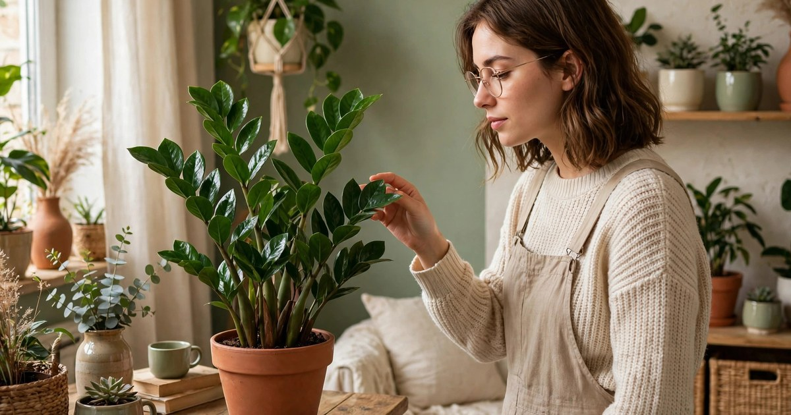
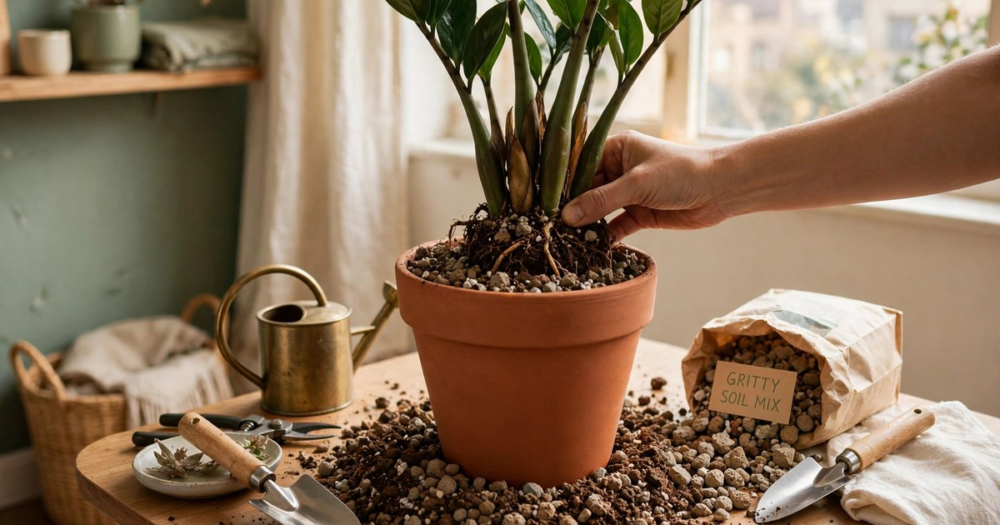
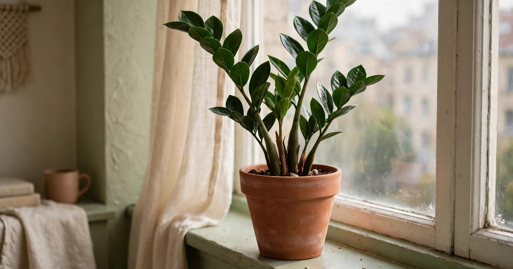
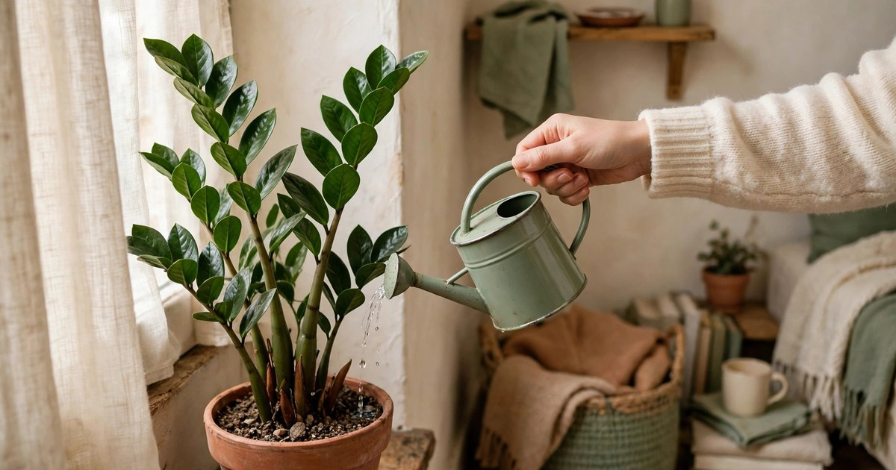
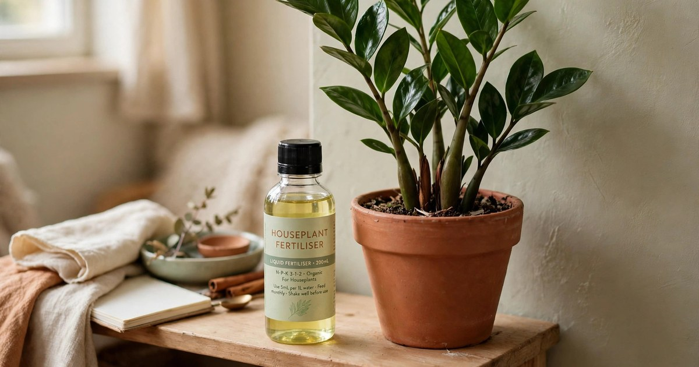
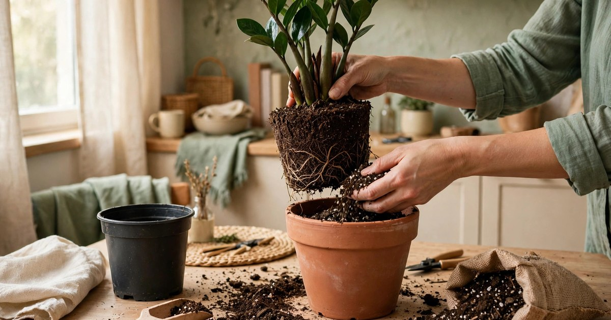
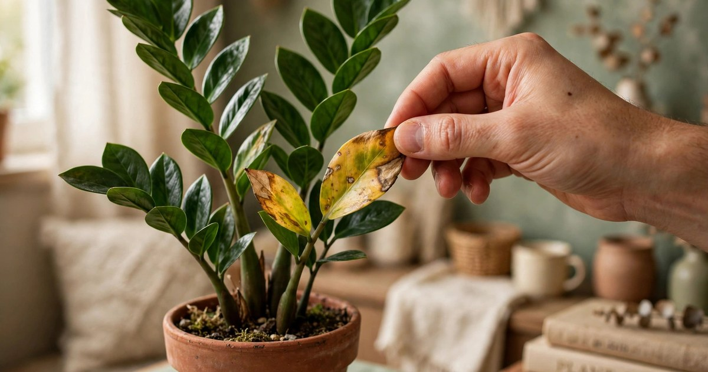

If there is one houseplant that was made for a small rented apartment, it is the ZZ plant. Zamioculcas zamiifolia — the ZZ plant, or Zanzibar gem — is the near-un-killable houseplant that every beginner has heard about and every busy renter should own. It tolerates low light, forgetful watering, dry radiator air, a north-facing window and a holiday spent alone in a dark flat, and it still looks glossy, green and expensive. In a small apartment, where floor space is precious and every object has to earn its place, a ZZ plant does the work of a piece of sculpture, a splash of green and a mood-lifter, all from a single pot in a corner.

That toughness is exactly why this guide exists. A ZZ plant is hard to kill, but it is not impossible to kill — and the people who do kill one almost always kill it the same way: by loving it too much, which in plant terms means watering it too often. The ZZ plant stores water in thick rhizomes buried in the soil, like potatoes, so it can go weeks without a drink. Drown those rhizomes and they rot, and a rotting ZZ plant goes downhill fast. Everything in this guide comes back to that one fact: a ZZ plant wants to be ignored far more than it wants to be watered.

The good news is that caring for a ZZ plant in a small apartment costs almost nothing, needs no drilling, no landlord permission and no special equipment. The seven steps below cover choosing a healthy plant, the right pot and soil, the best light spot in a small flat, the rare watering routine that keeps it alive, feeding twice a year, repotting every two to three years, and fixing yellow leaves and other problems before they become a dead plant. Follow them and your ZZ plant will still be thriving years from now, probably bigger than the day you brought it home — and you will have spent less than the price of a takeaway to get there.

### Step 1. Choose a Healthy Plant

A ZZ plant's future is decided before you bring it home, so choose carefully at the shop and you will save yourself years of troubleshooting. Look for deep green, glossy leaves with no yellow edges, no brown crispy tips and no white spots. The stems should stand upright and feel firm, not wobbly at the base — a stem that flops or leans at soil level is often the first sign of rot that started in the shop. Check the underside of a few leaves for tiny white or brown dots, which can be pests, and lift the pot to peek at the drainage holes: a few white root tips are fine, but a solid mat of roots bursting out means the plant is already pot-bound and will need repotting the moment you get home.

Size matters more in a small apartment than it does in a house, so buy a plant that fits the spot you have, not the plant you wish you had room for. A ZZ plant in a 15 cm pot — about six inches — is the sweet spot for a first plant: big enough to make an impact on a shelf or side table, small enough to carry home on the bus, and cheap, usually under £15. Skip the giant floor-standing specimen for now. A ZZ plant grows slowly, adding a few stems a year, so a small plant will fill out over time without ever taking over your living room, and if you want a bigger display later you can buy a second small plant rather than wrestling one huge pot up the stairs.

Price is where the ZZ plant really earns its reputation as a budget beginner plant. Garden centres and supermarkets sell small ZZ plants for £8 to £15, and a single plant bought once can be divided into two or three plants at repotting time, which means your one purchase multiplies for free. Avoid paying premium prices for a rare black variety like Raven as your first plant — it is beautiful, but it costs three times as much and cares for exactly the same way. Start with the classic green ZZ, and if you catch the plant bug, a [ZZ plant](https://www.amazon.com/s?k=zz+plant+live+plant&tag={{AMAZON_TAG}}) in a bigger size makes an easy second purchase when you know your flat's light and your watering habits. Bring it home in a paper bag rather than plastic if you can, keep it out of a cold draught on the journey, and let it settle in its new spot for a week before you do anything to it at all.

### Step 2. Pick the Right Pot and Soil

The pot and soil you choose are the single biggest defence against the one thing that kills ZZ plants: sitting in wet soil. A ZZ plant needs a pot with a drainage hole — full stop. No drainage hole means water has nowhere to go, the soil stays soggy, and the rhizomes rot from the bottom up, often invisibly until the stems start collapsing. If you fall in love with a beautiful pot that has no hole, use it as a cover pot: keep the plant in a plain plastic nursery pot inside it, lift the plant out to water, let it drain fully in the sink, and only then put it back. That way you get the look you want without drowning the plant.

Terracotta is the best material for a ZZ plant pot, and it is also the cheapest. Clay breathes, pulling moisture out of the soil between waterings, which is exactly the dry-wet cycle a ZZ plant wants. A terracotta pot in the 15 to 20 cm range costs a few pounds, looks warm and classic against a cream or sage wall, and its weight keeps a top-heavy ZZ plant from tipping over on a narrow shelf. Plastic and glazed ceramic pots hold moisture longer, so they are fine too as long as they have a drainage hole — just expect to water even less often. Whatever you choose, add a saucer or a cork mat underneath: in a rental, a saucer is the difference between a happy plant and a water ring on a wooden floor that costs you part of your deposit.

Soil is just as important as the pot, and ordinary bagged compost straight from the bag is too dense and moisture-retentive for a ZZ plant on its own. Mix roughly two parts standard houseplant potting soil with one part perlite or coarse grit, and if you have a handful of orchid bark, add that too — the chunky, open mix drains in seconds and lets air reach the roots, which is what stops rot before it starts. A small bag of [cactus and succulent potting mix](https://www.amazon.com/s?k=cactus+succulent+potting+mix&tag={{AMAZON_TAG}}) is a ready-made shortcut: it is already gritty and fast-draining, it costs a few pounds, and one bag will last you several repottings. In a small apartment, mix your soil on a tray or an old newspaper on the kitchen table, not on the carpet, and keep the bag sealed in a cupboard afterwards — it stays usable for years.

### Step 3. Find Its Light Spot

A ZZ plant's most famous talent is surviving in low light, and it genuinely is one of the few houseplants that will keep its leaves in a dim corner, a hallway with no window, or a north-facing room. That is why it is the classic renter's plant: most small apartments have one good window and several dark corners, and the ZZ plant is happy in either. But surviving is not the same as thriving. In bright, indirect light — a metre or two from a sunny window, or beside an east-facing window that gets gentle morning sun — a ZZ plant grows faster, its leaves stay a deeper green, and new stems appear more often. In a truly dark corner it will simply sit there, alive but barely growing, which is fine if that is what you need from it.

In a small apartment, the best spot is usually the brightest place that is not in direct sun. Direct afternoon sun through a south-facing window can scorch the glossy leaves, leaving pale, bleached patches that never heal, so keep the plant just out of the sun's direct path — a sheer curtain, a metre back from the glass, or a spot beside the window rather than in it. A north-facing window is ideal: bright all day, never harsh. If your flat's only window faces a brick wall or another building, do not worry — a ZZ plant will cope with that too, though it will grow more slowly, and a cheap clip-on [grow light for indoor plants](https://www.amazon.com/s?k=grow+light+indoor+plants+clip+on&tag={{AMAZON_TAG}}) run for eight to ten hours a day in the darkest winter weeks makes a visible difference for under £15.

The other small-apartment light trick is rotation. A ZZ plant grows towards the light, so its stems will slowly lean towards the window over a few months. Turn the pot a quarter turn every couple of weeks and the plant stays upright and symmetrical instead of leaning like a drunk. While you are at it, wipe the leaves with a damp cloth once a month — dust settles fast in a small flat, and a dusty leaf photosynthesises less and looks dull. Keep the plant a few centimetres back from freezing glass on the coldest nights, and never park it directly above a radiator where hot, dry air blasts its leaves from below while cold air chills them from above.

### Step 4. Water the ZZ Way (Rarely)

This is the step that decides whether your ZZ plant lives or dies, so read it twice: water rarely, water thoroughly, and then leave it alone. A ZZ plant in a small apartment typically needs water every three to four weeks in spring and summer, and every five to six weeks in autumn and winter — sometimes even less. Its thick, potato-like rhizomes store water underground, and its fleshy stems store more, so the plant is built to survive drought and dies from kindness. If you are not sure whether to water, do not water. A ZZ plant that is a week late for a drink looks exactly the same as a well-watered one; a ZZ plant that is watered a week too early starts rotting from the roots up.

The test is simple and costs nothing: push a finger or a wooden skewer deep into the soil, all the way to the bottom of the pot. If it comes out with any dampness at all, wait. Only water when the soil is completely dry from top to bottom, and when you do water, water properly — soak the soil until water runs freely out of the drainage hole, then tip every drop out of the saucer and never let the pot sit in a puddle. A moisture meter takes the guesswork out of this for under £10, and a [soil moisture meter for houseplants](https://www.amazon.com/s?k=soil+moisture+meter+houseplants&tag={{AMAZON_TAG}}) is one of the few plant gadgets worth owning in a small flat: push it in, read the dial, and water only when it reads dry at the root level, not just at the surface.

A few practical details make the routine foolproof. Water in the morning so any splashes on the leaves dry before the cool night, and use room-temperature water rather than cold water straight from the tap, which can shock the roots. In winter, when the heating is on and the days are short, your ZZ plant is barely growing and barely drinking — stretch the gap between waterings to six weeks or more and it will not mind at all. If you go away for a fortnight, do not ask a neighbour to water it; a ZZ plant is the one houseplant you can safely leave alone on holiday. And if a stem turns yellow and mushy at the base, that is overwatering, not thirst — stop watering immediately, let the soil dry out completely, and read Step 7 before you reach for the watering can again.

### Step 5. Feed Twice a Year

A ZZ plant is a light feeder, and feeding it is the easiest step in this whole guide because it only happens twice a year. In spring, when new stems start pushing up, and again in early summer, give it a half-strength dose of a balanced liquid houseplant fertiliser — half the strength printed on the bottle, mixed into the watering can. Half strength matters: ZZ plants are slow growers, and a full-strength feed in a small pot can burn the roots and leave brown, crispy leaf tips, which is the plant equivalent of overeating. One small bottle of fertiliser costs a few pounds and will last you years at two feeds a year, which makes this the cheapest plant-care habit there is.

Do not feed in autumn or winter. A ZZ plant in a small apartment in the darker months is resting, not growing, and fertiliser given to a resting plant sits in the soil, builds up as salts, and damages the roots — all for no benefit, because the plant cannot use it. The same goes for a plant that is stressed, newly repotted, or recovering from overwatering: skip the feed until it is healthy and growing again, which usually means waiting for spring. If you have ever wondered why your plant's leaf tips went brown after a feed, over-fertilising in the wrong season is the usual culprit, and the fix is to flush the soil once with plain water and then leave the fertiliser bottle in the cupboard until spring.

If you prefer to keep things simple, a slow-release fertiliser spike pushed into the soil in spring does the same job with even less effort — one spike, one season, no measuring. Either way, remember that feeding is optional in a way that watering correctly is not: a ZZ plant that is never fed will still live for years, just growing a little more slowly, while a ZZ plant that is overfed can be damaged in a single afternoon. When in doubt, feed less, feed later, and let the plant's slow, steady growth set the pace. A bottle of [liquid houseplant fertiliser](https://www.amazon.com/s?k=liquid+houseplant+fertiliser&tag={{AMAZON_TAG}}) kept on the shelf next to the plant is a good reminder — and a good way to make sure you only ever reach for it twice a year.

### Step 6. Repot Every Two to Three Years

A ZZ plant grows slowly, so it only needs repotting every two to three years — and it actually prefers being slightly snug in its pot, so there is no rush. The signs it is time are hard to miss: thick rhizomes pushing up out of the soil surface, roots circling out of the drainage hole, the pot bulging or cracking under pressure from the roots inside, or water running straight through the pot the moment you water because the soil has been replaced by roots. If none of those are happening, leave the plant alone. Repotting a ZZ plant that does not need it is a needless disturbance, and a plant that has just been repotted often sulks for a few weeks while it settles in.

When the time does come, do it in spring, when the plant is starting to grow again and can recover fastest. Choose a pot just one size bigger — about 2 to 3 cm wider than the old one — because a pot that is much too large holds a lot of wet soil around a small root system, and wet soil is exactly what rots a ZZ plant. Tip the plant out gently, shake off the loose old soil, and look at the rhizomes: they should be firm and pale, like small potatoes. Any that are black, soft or mushy should be cut away with clean scissors, and the cut left to dry for a day before repotting. This is also the perfect moment to divide a big plant for free: pull the rhizomes apart into two or three sections, each with at least one stem and a healthy rhizome, and pot each one up separately. One plant becomes three, and each one costs nothing — a [terracotta plant pot with drainage hole](https://www.amazon.com/s?k=terracotta+plant+pot+drainage+hole&tag={{AMAZON_TAG}}) for each new division is the only expense.

Repot on a tray or an old sheet on the kitchen table, because soil gets everywhere in a small flat and a tray keeps it contained. Fill the new pot with your gritty mix, set the plant at the same depth it was before — never bury the stems deeper than they were, or they will rot — and water it lightly once, then leave it alone for a couple of weeks before resuming the normal rare-watering routine. Do not feed a freshly repotted plant for at least six weeks; the fresh soil already contains enough nutrients, and a feed on top of that risks burning the new roots. A ZZ plant that has just been repotted and divided may look the same for months, but underground it is quietly filling its new pot, and by the following spring you will see fresh stems pushing up as proof.

### Step 7. Fix Yellow Leaves and Other Problems

A ZZ plant rarely complains, so when it does, act quickly — and start by assuming the problem is water, because it almost always is. Yellow leaves are the classic symptom: if one or two lower leaves turn yellow and feel soft at the base, the plant has been overwatered and the rhizomes are starting to rot. Stop watering immediately, let the soil dry out completely, and if more than one stem is affected, tip the plant out of its pot and inspect the roots. Cut away anything black, soft or mushy with clean scissors, let the healthy rhizomes dry in the air for a day, and repot into dry, gritty soil. Do not water for at least two weeks after repotting, and the plant will usually recover — a ZZ plant can lose half its stems and still come back from a healthy rhizome.

Not every yellow leaf is a disaster, and learning to tell the difference saves a lot of worry. A single old leaf yellowing at the base while the rest of the plant looks glossy and upright is usually just age: the plant is shedding its oldest leaf to make room for new growth, and you can snip it off at the base and forget about it. Brown, crispy leaf tips are a different problem — usually dry air, salts building up from fertiliser or hard tap water, or a leaf touching a hot radiator. Trim the brown tip with clean scissors, following the leaf's natural pointed shape, and flush the soil once with plain water to wash out accumulated salts. Wrinkled, curling leaves mean the plant is genuinely thirsty, which is rare but possible in a very warm, dry flat — give it a thorough soak and drain, and it should plump up within days.

Pests are uncommon on ZZ plants, but small apartments with lots of plants can pass them around, so check the undersides of the leaves once a month. The most likely visitors are mealybugs — small white cottony lumps in the leaf joints — and scale, which looks like tiny brown bumps on the stems. Dab mealybugs off with a cotton bud dipped in rubbing alcohol, and wipe scale off with a damp cloth; for a bigger outbreak, a spray bottle of [neem oil spray for houseplants](https://www.amazon.com/s?k=neem+oil+spray+houseplants&tag={{AMAZON_TAG}}) used once a week for three weeks usually clears them. Keep a new plant away from your other plants for its first two weeks, so any pest it arrived with does not spread, and remember the golden rule: a ZZ plant with a problem is almost always a ZZ plant that has been watered too often. Fix the watering first, and most other problems fix themselves.

## Frequently Asked Questions

### How often should I water a ZZ plant in a small apartment?

Every three to four weeks in spring and summer, and every five to six weeks in autumn and winter — and only when the soil is completely dry all the way to the bottom of the pot. Push a finger or a wooden skewer deep into the soil; if it comes out damp at all, wait another week. Overwatering is the number one way people kill ZZ plants, so when in doubt, do not water. A ZZ plant can go six to eight weeks without water and look exactly the same, while one watered too often can rot within a month.

### Can a ZZ plant survive in a room with no windows?

Yes — a ZZ plant is one of the few houseplants that will genuinely survive in a windowless room, a dark hallway or a bathroom with no natural light, which is why it is such a good fit for small apartments with awkward layouts. It will grow very slowly and may not produce new stems, but it will stay alive and green for months. If you want it to actually grow, a cheap clip-on grow light run for eight to ten hours a day makes a real difference, or move the plant to your brightest room for a few weeks every couple of months to give it a light boost.

### Why are my ZZ plant's leaves turning yellow?

Yellow leaves on a ZZ plant are almost always a sign of overwatering and the start of root rot. Stop watering immediately, let the soil dry out completely, and check whether the stems feel soft at the base. If more than one stem is affected, tip the plant out, cut away any black, mushy rhizomes, and repot into dry, gritty soil. A single old leaf yellowing while the rest of the plant looks healthy is usually just age — snip it off and carry on. Yellow leaves caused by overwatering will not turn green again, so remove them and focus on saving the healthy stems.

### Is a ZZ plant safe for pets and children?

ZZ plants are mildly toxic if eaten — all parts of the plant contain calcium oxalate crystals that can irritate the mouth and stomach — so they are not a good choice for a flat where a dog, cat or small child is likely to chew on leaves. The risk is low: most pets take one bite, dislike the taste, and leave it alone, but it is sensible to keep the plant on a high shelf or a plant stand out of reach rather than on the floor. If a pet or child does eat part of a leaf, rinse the mouth with water and call your vet or doctor for advice. Wash your hands after handling the plant's sap, which can irritate sensitive skin.

### How big will a ZZ plant get in a small apartment?

Slowly — and that is the appeal. A ZZ plant in a 15 cm pot typically grows to about 60 to 90 cm tall over several years, adding a few stems each growing season. It grows upright rather than spreading sideways, so it suits the narrow gaps beside wardrobes, bookcases and sofas that no other plant can use. If it ever gets too big for your flat, divide it at repotting time into two or three smaller plants, keep one and give the others away — or simply prune the tallest stems at the base. A ZZ plant will never outgrow a small apartment the way a monstera or a fiddle-leaf fig can.

### Do ZZ plants need a lot of light to grow?

No — but they grow faster with more of it. In bright, indirect light a ZZ plant will produce several new stems each year and keep its leaves a deep, glossy green. In low light it will survive happily but grow very slowly, sometimes adding only one stem a year. It tolerates a north-facing window, a spot a few metres from a window, and even a dim corner, but it will not thrive in total darkness forever. If your flat is very dark, rotate the plant into your brightest spot for a few weeks at a time, or add a small grow light, and you will see new growth within a month or two.
